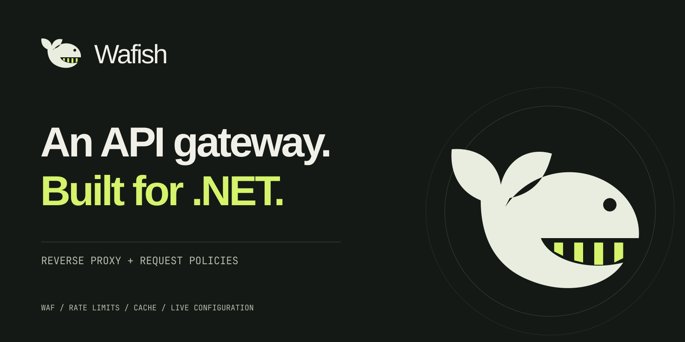
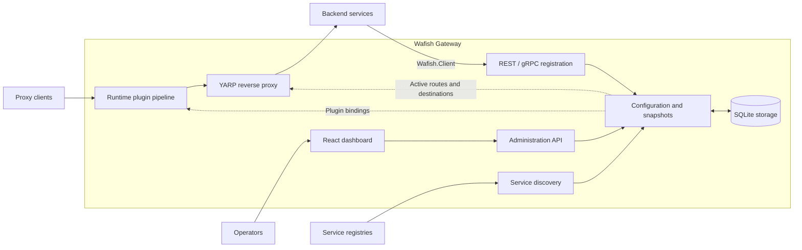
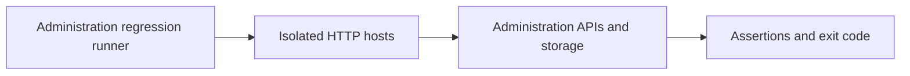

# Wafish archive

Historical records consolidated on 2026-11-26.
These snapshots describe their original revisions. They are not current instructions or live verification results.
Use [README.md](README.md) for setup and [PLAN.md](PLAN.md) for unresolved work.
Raw evidence, fixtures, images, logs, JSON, and CSV files remain at their original paths.
Current guides retain operating and compatibility requirements.
Mixed documents are preserved as complete snapshots to prevent information loss.
Headings and relative links have been adapted for this combined file. Code blocks retain their original content.

## R36: Named local route quotas — 2026-11-28

Implemented optional `quotaGroup` bindings in the existing local rate-limit plugin.
Group members share permits across routes, with global, route, client-address, or identity-name partitions.
Different groups and ungrouped bindings retain separate counters.

The compiler validates bounded names and effective policies before persistence. Equivalent durations share policy identity.
Preview allocates no counters. Conflicting route policies and retained-state conflicts reject configuration mutations.
Route changes, binding deletion, and recreation do not reset consumed quotas.

The runtime store retains one policy until all group partitions safely retire.
Active or queued leases and consumed quotas survive cleanup. Stale requests cannot create competing policy counters.
Named and ungrouped partitions share the existing 2,000-entry admission limit.
The optional `IGroupedRateLimiterStore` interface preserves existing custom-store contracts.

Verification on the implementation branch:

- Release solution build passed with zero warnings and zero errors.
- All 321 core regression checks passed, including seven new quota scenarios and nine lifetime stress scenarios.
- All 61 administration checks passed.
- All 24 package API checks and three isolated package consumers passed.
- Package compatibility negative checks passed; reviewed API baselines were unchanged.
- Focused changed-line coverage was 119/120 executable lines (99.2%), counting partial coverage conservatively.
- Changed Markdown file links and Git whitespace checks passed.

Counters remain process-local. Retained policies cannot change until their partitions retire, unless a new group name is selected.
Cleanup requires eligible requests and idle partitions; removal alone does not immediately release policy ownership.

Source entry points:

- [Group compiler](src/Wafish.Plugin.RateLimit/RateLimitGroupCompiler.cs).
- [Policy normalization](src/Wafish/Models/LocalQuotaGroupPolicy.cs).
- [Limiter store](src/Wafish.Runtime/Infrastructure/State/InMemoryRateLimiterStore.cs).
- [Named quota regressions](tests/Wafish.Regression/NamedQuotaChecks.cs).
- [Configuration guide](src/Wafish.Plugin.RateLimit/README.md#named-route-quotas).

## Redirect plugin implementation — 2026-11-27

Implemented `Wafish.Plugin.Redirect`, with route bindings and schema version 1.
Targets support fixed URLs, route values, effective hosts, original paths, and HTTPS enforcement.
Supported status codes are 301, 302, 303, 307, and 308. The default is 307.
Incoming query parameters are discarded unless explicitly preserved. Literal target parameters take precedence.
Dynamic destination hosts require exact allowlists. URL validation rejects unsafe components and direct self-redirects.

Redirect endpoints work without clusters. Authentication, authorization, WAF, local limits, and Redis limits remain applicable.
Logs and route metrics observe redirects without inventing backend activity.
Disabled redirects and already-HTTPS requests use normal forwarding, or return 503 without a backend.
Request leases protect retired domains during replacement.

The existing binding editor includes authenticated request preview.
Preview uses native endpoint matching, the binding schema, and the runtime evaluator.
It does not save configuration, execute access policies, consume quotas, or contact destinations.
Separate redirect pages, bulk imports, and chain analysis remain outside this feature.

Verification completed locally:

- Release solution build: zero warnings and errors.
- Core executable suite: 303 checks passed, including eight redirect cases and existing lifecycle checks.
- Administration executable suite: 61 checks passed.
- React lint and coverage: 94 tests passed. All 30 instrumented changed frontend lines were covered.
- Browser suite: 32 checks passed, including preview and redirects without clusters.
- Package checks: 20 packages, compatible API additions, and three isolated consumers passed.
- Seven negative package checks passed. No package was published.
- Website build checked links and assets across 30 HTML pages.
- Changed .NET lines: 365 of 372 covered, or 98.1%.
- Counting partially exercised branches as uncovered gives 322 of 372 lines, or 86.6%.

Regression checks cover rename, restart, rollback, disabled bindings, cancellation, replacement, security policies, and preview isolation.
The final schema-validation adjustment passed both executable suites after the browser run.
Public API snapshots record only intentional additions. Documentation and the package workflow include the new plugin.
APM dependency installation encountered an existing generated-skill hash mismatch. APM compilation succeeded separately.

## Source inventory

The SHA-256 values identify original file bytes before consolidation.
Every source comes from commit `5d91599e8d5aa90e6e8433a13745351c0a16d188`.

| Original path | SHA-256 | Record |
|---|---|---|
| `CHANGELOG.md` | `249aac59ce1dc544c83d791aecc8bd4d830c07c32139f859e9ea40a33f1b5320` | [Read](#archive-changelog-md) |
| `PLAN.md` | `d08514b33574cae407504cdc9bf7cc7779cb6b1dc0eb5f929470809a770e2048` | [Read](#archive-plan-md) |
| `README.md` | `82e8751cb49c9dd456a30ccfdcba53e98d7d9580841c7d1e8dc663cb89c7b733` | [Read](#archive-readme-md) |
| `docs/architecture.md` | `044b2ad5095960b35a9b0b6b7b9d771eb8b04299bce6dd8ce859461d36ba64a1` | [Read](#archive-docs-architecture-md) |
| `docs/archive/2026-11-planning/DOTNET_REVIEW.md` | `077ba27cf0fb482caa14c682d6f8a61acab3e527abb28ab96f80a9a1517bde02` | [Read](#archive-docs-archive-2026-11-planning-dotnet-review-md) |
| `docs/archive/2026-11-planning/IDEAS.md` | `88e21a64b415cf417255a3cd6c765da9bf78e7f501a50224a6f59984ecb3349e` | [Read](#archive-docs-archive-2026-11-planning-ideas-md) |
| `docs/archive/2026-11-planning/PLAN.md` | `78ebf41d45ec19b6058a08ed5d4e4baebab48debb90111dea9051a3f550e9aab` | [Read](#archive-docs-archive-2026-11-planning-plan-md) |
| `docs/archive/2026-11-planning/README.md` | `ad6157dcd693c546a087a79db36b08e582c9a50b4d62d1560f992eafab61be37` | [Read](#archive-docs-archive-2026-11-planning-readme-md) |
| `docs/archive/2026-11-planning/Wafish.AppHost/PLAN.md` | `52fff3d08e61a2690c5e5ef1cbe269c1ec8fb03c9aa7437103b3e1213d85adbf` | [Read](#archive-docs-archive-2026-11-planning-wafish-apphost-plan-md) |
| `docs/archive/2026-11-planning/docs/ui-design.md` | `4d403528a4fa5378fce50ef1275abac32f5ecec36813c57ccf07a40a638fb2df` | [Read](#archive-docs-archive-2026-11-planning-docs-ui-design-md) |
| `docs/archive/2026-11-planning/docs/ui-implementation.md` | `d1539ff3c7659d515c3bfbf88a28e47be4121098ac7e22f964ce2c5f3045ca48` | [Read](#archive-docs-archive-2026-11-planning-docs-ui-implementation-md) |
| `docs/archive/2026-11-planning/samples/SampleGateway/PLAN.md` | `0b27abc7c534dc70a64f0cd25bd34aaeca6dfee6501f01cb92550dc5ac86431a` | [Read](#archive-docs-archive-2026-11-planning-samples-samplegateway-plan-md) |
| `docs/archive/2026-11-planning/samples/SampleLocalService/PLAN.md` | `cce792d8aeed481fc9054defdd3211557a778a6b79edb96d7686eb7ddf88a1fb` | [Read](#archive-docs-archive-2026-11-planning-samples-samplelocalservice-plan-md) |
| `docs/archive/2026-11-planning/samples/SampleServiceDefaults/PLAN.md` | `69dbdf69f91ccd2ace3cbdb5dee786659d37fc9244d787e9657968d1d75f8912` | [Read](#archive-docs-archive-2026-11-planning-samples-sampleservicedefaults-plan-md) |
| `docs/archive/2026-11-planning/src/Wafish.Administration/PLAN.md` | `59c0ebd2f17b1ea7fc3bd94b1c9439b4b708be3b39bafa4469d5f217d3bf926c` | [Read](#archive-docs-archive-2026-11-planning-src-wafish-administration-plan-md) |
| `docs/archive/2026-11-planning/src/Wafish.Client/PLAN.md` | `174b7d6e73d3792da1345d5925008ce7fcc82c1543aa17de45fab2e6355bcfae` | [Read](#archive-docs-archive-2026-11-planning-src-wafish-client-plan-md) |
| `docs/archive/2026-11-planning/src/Wafish.Grpc/PLAN.md` | `cb6380be88d44692aed3812b9111b958c7c1139bda55b8295e5ccb0baa211af2` | [Read](#archive-docs-archive-2026-11-planning-src-wafish-grpc-plan-md) |
| `docs/archive/2026-11-planning/src/Wafish.Plugin.Abstractions/PLAN.md` | `e385d36e5db4d48149c5c378fe923b4b3f682553f4ffbf8c7908f6ff6f21bb22` | [Read](#archive-docs-archive-2026-11-planning-src-wafish-plugin-abstractions-plan-md) |
| `docs/archive/2026-11-planning/src/Wafish.Plugin.Cache/PLAN.md` | `fea8d22c690c786ec40a64f097edcf1df39e12e83a413f83d4e8a2df1e5ad03d` | [Read](#archive-docs-archive-2026-11-planning-src-wafish-plugin-cache-plan-md) |
| `docs/archive/2026-11-planning/src/Wafish.Plugin.CircuitBreaker/PLAN.md` | `45e5f67dfe6faaf51868b952862ffa80edd3b6ed43137f4c97f564bebadb19cc` | [Read](#archive-docs-archive-2026-11-planning-src-wafish-plugin-circuitbreaker-plan-md) |
| `docs/archive/2026-11-planning/src/Wafish.Plugin.Compression/PLAN.md` | `4cfcb87cb5f0cde8a5a9ef611cf004f4065c0e77c8b14d6d84d8568ea1ba0ae2` | [Read](#archive-docs-archive-2026-11-planning-src-wafish-plugin-compression-plan-md) |
| `docs/archive/2026-11-planning/src/Wafish.Plugin.Metrics/PLAN.md` | `4892b97c4e9b33814425baecb45dce2e41291f783da132ae946a14838de52983` | [Read](#archive-docs-archive-2026-11-planning-src-wafish-plugin-metrics-plan-md) |
| `docs/archive/2026-11-planning/src/Wafish.Plugin.ProxyLog/PLAN.md` | `3faf72043d2768f0efc5166a8cdfbee6f8601dae83b0bee80220f0ffa199db5a` | [Read](#archive-docs-archive-2026-11-planning-src-wafish-plugin-proxylog-plan-md) |
| `docs/archive/2026-11-planning/src/Wafish.Plugin.RateLimit.Redis/PLAN.md` | `976ca63b70b12e493274b420136b9af7ae766dd34e035392e86870cce4292b15` | [Read](#archive-docs-archive-2026-11-planning-src-wafish-plugin-ratelimit-redis-plan-md) |
| `docs/archive/2026-11-planning/src/Wafish.Plugin.RateLimit/PLAN.md` | `9e2b08d0f377399a3c6c5aee9be5e9044aef3a9e8cede30986ec1be74bc648e6` | [Read](#archive-docs-archive-2026-11-planning-src-wafish-plugin-ratelimit-plan-md) |
| `docs/archive/2026-11-planning/src/Wafish.Plugin.Retry/PLAN.md` | `2f2f397a54a3822da77eee95c3f08d7aa220995a8a0a6e7e67212ab7a8ca020d` | [Read](#archive-docs-archive-2026-11-planning-src-wafish-plugin-retry-plan-md) |
| `docs/archive/2026-11-planning/src/Wafish.Plugin.ServiceDiscovery/PLAN.md` | `ce3bb1879ca351c84f5dea460ce1d2adb6403b244f78c13df3f2c61668759f80` | [Read](#archive-docs-archive-2026-11-planning-src-wafish-plugin-servicediscovery-plan-md) |
| `docs/archive/2026-11-planning/src/Wafish.Plugin.Waf/PLAN.md` | `8b9c64d58fee4c0b2685b0b4dbdcb622638725debd5faa46f8e160e83cc253a2` | [Read](#archive-docs-archive-2026-11-planning-src-wafish-plugin-waf-plan-md) |
| `docs/archive/2026-11-planning/src/Wafish.ReactUi/PLAN.md` | `99ca11849123de9561332d23a022b0852a6d6f6d19780397287ca717e51c55ed` | [Read](#archive-docs-archive-2026-11-planning-src-wafish-reactui-plan-md) |
| `docs/archive/2026-11-planning/src/Wafish.Runtime/PLAN.md` | `2281a1236b544dce9e5464b986ea6996096d52a48194970ce135a86b68e084b9` | [Read](#archive-docs-archive-2026-11-planning-src-wafish-runtime-plan-md) |
| `docs/archive/2026-11-planning/src/Wafish.Storage.Abstractions/PLAN.md` | `05e9a944ae0551672cb91408de4f8af8c1817a605f22c7e9ea1946946efd8cc6` | [Read](#archive-docs-archive-2026-11-planning-src-wafish-storage-abstractions-plan-md) |
| `docs/archive/2026-11-planning/src/Wafish.Storage.Sqlite/PLAN.md` | `59c16480497c3f93803c4e8947ddcf6edad9e43693961afe9d6c2ef92a767f08` | [Read](#archive-docs-archive-2026-11-planning-src-wafish-storage-sqlite-plan-md) |
| `docs/archive/2026-11-planning/src/Wafish/PLAN.md` | `199b1ca3826576f3a28a87568c2adc77ee9566f1aef44c3ed52d31ebb8fb0688` | [Read](#archive-docs-archive-2026-11-planning-src-wafish-plan-md) |
| `docs/archive/2026-11-planning/tests/Wafish.Administration.Regression/PLAN.md` | `55da9daadcad18241b8304fb24502bdcbb0e6f0986ed6194110857d44c92bbed` | [Read](#archive-docs-archive-2026-11-planning-tests-wafish-administration-regression-plan-md) |
| `docs/archive/2026-11-planning/tests/Wafish.Performance/Backend/PLAN.md` | `b2a9e479605ad98be92895f9477cfda9cc9d02c7e12425f24da65bc6d0e85543` | [Read](#archive-docs-archive-2026-11-planning-tests-wafish-performance-backend-plan-md) |
| `docs/archive/2026-11-planning/tests/Wafish.Performance/EnhancedYarp/PLAN.md` | `dea6ee495c7a7827cab5d7229bf28bfd8e258085dfa6e7143f0461813087b862` | [Read](#archive-docs-archive-2026-11-planning-tests-wafish-performance-enhancedyarp-plan-md) |
| `docs/archive/2026-11-planning/tests/Wafish.Performance/NativeYarp/PLAN.md` | `48529e1da434cc6d21d3c8f9454553182fc196336582a85add5e12e7c1a0d6c5` | [Read](#archive-docs-archive-2026-11-planning-tests-wafish-performance-nativeyarp-plan-md) |
| `docs/archive/2026-11-planning/tests/Wafish.Performance/Runner/PLAN.md` | `ceaf8cd8d1914a132e892a2bb020d35dab6b12fcc4c33b0624d891702d2c4236` | [Read](#archive-docs-archive-2026-11-planning-tests-wafish-performance-runner-plan-md) |
| `docs/archive/2026-11-planning/tests/Wafish.ReactUi.Host/PLAN.md` | `a098e85bede5f596ff93c934f038b16944535f5e5fc87baddb2923cca813fd1e` | [Read](#archive-docs-archive-2026-11-planning-tests-wafish-reactui-host-plan-md) |
| `docs/archive/2026-11-planning/tests/Wafish.Regression/PLAN.md` | `51f73ed50372095217f710ed6f38fdc51d8ef7d59ffbf69c6cf52ed86d5b9bbd` | [Read](#archive-docs-archive-2026-11-planning-tests-wafish-regression-plan-md) |
| `docs/public-release.md` | `3bdf0235e5861416ee26f06d3bc2c0ba44abb5be08be4830cc88bdf91b904781` | [Read](#archive-docs-public-release-md) |
| `docs/release-notes-1.0.0-rc.1.md` | `02ededf31015116c1bfad8049d3e4edb5e960fb69b8771a76d5cd28bf5789929` | [Read](#archive-docs-release-notes-1-0-0-rc-1-md) |
| `tests/Wafish.Administration.Regression/README.md` | `7273e56c520c7269b5c42c36ae8ceaeab19f90a9dbdafac0143f3a94d9177db8` | [Read](#archive-tests-wafish-administration-regression-readme-md) |
| `tests/Wafish.Performance/results/README.md` | `6d2cc846e02d6124e8e42f90d0a9611c6c7bd96cada793394f638eb6d7fc674d` | [Read](#archive-tests-wafish-performance-results-readme-md) |
| `tests/Wafish.Performance/results/archive/performance-20260729-175727.md` | `20ae2fde66facb0e6cfc227beefab07f3d515b6d8f954f0a379258b2919829f6` | [Read](#archive-tests-wafish-performance-results-archive-performance-20260729-175727-md) |
| `tests/Wafish.Performance/results/archive/performance-20260828-145817.md` | `2260583d758a4ae36f11ba9f928fb7c2d07f47a32f154dbffc3bb7e6973a9d86` | [Read](#archive-tests-wafish-performance-results-archive-performance-20260828-145817-md) |
| `tests/Wafish.Performance/results/archive/performance-first-20260730-085811.md` | `31320c959c10015fa6713654b9aafbf2ef9195921df75932b32c5a35303a0eae` | [Read](#archive-tests-wafish-performance-results-archive-performance-first-20260730-085811-md) |
| `tests/Wafish.Performance/results/archive/performance-first-20260730-091057.md` | `ed2314cc90d69023d467dfa5ae5815cf9a762a47bf9e8252c1e2bb91bd0caa28` | [Read](#archive-tests-wafish-performance-results-archive-performance-first-20260730-091057-md) |
| `tests/Wafish.Performance/results/archive/performance-first-20260730-091324.md` | `13e1ed4fa799621f258be9dfa780d61483b240fbe81ec47f2b81613e2fa19ede` | [Read](#archive-tests-wafish-performance-results-archive-performance-first-20260730-091324-md) |
| `tests/Wafish.Performance/results/archive/performance-first-20260730-092511.md` | `b92c2f5403d7c15009096af921e3bb3ceeedc92cde4d5526b701614058234c12` | [Read](#archive-tests-wafish-performance-results-archive-performance-first-20260730-092511-md) |
| `tests/Wafish.Performance/results/archive/performance-first-20260730-092912.md` | `ef6cd8a67baf90d4abe153fda470f0c9904cd991aa4fb58b0ed96cbab9011c28` | [Read](#archive-tests-wafish-performance-results-archive-performance-first-20260730-092912-md) |
| `tests/Wafish.Performance/results/archive/performance-first-20260730-093100.md` | `80d7a3583e8e7f8e9b23414b460857062e4058e33792adf19900138d55a716d3` | [Read](#archive-tests-wafish-performance-results-archive-performance-first-20260730-093100-md) |
| `tests/Wafish.Performance/results/archive/performance-first-20260730-094318.md` | `66cf033d3f87e6e8b17b0360f637cf6f628d55a159b4c3c99459aa72ba7ad125` | [Read](#archive-tests-wafish-performance-results-archive-performance-first-20260730-094318-md) |
| `tests/Wafish.Performance/results/archive/performance-first-20260730-094705.md` | `c5b3f5039b8966f89ea3f0b88f44ca01e5e140fe5dc021518a079bc50d785778` | [Read](#archive-tests-wafish-performance-results-archive-performance-first-20260730-094705-md) |
| `tests/Wafish.Performance/results/archive/performance-first-20260730-095010.md` | `65001db1fb0a0b845622866f356d57f712b4750c152e699260bda2c1075ed195` | [Read](#archive-tests-wafish-performance-results-archive-performance-first-20260730-095010-md) |
| `tests/Wafish.Performance/results/archive/performance-first-20260730-100046.md` | `397d4e8d3e0098980e55f58cea9f1a5220f3b7f4083babf8d26e7054a0895a9a` | [Read](#archive-tests-wafish-performance-results-archive-performance-first-20260730-100046-md) |
| `tests/Wafish.Performance/results/archive/performance-first-20260730-100544.md` | `7a29968b9da767783c79c5726a703143808dbcf6616e09bf7996e8d2fe298bfc` | [Read](#archive-tests-wafish-performance-results-archive-performance-first-20260730-100544-md) |
| `tests/Wafish.Performance/results/archive/performance-first-20260730-100734.md` | `feef6adde0282e27d92bf81a1efbcf1bc6b10db6022ca635ac7e7cd381fb68bd` | [Read](#archive-tests-wafish-performance-results-archive-performance-first-20260730-100734-md) |
| `tests/Wafish.Performance/results/external-20261114-005827.md` | `ef2e8e1418a7edc822b2ee13c246b843ec54e66bab70cd02d112f181a81036ce` | [Read](#archive-tests-wafish-performance-results-external-20261114-005827-md) |
| `tests/Wafish.Performance/results/external-20261115-003336-909-a83e2018.md` | `795adffa71c6fa3c3d8f4764fb6a81ccd2f077383ede2cf4ce93164d500ecc27` | [Read](#archive-tests-wafish-performance-results-external-20261115-003336-909-a83e2018-md) |
| `tests/Wafish.Performance/results/external-20261115-review.md` | `5c0b5bb78ad4b3fbe74da854325ca264edf03d8ce6b116ca2111387c52db1311` | [Read](#archive-tests-wafish-performance-results-external-20261115-review-md) |
| `tests/Wafish.Performance/results/performance-20261114-010241.md` | `8d5b0eb56ab36655ca0c86acd4bb84d05f2aaef5362654b866e2cd1d49decfc5` | [Read](#archive-tests-wafish-performance-results-performance-20261114-010241-md) |
| `tests/Wafish.Regression/evidence/README.md` | `4e744f242601c77572d227e2bf9849bfd613f2bd608f5255619da1a61e6e80d1` | [Read](#archive-tests-wafish-regression-evidence-readme-md) |
| `tests/Wafish.Regression/evidence/administration-lifecycle/README.md` | `5535b5bbb5fe04436ca65191fc4c5fcb87f4de31c18adef55e2097363c68b6fa` | [Read](#archive-tests-wafish-regression-evidence-administration-lifecycle-readme-md) |
| `tests/Wafish.Regression/evidence/allocation-pressure/README.md` | `67fc67d03259d0c8ecaca43e808e9c8b71b07e262533c10e6787cc86bea20ebf` | [Read](#archive-tests-wafish-regression-evidence-allocation-pressure-readme-md) |
| `tests/Wafish.Regression/evidence/arch03/README.md` | `ec756f39ecf5dab1e447128922c0fa28c5de0a87e457b6b3b5dde8309f83a61c` | [Read](#archive-tests-wafish-regression-evidence-arch03-readme-md) |
| `tests/Wafish.Regression/evidence/arch04-09/README.md` | `065d9fad21701a0c86c4fbd7f226b9c4b2b49ed6770117ceeae3a8cdf87ae66f` | [Read](#archive-tests-wafish-regression-evidence-arch04-09-readme-md) |
| `tests/Wafish.Regression/evidence/archive/framework-migration/README.md` | `654786a6d810a3822291a8df6336eaa5fccafe83a1436877fa5fb82a24aa1c9b` | [Read](#archive-tests-wafish-regression-evidence-archive-framework-migration-readme-md) |
| `tests/Wafish.Regression/evidence/aspire-dashboard-links/README.md` | `0fda870e9717387ef7cc969c28ff58786416b17f6d1784d8b57afbd5499e8900` | [Read](#archive-tests-wafish-regression-evidence-aspire-dashboard-links-readme-md) |
| `tests/Wafish.Regression/evidence/aspire/README.md` | `65e5764d4730549e3a71a734aff60c7734a90fcda3fc20614d239eab70b33286` | [Read](#archive-tests-wafish-regression-evidence-aspire-readme-md) |
| `tests/Wafish.Regression/evidence/async-retry/README.md` | `21837f347b4bee56669190a090b54d6a38efaf935816294d256a40d8199fa985` | [Read](#archive-tests-wafish-regression-evidence-async-retry-readme-md) |
| `tests/Wafish.Regression/evidence/benchmark-reliability/README.md` | `54eba47d07fa7bec93d34498e645e19b6d2401723dd0648350477fde41e1c5a7` | [Read](#archive-tests-wafish-regression-evidence-benchmark-reliability-readme-md) |
| `tests/Wafish.Regression/evidence/benchmark-reliability/performance-first-20261114-200040-715-f681df41.md` | `61383ec97b5ba232010bae54dc85fac810e16d9b5a9fd9f62b9e08571bed68c0` | [Read](#archive-tests-wafish-regression-evidence-benchmark-reliability-performance-first-20261114-200040-715-f681df41-md) |
| `tests/Wafish.Regression/evidence/branding-cleanup/README.md` | `7ce394897c6c083f88e27f5f8e57fd85930f6a6bfd872e92ce8f55fe5c890de8` | [Read](#archive-tests-wafish-regression-evidence-branding-cleanup-readme-md) |
| `tests/Wafish.Regression/evidence/lifetime-stress/README.md` | `054232de12422b063705d22c7eabbd4e4cd88abc1adcbc1e78eb9af8807e3f2d` | [Read](#archive-tests-wafish-regression-evidence-lifetime-stress-readme-md) |
| `tests/Wafish.Regression/evidence/mutation-contracts/README.md` | `fb1ee832eb2be254ebda6d6b29abf2f434c8603cf6908c38cf6377f8462c1d3e` | [Read](#archive-tests-wafish-regression-evidence-mutation-contracts-readme-md) |
| `tests/Wafish.Regression/evidence/naming/README.md` | `ceaa9112bfb07b2dd537557d821d41bf30c7afcbb0f45faae130d772c4ca3aa6` | [Read](#archive-tests-wafish-regression-evidence-naming-readme-md) |
| `tests/Wafish.Regression/evidence/need-seven/README.md` | `f178e898eaf4f69d1539b990019376edcd97e769e1c554b4be899b7bed2899f0` | [Read](#archive-tests-wafish-regression-evidence-need-seven-readme-md) |
| `tests/Wafish.Regression/evidence/need-six/README.md` | `bd2f1f44664887323eef4db54906f44d98705d4291bc3286d622c44d4dc354c9` | [Read](#archive-tests-wafish-regression-evidence-need-six-readme-md) |
| `tests/Wafish.Regression/evidence/operation-previews/README.md` | `61699b3a94686642113113cc27dd9dc0380d8af4cb3f40066e0d51d4eead9a38` | [Read](#archive-tests-wafish-regression-evidence-operation-previews-readme-md) |
| `tests/Wafish.Regression/evidence/performance-r42/README.md` | `900c1cb960ce81e1010324658fba24c8594359dd3fd107bb185b1f9a6994937b` | [Read](#archive-tests-wafish-regression-evidence-performance-r42-readme-md) |
| `tests/Wafish.Regression/evidence/performance-r43/README.md` | `97dad9da4482711946b297eb2dbbb8c05f3b9cdcbc9ce63751b551f025581722` | [Read](#archive-tests-wafish-regression-evidence-performance-r43-readme-md) |
| `tests/Wafish.Regression/evidence/performance-r44/README.md` | `dd87506bbfb69fe494ec990f876c21906602d52b0aabe7dfd24df0474c47505e` | [Read](#archive-tests-wafish-regression-evidence-performance-r44-readme-md) |
| `tests/Wafish.Regression/evidence/performance-r47/README.md` | `577808f76cf07cad1babfe2b440ff08336b294313371553b963453797ea3c7a3` | [Read](#archive-tests-wafish-regression-evidence-performance-r47-readme-md) |
| `tests/Wafish.Regression/evidence/protocol-properties/README.md` | `e285e5bc87f75edad9e5706b9a537483e9b7e906a71a5387999a7f0989a16509` | [Read](#archive-tests-wafish-regression-evidence-protocol-properties-readme-md) |
| `tests/Wafish.Regression/evidence/public-release/README.md` | `91b01055128fc471b24bcc5ac7b174318e260c52ab37c9f085ded42517c73429` | [Read](#archive-tests-wafish-regression-evidence-public-release-readme-md) |
| `tests/Wafish.Regression/evidence/recovery/README.md` | `f8556746ec14bfa362fc2c13491b73fad11c5dad4d37e478ac2eec28e73cbc9e` | [Read](#archive-tests-wafish-regression-evidence-recovery-readme-md) |
| `tests/Wafish.Regression/evidence/regression-infrastructure/README.md` | `621b4e5662481b2db634406863ea713e7fbd882ba03ebec56d02f6007e9f2cff` | [Read](#archive-tests-wafish-regression-evidence-regression-infrastructure-readme-md) |
| `tests/Wafish.Regression/evidence/release-candidate/README.md` | `e51c51d10ff12c863e4d8c68fbb491b28ba3775ea382478ef2bcbab63ed650fd` | [Read](#archive-tests-wafish-regression-evidence-release-candidate-readme-md) |
| `tests/Wafish.Regression/evidence/review111213/README.md` | `22d43d8b8fc50a97fd78a74737e4c1bd50d2c0fcf3c9782b5304fffbe885d19c` | [Read](#archive-tests-wafish-regression-evidence-review111213-readme-md) |
| `tests/Wafish.Regression/evidence/review123/README.md` | `6341070cbe64e3f3440aab1d94b060ac60eabab11995b4b36864ffbfb6de17f6` | [Read](#archive-tests-wafish-regression-evidence-review123-readme-md) |
| `tests/Wafish.Regression/evidence/review141516/README.md` | `91ea65671ede4338fe89f638c1913495ff6cfc7197e292dfe3944c4fbb5c2573` | [Read](#archive-tests-wafish-regression-evidence-review141516-readme-md) |
| `tests/Wafish.Regression/evidence/review4567/README.md` | `ed7b7ce168cf91eb6c5f431313d531eb4344311677b805ad85429fe4590c8d47` | [Read](#archive-tests-wafish-regression-evidence-review4567-readme-md) |
| `tests/Wafish.Regression/evidence/review8910/README.md` | `b10094205f559e15b9910180661c5ee8408451aef9a0742d0d01466edce27acd` | [Read](#archive-tests-wafish-regression-evidence-review8910-readme-md) |
| `tests/Wafish.Regression/evidence/sample-contracts/README.md` | `6383aec54199e5a2581bdaabe0b9c980c5b4aa85be377f45de7443c7a573e81a` | [Read](#archive-tests-wafish-regression-evidence-sample-contracts-readme-md) |
| `tests/Wafish.Regression/evidence/sample-deployment/README.md` | `84a71bf2832aeee453f06c36a439b98ff3032b22f3a209eb42d53369321d6226` | [Read](#archive-tests-wafish-regression-evidence-sample-deployment-readme-md) |
| `tests/Wafish.Regression/evidence/sec14/README.md` | `07bf39dbd9cea3d764ea3b4a7c02adaf731b5b6cf6a2428dd8f377b2aa8360dd` | [Read](#archive-tests-wafish-regression-evidence-sec14-readme-md) |
| `tests/Wafish.Regression/evidence/security/README.md` | `4eab84e6f1b8ba640e8166e26f802fad397bd42e8d7736cbe8407b27a8225b70` | [Read](#archive-tests-wafish-regression-evidence-security-readme-md) |
| `tests/Wafish.Regression/evidence/storage-reliability/README.md` | `dfa4371b5b0172b70e259f65080dd1fd67feaf326794629942bb6da0e1c42b39` | [Read](#archive-tests-wafish-regression-evidence-storage-reliability-readme-md) |
| `tests/Wafish.Regression/evidence/ui/README.md` | `b326d7e570e6632b73be5084df8c30e728125497269bb8009722947865de6c3a` | [Read](#archive-tests-wafish-regression-evidence-ui-readme-md) |
| `tests/Wafish.Regression/evidence/ui08/README.md` | `53f09e65013e2c7d3841a57799967041dfa1310304cbd08e23c66a6233559c6b` | [Read](#archive-tests-wafish-regression-evidence-ui08-readme-md) |
| `website/README.md` | `4a39a891ddd56684cde1bd5c0ff9e42f6478ccff887cffc5ee414439021e6e81` | [Read](#archive-website-readme-md) |

<a id="archive-changelog-md"></a>

## `CHANGELOG.md`

Original source: `CHANGELOG.md`. Snapshot: `5d91599e8d5aa90e6e8433a13745351c0a16d188`.

<!-- archive:start archive-changelog-md -->
<a id="archive-changelog-md--changelog"></a>

### Changelog

<a id="archive-changelog-md--100-rc1---2026-11-15"></a>

#### [1.0.0-rc.1] - 2026-11-15

First Wafish public release candidate. Publication is pending approval.
Includes completed R01–R35 scope and reviewed first-release API snapshots.
See [candidate release notes](#archive-docs-release-notes-1-0-0-rc-1-md) for compatibility and support boundaries.

Earlier version entries retain inherited development history. They do not define this first-release compatibility baseline.

<a id="archive-changelog-md--unreleased"></a>

#### [Unreleased]

- Rename projects, packages, namespaces, and extension methods to Wafish.
- Use `Wafish.slnx` and central package versions in `Directory.Packages.props`.
- Use English documentation, UI labels, alerts, and AI prompts.
- Remove duplicate Chinese resources and root PowerShell and batch scripts.

<a id="archive-changelog-md--23030---2026-09-20"></a>

#### [2.3.0.30] - 2026-09-20

The stable release includes all features from 2.3.0.30-preview.1, plus branding and packaging updates.
These include the plugin architecture, response compression, Redis rate limiting, native YARP configuration editing, and configuration failure alerts.
See the preview entry below for details.

- Fix known bugs in `2.3.0.30-preview.1`.

<a id="archive-changelog-md--23030-preview1---2026-08-28"></a>

#### [2.3.0.30-preview.1] - 2026-08-28

This prerelease collected feedback and verified stability. At release time, production users were directed to stable version 2.3.0.25.
It includes all changes since 2.3.0.25.
Feedback was collected through GitHub Issues until 2026-09-04, with a stable release planned seven days later.

<a id="archive-changelog-md--new-features"></a>

##### New features

- Complete the plugin architecture with 11 first-party plugins and plugin-driven navigation.
  All plugins implement `ConfigureDashboard()` to supply navigation entries.
  `PluginDashboardInitializer` collects menus and widgets at startup.
  `_DashboardLayout.cshtml` renders the plugin group dynamically, including `data-plugin-requires`, localized labels, and server fallback titles.
  Remove hardcoded plugin menu entries.
- Add `Wafish.Plugin.Compression`, a route-scoped proxy pipeline plugin.
  Enable Gzip/Brotli according to allowed MIME types and minimum response size.
  Support Optimal, Fastest, and NoCompression levels.
  Set Content-Encoding and Vary correctly, and remove Content-Length.
  Add the `/compression` management page and binding controls.
- Add `Wafish.Plugin.RateLimit.Redis` with atomic Lua scripts for FixedWindow, SlidingWindow, and TokenBucket algorithms.
  Apply accurate global limits across gateway instances.
  Return Retry-After and X-RateLimit-* headers with 429 responses.
  Load StackExchange.Redis optionally through reflection; allow requests through when the host has no Redis reference.
  Add the `/rate-limit-redis` management page and binding controls.
- Confirm six discovery providers in `ServiceDiscoveryRefreshService`.
  Consul filters healthy instances; Nacos uses healthyOnly and parses hosts.
  Eureka parses JSON and `port.$`, filtering for UP status.
  Kubernetes uses ServiceAccount bearer tokens and parses endpoints.
  HttpJson and Static are also supported.
- Add a shared form/JSON dialog for creating and editing clusters and routes.
  JSON Schema drives grouped cards for basic fields, objects, and arrays.
  Support `patternProperties` dynamic objects, including Destinations, and array item editing.
  JSON mode supports formatting, compact output, and validation.
- Detect configuration application failures through YARP `IConfigChangeListener` and publication checks through `IConfigValidator`.
  Store errors in `IProxyConfigErrorStore`, deduplicating reload/prevalidate sources and preferring reload errors.
  Show overview alerts, list banners, and inline cluster/route errors.
  Expose errors through `GET /api/config/apply-errors`.

<a id="archive-changelog-md--architecture"></a>

##### Architecture

- Remove all native plugin adapters and use native YARP JSON schemas directly.
  These include `ClusterSchema.json`, `RouteSchema.json`, and `ConfigurationSchema.json`.
  The form/JSON editor removes field overrides and inconsistent behavior from the adapter layer.
  The `allclusterprops` test cluster exposed invalid HealthCheck Policy and Affinity configuration through this change.
- Add 19 translation keys for form/JSON selection, validation panels, and configuration comparison.
  Fix `__('key') || 'fallback'`: missing keys returned their own names, preventing the fallback.
- Record all milestone execution states in `docs/plans/route-cluster-plugin-architecture.md`.

<a id="archive-changelog-md--fixes"></a>

##### Fixes

- Parse wildcard `applicationUrl` bindings from `launchSettings.json`, including `http://*:port` and `http://+:port`.
  Previously, `new Uri()` threw `UriFormatException`, leaving unresolved addresses registered with the gateway.
  Wildcards now participate in all-interface detection and LAN IP resolution like `0.0.0.0` and `::1`.
- Match expanded and empty cluster/route row `colspan` values to their table headers.

<a id="archive-changelog-md--grpc-registration-wafishgrpc-and-wafishclient"></a>

##### gRPC registration: Wafish.Grpc and Wafish.Client

- Extend `GatewayRegistrationOptions` with `MatchPaths`, `LoadBalancingPolicy`, `ExtraDestinationAddresses`, and `Metadata`.
  Multiple paths create routes sharing one cluster.
  Support PowerOfTwoChoices, Random, RoundRobin, and LeastRequests policies.
  Include all extra destinations in load balancing and transmit all fields through gRPC registration.
  Previously, only one path and destination were sent; load-balancing policy and metadata were lost.
- Expose `GetServicesAsync` and `UpdateDestinationsAsync` for gRPC service queries and complete destination replacement.
- Register again after three consecutive heartbeat failures, recovering registration after gateway restarts.
  Resume heartbeats after successful registration and log gRPC heartbeat exceptions.
- Remove all `{serviceId}-path{N}` routes during unregistration, with exact service matching and path suffix validation.
- Fall back to `{serviceId}-path{N}` when heartbeats cannot find `{serviceId}`.
- Preserve the cluster LoadBalancingPolicy when updating destinations.
  Previously, complete replacement through `TryAddCluster` silently reset it to null.

<a id="archive-changelog-md--notes"></a>

##### Notes

- Use in-process hot reload through `PluginRuntimeDomainManager`, DI registration, and atomic middleware reconstruction.
  Process-level blue/green replacement is unsuitable for a NuGet library embedded in a host process.
  Host deployment strategies, such as Kubernetes rolling updates, provide zero downtime.
- Add compression/rateLimitRedis translation keys in core.json and plugins.json.
- Recorded Release validation completed with zero warnings and errors, removing eight previous warnings.
  The historical translation check aligned 2,334 keys across 11 files in each supported locale.

<a id="archive-changelog-md--23025---2026-07-14"></a>

#### [2.3.0.25] - 2026-07-14

AI operations, WAF and logging changes, core decomposition, SignalR updates, and localization restructuring.

<a id="archive-changelog-md--new-features-1"></a>

##### New features

- Add an embedded chatbot for natural-language gateway management, including routes, clusters, and policies.
  Use OpenAI-compatible APIs, SSE streaming, and function-calling tools.
- Add AI settings for Provider, BaseUrl, API key, model, and Temperature, including Qwen and DeepSeek support.
- Analyze logs and configuration in a background service to identify anomalies.
- Generate AI analysis summaries for notifications.
- Broadcast overview traffic and status through SignalR instead of HTTP polling.
- Split WAF checks into independent, chained rules for IP access, SQL injection, XSS, traversal, size, and security headers.
- Collect request and response logs separately, with sampling, filtering, dynamic settings, SQLite batching, and aggregate queries.
- Adjust log levels, sampling rates, and retention at runtime.
- Introduce `ISchemaMigration` and nine scripts for SQLite schema upgrades.

<a id="archive-changelog-md--improvements"></a>

##### Improvements

- Merge ProxyRequest and ProxyResponse entries with the same traceId into one history row.
  Expanded rows show the upstream request, downstream request, and response.
- Estimate history totals from the pairing ratio to reflect merged rows.
- Redesign the overview layout and connect SignalR data.
- Add notification cooldowns, warmup, and channel/rule management.
- Filter routes by cluster ID, including `(none)` for unbound routes.
- Refresh the overview QPS chart every ten seconds.
- Move inline translations into ten JSON files per supported locale.
- Standardize local time with `DateTime.Now` and SQLite `localtime` to correct time offsets.

<a id="archive-changelog-md--architecture-1"></a>

##### Architecture

- Split the 2,000-plus-line `DynamicYarpConfigService` into `ClusterConfigManager`, `RouteConfigManager`, `DynamicConfigPublisher`, `DynamicConfigPersister`, and `YarpConfigParser`.
- Add `ProxyLogMetaEntity`, `ProxyLogBodyEntity`, `SqliteProxyLogAggregator`, and `SqliteProxyLogBatchWriter`.
- Add `DashboardViewLocationExpander` for modular view locations.

<a id="archive-changelog-md--removed"></a>

##### Removed

- Remove WAF security event storage, persistence, AI tools, and the separate event page.
  WAF blocking logs and notifications remain.
- Remove the Benchmarks project.
- Move docker-compose, systemd, and Windows installation scripts to a separate repository.
- Remove GitHub Actions configuration and GatewayTracing options/service extensions.

<a id="archive-changelog-md--fixes-1"></a>

##### Fixes

- Fix an asynchronous race that prevented history from loading on the first tab selection.
- Correct an eight-hour SQLite `strftime` offset using `localtime`.
- Replace `DateTime.UtcNow` with `DateTime.Now` throughout the project for consistent local time.

<a id="archive-changelog-md--23024---2026-06-28"></a>

#### [2.3.0.24] - 2026-06-28

<a id="archive-changelog-md--new-features-2"></a>

##### New features

- Support complete YARP configuration in the dashboard.
  Include route Host/Header/Query/CORS/Auth matching and cluster affinity, health, and HTTP settings.
- Show request logs immediately, before responses arrive.
- Configure CORS and authorization middleware automatically.

<a id="archive-changelog-md--fixes-2"></a>

##### Fixes

- Preserve advanced properties after configuration changes and page refreshes.
- Show actual added/deleted content instead of null in comparisons.
- Create a snapshot after configuration import.
- Correct English labels on statistics, history, notification, and deployment pages.

<a id="archive-changelog-md--cleanup-and-improvements"></a>

##### Cleanup and improvements

- Remove `ConfigurationFileWatcher`, simplify logs to requests/responses, and remove manual deployment-page actions.
- Unify initialization across 16 pages and make the log layout adapt to screen height.

<a id="archive-changelog-md--23022---2026-06-26"></a>

#### [2.3.0.22] - 2026-06-26

<a id="archive-changelog-md--new-features-3"></a>

##### New features

- Preserve all native YARP properties when saving routes and clusters through the dashboard.
  Include SessionAffinity, HttpClient, HttpRequest, full Match conditions, and Auth/Cors/Timeout policies.
- Add a global API progress bar, load retry buttons, and offline detection.
- Accept JSON comments (`//` and `/* */`) and trailing commas in editors and imports.
- Support `IsCaseSensitive` for Header and QueryParameter matching.

<a id="archive-changelog-md--fixes-and-improvements"></a>

##### Fixes and improvements

- Prevent duplicate endpoint bindings and address conflicts with `Kestrel:Endpoints`.
- Display HttpRequest properties, including ActivityTimeout and Version, in cluster details.
- Accept `Routes`/`routes` and `Clusters`/`clusters` during import.
- Add audit loading indicators and retryable cluster-load errors.
- Add an official-account QR code to the historical README.
- Add the complete configuration reference `docs/yarp_all.json`.

<a id="archive-changelog-md--23021---2026-06-24"></a>

#### [2.3.0.21] - 2026-06-24

Flexible ports and deployment modes, health checks, configuration reload, TOTP, UI changes, and performance improvements.

<a id="archive-changelog-md--ports-and-deployment-modes"></a>

##### Ports and deployment modes

- Define multiple IP/port endpoints through `Kestrel:Endpoints`.
- Support Auto, AllInOne, Split, ProxyOnly, and DashboardOnly modes.
- Route requests by LocalPort and role through `EndpointRouterMiddleware`.
- Support Proxy, Dashboard, Admin, Health, and All roles.
- Default `RequireLoopbackForDashboard` to true; reject public dashboard bindings at startup.
- Add `--deployment split --proxy-url ... --dashboard-url ...` arguments.
- Preserve existing `Urls` configuration behavior.

<a id="archive-changelog-md--health-checks"></a>

##### Health checks

- Add `/health`, `/ready`, and `/live` endpoints.
- Optionally check database connections and YARP configuration loading.
- Support optional IP allowlists and tokens through `X-Health-Token` or `?token=`.
- Return Kubernetes-friendly JSON with status, checks, uptime, version, and endpoints.

<a id="archive-changelog-md--configuration-reload"></a>

##### Configuration reload

- Watch `appsettings.json` and `appsettings.{Env}.json` with FileSystemWatcher.
- Poll every 30 seconds to handle missed temporary-file rename events.
- Debounce changes for 500ms and restore the previous snapshot after reload failure.
- Keep five versions in `.config-snapshots/` for manual rollback.
- Alert on Kestrel endpoint changes without restarting automatically.

<a id="archive-changelog-md--totp-authentication"></a>

##### TOTP authentication

- Add `TotpHelper` with Base32 secrets and `otpauth://` URIs for authenticator applications.
- Detect two-factor authentication during login; show a code field after HTTP 202 and change the button to Verify.
- Add setup with secret/QR generation, binding verification, disable controls, and live status.
- Persist enabled state in `twofactor-state.json` across restarts.
- Add `login.verify`, `login.verifying`, and `config.twofactor*` translations.

<a id="archive-changelog-md--system-health"></a>

##### System health

- Extend `DashboardInfoResponse` with CPU, working set, total memory, GC counts, and thread counts.
- Calculate CPU from processor/elapsed time and collect GC/thread data in `DashboardInfoQueryService`.

<a id="archive-changelog-md--login-and-navigation"></a>

##### Login and navigation

- Add a translucent login card with `backdrop-filter: blur(20px)`.
- Add an indigo/purple/blue brand panel, glass icons, and decorative circles.
- Animate 24 rising bubbles with six random colors, horizontal motion, and scaling.
- Add a gradient login button with a shadow and hover motion.
- Display `v2.3.0 · MIT License · © 2026 Wafish` below login.
- Group navigation into Dashboard, Gateway Management, Monitoring, Security, and System Management.
- Expand the current group automatically and collapse other groups.
- Add a three-color brand icon, glow, subtitle, gradient avatar, and pulsing online indicator.
- Add language and logout icon buttons.
- Increase body text from 14px to 15px, menu text from 13px to 14px, and group labels from 10.5px to 13px.

<a id="archive-changelog-md--performance"></a>

##### Performance

- Convert five Inter fonts from TTF to WOFF2, reducing 1,590KB to 553KB (65%).
- Remove `Cache-Control: no-store`; existing version query parameters allow safe caching.
- Change Brotli/Gzip from Fastest to Optimal and add font MIME types.
- Remove eight unused Monaco language packs (1,747KB) and 74 basic-languages directories (450KB).
- Move 17 page modules from Layout to page `@section Scripts`, saving approximately 500–700KB per page.
- Load eight editor scripts only on Settings, Clusters, and Routes pages.
- Remove approximately 97 duplicate script references across 13 pages.

<a id="archive-changelog-md--fixes-3"></a>

##### Fixes

- Return 400 instead of 401 for incorrect TOTP codes, preventing unwanted login redirects.
- Read `resp.secret` instead of `resp.data.secret`; DashboardApi already unwraps responses.
- Remove a stray duplicate block after `resetAll` in dashboard-plugins.js.
- Define DashboardApp in dashboard-core.js with modules, registerModule, and navigateTo.
- Add dashboard-home.js and direct API fallback rendering to Overview.cshtml.
- Replace the nonexistent `DashboardApi.getInfo()` with `DashboardApi.endpoints.getInfo()`.
- Initialize ServiceTabs immediately when DOMContentLoaded has already fired.

<a id="archive-changelog-md--cleanup"></a>

##### Cleanup

- Remove 48 console.log calls, 277 separator comments, and 59 redundant JavaScript comments (384 total).
- Remove 42 C# separator comments while retaining XML documentation.
- Update the historical NuGet script with two Storage projects, dependency-order packaging, and `-SkipRestore`.

<a id="archive-changelog-md--added-files"></a>

##### Added files

```text
src/Wafish.Dashboard/
├── Infrastructure/
│   ├── Deployment/
│   │   ├── DeploymentOptions.cs        # Options and five modes
│   │   ├── EndpointRoleResolver.cs     # Port-to-role mapping
│   │   ├── DeploymentConfigValidator.cs # Startup validation
│   │   ├── ConfigSnapshot.cs           # Snapshot models and file storage
│   │   └── DeploymentCli.cs            # Command-line parsing
│   ├── Middleware/
│   │   ├── EndpointRouterMiddleware.cs # Port-based routing
│   │   └── HealthCheckMiddleware.cs    # Health checks
│   ├── HostedServices/
│   │   ├── ConfigurationFileWatcher.cs # File reload
│   │   └── KestrelEndpointChangeDetector.cs # Endpoint change detection
│   └── Alert/
│       ├── IGatewayAlertService.cs     # Alert interface
│       └── NullGatewayAlertService.cs  # Default implementation
├── Infrastructure/Auth/
│   └── TotpHelper.cs                   # TOTP authentication
├── Modules/Dashboard/
│   ├── Controllers/DeploymentInfoController.cs # /api/deployment/* endpoints
│   └── Views/Dashboard/Deployment.cshtml         # Deployment status
└── wwwroot/js/modules/
    └── dashboard-deployment.js         # Frontend module

samples/SampleGateway/appsettings.examples/
├── appsettings.AllInOne.json           # Compatibility example
├── appsettings.Split.json              # Separate ports
├── appsettings.SplitWithHealth.json    # Health checks
├── appsettings.ProxyOnly.json          # Proxy only
└── README.md                           # Instructions
```

<a id="archive-changelog-md--historical-usage-examples"></a>

##### Historical usage examples

```csharp
// Enable deployment in Program.cs.
builder.Services.AddWafishDeployment(builder.Configuration);

// Add middleware before UseWafishDashboard.
app.UseMiddleware<EndpointRouterMiddleware>();
app.UseMiddleware<HealthCheckMiddleware>();
app.UseWafishDashboard();
```

```json
{
  "Kestrel": {
    "Endpoints": {
      "Proxy": { "Url": "http://0.0.0.0:80" },
      "Dashboard": { "Url": "http://127.0.0.1:5000" }
    }
  },
  "Gateway": {
    "Deployment": {
      "Mode": "Split",
      "EndpointRoles": { "Proxy": "Proxy", "Dashboard": "Dashboard" }
    }
  }
}
```

The historical design document was `docs/flexible-ports-and-startup-design.md`.

<a id="archive-changelog-md--deployment-status-page"></a>

##### Deployment status page

- Add System Management → Deployment at `/{prefix}/deployment`.
- Highlight the current Auto, AllInOne, Split, ProxyOnly, or DashboardOnly mode.
- Show process start time, live uptime, version, and environment.
- List endpoint names, addresses, ports, roles, public exposure, and status.
- Show reload settings: enabled state, files, debounce, polling, and rollback.
- Show health-check state, paths, authentication, and checks.
- Highlight public Dashboard/Admin/Health exposure in red.
- List snapshot times, triggers, files, and details.
- Add manual reload, snapshot, and health-check actions.
- Aggregate runtime information through `GET /api/deployment/summary`.
- Use `DeploymentOptions`, `EndpointRoleResolver`, and `IConfigSnapshotStore` as data sources.

<a id="archive-changelog-md--23020---2026-06-13"></a>

#### [2.3.0.20] - 2026-06-13

Milestone release: WAF, notifications, health panels, circuit-breaker/rate-limit/retry dashboards, storage decomposition, SQLCipher, and database downloads.
Expand the README with technology, middleware, plugins, policies, and performance documentation.

<a id="archive-changelog-md--waf"></a>

##### WAF

- Add the 424-line `WafMiddleware` before the YARP proxy pipeline.
- Support exact IPs, CIDR ranges, and wildcards, with allowlist precedence and cached regular expressions.
- Use two precompiled SQL detection expression sets with a 5ms ReDoS timeout.
- Detect script tags, `javascript:` URLs, and injected event handlers.
- Detect `../`, URL-encoded traversal, and double encoding.
- Limit body size (10MB default), header count, header size, and URI length (4096 default).
- Inject X-Content-Type-Options, X-Frame-Options, X-XSS-Protection, Referrer-Policy, and Content-Security-Policy.
- Allow per-route control through `Waf:Enabled` metadata.
- Return 403 JSON with `waf:true` for blocked requests.
- Add Waf.cshtml settings for global/rule switches, IP lists, and limits.
- Persist settings through `WafSettingsPersistenceService`, with memory caching, `SemaphoreSlim`, and appsettings.json fallback.
- Add Security.cshtml and dashboard-security.js with 15-second refresh, event filters, attack charts, and top attacker IPs.
- Keep the latest 1,000 events in a `ConcurrentQueue` through `WafEventStore`, with query and clear operations.
- Add `/api/security-events` queries, clear, test events, batch tests, and statistics.

<a id="archive-changelog-md--notifications"></a>

##### Notifications

- Support multiple webhook channels with separate timeouts and retries.
- Control rules for circuit openings, exhausted retries, WAF blocks, proxy errors, and rate limits independently.
- Notify on route/cluster creation, deletion, updates, renames, and configuration rollback.
- Suppress repeated alerts during cooldown periods.
- Separate event notifications through `IConfigChangeNotifier`.
- Queue events in `ConfigChangeEventDispatcher`, with a three-second startup delay and 200ms polling.
- Use a `readonly struct` PendingNotification to avoid queue allocation pressure.
- Store history in a memory ring buffer and SQLite, with paging and event-type filters.
- Add channel, rule, timeout, retry, cooldown, and history-limit controls.
- Seed default rules for 11 event types through `StartupWarmupService`.

<a id="archive-changelog-md--health-circuit-breakers-and-rate-limits"></a>

##### Health, circuit breakers, and rate limits

- Add HealthCheck.cshtml with cluster health and destination scores.
- Show unhealthy addresses, status, and failure reasons, with an unhealthy-only filter.
- Add ActiveHealthCheckConfig (interval, timeout, policy, path), PassiveHealthCheckConfig (policy, recovery), and ClusterHealthCheckConfig.
- Expose `/api/health-check/clusters` and `/api/health-check/status`.
- Apply default passive checks to all clusters at startup through `DefaultHealthCheckService`.
- Add CircuitBreaker.cshtml with Closed, Open, and HalfOpen states per cluster/destination.
- Show failure counts, thresholds, recovery countdowns, opening times, and last access.
- Allow resetting all breakers after confirmation.
- Show fixed-window, sliding-window, token-bucket, and concurrency-limit states.
- Display limits, windows, active requests, rejections, and request totals.

<a id="archive-changelog-md--database-settings-and-encryption"></a>

##### Database settings and encryption

- Download SQLite databases from settings for inspection with external database tools.
- Resolve Data Source from ConnectionString, convert relative paths, and stream through `PhysicalFile` in DashboardController.DownloadDatabase.
- Add `SQLitePCLRaw.bundle_e_sqlcipher` for SQLCipher AES-256 encryption.
- Enable encryption with `Password=xxx`, for example `Data Source=gateway-store.db;Password=MyP@ss`.
- Keep encryption transparent to repositories and download interfaces.

<a id="archive-changelog-md--client-registration-and-grpc"></a>

##### Client registration and gRPC

- Support HTTP REST and gRPC registration in `GatewayAutoRegistrationClient` using `GatewayRegistryClient`.
- Retry startup registration five times, waiting 2, 4, 8, 16, and 30 seconds.
- Set the gRPC port to HTTP plus one and configure HTTP/1.1 and HTTP/2 (h2c).
- Resolve addresses from Kestrel:EndPoints, Urls, then ASPNETCORE_URLS; detect all-interface listeners through KestrelAutoConfigService.
- Support bearer tokens, Basic authentication, and API keys.
- Infer RouteName from the entry assembly, default MatchPath to `/{**catch-all}`, and infer DestinationAddress through RegistrationOptionsResolver.
- Add `Wafish.Grpc` and GatewayRegistry.proto with RegisterService, UnregisterService, and Heartbeat contracts.
- Mark gRPC route sources and support idempotent replacement in GatewayRegistryService.

<a id="archive-changelog-md--storage-architecture"></a>

##### Storage architecture

- Share one `SqliteConnectionFactory` and connection pool across repositories.
  Use double-checked locking to initialize `SQLitePCL.Batteries_V2.Init()` once.
- Replace IGatewayRepository with eight interfaces: IRouteRepository, IClusterRepository, IPolicyRepository, IConfigHistoryRepository,
  IAuditLogRepository, IWafSettingsRepository, IProxyLogRepository, and INotificationRepository.
- Add eight focused SQLite implementations, each owning its tables.
- Create tables lazily through EnsureInitializedAsync with a lock and `_initialized` flag, avoiding startup blocking.
- Change six consumers to inject only one or two required interfaces.
- Register repositories and the connection factory centrally through `StorageServiceCollectionExtensions.AddWafishStorage()`.

<a id="archive-changelog-md--events-caches-and-warmup"></a>

##### Events, caches, and warmup

- Separate IConfigChangeNotifier events from IConfigChangeAuditLog auditing plus events.
  Queue ConfigChangeAuditLog events through ConfigChangeEventDispatcher.
- Use memory caches and `SemaphoreSlim(1,1)` double-checked locking for WAF, dynamic configuration, and notification settings.
- Warm four areas concurrently through `Task.WhenAll`: repository tables, query caches, proxy log storage, and notification seeds.
  Record timings in StartupWarmupService.
- Load notification channels, rules, and settings through NotificationWarmupService.PreloadAsync.
- Isolate warmup failures so startup continues.

<a id="archive-changelog-md--models-and-configuration"></a>

##### Models and configuration

- Split RouteEntity, ClusterEntity, DestinationEntity, ConfigHistoryEntity, PolicyEntity, AuditLogEntity, and ProxyLogEntity into separate files.
- Add ActiveHealthCheckConfig, PassiveHealthCheckConfig, ClusterHealthCheckConfig, HealthCheckConfig, and CircuitBreakerConfig files.
- Convert domain models and storage entities through ConfigEntityMapper with shared System.Text.Json camelCase settings.
- Group dashboard DTOs/models under Modules/*/Models by feature.
- Standardize Gateway:{Subsystem}, including Gateway:Storage, Gateway:Dashboard, and Gateway:Dashboard:Waf.
- Inject dashboard route prefixes into WAF options through `PostConfigure<WafOptions>`.
- Register key interfaces and concrete types as the same singleton, including IConfigChangeAuditLog and ConfigChangeAuditLog.

<a id="archive-changelog-md--fixes-4"></a>

##### Fixes

- Replace ReaderWriterLockSlim with SemaphoreSlim(1,1) in DynamicYarpConfigService to support asynchronous methods safely.
- Synchronize memory metadata in TrySetRouteDisabled and TrySetClusterDisabled.
- Resolve CS0121 ambiguity between EntityMapper and ConfigEntityMapper through explicit namespaces in ConfigPersistenceService.
- Correct StorageOptions namespace resolution in SqliteConnectionFactory.

<a id="archive-changelog-md--removed-1"></a>

##### Removed

- Remove IGatewayRepository.cs, which combined nine interfaces and IAsyncDisposable.
- Remove the 970-line SqliteGatewayRepository.cs monolith.
- Remove RedisGatewayRepositoryPlaceholder.cs, whose methods threw NotImplementedException.
- Replace IDataStore.cs and IStructuredDataStore.cs with focused repository interfaces.
- Move IDynamicConfigPersistenceService/DynamicConfigPersistenceService responsibilities to IRouteRepository and IClusterRepository.
- Merge DynamicConfigPreloadService and WebhookSettingsPreloadService into StartupWarmupService.
- Remove SqliteDataStore.cs, RedisDataStore.cs, StructuredSqliteStore.cs, and the unnecessary GatewayRepositoryAdapter.cs.

<a id="archive-changelog-md--localization"></a>

##### Localization

- Add over 120 translation key pairs for WAF settings, rules, IP lists, and save/load states.
- Cover notification channels, rules, advanced settings, event descriptions, and the security event viewer.
- Cover health lists, destinations, errors, status labels, circuit states, confirmations, thresholds, rate-limit policies, windows, and statistics.
- Cover database download buttons, descriptions, progress, completion, and failures.

<a id="archive-changelog-md--23010---2026-05-24"></a>

#### [2.3.0.10] - 2026-05-24

- Add audit logs with operation type, target, actor, before/after JSON, and timestamps.
- Add `Wafish.Client` for one-line automatic microservice registration.
- Improve rollback reliability, log-page interaction, code structure, and documentation; remove compiler warnings.

<a id="archive-changelog-md--2309---2026-05-19"></a>

#### [2.3.0.9] - 2026-05-19

- Support HTTPS listeners and HTTPS client registration addresses.

<a id="archive-changelog-md--2308---2026-05-19"></a>

#### [2.3.0.8] - 2026-05-19

- Update the README.

<a id="archive-changelog-md--2327---2026-05-19"></a>

#### [2.3.2.7] - 2026-05-19

- Add IpBasedLoadBalancingPolicy for developers sharing route paths.
  Route by client IP without frontend changes.

<a id="archive-changelog-md--2306---2026-05-19"></a>

#### [2.3.0.6] - 2026-05-19

- Support IWebHostBuilder for traditional ASP.NET Core hosts.

<a id="archive-changelog-md--2305---2026-05-19"></a>

#### [2.3.0.5] - 2026-05-19

- Fix automatic client registration listening on `0.0.0.0`.

<a id="archive-changelog-md--2304---2026-05-15"></a>

#### [2.3.0.4] - 2026-05-15

- Fix access to dashboard frontend assets.

<a id="archive-changelog-md--2303---2026-05-06"></a>

#### [2.3.0.3] - 2026-05-06

- Add configuration import/export with standard YARP format conversion.
- Listen on `0.0.0.0` automatically without manual Kestrel address configuration.
- Improve structure and stability.

<a id="archive-changelog-md--2302---2026-04-30"></a>

#### [2.3.0.2] - 2026-04-30

- Add runtime language switching.
- Fix log scrollbars.
- Load frontend assets locally instead of from CDNs for offline use.
- Improve log performance and code structure.

<a id="archive-changelog-md--230---2026-04-28"></a>

#### [2.3.0] - 2026-04-28

- Add live request/response logging through the gateway.
- Add header denylisting, JSON field redaction, and sampling rates.
- Push live logs over WebSockets and improve logging middleware.

<a id="archive-changelog-md--200---2026-04-28"></a>

#### [2.0.0] - 2026-04-28

- Initial release, based on YARP 2.3.0, under the MIT license.
- Add an embedded Razor Class Library dashboard.
- Manage routes and clusters at runtime without restarts.
- Add configuration snapshots and one-click rollback.
- Persist `gateway-dynamic.json` atomically.
- Support None, DefaultJwt, CustomJwt, and ApiKey authentication.
- Configure route prefixes through IApplicationModelConvention.
- Use ReaderWriterLockSlim for concurrent access.
- Include SampleGateway and SampleLocalService.
<!-- archive:end archive-changelog-md -->

<a id="archive-plan-md"></a>

## `PLAN.md`

Original source: `PLAN.md`. Snapshot: `5d91599e8d5aa90e6e8433a13745351c0a16d188`.

<!-- archive:start archive-plan-md -->
<a id="archive-plan-md--wafish-remaining-work"></a>

### Wafish remaining work

Updated: 2026-11-26.

This is the single active backlog. R01–R35 and the approved review fixes are complete.
Completed plans and design records are in the [planning archive](#archive-docs-archive-2026-11-planning-readme-md).
Current behavior belongs in project READMEs and [product documentation](docs/guide/index.md).

<a id="archive-plan-md--priority-and-ratings"></a>

#### Priority and ratings

Value measures expected product or engineering benefit. Need measures urgency within the current release scope.
Both scores range from 1 (low) to 10 (essential).
Order accounts for dependencies, not only scores. Scores are judgments, not defect severity ratings.
The scope remains one gateway host with optional administration and UI.
Tenant isolation, mandatory passkeys, or central gateway management would change these priorities.
Remaining items within R36–R55 are optional proposals. Listing a feature does not make it a release requirement.
R56 records a release discrepancy found during cleanup; it does not authorize publication.

| Order | ID | Remaining task | Value / 10 | Need / 10 |
|---|---|---|---|---|
| 1 | R56 | [Reconcile the release version and package publication](#archive-plan-md--r56) | 9 | 9 |
| 2 | R45 | [Enforce CI performance budgets](#archive-plan-md--r45) | 9 | 7 |
| 3 | R38 | [Combine burst and sustained quotas](#archive-plan-md--r38) | 8 | 6 |
| 4 | R36 | [Share local quotas across named route groups](#archive-plan-md--r36) | 7 | 6 |
| 5 | R40 | [Measure compression savings](#archive-plan-md--r40) | 7 | 6 |
| 6 | R41 | [Configure allowed compression algorithms](#archive-plan-md--r41) | 7 | 5 |
| 7 | R50 | [Demonstrate blue-green deployment](#archive-plan-md--r50) | 7 | 5 |
| 8 | R48 | [Benchmark multiple destinations](#archive-plan-md--r48) | 6 | 5 |
| 9 | R46 | [Add WebAuthn authentication](#archive-plan-md--r46) | 8 | 5 |
| 10 | R37 | [Partition quotas by trusted tenant](#archive-plan-md--r37) | 8 | 4 |
| 11 | R39 | [Assign weighted request costs](#archive-plan-md--r39) | 6 | 4 |
| 12 | R49 | [Add optional network fault injection](#archive-plan-md--r49) | 6 | 4 |
| 13 | R51 | [Demonstrate service discovery](#archive-plan-md--r51) | 6 | 4 |
| 14 | R55 | [Save operator views](#archive-plan-md--r55) | 5 | 3 |
| 15 | R52 | [Demonstrate cancellable streaming](#archive-plan-md--r52) | 5 | 3 |
| 16 | R53 | [Show redacted telemetry configuration](#archive-plan-md--r53) | 5 | 3 |
| 17 | R54 | [Demonstrate idempotent orders](#archive-plan-md--r54) | 4 | 2 |
| 18 | IDEA-01 | [Separate administration and gateway processes](#archive-plan-md--idea-01) | 9 | 3 |

<a id="archive-plan-md--completion-rule"></a>

#### Completion rule

Complete each task only after its implementation and acceptance checks pass.
Record verification evidence and compatibility impact. Update the current documentation.
Retain task IDs when priorities change.
R45 follows representative measurements and repeatability checks; use R42–R44 and R47 where relevant.
Publication requires a separate release decision after checking the feed and artifact identity.

<a id="archive-plan-md--backlog-audit-2026-11-26"></a>

#### Backlog audit: 2026-11-26

Reviewed source commit `3d5a2eb387dab858a70039d7c5fbbf8a86fa0345`, tests, documentation, and GitHub release and workflow records.
At the audited revision, no remaining task met all its acceptance criteria.
At that revision, R41 and R56 were partly complete. The other 19 numbered tasks remained valid optional proposals.
IDEA-01 remains deferred. Existing related features do not complete the proposed demonstrations or extensions.
Ratings remain planning judgments; this audit does not promote optional work into release requirements.

| Task | Result | Evidence and remaining work |
|---|---|---|
| R36 | Still valid | [Local limiter keys](src/Wafish.Plugin.RateLimit/Middleware/RateLimitMiddleware.cs) include route identity. Named groups across routes are absent. |
| R37 | Still valid | [Redis middleware](src/Wafish.Plugin.RateLimit.Redis/Middleware/RedisRateLimitMiddleware.cs) partitions by route and client IP. Trusted tenant claims are absent. |
| R38 | Still valid | [Redis Lua](src/Wafish.Plugin.RateLimit.Redis/RedisLuaRateLimitStore.cs) supports single quotas, including token-bucket bursts. Two independent allowances lack one atomic decision. |
| R39 | Still valid | [Runtime store](src/Wafish.Runtime/Infrastructure/State/InMemoryRateLimiterStore.cs) calls `AcquireAsync(1, ...)`. Configurable request costs are absent. |
| R40 | Still valid | [Compression middleware](src/Wafish.Plugin.Compression/CompressionMiddleware.cs) has no input/output byte metrics. Allocation checks do not provide operator savings metrics. |
| R41 | Partial | [Schema](src/Wafish.Plugin.Compression/CompressionPlugin.cs) already exposes `compressionLevel`. Allowed algorithms and separate algorithm levels remain absent. |
| R42 | Still valid | [Backend](tests/Wafish.Performance/Backend/Program.cs) has payload, delay, and fault endpoints. Paced streams and runner first-byte measurements remain absent. |
| R43 | Still valid | [Address validation](tests/Wafish.Performance/Shared/BenchmarkOptions.cs) requires HTTP. [Native upstream](tests/Wafish.Performance/NativeYarp/Program.cs) uses exact HTTP/1.1. Matched HTTP/2 and TLS modes are absent. |
| R44 | Still valid | [Runner](tests/Wafish.Performance/Runner/Program.cs) workers await each full response. Scheduled arrivals, bounded queues, and dropped-arrival reports are absent. |
| R45 | Still valid | [Runner](tests/Wafish.Performance/Runner/Program.cs) reports comparisons without baseline tolerances. [CI verification](.github/workflows/verify.yml) has no performance budget gate. |
| R46 | Still valid; conditional | [Authentication](src/Wafish.Administration/Modules/Dashboard/Controllers/DashboardAuthController.cs) supports passwords and TOTP. WebAuthn enrollment, challenges, revocation, and recovery are absent. |
| R47 | Still valid | [Benchmark host](tests/Wafish.Performance/EnhancedYarp/Program.cs) has fixed modes and manifests. Selected plugin combinations and a bounded combination matrix remain absent. |
| R48 | Still valid | [Native baseline](tests/Wafish.Performance/NativeYarp/Program.cs) accepts one configurable backend. Destination lists, policy selection, and distribution reports are absent. |
| R49 | Still valid; narrower scope | [Benchmark faults](tests/Wafish.Performance/Backend/Program.cs) already cover stalls and disconnects. [AppHost](Wafish.AppHost/AppHost.cs) lacks an optional network fault resource and recovery walkthrough. |
| R50 | Still valid | [Sample guide](samples/SampleGateway/README.md) lacks a blue-green walkthrough. Existing configuration rollback APIs do not demonstrate health-checked cutover and rollback. |
| R51 | Still valid | [AppHost](Wafish.AppHost/AppHost.cs) uses gRPC registration. An HTTP JSON discovery catalog profile and refresh-failure demonstration remain absent. |
| R52 | Still valid | [Sample controller](samples/SampleLocalService/Controllers/LocalServiceController.cs) returns complete ping and echo responses. Cancellable chunk streaming remains absent. |
| R53 | Still valid; narrower scope | [AppHost](Wafish.AppHost/AppHost.cs) configures redaction. [Service defaults](samples/SampleServiceDefaults/Extensions.cs) lack a diagnostic view of exporters and instrumentation. |
| R54 | Still valid | [Sample controller](samples/SampleLocalService/Controllers/LocalServiceController.cs) has no order operation or idempotency-key store. Gateway configuration receipts serve another purpose. |
| R55 | Still valid | [Log filters](src/Wafish.ReactUi/ClientApp/src/pages/observe.tsx) use component state. Named views and authenticated per-user persistence remain absent. |
| R56 | Partial | [Publication rehearsal](https://github.com/hallojoe/wafish/actions/runs/45721202092) passed. Uploads were skipped. Release metadata still conflicts with source metadata. |
| IDEA-01 | Still deferred | [Split mode](samples/SampleGateway/appsettings.examples/README.md) separates ports within one process. Independent administration and its management protocol remain outside the current scope. |

Verification was read-only source inspection and registry/workflow queries. No application tests or benchmarks were rerun for this documentation update.
The successful publication rehearsal verifies packages and consumers on Linux; it does not prove publication or complete cross-platform release acceptance.

<a id="archive-plan-md--task-details"></a>

#### Task details

<a id="archive-plan-md--r56"></a>

<a id="archive-plan-md--r56-reconcile-the-release-version-and-package-publication"></a>

##### R56: Reconcile the release version and package publication

Status: PARTIAL. Value: 9/10. Need: 9/10.

The GitHub v1.0.0 tag differs from the candidate version in source and release notes.

Evidence: [GitHub release v1.0.0](https://github.com/hallojoe/wafish/releases/tag/v1.0.0),
[source version](src/Directory.Build.props), and [candidate release notes](#archive-docs-release-notes-1-0-0-rc-1-md).
The source and release notes still identify `1.0.0-rc.1`; the notes say publication is pending.
The live release remains stable `v1.0.0`, with no attached assets.
Its tag points to `b5e32e121133cc680e903f0c585c673e1e4f9a11`, whose package metadata also specifies `1.0.0-rc.1`.

The [manual publication run](https://github.com/hallojoe/wafish/actions/runs/45721202092) passed on 2026-11-26, Copenhagen time.
It used source commit `3d5a2eb387dab858a70039d7c5fbbf8a86fa0345`, version `1.0.0-rc.1`, registry `both`, and `dry-run=true`.
NuGet authentication and both registry uploads were skipped. `NUGET_USER` was empty in that run.
All 19 package version-index requests to NuGet.org returned HTTP 404 during this audit.
The checked URL format was `https://api.nuget.org/v3-flatcontainer/<lowercase-package-id>/index.json`.
No published versions were found there. GitHub Packages inventory and NuGet trusted-publisher settings remain unverified.

Publishing automation is implemented: [workflow setup](docs/package-publishing.md).
Package creation and the Linux rehearsal are complete. Version reconciliation and confirmed publication remain open.
For NuGet.org publication, set `NUGET_USER` and verify the trusted-publisher policy.
The workflow validates the source version; it does not increment or replace it.

Acceptance:

- Verify the package feed, published versions, release tag, and associated source commit.
- Select the intended public version without replacing published packages or rewriting release history.
- Align package metadata, release notes, website installation examples, and release assets.
- Verify clean package consumers and supported-platform CI for the exact release artifacts.
- Record the published package baseline when publication is complete.
- Keep reviewed API snapshots authoritative until that baseline exists.

<a id="archive-plan-md--r43"></a>

<a id="archive-plan-md--r43-add-matched-http2-and-tls-baselines"></a>

##### R43: Add matched HTTP/2 and TLS baselines

Status: COMPLETE. Value: 8/10. Need: 7/10.

Establish fair HTTP/2 and TLS comparisons before performance claims.

Source: [NativeYarp FEAT-01](#archive-docs-archive-2026-11-planning-tests-wafish-performance-nativeyarp-plan-md--feat-01-add-selectable-http2-and-tls-baselines).

Measure transport overhead with explicit, matched client and upstream settings.

Acceptance: Reports compare equivalent transport modes and document certificate setup.

Verification: [R43 evidence](#archive-tests-wafish-regression-evidence-performance-r43-readme-md).

<a id="archive-plan-md--r44"></a>

<a id="archive-plan-md--r44-schedule-request-arrival-rates"></a>

##### R44: Schedule request arrival rates

Status: COMPLETE. Value: 8/10. Need: 7/10.

Expose overload instead of reducing offered load silently.

Source: [Runner FEAT-02](#archive-docs-archive-2026-11-planning-tests-wafish-performance-runner-plan-md--feat-02-add-scheduled-request-rate-mode).

The default remains closed-loop. `--arrival-rate` enables a fixed schedule with bounded workers and a bounded queue.

Add an optional fixed arrival-rate mode with a bounded queue.
Report queue delay, dropped arrivals, completed responses, and service time separately.

Acceptance: A slow gateway does not silently reduce the offered request rate.
Overload remains visible without unbounded client memory.

Verification: [R44 evidence](#archive-tests-wafish-regression-evidence-performance-r44-readme-md).

<a id="archive-plan-md--r42"></a>

<a id="archive-plan-md--r42-add-paced-streaming-benchmarks"></a>

##### R42: Add paced streaming benchmarks

Status: COMPLETE. Value: 8/10. Need: 6/10.

Measure early delivery and buffering for streaming workloads.

Source: [Backend FEAT-01](#archive-docs-archive-2026-11-planning-tests-wafish-performance-backend-plan-md--feat-01-add-paced-streaming-scenarios).

Provide chunked and event-stream responses with controlled chunk sizes and intervals.

Acceptance: The harness can measure first-byte latency and buffering without an external service.

Verification: [R42 evidence](#archive-tests-wafish-regression-evidence-performance-r42-readme-md).

<a id="archive-plan-md--r47"></a>

<a id="archive-plan-md--r47-benchmark-selected-plugin-combinations"></a>

##### R47: Benchmark selected plugin combinations

Status: COMPLETE. Value: 8/10. Need: 6/10.

Measure the actual policy combinations used by gateways.

Source: [EnhancedYarp FEAT-01](#archive-docs-archive-2026-11-planning-tests-wafish-performance-enhancedyarp-plan-md--feat-01-add-a-bounded-plugin-combination-matrix).

Generate selected plugin combinations with a recorded configuration for each run.

Acceptance: Reports attribute cost to explicit combinations and keep the matrix size controlled.

Verification: [R47 evidence](#archive-tests-wafish-regression-evidence-performance-r47-readme-md).

<a id="archive-plan-md--r45"></a>

<a id="archive-plan-md--r45-enforce-ci-performance-budgets"></a>

##### R45: Enforce CI performance budgets

Status: TODO. Value: 9/10. Need: 7/10.

Automate regression detection after stable, representative baselines exist.

Source: [Runner FEAT-01](#archive-docs-archive-2026-11-planning-tests-wafish-performance-runner-plan-md--feat-01-add-ci-performance-regression-budgets).

Compare a run against a selected baseline with explicit tolerances.

Acceptance: The runner reports regressions separately from request failures and measurement noise.

<a id="archive-plan-md--r38"></a>

<a id="archive-plan-md--r38-combine-burst-and-sustained-quotas"></a>

##### R38: Combine burst and sustained quotas

Status: TODO. Value: 8/10. Need: 6/10.

Protect against short bursts and sustained excess traffic atomically.

Source: [Wafish.Plugin.RateLimit.Redis FEAT-02](#archive-docs-archive-2026-11-planning-src-wafish-plugin-ratelimit-redis-plan-md--feat-02-combine-burst-and-sustained-quotas).

Evidence: [RedisLuaRateLimitStore.cs](src/Wafish.Plugin.RateLimit.Redis/RedisLuaRateLimitStore.cs) evaluates one quota per acquisition.
Its token bucket already supports `burstBalance`. This does not enforce two independent quota windows.

Support a short burst allowance and a longer sustained allowance in one atomic decision.
Define Redis Cluster key placement and expiry rules.

Acceptance: Exceeding either allowance rejects the request.
Rejected requests do not partially consume another allowance.

<a id="archive-plan-md--r36"></a>

<a id="archive-plan-md--r36-share-local-quotas-across-named-route-groups"></a>

##### R36: Share local quotas across named route groups

Status: TODO. Value: 7/10. Need: 6/10.

Share one allowance across related routes.

Source: [Wafish.Plugin.RateLimit FEAT-01](#archive-docs-archive-2026-11-planning-src-wafish-plugin-ratelimit-plan-md--feat-01-support-named-quota-groups).

Let selected routes share an explicitly named local quota.

Acceptance: Grouped routes share permits while unrelated routes remain isolated.

<a id="archive-plan-md--r40"></a>

<a id="archive-plan-md--r40-measure-compression-savings"></a>

##### R40: Measure compression savings

Status: TODO. Value: 7/10. Need: 6/10.

Measure whether compression produces useful savings.

Source: [Wafish.Plugin.Compression FEAT-01](#archive-docs-archive-2026-11-planning-src-wafish-plugin-compression-plan-md--feat-01-expose-compression-savings-metrics).

Report input bytes, output bytes, and chosen encoding through bounded metric dimensions.

Acceptance: Operators can identify routes where compression increases cost without useful byte savings.

<a id="archive-plan-md--r41"></a>

<a id="archive-plan-md--r41-configure-allowed-compression-algorithms"></a>

##### R41: Configure allowed compression algorithms

Status: PARTIAL. Value: 7/10. Need: 5/10.

Control route CPU and bandwidth tradeoffs.

Source: [Wafish.Plugin.Compression FEAT-02](#archive-docs-archive-2026-11-planning-src-wafish-plugin-compression-plan-md--feat-02-configure-allowed-compression-algorithms).

Evidence: [CompressionMiddleware.cs](src/Wafish.Plugin.Compression/CompressionMiddleware.cs), `SelectEncoding`, always considers Brotli and Gzip.

Already implemented: one route-level `compressionLevel` setting, supporting `Optimal`, `Fastest`, and `NoCompression`.
The middleware applies that setting to either selected encoding.
Remaining: let route policy select allowed algorithms and configure their levels separately.
Preserve the current shared-level setting as the compatibility default.

Acceptance: Disabled algorithms are never selected.
Quality values, identity fallback, and Vary handling remain correct.

<a id="archive-plan-md--r50"></a>

<a id="archive-plan-md--r50-demonstrate-blue-green-deployment"></a>

##### R50: Demonstrate blue-green deployment

Status: TODO. Value: 7/10. Need: 5/10.

Demonstrate safe deployment and rollback with existing APIs.

Source: [SampleGateway FEAT-01](#archive-docs-archive-2026-11-planning-samples-samplegateway-plan-md--feat-01-add-a-blue-green-deployment-example).

Demonstrate a health-checked switch between two backend versions using existing configuration APIs.

Acceptance: The walkthrough proves cutover and rollback without losing the original route identity.

<a id="archive-plan-md--r48"></a>

<a id="archive-plan-md--r48-benchmark-multiple-destinations"></a>

##### R48: Benchmark multiple destinations

Status: TODO. Value: 6/10. Need: 5/10.

Measure load balancing across matched destinations.

Source: [NativeYarp FEAT-02](#archive-docs-archive-2026-11-planning-tests-wafish-performance-nativeyarp-plan-md--feat-02-add-a-multiple-destination-baseline).

Evidence: [Program.cs](tests/Wafish.Performance/NativeYarp/Program.cs) configures one destination through `--backend-url`.
Its address is configurable; the destination count remains fixed at one.

Support a bounded configurable destination list and explicit YARP load-balancing policy.
Compare the same destinations and transport settings with EnhancedYarp.

Acceptance: Reports identify destination count and distribution.
The baseline keeps its independence from Wafish packages.

<a id="archive-plan-md--r46"></a>

<a id="archive-plan-md--r46-add-webauthn-authentication"></a>

##### R46: Add WebAuthn authentication

Status: TODO. Value: 8/10. Need: 5/10.

Add passkeys when stronger operator login requirements justify the work.

Source: [Wafish.Administration FEAT-01](#archive-docs-archive-2026-11-planning-src-wafish-administration-plan-md--feat-01-add-webauthn-authentication).

Support registered authenticators as an additional administration login method.

Acceptance: Enrollment, challenge expiry, revocation, and recovery have integration tests.

<a id="archive-plan-md--r37"></a>

<a id="archive-plan-md--r37-partition-quotas-by-trusted-tenant"></a>

##### R37: Partition quotas by trusted tenant

Status: TODO. Value: 8/10. Need: 4/10.

Raise priority when authenticated tenant quotas become a requirement.

Source: [Wafish.Plugin.RateLimit.Redis FEAT-01](#archive-docs-archive-2026-11-planning-src-wafish-plugin-ratelimit-redis-plan-md--feat-01-add-trusted-tenant-quota-partitions).

Allow an explicitly configured, authenticated tenant claim to select the shared quota key.

Acceptance: Missing or untrusted claims follow a documented policy and cannot create unlimited key cardinality.

<a id="archive-plan-md--r39"></a>

<a id="archive-plan-md--r39-assign-weighted-request-costs"></a>

##### R39: Assign weighted request costs

Status: TODO. Value: 6/10. Need: 4/10.

Apply larger quota charges to expensive routes.

Source: [Wafish.Plugin.RateLimit FEAT-02](#archive-docs-archive-2026-11-planning-src-wafish-plugin-ratelimit-plan-md--feat-02-support-weighted-request-costs).

Evidence: [RateLimitMiddleware.cs](src/Wafish.Plugin.RateLimit/Middleware/RateLimitMiddleware.cs) delegates permit acquisition to the runtime store.
[InMemoryRateLimiterStore.cs](src/Wafish.Runtime/Infrastructure/State/InMemoryRateLimiterStore.cs) calls `AcquireAsync(1, cancellationToken)`.

Allow validated route policy to assign a request cost for token and window algorithms.
Take costs from trusted configuration rather than caller headers.

Acceptance: An expensive route consumes its configured allowance.
Invalid costs fail validation, and rejection reports usable retry information.

<a id="archive-plan-md--r49"></a>

<a id="archive-plan-md--r49-add-optional-network-fault-injection"></a>

##### R49: Add optional network fault injection

Status: TODO. Value: 6/10. Need: 4/10.

Make resilience demonstrations repeatable with controlled network failures.

Source: [Wafish.AppHost FEAT-01](#archive-docs-archive-2026-11-planning-wafish-apphost-plan-md--feat-01-add-optional-network-fault-injection).

Provide a local resource that can delay or interrupt backend traffic on request.
Existing loopback benchmark stall and disconnect fixtures already cover transport failures in regression tests.
Reuse those fixtures where suitable. This task concerns the optional AppHost resource and its repeatable demonstration.

Acceptance: A repeatable scenario demonstrates retries and circuit recovery without changing production defaults.

<a id="archive-plan-md--r51"></a>

<a id="archive-plan-md--r51-demonstrate-service-discovery"></a>

##### R51: Demonstrate service discovery

Status: TODO. Value: 6/10. Need: 4/10.

Demonstrate discovery changes without changing the default sample.

Source: [Wafish.AppHost FEAT-02](#archive-docs-archive-2026-11-planning-wafish-apphost-plan-md--feat-02-add-a-service-discovery-demonstration-profile).

Evidence: [AppHost.cs](Wafish.AppHost/AppHost.cs) currently demonstrates registration through gRPC.

Add an opt-in HTTP JSON discovery catalog for the sample backends.
Exercise endpoint addition, removal, stale discovery, and recovery through real plugin bindings.

Acceptance: The default topology remains unchanged.
The discovery profile demonstrates stable destination identity and visible refresh failures.

<a id="archive-plan-md--r55"></a>

<a id="archive-plan-md--r55-save-operator-views"></a>

##### R55: Save operator views

Status: TODO. Value: 5/10. Need: 3/10.

Reduce repeated filter and column setup for operators.

Source: [Wafish.ReactUi FEAT-01](#archive-docs-archive-2026-11-planning-src-wafish-reactui-plan-md--feat-01-add-saved-operator-views).

Persist named filters and column choices through an authenticated per-user API.

Acceptance: Views restore after sign-in without storing credentials or sharing private preferences between users.

<a id="archive-plan-md--r52"></a>

<a id="archive-plan-md--r52-demonstrate-cancellable-streaming"></a>

##### R52: Demonstrate cancellable streaming

Status: TODO. Value: 5/10. Need: 3/10.

Teach streaming cancellation through a bounded sample.

Source: [SampleLocalService FEAT-02](#archive-docs-archive-2026-11-planning-samples-samplelocalservice-plan-md--feat-02-demonstrate-cancellable-streaming).

Evidence: [LocalServiceController.cs](samples/SampleLocalService/Controllers/LocalServiceController.cs) returns complete responses.

Add a bounded streaming endpoint with configurable chunk count and interval.
Observe request cancellation and report only synthetic sample data.

Acceptance: The first chunk arrives before completion.
Disconnecting the client stops backend work.
The sample demonstrates cache, compression, and retry streaming behavior.

<a id="archive-plan-md--r53"></a>

<a id="archive-plan-md--r53-show-redacted-telemetry-configuration"></a>

##### R53: Show redacted telemetry configuration

Status: TODO. Value: 5/10. Need: 3/10.

Make local telemetry setup easier to inspect.

Source: [SampleServiceDefaults FEAT-01](#archive-docs-archive-2026-11-planning-samples-sampleservicedefaults-plan-md--feat-01-add-redacted-telemetry-diagnostics).

Expose an opt-in local diagnostic view of enabled exporters and instrumentation.
Telemetry redaction defaults already exist. The missing work is the diagnostic view, not basic redaction setup.

Acceptance: The view reports configuration state without revealing credentials or payload data.

<a id="archive-plan-md--r54"></a>

<a id="archive-plan-md--r54-demonstrate-idempotent-orders"></a>

##### R54: Demonstrate idempotent orders

Status: TODO. Value: 4/10. Need: 2/10.

Teach application idempotency; this extends the sample, not gateway behavior.

Source: [SampleLocalService FEAT-01](#archive-docs-archive-2026-11-planning-samples-samplelocalservice-plan-md--feat-01-add-an-idempotent-order-example).

Provide a sample write operation that demonstrates safe repeated requests with an idempotency key.

Acceptance: Repeated keys do not create duplicate sample orders, and conflicting payloads are rejected.

<a id="archive-plan-md--idea-01"></a>

<a id="archive-plan-md--idea-01-separate-administration-and-gateway-processes"></a>

##### IDEA-01: Separate administration and gateway processes

Status: DEFERRED. Value: 9/10. Need: 3/10.

Defer until independent deployment or multi-gateway management is required.

<a id="archive-plan-md--purpose"></a>

###### Purpose

Run administration independently from gateway traffic processing.
This could support central management, independent scaling, and separate network access policies.

<a id="archive-plan-md--current-decision"></a>

###### Current decision

Phase one separates packages while retaining runtime and administration within one host.
It makes the UI optional. It does not introduce a remote gateway-management protocol.
Preserve clean interfaces so process separation remains possible later.

<a id="archive-plan-md--required-design-work"></a>

###### Required design work

- Define gateway identity, enrollment, credential rotation, and revocation.
- Select an authenticated transport and authorize each management operation.
- Define configuration ownership, versioning, delivery, acknowledgment, and conflict handling.
- Distinguish persisted configuration from configuration active on each gateway.
- Define behavior during disconnection, partial rollout, and administration outages.
- Plan secure telemetry and audit attribution across process boundaries.
- Define topology, discovery, network exposure, health checks, and deployment requirements.
- Specify storage ownership and migration from the current single-host model.
- Version the management protocol and define compatibility between independently deployed components.

<a id="archive-plan-md--promotion-criteria"></a>

###### Promotion criteria

- A concrete requirement needs independent administration deployment or management of multiple gateways.
- Package separation and configuration persistence checks are complete.
- The user selects the operational model and accepts its additional complexity.
- Failure behavior, security boundaries, migration steps, and acceptance checks are documented.

<a id="archive-plan-md--future-acceptance-scenarios"></a>

###### Future acceptance scenarios

- An enrolled gateway receives and acknowledges an authorized configuration update.
- An unauthorized or revoked gateway cannot access management operations.
- A disconnected gateway follows an explicit last-known-configuration policy.
- Partial application across gateways is visible and recoverable.
- Every update identifies its actor, target gateway, persisted version, and active version.
- Administration restart does not interrupt gateway request processing.
<!-- archive:end archive-plan-md -->

<a id="archive-readme-md"></a>

## `README.md`

Original source: `README.md`. Snapshot: `5d91599e8d5aa90e6e8433a13745351c0a16d188`.

<!-- archive:start archive-readme-md -->
<div align="center">


<br/>


**Wafish — Full-featured API Gateway powered by YARP**

Plugin Architecture · Dashboard · Dynamic Routing · WAF · Service Discovery · AI Assistant · 2FA · IP Isolation

[](https://www.nuget.org/packages/Wafish)
[](https://www.nuget.org/packages/Wafish.ReactUi)
[](https://www.nuget.org/packages/Wafish.Client)
[](https://github.com/microsoft/reverse-proxy)
[](https://dotnet.microsoft.com/)
[](LICENSE)


</div>

---

**Wafish** is an API gateway built on [Microsoft YARP](https://microsoft.github.io/reverse-proxy/) 2.3.0. It adds a **plugin architecture** (11 built-in plugins), a visual **management dashboard**, WAF, AI assistant, multi-provider **service discovery**, notifications, health & circuit-breaker monitoring, and **client auto-registration**.

[Website](https://hallojoe.github.io/wafish/) · [Documentation](https://hallojoe.github.io/wafish/docs/) · [Presentation](https://hallojoe.github.io/wafish/presentation/) · [Quick Start](#archive-readme-md--quick-start)

---

<a id="archive-readme-md--release-candidate"></a>

#### Release candidate

Candidate `1.0.0-rc.1` supports Linux, Windows, and macOS with .NET 10. Publication is pending.
See [release notes](#archive-docs-release-notes-1-0-0-rc-1-md) for the completed scope, support boundaries, and verification.
Maintainers can use the [package publishing workflows](docs/package-publishing.md).

<a id="archive-readme-md--wafish-vs-bare-yarp"></a>

#### Wafish vs. Bare YARP

Wafish uses YARP for proxy forwarding and destination selection.
Its additions provide management, persistence, and operational policies.

| Need | Bare YARP | Wafish |
|:-----|:----------|:-------------|
| Management UI | Build your own | ✅ Included |
| Edit config at runtime | File reload and programmatic updates through configuration providers | ✅ Management API and UI, persistent revisions, previews, rollback, and audit |
| Security (WAF) | None | ✅ WAF plugin (IP allow/deny, SQLi, XSS, path traversal) |
| Microservice registration | None | ✅ One-line REST/gRPC + heartbeat recovery |
| Observability | Logging, distributed tracing, and .NET/ASP.NET Core metrics | ✅ Stored request logs, gateway metrics, health views, and circuit-breaker controls |
| Service discovery | Destinations supplied through configuration providers | ✅ Consul / Nacos / Eureka / K8s / HTTP-JSON / Static |
| AI assistant | None | ✅ Chat-based management (40 tools, read/write split) |
| Extensibility | Middleware, transforms, configuration providers, and policy extension points | ✅ Managed `IGatewayPlugin` lifecycle, bindings, ordering, and compatibility checks |

See Microsoft’s documentation for [configuration providers](https://learn.microsoft.com/en-us/aspnet/core/fundamentals/servers/yarp/config-providers),
[logging](https://learn.microsoft.com/en-us/aspnet/core/fundamentals/servers/yarp/diagnosing-yarp-issues?view=aspnetcore-10.0),
[distributed tracing](https://learn.microsoft.com/en-us/aspnet/core/fundamentals/servers/yarp/distributed-tracing?view=aspnetcore-10.0),
[framework metrics](https://learn.microsoft.com/en-us/aspnet/core/metrics/overview?view=aspnetcore-10.0),
and [YARP extension points](https://learn.microsoft.com/en-us/aspnet/core/fundamentals/servers/yarp/extensibility?view=aspnetcore-10.0).

---

<a id="archive-readme-md--architecture"></a>

#### Architecture



The host selects runtime, administration, UI, and storage components.
Plugins provide WAF, rate limits, retry, circuit breaking, caching, compression, metrics, and request logs.
See [package boundaries and hosting APIs](#archive-docs-architecture-md).

---

<a id="archive-readme-md--highlights"></a>

#### Highlights

- **Plugin architecture** — everything is a plugin; 11 first-party plugins provide WAF, rate limiting, retry, circuit breaking, compression, caching, metrics and more. Bring your own `IGatewayPlugin` in minutes.
- **Visual dashboard** — clusters, routes, plugins, WAF, health, circuit breakers, logs, notifications, audit trail and config history in one place.
- **Runtime dynamic routing** — create / edit clusters & routes without restarting; auto-persists and auto-recovers on restart.
- **Native YARP config editing** — dual-mode **form + JSON** editor that works directly on the standard YARP schema.
- **Multi-provider service discovery** — Consul, Nacos, Eureka, Kubernetes, HTTP-JSON, Static.
- **One-line client registration** — microservices register on startup and unregister on shutdown over REST or gRPC, with heartbeat self-healing.
- **AI assistant** — manage the gateway by chat; 40 Function-Calling tools with a strict read/write permission split.
- **Flexible deployment** — `Auto` / `AllInOne` / `Split` / `ProxyOnly` / `DashboardOnly` with role-based endpoints.

---

The sample serves the [React workspace](docs/react-ui.md) at `/console`. The old Razor interface has been removed.
Use the [Aspire guide](docs/aspire.md) to start the gateway with two backend instances.
Use the [SonarQube guide](docs/sonarqube.md) for local analysis, .NET coverage, and CI quality gates.

<a id="archive-readme-md--quick-start"></a>

#### Quick Start

<a id="archive-readme-md--runtime-only"></a>

##### Runtime only

Run `dotnet run --project samples/MinimalGateway` for a gateway with Runtime and SQLite only.
See the [minimal sample](samples/MinimalGateway/README.md) for backend configuration and independent package references.

<a id="archive-readme-md--with-administration"></a>

##### With administration

```bash
dotnet add package Wafish
dotnet add package Wafish.ReactUi
dotnet add package Wafish.Storage.Sqlite
```

```csharp
// Program.cs — Gateway
using Wafish.Extensions;
using Wafish.Runtime;
using Wafish.Administration;
using Wafish.ReactUi;
using Wafish.Storage.Sqlite;

var builder = WebApplication.CreateBuilder(args);
builder.Services.AddWafish();
builder.Services.AddWafishStorage();
builder.Services.AddWafishReactUi();

var app = builder.Build();
app.UseWafishGateway();   // includes MapReverseProxy
app.MapWafishAdministration();
app.MapWafishReactUi();
app.Run();
```

Dashboard: `http://localhost:5000/console`

**Microservice** — auto-registers on startup, no extra code:

```bash
dotnet add package Wafish.Client
```

```csharp
builder.Services.AddWafishClient();
```

```json
{ "Gateway": { "Registration": { "GatewayUrl": "http://localhost:5000" } } }
```

<a id="archive-readme-md--recommended-multi-port--grpc--hot-reload"></a>

##### Recommended (multi-port + gRPC + hot reload)

```csharp
using Wafish.Extensions;
using Wafish.Runtime;
using Wafish.Administration;
using Wafish.ReactUi;
using Wafish.Storage.Sqlite;

var builder = WebApplication.CreateBuilder(args);
builder.UseYarpKestrelAutoConfig();           // multi-port / gRPC support
builder.Services.AddWafish();
builder.Services.AddWafishStorage();
builder.Services.AddWafishReactUi();
builder.Services.AddWafishAdministrationDeployment();  // deployment modes + health endpoints

var app = builder.Build();
app.UseWafishGateway();
app.MapWafishAdministration();
app.MapWafishReactUi();
app.Run();
```

> See the [sample gateway](samples/SampleGateway/README.md) and [HTTPS setup](docs/sample-https.md).

---

<a id="archive-readme-md--package-structure"></a>

#### Package Structure

See the [solution project guide](docs/projects.md) for project READMEs, Mermaid diagrams, agent notes, and proposed work.

| Package | Purpose | YARP |
|:--------|:--------|:---:|
| **Wafish** | Gateway core: dynamic routing, IP isolation, API auth, plugin execution | ✅ |
| **Wafish.Runtime** | Runtime startup, plugin lifecycle, state, and proxy middleware | via core |
| **Wafish.Administration** | Administration APIs, authentication, realtime services, and AI services | via runtime |
| **Wafish.ReactUi** | React administration workspace | via administration |
| **Wafish.Client** | One-line auto-registration (no YARP dependency) | ❌ |
| **Wafish.Storage.Sqlite** | SQLite storage with optional SQLCipher-compatible encryption | via storage |
| **Wafish.Storage.Abstractions** | Storage interfaces & entities | ❌ |
| **Wafish.Grpc** | gRPC registration protocol | ❌ |
| **Wafish.Plugin.Abstractions** | Plugin contract (`IGatewayPlugin`) | ❌ |
| **Wafish.Plugin.\*** | 11 first-party plugins, pulled in individually | via core |

**.NET 10.0**.

Install the .NET 10 SDK to build this repository. Use the .NET 10 ASP.NET Core runtime for deployment.
`global.json` selects stable .NET 10 SDK feature bands. .NET 8 and .NET 9 targets are no longer supported.

---

<a id="archive-readme-md--feature-overview"></a>

#### Feature Overview

| Area | What you get | Detail |
|:-----|:-------------|:-------|
| **Routing** | Dynamic clusters & routes, drag-sort priority, dual form/JSON editor, import/export, snapshot & rollback, audit log | [Guide](src/Wafish/README.md) |
| **Authentication** | `None` / `DefaultJwt` / `CustomJwt` / `ApiKey` / custom delegate; TOTP **2FA** | [Guide](docs/security.md) |
| **Security** | WAF: IP allow/deny, SQLi / XSS / path-traversal detection, request limits, security headers | [Guide](src/Wafish.Plugin.Waf/README.md) |
| **Observability** | Request logs (TraceID pairing, sanitization, sampling), real-time WebSocket stream | [Guide](src/Wafish.Plugin.ProxyLog/README.md) |
| **Monitoring** | Request / latency / status metrics (P50/P90/P99), health checks, circuit-breaker panel | [Guide](src/Wafish.Plugin.Metrics/README.md) |
| **Notification** | Webhook channels (DingTalk / HTTP), event rules with cooldown, delivery history | [Guide](src/Wafish.Administration/README.md) |
| **AI Assistant** | Chat-based management, 40 tools, read/write permission split, streaming, multi-provider | [Guide](src/Wafish.Administration/README.md) |
| **IP Isolation** | Route requests to a specific developer's instance by client IP for collaborative debugging | [Guide](src/Wafish/README.md) |
| **Client SDK** | Auto-register / unregister, heartbeat recovery, `GetServicesAsync` / `UpdateDestinationsAsync` | [Guide](src/Wafish.Client/README.md) |
| **Extensibility** | `IGatewayPlugin` contract, plugin-center management, hot-reconfigured bindings | [Guide](src/Wafish.Plugin.Abstractions/README.md) |
| **Config safety** | Auto-snapshot, rollback, `GET /api/config/apply-errors`, optional encrypted SQLite storage | [Guide](#archive-docs-architecture-md--configuration-transactions-arch-06-and-arch-07) |

---

<a id="archive-readme-md--service-discovery"></a>

#### Service Discovery

`ServiceDiscoveryRefreshService` periodically resolves a cluster's destinations from a registry and publishes a new YARP snapshot — no restart. Bound per cluster (`service-discovery` plugin binding).

| Mode | Notes |
|:-----|:------|
| `Static` | Fixed endpoint list |
| `HttpJson` | Generic HTTP endpoint returning JSON endpoints |
| `Consul` | Healthy-instance filtering |
| `Nacos` | `healthyOnly` filter + `hosts` resolution |
| `Eureka` | JSON + `port.$` parsing + `UP` filtering |
| `Kubernetes` | ServiceAccount token + endpoints subsets |

Config: `Mode` (default `Static`), `Endpoint`, `ServiceName`, `Namespace` (`default`), `Scheme` (`http`), `RefreshSeconds` (`30`), `RequestTimeoutSeconds` (`5`).

---

<a id="archive-readme-md--built-in-plugins"></a>

#### Built-in Plugins

| ID | Scope | What it does |
|:---|:------|:-------------|
| `waf` | Route | IP allow/deny, SQLi / XSS / path-traversal detection, request limits, security headers |
| `rate-limit` | Route | FixedWindow / SlidingWindow / TokenBucket / Concurrency |
| `rate-limit-redis` | Route | Distributed limiting via Redis Lua; 429 with `Retry-After` / `X-RateLimit-*` |
| `request-retry` | Route | Retry with exponential backoff + jitter, status/exception policy |
| `circuit-breaker` | Cluster | Failure threshold, recovery timeout, half-open probing |
| `compression` | Route | Gzip / Brotli by MIME allowlist + min size |
| `response-cache` | Route | Bounded in-memory cache with TTL & vary key |
| `traffic-metrics` | Route | Per-route requests / errors / latency / bytes |
| `cluster-metrics` | Cluster | Per-cluster requests / errors / latency / destinations |
| `proxy-log` | Route | Full proxy capture (headers / optional body), sampling |
| `service-discovery` | Cluster | Periodic registry-backed endpoint refresh |

---

<a id="archive-readme-md--documentation"></a>

#### Documentation

Documentation is maintained in this repository.

- **Getting started** — [Sample gateway](samples/SampleGateway/README.md) · [HTTPS setup](docs/sample-https.md) · [Aspire topology](docs/aspire.md)
- **Architecture** — [Package boundaries](#archive-docs-architecture-md) · [Project guide](docs/projects.md)
- **Dashboard** — [React workspace](docs/react-ui.md)
- **Security** — [Authentication and deployment](docs/security.md) · [WAF](src/Wafish.Plugin.Waf/README.md)
- **Plugins** — [Plugin contracts](src/Wafish.Plugin.Abstractions/README.md) · [Lifecycle](docs/plugin-lifecycle-contract.md)
- **Operations** — [Leases, readiness, policy controls, and diagnostics](docs/registration-operations-contracts.md)
- **Client SDK** — [Registration](src/Wafish.Client/README.md) · [Mutation outcomes](docs/mutation-contracts.md)
- **Storage** — [SQLite](src/Wafish.Storage.Sqlite/README.md) · [Offline inspection](tools/Wafish.Storage.Tool/README.md)
- **Development** — [SonarQube](docs/sonarqube.md) · [Regression checks](tests/Wafish.Regression/README.md)

---

<a id="archive-readme-md--contributing"></a>

#### Contributing

We welcome contributions!

1. Fork the repo and create a feature branch (`git checkout -b feature/your-feature`).
2. Commit with a clear message describing the change and its purpose.
3. Keep the **API surface stable** — new features should ideally be added as plugins.
4. For new plugins, follow the `IGatewayPlugin` manifest conventions (id, display name, version, scope, capabilities) and provide a JSON Schema.
5. When changing Dashboard strings, update the `en-US` language pack.
6. Build the solution with **0 warnings / 0 errors** before submitting a Pull Request.

Report bugs and feature requests via GitHub Issues. All first-party packages are MIT-licensed.

---

<a id="archive-readme-md--nuget"></a>

#### NuGet

| Package | NuGet |
|:--------|:-----:|
| **Wafish** | [](https://www.nuget.org/packages/Wafish) |
| **Wafish.ReactUi** | [](https://www.nuget.org/packages/Wafish.ReactUi) |
| **Wafish.Client** | [](https://www.nuget.org/packages/Wafish.Client) |
| **Wafish.Storage.Abstractions** | [](https://www.nuget.org/packages/Wafish.Storage.Abstractions) |
| **Wafish.Storage.Sqlite** | [](https://www.nuget.org/packages/Wafish.Storage.Sqlite) |
| **Wafish.Grpc** | [](https://www.nuget.org/packages/Wafish.Grpc) |
| **Wafish.Plugin.Abstractions** | [](https://www.nuget.org/packages/Wafish.Plugin.Abstractions) |

**.NET 10.0** · **YARP 2.3.0**

---

<a id="archive-readme-md--build"></a>

#### Build

Open `Wafish.slnx` or build from the repository root:

```bash
dotnet build Wafish.slnx -c Release
```

NuGet versions are defined in `Directory.Packages.props` for source, sample, test, and AppHost projects.
Keep package references versionless in project files.
The administration UI and API labels use English.

<a id="archive-readme-md--license"></a>

#### License

[MIT](LICENSE)

<a id="archive-readme-md--changelog"></a>

#### Changelog

<a id="archive-readme-md--2026-11-14--complete-need-7-operational-features"></a>

##### 2026-11-14 — Complete need-7 operational features

- Add instance leases, graceful draining, and optional registration readiness.
- Add latency histograms, route/tag cache purge, and audited WAF detection and exclusion policies.
- Add plugin drain diagnostics, storage capability checks, provider-owned backups, and redacted diagnostic bundles.

See [contracts and limits](docs/registration-operations-contracts.md) and [verification](#archive-tests-wafish-regression-evidence-need-seven-readme-md).

<a id="archive-readme-md--2026-11-14--generated-protocol-checks"></a>

##### 2026-11-14 — Generated protocol checks

- Correct six WAF false positives and reject mixed-encoding traversal. Retain explicit broad-rule limits.
- Validate complete compression quality fields and malformed-list fallback.
- Add seeded WAF, cache-header, encoding, and concurrent metric checks.
- Pass 214 main and 35 administration cases with 100% changed production-line coverage.

<a id="archive-readme-md--2026-11-14--regression-infrastructure-and-workspace-states"></a>

##### 2026-11-14 — Regression infrastructure and workspace states

- Add case listing, exact selections, JSON reports, and seeded fault replay.
- Share isolated browser fixture setup and add large, plugin, and real failure profiles.
- Preserve bounded audit history during background loading. Fix realtime overview query updates.
- Show assistant loading and error states. Verify drafts, stale reads, keyboard focus, and accessibility.
- Pass 209 main, 35 administration, 81 frontend, and 30 browser tests.

<a id="archive-readme-md--2026-11-14--mutation-and-lifecycle-contracts"></a>

##### 2026-11-14 — Mutation and lifecycle contracts

- Share HTTP mutation errors and revision fields. Read named application results from `outcome`.
- Add structured registration results, retry guidance, gRPC deadlines, and caller cancellation.
- Verify protobuf compatibility and reject new abstract requirements on existing plugin interfaces.
- Prevent resource restarts during shutdown. Join accepted audit writes before releasing storage.
- Pass 200 main, 35 administration, 32 frontend, and 23 browser cases.
- [Migration and verification](#archive-tests-wafish-regression-evidence-mutation-contracts-readme-md).

<a id="archive-readme-md--2026-11-14--runtime-lifetime-and-shutdown-verification"></a>

##### 2026-11-14 — Runtime lifetime and shutdown verification

- Drain request leases before disposal. Copied leases release ownership once.
- Stop and dispose external plugins before releasing their dependencies. Completed shutdown tasks release collectible references.
- Correct local limiter retry guidance and verify probe limits, partition churn, and shutdown accounting.
- Release build, 187 main tests, and 34 administration tests pass. Changed source coverage is 89.69%.
- [Verification and compatibility](#archive-tests-wafish-regression-evidence-lifetime-stress-readme-md).

<a id="archive-readme-md--2026-11-14--storage-recovery-and-offline-verification"></a>

##### 2026-11-14 — Storage recovery and offline verification

- Verify migration rollback and recovery after forced process termination.
- Bound history and log queries. Define stable ordering and prevent offset overflow.
- Add provider-neutral storage contract checks.
- Inspect and verify backup copies without changing source files.
- Verify 178 main and 33 administration cases. See [evidence](#archive-tests-wafish-regression-evidence-storage-reliability-readme-md).

<a id="archive-readme-md--2026-11-14--administration-lifecycle-and-https-verification"></a>

##### 2026-11-14 — Administration lifecycle and HTTPS verification

- Protect plugin controller actions through the shared authorization scope.
- Revoke JWT sessions on sign-out, two-factor changes, expiry, and host restart.
- Close revoked realtime connections and recheck credentials on existing hubs.
- Add HTTPS browser fixtures and parent-owned cleanup after failures.
- Verify 168 main, 32 administration, and 23 browser cases. See [evidence](#archive-tests-wafish-regression-evidence-administration-lifecycle-readme-md).

<a id="archive-readme-md--2026-11-14--consistent-wafish-names"></a>

##### 2026-11-14 — Consistent Wafish names

- Align API names, assemblies, packages, project paths, resources, scripts, and documentation.
- Rebuild consumers and sign in again. See [migration steps](docs/naming-migration.md).

<a id="archive-readme-md--2026-11-14--async-configuration-and-retry-deadlines"></a>

##### 2026-11-14 — Async configuration and retry deadlines

- Await configuration preparation and support cancellation before persistence.
- Preserve commit ownership after persistence starts.
- Honor bounded Retry-After delays within a configurable total deadline.
- Correct the administration authorization namespace check.
- Verify 168 main and 24 administration cases. See [evidence](#archive-tests-wafish-regression-evidence-async-retry-readme-md).

<a id="archive-readme-md--2026-11-14--redis-and-discovery-recovery"></a>

##### 2026-11-14 — Redis and discovery recovery

- Retry failed Redis connection creation with bounded backoff and one shared replacement.
- Verify deployment isolation, interrupted Lua operations, and shared quotas after restart.
- Preserve discovery failures per binding. Add jittered retries, freshness diagnostics, and configurable stale destination policies.
- Correct Eureka and Kubernetes parsing. Add provider fixtures and live proxy expiry checks.
- Complete protobuf and regression reflection namespace alignment with `Wafish`.
- Verify 159 regression cases and seven live Redis scenario groups. See [evidence](#archive-tests-wafish-regression-evidence-recovery-readme-md).

<a id="archive-readme-md--2026-11-14--review-items-1113"></a>

##### 2026-11-14 — Review items 11–13

- Included deployment path bases in UI, API, and asset URLs.
- Tracked frontend build inputs and rejected incomplete assets before embedding or packing.
- Joined retired plugin domains and watcher tasks during shutdown.
- Deprecated ineffective cache switches and made compression fallback independent of write chunk size.
- Fixed notification queue cleanup when shutdown precedes background execution.
- Verified 163 .NET regressions, 20 browser checks, and 93.85% changed C# source coverage.
- [Verification and compatibility evidence](#archive-tests-wafish-regression-evidence-review111213-readme-md).

<a id="archive-readme-md--2026-11-14--review-items-810"></a>

##### 2026-11-14 — Review items 8–10

- Preserved interrupted log batches and counted exhausted retries, overflow, and shutdown losses.
- Added notification delivery, failure, suppression, and discard counters.
- Corrected indexed SQLite UTC comparisons and batch orphan-cluster cleanup.
- Recorded failed and cancelled metric attempts once, with explicit retry semantics.
- Verified 157 regression executions and 86.67% changed production-line coverage.
- [Verification and compatibility evidence](#archive-tests-wafish-regression-evidence-review8910-readme-md).

<a id="archive-readme-md--2026-11-14--complete-review-items-13"></a>

##### 2026-11-14 — Complete review items 1–3

- Limit authentication attempts and verify real HTTPS cookie flows.
- Reject invalid CIDR rules and remove request secrets from WAF rejection logs.
- Require complete bounded request replay and stop retries when response transmission begins.
- Bound decoded log capture and local limiter admission. Preserve active limiter leases during cleanup.
- Add live Kestrel/YARP streaming, plugin-combination, and cancellation regressions.
- Release build, 110 main checks, and 24 administration checks pass. Changed source coverage is 91.64%.
- See [verification evidence](#archive-tests-wafish-regression-evidence-review123-readme-md) and [consumer migration notes](docs/security.md#consumer-changes-for-review-fixes).

<a id="archive-readme-md--2026-11-14--replace-the-outdated-native-database-component"></a>

##### 2026-11-14 — Replace the outdated native database component

- Replace the retired SQLCipher bundle with SQLite3MC 2.7.0 and SQLite 3.54.1.
- Preserve existing plaintext files and SQLCipher 4 encrypted databases without changing default encryption settings.
- Verify old database fixtures, migrations, writes, reopening, wrong-key rejection, and native version requirements.
- Preserve encryption and committed WAL writes in backups. Return HTTP 503 when backup creation fails.
- Add native storage checks to Linux, Windows, and macOS CI jobs.
- Resolve the documented database release blocker. See [migration guidance](docs/security.md#native-sqlite-replacement-sec-14).


<a id="archive-readme-md--2026-11-14--remove-the-old-razor-interface"></a>

##### 2026-11-14 — Remove the old Razor interface

- Remove the Razor project, page routes, static assets, hosting wrappers, and React fallback link.
- Keep React at `/console` with the existing administration APIs and authentication.
- Update sample and performance hosts, package publishing, and migration instructions.
- Preserve all 87 non-page controller contracts.
- Verify React-only publishing and deployment isolation. See [removal evidence](#archive-tests-wafish-regression-evidence-ui08-readme-md).


<a id="archive-readme-md--2026-11-14--react-administration-workspace"></a>

##### 2026-11-14 — React administration workspace

- Implement the approved React UI with TypeScript, Tailwind, shadcn/ui, and Radix components.
- Add responsive navigation, light/dark themes, and English translations.
- Implement configuration, plugins, observation, history, settings, and optional AI workflows.
- Preserve form drafts and distinguish validation, conflict, storage, and activation failures.
- Use cookie JWT sessions and memory-only Basic/API-key credentials, including authenticated realtime updates.
- Persist two-factor state atomically. Reject login when existing state cannot be read safely.
- Preserve disabled routes across restart, export, import, rollback, and rename.
- Repair Razor JSON workers and load fallback assets during Aspire development.
- Embed production assets. Add a Node.js container build stage and continuous verification workflow.
- See [hosting instructions](docs/react-ui.md) and [verification evidence](#archive-tests-wafish-regression-evidence-ui-readme-md).

<a id="archive-readme-md--2026-11-14--aspire-development-topology"></a>

##### 2026-11-14 — Aspire development topology

- Add an AppHost with dynamic HTTP/gRPC endpoints, two backend identities, persistent SQLite, and secret injection.
- Add health checks and correlated telemetry without changing gateway retry behavior.
- Verify load balancing, process restart, optional Redis, shared limits across two gateways, and outage recovery.
- Add external-endpoint performance-runner mode. Preserve the existing managed mode.
- Remove unconditional registration-client TLS certificate acceptance.
- Document [operation and recovery](docs/aspire.md) with [verification evidence](#archive-tests-wafish-regression-evidence-aspire-readme-md).


Track pending work and acceptance checks in [PLAN.md](#archive-plan-md).
Deferred proposals are recorded in the [backlog](#archive-plan-md--idea-01).
Earlier release history remains in [CHANGELOG.md](#archive-changelog-md).

<a id="archive-readme-md--2026-11-14--administration-and-proxy-security"></a>

##### 2026-11-14 — Administration and proxy security

- Apply shared authentication and network checks across REST, gRPC, dashboard APIs, hubs, and MCP.
- Remove working sample credentials and restrict default listeners to loopback.
- Bound response-cache memory and stream compressed responses.
- Inspect unknown-length request bodies and enforce byte limits.
- Make Redis outage behavior explicit. Verify shared counters and reconnection with Redis.
- Document [security configuration](docs/security.md), secret injection, and the unresolved native SQLCipher release blocker.

<a id="archive-readme-md--2026-11-14--atomic-configuration-updates"></a>

##### 2026-11-14 — Atomic configuration updates

- Validate isolated candidates before storing and publishing configuration.
- Commit routes, clusters, destinations, binding identities, and revisions in one SQLite transaction.
- Preserve active configuration when storage fails. Report stored and active revisions when activation fails.
- Add structured outcomes and HTTP error codes. Show actionable errors in the existing dashboard.
- Make gRPC multi-route registration and deregistration atomic.
- Verify restart recovery, concurrent readers, write failures, renamed bindings, and plugin lifecycle behavior.
- Publish [migration instructions](#archive-docs-architecture-md--configuration-transactions-arch-06-and-arch-07) and [verification evidence](#archive-tests-wafish-regression-evidence-arch04-09-readme-md).

<a id="archive-readme-md--2026-11-14--runtime-pipeline-and-optional-features"></a>

##### 2026-11-14 — Runtime pipeline and optional features

- Moved gateway pipeline composition and deployment middleware into the runtime package.
- Verified proxy-only caching, transforms, health endpoints, and endpoint-role isolation.
- Removed stale transfer headers from cached responses.
- Added explicit, independent AI and MCP registration.
- Disabled AI controls and endpoints when AI services are not registered.

<a id="archive-readme-md--2026-11-14--administration-and-presentation-separation"></a>

##### 2026-11-14 — Administration and presentation separation

- Added `Wafish.Administration` for administration APIs, authentication, history, realtime hubs, models, and services.
- Added administration registration and endpoint mapping without Razor services or dashboard assets.
- Kept the existing dashboard entry points as presentation wrappers over administration services.
- Separated login rendering and database settings APIs while preserving all 102 controller method/path contracts.
- Verified 44 main regression checks, eight API-only checks, and browser login, cluster creation, navigation, and localization.
- Added [hosting and migration instructions](#archive-docs-architecture-md--administration-extraction-arch-03).

<a id="archive-readme-md--2026-11-13--net-10-and-urgent-security-fixes"></a>

##### 2026-11-13 — .NET 10 and urgent security fixes

- Target .NET 10 across libraries, samples, regression checks, and performance tools.
- Added SDK selection and updated Docker images, debugger paths, and benchmark paths.
- Updated Microsoft.Data.Sqlite.Core to 10.0.15, preserving the SQLCipher provider for encrypted storage.
- Added encrypted-storage checks for reopening databases and rejecting missing or incorrect keys.
- Native SQLCipher dependency review remains tracked under SEC-10.
- Disabled registration now removes both REST and gRPC registration endpoints.
- Invalid authentication configuration is rejected. Empty dashboard API keys no longer grant access.
- Gateway authentication reads nested dashboard settings and respects explicit control-plane configuration.
- gRPC enforces its selected authentication mode.
- Shared caching bypasses authenticated requests and excludes private or cookie-setting responses.
- Added security regression checks and preserved baseline evidence.
- Restored legacy plugin-state import and corrected logging setup in runtime test fixtures.
- Extracted runtime services into Wafish.Runtime. Proxy startup no longer requires dashboard registration.
- Fixed response-header callback ordering in the extracted proxy pipeline.
- Verified Debug and Release builds, 42 regression checks, and published dashboard startup with encrypted storage.

<a id="archive-readme-md--2026-11-13--improvement-planning"></a>

##### 2026-11-13 — Improvement planning

- Added phase plans for architecture, security, Aspire, and UI, with urgent security fixes first.
- Added task identifiers, dependencies, status tracking, and completion checks.
- Recorded historical review results separately from current source findings.
- Recorded decisions to permit breaking changes and reject configuration updates when persistence fails.
- Deferred separate administration processes and replacement UI selection to their respective design milestones.

See the [backlog](#archive-plan-md) for remaining tasks.
See the [planning archive](#archive-docs-archive-2026-11-planning-readme-md) for completed work and verification history.

<a id="archive-readme-md--review-completion-items-1416"></a>

#### Review completion: items 14–16

Public packages now have package consistency checks and initial API snapshots.
Isolated consumers verify runtime, administration, React assets, and encrypted SQLite.
The manual `Verify` workflow runs live Redis checks and strict dependency audits, with retained JSON test reports.
UTC migration and injected clocks support consistent storage and controlled policy timing.
Metric stores retire obsolete identities and bound retained series.
See [verification and platform limits](#archive-tests-wafish-regression-evidence-review141516-readme-md).
<!-- archive:end archive-readme-md -->

<a id="archive-docs-architecture-md"></a>

## `docs/architecture.md`

Original source: `docs/architecture.md`. Snapshot: `5d91599e8d5aa90e6e8433a13745351c0a16d188`.

<!-- archive:start archive-docs-architecture-md -->
<a id="archive-docs-architecture-md--gateway-package-boundaries"></a>

### Gateway package boundaries

Decision date: 2026-11-13. Related tasks: ARCH-01 through ARCH-09.

<a id="archive-docs-architecture-md--ownership"></a>

#### Ownership

| Package | Responsibility | Dependencies |
|---|---|---|
| Wafish | Configuration, snapshots, registration protocols, and core contracts | Storage and plugin abstractions; client and gRPC contracts |
| Wafish.Runtime | Runtime startup, plugin lifecycle, state, proxy middleware, and request logging | Core and plugin implementations |
| Wafish.Administration | Administration APIs, authentication, history, telemetry queries, shared translations, and AI/MCP services | Runtime and storage abstractions |
| Wafish.ReactUi | React workspace, navigation, localization, and embedded frontend assets | Administration |
| Wafish.Storage.Sqlite | SQLite repositories and transactional persistence | Storage abstractions |

Existing core models and plugin abstractions provide shared contracts. Do not duplicate these types in the UI.
Package dependencies must not point from runtime to administration or presentation.
Existing namespaces may remain during assembly extraction. Namespace names do not establish assembly dependencies.

<a id="archive-docs-architecture-md--hosting-apis"></a>

#### Hosting APIs

- `AddWafishRuntime` registers runtime services without administration controllers or views.
- `UseWafishRuntime` installs runtime middleware.
- `MapWafishProxy` maps the proxy pipeline and optional host customization.
- `AddWafishAdministration` registers administration services and API controllers.
- `MapWafishAdministration` maps administration endpoints and realtime hubs.
- `AddWafishReactUi` registers React presentation over administration services.
- `MapWafishReactUi` maps the workspace and embedded assets.
- `AddWafishAI` enables AI chat and analysis.
- `AddWafishMcp` registers the separate MCP host. Neither method enables the other feature.

The host selects storage and registers it once. Registration endpoints are disabled by default in the runtime entry point.
Hosts use explicit runtime, administration, and React composition. The old Razor wrappers are removed.

<a id="archive-docs-architecture-md--behavior-boundaries"></a>

#### Behavior boundaries

Runtime owns plugin activation, configuration loading, request state, capture, and forwarding.
Administration owns configuration commands, history, queries, authentication, and operator notifications.
Presentation owns view selection, navigation, locale rendering, and browser interaction.
Plugin navigation contributions remain plain metadata usable by different presentation clients.

Persistence uses candidate configuration. Validation and transaction commit precede activation.
Storage failure preserves the active version. Activation failure reports separate persisted and active outcomes.

<a id="archive-docs-architecture-md--migration-requirements"></a>

#### Migration requirements

All packages now target .NET 10. Consumers need a .NET 10 SDK and runtime.
The SDK is selected through `global.json`. Containers use the .NET 10 SDK and ASP.NET Core images.
SQLite consumers must use `Microsoft.Data.Sqlite.Core` with `SQLite3MC.PCLRaw.bundle` 2.7.0.
Adding `Microsoft.Data.Sqlite` also adds a competing native bundle and can break encrypted storage.
The storage factory preserves the SQLCipher 4 format when a database password is configured.
Plaintext databases remain plaintext. See [storage migration and backup guidance](docs/security.md#native-sqlite-replacement-sec-14).
Rebuild consumers after these assembly changes. Moved types retain their namespaces.
Custom storage and snapshot compiler implementations require the interface changes documented below.
Do not add remote administration transport in this phase. See the [deferred control-plane proposal](#archive-plan-md--idea-01).

<a id="archive-docs-architecture-md--verification"></a>

#### Verification

Build and test after each extraction. Preserve existing controller routes and serialized field names during the move.
Start a host that references runtime and SQLite only. Verify configuration, plugins, and forwarding without dashboard dependencies.
Start the full sample and verify authentication, administration APIs, React pages, and embedded assets.

<a id="archive-docs-architecture-md--administration-extraction-arch-03"></a>

#### Administration extraction: ARCH-03

Completed: 2026-11-14.

Administration controllers, authentication, configuration history, realtime hubs, models, and services now live in `Wafish.Administration`.
Shared translations moved with administration because APIs also return localized messages.
Resource names remain unchanged. UI-08 subsequently removes the Razor presentation package.

The initial extraction retained `DashboardPagesController`; UI-08 removes it and its 15 page routes.
`DashboardAuthController` retains POST login, logout, and authentication APIs.
`DashboardSettingsController` owns system information and database downloads.
The extraction preserved 102 controller contracts. After UI-08, all 87 non-page contracts remain unchanged.

<a id="archive-docs-architecture-md--host-administration-without-razor"></a>

##### Host administration without Razor

Reference `Wafish.Administration` and your storage implementation. The dashboard package is unnecessary.

```csharp
using Wafish.Administration;
using Wafish.Storage.Sqlite;

var builder = WebApplication.CreateBuilder(args);
builder.Services.AddWafishStorage();
builder.Services.AddWafishAdministration();

var app = builder.Build();
app.MapWafishAdministration();
app.Run();
```

Existing `Gateway:Dashboard` configuration controls the route prefix, authentication, localization, and log settings.
For API-key authentication, set `Gateway:Dashboard:Auth:AuthMode` to `ApiKey`.
Supply the key through `Gateway__Dashboard__Auth__ApiKey` or another configuration provider.
Storage configuration remains under `Gateway:Storage`.

This host serves administration APIs and realtime hubs. It has no Razor engine, login page, or dashboard assets.
POST login remains available for configured JWT modes. GET login returns 405 without the presentation package.

To forward proxy traffic in the same host, use `UseWafishGateway()` before mapping administration.
Their namespace is `Wafish.Runtime`. Keep host authentication and authorization middleware in the required order.

<a id="archive-docs-architecture-md--replace-the-removed-razor-ui"></a>

##### Replace the removed Razor UI

`AddWafishDashboard()` and `UseWafishDashboard()` are removed.
Replace them using the [React hosting example](docs/react-ui.md#host-registration).
Replace `AddWafishDeployment()` with `AddWafishAdministrationDeployment()`.
`UseWafishGateway` owns deployment middleware, compression, plugin activation, and proxy mapping.
Map administration APIs and the React UI explicitly after gateway middleware.
No Razor view engine, page controller, static asset handler, or compatibility UI remains.

<a id="archive-docs-architecture-md--consumer-migration"></a>

##### Consumer migration

- Upgrade administration and runtime packages. Replace the dashboard package reference with `Wafish.ReactUi`.
- Existing CLR namespaces and JSON names remain unchanged.
- Public types moved between assemblies. Rebuild consumers and plugins that reference these types.
- Code that depended on assembly-qualified names must use the new owning assembly.
- Remove code that constructs `DashboardPagesController`. React owns the login screen at `/console`.
- System and database actions remain in `DashboardSettingsController`.
- API clients keep their existing URLs, methods, credentials, and payloads. Old Razor page URLs are removed.

AI and MCP require explicit service registration. Configuration alone cannot activate either feature.
The sample explicitly registers AI. MCP remains unregistered until its security checks pass.
Persistence ordering changes remain under ARCH-06 and ARCH-07.

See [ARCH-03 verification](#archive-tests-wafish-regression-evidence-arch03-readme-md).
The [backlog](#archive-plan-md) records remaining work.

<a id="archive-docs-architecture-md--configuration-transactions-arch-06-and-arch-07"></a>

#### Configuration transactions: ARCH-06 and ARCH-07

Configuration changes now use isolated candidates. Readers receive copies of active configuration.
The gateway validates candidates before storage. SQLite commits routes, clusters, destinations, binding identities, and revision together.
The gateway publishes only after the transaction commits. Failed writes leave active configuration unchanged.

Storage providers must implement `IConfigurationSnapshotRepository`.
`SaveAsync` requires the expected stored revision. Reject stale revisions without changing any rows.
`LoadAsync` must return one consistent revision. Individual repository writes do not replace this transaction contract.
SQLite migration 017 adds the revision record. Existing route and cluster UIDs remain stable.

Operation results retain `Success` and `Message`. They add `Status`, `PersistedVersion`, and `ActiveVersion`.

| Status | HTTP status | Required action |
|---|---|---|
| Applied | 200 | Continue. The candidate was stored and published. |
| ValidationRejected | 400 | Correct the configuration. |
| VersionConflict | 409 | Reload current configuration before another update. |
| StorageFailed | 503 | Correct storage access, then retry. |
| ActivationFailed | 500 | Inspect both revisions. Restart to activate the stored revision. |

The active revision identifies the published configuration. Existing requests can finish against earlier snapshots.
A pending stored revision blocks further configuration writes until restart.
Startup now fails when loading, validating, storing, or publishing configuration fails.
Success audit events follow storage and publication. Batch results report commit failures for all affected items.
`ReplaceAllConfig` throws `ConfigurationUpdateException` with the structured outcome when replacement fails.

Custom snapshot compilers must accept candidate route and cluster identity maps.
These maps preserve plugin bindings when validation occurs before a rename is committed.

```csharp
var result = await configuration.TryAddRouteConfig(route);
if (!result.Success)
{
    logger.LogError("Update failed: {Status}; stored {Stored}; active {Active}",
        result.Status, result.PersistedVersion, result.ActiveVersion);
}
```

The gRPC registration, deregistration, and destination update responses now include `status`, `persisted_version`, and `active_version`.
Regenerate clients from `GatewayRegistry.proto` to consume these additive fields.
Multi-path registration commits the cluster and all routes in one transaction.

<a id="archive-docs-architecture-md--proxy-only-host"></a>

##### Proxy-only host

```csharp
using Wafish.Runtime;
using Wafish.Storage.Sqlite;

var builder = WebApplication.CreateBuilder(args);
builder.Services.AddWafishStorage();
builder.Services.AddWafishRuntime();
var app = builder.Build();
app.UseWafishGateway();
app.Run();
```

Set `Gateway:Deployment:Mode` to `ProxyOnly` when endpoint-role isolation is required.
Registration stays disabled unless `enableRegistration: true` is supplied explicitly.

<a id="archive-docs-architecture-md--route-activation-and-rename-preservation-arch-10"></a>

#### Route activation and rename preservation (ARCH-10)

SQLite migration 018 adds persistent route activation state.
Existing database rows default to enabled because earlier versions did not store this state.
New disabled routes remain disabled after restart.
Route renames preserve native match fields, metadata, transforms, identities, and activation.
Cluster renames preserve destination settings.

Configuration exports and snapshots include an optional `GatewayState.RouteActivation` map beside `ReverseProxy`.
Keys contain route identifiers. Values contain Boolean activation states.
Imports and rollback apply this map within the configuration transaction.
Older documents without this section remain supported.
Snapshot comparisons report activation changes separately from native YARP changes.

Custom `IDynamicYarpConfigService` implementations must accept the new optional `routeActivation` argument.
This applies to `ImportBatchAsync` and `ReplaceAllConfig`.

<a id="archive-docs-architecture-md--optional-react-presentation"></a>

#### Optional React presentation

`Wafish.ReactUi` contains the modern administration workspace.
It references administration services without referencing the Razor package.
Its embedded assets support standalone hosts and container publishing.
See [registration, development, authentication, and migration](docs/react-ui.md).
<!-- archive:end archive-docs-architecture-md -->

<a id="archive-docs-archive-2026-11-planning-dotnet-review-md"></a>

## `docs/archive/2026-11-planning/DOTNET_REVIEW.md`

Original source: `docs/archive/2026-11-planning/DOTNET_REVIEW.md`. Snapshot: `5d91599e8d5aa90e6e8433a13745351c0a16d188`.

<!-- archive:start archive-docs-archive-2026-11-planning-dotnet-review-md -->
<a id="archive-docs-archive-2026-11-planning-dotnet-review-md--net-source-review-and-proposed-work"></a>

### .NET source review and proposed work

> Historical record, archived 2026-11-15. This document is not an active plan.
> See the [current backlog](#archive-plan-md). Old statuses describe their original review date.

Review date: 2026-11-14.
Status: Approved review items 1–16 are complete. Other proposals retain their recorded status.
See [execution records and implementation evidence](#archive-docs-archive-2026-11-planning-plan-md--execution-record).

<a id="archive-docs-archive-2026-11-planning-dotnet-review-md--scope-and-evidence"></a>

#### Scope and evidence

This review covers all 30 .NET projects in [Wafish.slnx](Wafish.slnx).
It covers libraries, samples, Aspire orchestration, regression applications, and performance tools.
The ReactUi review covers .NET hosting and asset packaging.
React component design and TypeScript behavior are outside this review.

Findings come from source, project files, existing plans, and CI workflows.
Source links identify the relevant implementation in each project plan.
Defects describe paths visible in source. They still require focused regression checks before fixes.
Performance proposals require measurements before implementation choices.

No .NET build, regression application, benchmark, or service was run for this documentation review.
No fresh dependency vulnerability audit was run.
Historical results in [PLAN.md](#archive-docs-archive-2026-11-planning-plan-md) are not current verification results.
The original documentation review did not change application code. Follow-up implementation has separate verification evidence.

<a id="archive-docs-archive-2026-11-planning-dotnet-review-md--existing-foundations"></a>

#### Existing foundations

- Projects target .NET 10 and use centrally managed package versions.
- Runtime, administration, plugin contracts, and storage have separate project boundaries.
- Configuration mutations validate candidates before storage and report storage and activation failures separately.
- Snapshot publication rejects stale versions.
- CI runs regression applications, frontend checks, and native storage checks across three operating systems.

Preserve these foundations when implementing the proposals.
Keep separate administration processes deferred under [IDEA-01](#archive-docs-archive-2026-11-planning-ideas-md--idea-01-separate-administration-and-gateway-processes).

<a id="archive-docs-archive-2026-11-planning-dotnet-review-md--priority-guide"></a>

#### Priority guide

| Priority | Meaning |
|---|---|
| P1 | Correctness, security, availability, or misleading verification. Address before optional features. |
| P2 | Important reliability, maintainability, compatibility, or performance work. |
| P3 | Optional capability or later optimization. Validate demand first. |

Priorities describe recommended order. They do not create release commitments.

<a id="archive-docs-archive-2026-11-planning-dotnet-review-md--highest-priority-findings"></a>

#### Highest-priority findings

| Area | Finding | Detailed work |
|---|---|---|
| Configuration | Independent writers can consume a prepared snapshot version before activation. | [NET-IMP-01](#archive-docs-archive-2026-11-planning-dotnet-review-md--net-imp-01-coordinate-snapshot-commit-and-publication) |
| Retry | Requests can retry without replayable bodies. Responses use unbounded buffering. | [Retry IMP-03 and IMP-04](#archive-docs-archive-2026-11-planning-src-wafish-plugin-retry-plan-md--imp-03-disable-retries-when-request-replay-is-unavailable) |
| Resource limits | Decoded log bodies and new limiter keys need immediate limits. | [ProxyLog plan](#archive-docs-archive-2026-11-planning-src-wafish-plugin-proxylog-plan-md), [RateLimit plan](#archive-docs-archive-2026-11-planning-src-wafish-plugin-ratelimit-plan-md) |
| Administration | Credential checks lack dedicated attempt limits. | [Administration plan](#archive-docs-archive-2026-11-planning-src-wafish-administration-plan-md) |
| Policy behavior | Circuit probes, Redis policy changes, and invalid CIDR input have unsafe paths. | [CircuitBreaker plan](#archive-docs-archive-2026-11-planning-src-wafish-plugin-circuitbreaker-plan-md), [Redis plan](#archive-docs-archive-2026-11-planning-src-wafish-plugin-ratelimit-redis-plan-md), [Waf plan](#archive-docs-archive-2026-11-planning-src-wafish-plugin-waf-plan-md) |
| Data accuracy | Time comparisons can include old records. Batch deletion can retain orphaned clusters. | [SQLite plan](#archive-docs-archive-2026-11-planning-src-wafish-storage-sqlite-plan-md), [Core plan](#archive-docs-archive-2026-11-planning-src-wafish-plan-md) |
| Verification | Benchmark labels can differ from active policies. Managed failures can return success. | [EnhancedYarp plan](#archive-docs-archive-2026-11-planning-tests-wafish-performance-enhancedyarp-plan-md), [Runner plan](#archive-docs-archive-2026-11-planning-tests-wafish-performance-runner-plan-md) |

Project plans contain additional findings, evidence, feature ideas, and acceptance criteria.

<a id="archive-docs-archive-2026-11-planning-dotnet-review-md--solution-wide-improvements"></a>

#### Solution-wide improvements

<a id="archive-docs-archive-2026-11-planning-dotnet-review-md--net-imp-01-coordinate-snapshot-commit-and-publication"></a>

##### NET-IMP-01: Coordinate snapshot commit and publication

Status: DONE. Priority: P1. Type: consistency gap.


Implemented 2026-11-14. [Verification and recovery contracts](#archive-tests-wafish-regression-evidence-review4567-readme-md).

Evidence:

- [DynamicConfigPublisher.cs](src/Wafish/Services/DynamicConfigPublisher.cs) chooses a candidate version during preparation.
- [ConfigurationMutation.cs](src/Wafish/Services/ConfigurationMutation.cs) stores the candidate before activation.
- [PluginBindingMutationService.cs](src/Wafish.Runtime/Infrastructure/Plugin/PluginBindingMutationService.cs) uses a separate publication gate.
- [ServiceDiscoveryRefreshService.cs](src/Wafish.Plugin.ServiceDiscovery/ServiceDiscoveryRefreshService.cs) uses its own publication lock.
- [GatewaySnapshotPublisher](src/Wafish/Services/GatewaySnapshotCompiler.cs) rejects stale versions through compare-and-exchange.

The stale-version guard is correct, but independent preparation can create competing candidates.
A discovery refresh can publish while a configuration mutation awaits storage.
The stored candidate can then fail activation because its snapshot version is stale.
The mutation reports a persisted revision that requires restart before further updates.
This is a source-derived concurrency risk. Add a deterministic reproduction before changing coordination.

Introduce one coordination contract for configuration, binding, and discovery publication.
Define expected generations, preparation ownership, activation order, and recovery after storage succeeds.
Reject stale candidates before persistence where possible.
Rebuild or reconcile candidates when their dependencies change.
Do not remove the stale-version guard.
Keep stored configuration revisions distinct from runtime snapshot generations.
Prevent compensation from overwriting a newer successful operation.

Owners: Wafish, Runtime, ServiceDiscovery, Storage.Abstractions, and Storage.Sqlite.
The [atomic binding contract](#archive-docs-archive-2026-11-planning-src-wafish-storage-abstractions-plan-md--imp-03-add-an-atomic-binding-batch-contract) supports this work.

Acceptance: Deterministic barriers interleave route changes, binding updates, and discovery refreshes.
Every successful change remains represented in the final active snapshot.
Concurrent publication alone does not leave a stored revision awaiting restart.
Storage failures leave active state unchanged.
Actual activation failures remain explicit and recoverable.

<a id="archive-docs-archive-2026-11-planning-dotnet-review-md--net-imp-02-validate-published-packages-and-consumer-compatibility"></a>

##### NET-IMP-02: Validate published packages and consumer compatibility

Status: DONE. Owner: Codex. Completed: 2026-11-14. Priority: P2. Type: release quality.

Implemented under review items 14–16. [Verification and limitations](#archive-tests-wafish-regression-evidence-review141516-readme-md).
The original finding and acceptance criteria follow.
User-approved baseline decision: treat packages as first releases and use reviewed API snapshots until publication.

Evidence: [src/Directory.Build.props](src/Directory.Build.props) defines packaging without a package-validation baseline.
The [verification workflow](.github/workflows/verify.yml) builds project references without isolated package consumers.

Add package validation for public libraries.
After publication, choose the baseline from an actual supported release.
Record intentional API changes and consumer migrations.
Package validation can compare public APIs against a baseline during packing.
See [Microsoft package validation](https://learn.microsoft.com/en-us/dotnet/fundamentals/package-validation/overview).

Build isolated consumers from produced packages with no repository project references.
Cover runtime-only hosting, administration hosting, plugin composition, and embedded React assets.
Check native SQLite loading and encryption on supported operating systems.
Preserve the single SQLite3MC native provider.

Owners: All packable src projects and CI.

Acceptance: Missing public dependencies, embedded assets, or native files fail the consumer checks.
An unintended public API removal fails compatibility validation.
Approved breaking changes include migration notes and an explicit baseline decision.

<a id="archive-docs-archive-2026-11-planning-dotnet-review-md--net-imp-03-define-shared-resource-and-cancellation-limits"></a>

##### NET-IMP-03: Define shared resource and cancellation limits

Status: DONE. Priority: P1. Type: availability.

Request replay, response capture, decoded logging, partition admission, and combined streaming checks are complete.
See [review items 1–3 evidence](#archive-tests-wafish-regression-evidence-review123-readme-md).
Queued-record loss accounting is complete. [Review items 8–10 evidence](#archive-tests-wafish-regression-evidence-review8910-readme-md).
Heartbeat shutdown ownership is complete under item 7. Retired-domain ownership is complete under item 12.
See [review items 11–13 evidence](#archive-tests-wafish-regression-evidence-review111213-readme-md).
Deadline policy and asynchronous configuration preparation are complete.
See [async policy evidence](#archive-tests-wafish-regression-evidence-async-retry-readme-md),
[lifetime evidence](#archive-tests-wafish-regression-evidence-lifetime-stress-readme-md), and
[allocation evidence](#archive-tests-wafish-regression-evidence-allocation-pressure-readme-md).
R01 verification repeated all three focused suites successfully on 2026-11-14.
Cancellation remains cooperative. Arbitrary plugin code and held requests cannot be forcibly terminated.
Configured deadlines bound owned waits; committed configuration reconciliation retains ownership.

Evidence: [Retry](#archive-docs-archive-2026-11-planning-src-wafish-plugin-retry-plan-md), [ProxyLog](#archive-docs-archive-2026-11-planning-src-wafish-plugin-proxylog-plan-md), and [RateLimit](#archive-docs-archive-2026-11-planning-src-wafish-plugin-ratelimit-plan-md) expose different limit gaps.
[Client](#archive-docs-archive-2026-11-planning-src-wafish-client-plan-md) and [Runtime](#archive-docs-archive-2026-11-planning-src-wafish-runtime-plan-md) also need explicit background-task ownership.

Define common rules for request replay, response capture, decoded data, queued records, and partition counts.
Specify maximum retained bytes and behavior when each limit is reached.
Include plugin combinations because several plugins can buffer the same request.
Define request deadlines, shutdown deadlines, and ownership of disposable resources.
Allow cancellation during preparation without abandoning reconciliation after a successful commit.

Use asynchronous operations through the complete call path.
Measure large allocations and blocked worker threads under load.
See [ASP.NET Core best practices](https://learn.microsoft.com/en-us/aspnet/core/fundamentals/best-practices?view=aspnetcore-10.0).

Owners: Runtime, Client, body-processing plugins, and regression projects.

Acceptance: Oversized bodies, compressed expansion, slow clients, and many partition keys retain bounded resources.
Cancellation releases owned resources and completes within the declared shutdown budget.
Retries never replay incomplete bodies or change responses after transmission starts.
Loss counters account for every discarded queued record.

<a id="archive-docs-archive-2026-11-planning-dotnet-review-md--net-imp-04-strengthen-dependency-and-integration-checks"></a>

##### NET-IMP-04: Strengthen dependency and integration checks

Status: DONE. Owner: Codex. Completed: 2026-11-14. Priority: P2. Type: verification coverage.

Implemented under review items 14–16. [Verification and limitations](#archive-tests-wafish-regression-evidence-review141516-readme-md).
The original finding and acceptance criteria follow.

Evidence: [Directory.Packages.props](Directory.Packages.props) centralizes dependencies.
The [verification workflow](.github/workflows/verify.yml) has no live Redis job or archived .NET dependency audit report.

.NET 10 projects already audit direct and transitive packages during restore by default.
Define explicit failure severity, audit-source availability handling, and report retention.
Avoid broad warning suppression.
See [Microsoft NuGet auditing guidance](https://learn.microsoft.com/en-us/nuget/concepts/auditing-packages).
This review makes no claim about specific vulnerable dependency versions.

Add an isolated Redis service job for the existing Redis regression mode.
Cover algorithm changes, reconnection, concurrent callers, and unavailable-server behavior.
Add real-server tests for retry streaming and administration cookies.
Keep cross-platform SQLite checks and encrypted fixtures.
Publish machine-readable .NET results with case names and failure evidence.
Preserve console-runner entry points until any test-framework migration proves equivalent coverage.

Owners: Regression projects, performance tools, and CI.
Dependencies: Fix misleading benchmark outcomes before adding performance gates.

Acceptance: Redis failures and incorrect policy behavior fail CI.
Dependency audit failures cannot silently appear as a clean report.
Expected HTTP rejections remain distinct from connection failures.
CI artifacts identify the failing .NET scenario without requiring local reproduction.

<a id="archive-docs-archive-2026-11-planning-dotnet-review-md--net-imp-05-standardize-stored-time-and-controllable-clocks"></a>

##### NET-IMP-05: Standardize stored time and controllable clocks

Status: DONE. Owner: Codex. Completed: 2026-11-14. Priority: P2. Type: data consistency and testability.

Implemented under review items 14–16. [Verification and limitations](#archive-tests-wafish-regression-evidence-review141516-readme-md).
The original finding and acceptance criteria follow.

Proxy log UTC comparisons and migration 020 are complete under review item 9.
The wider clock and stored-time standardization is complete under review item 16.
Evidence: [SQLite plan](#archive-docs-archive-2026-11-planning-src-wafish-storage-sqlite-plan-md).
[Core configuration](src/Wafish/Services/ConfigurationMutation.cs) uses UTC timestamps, while other records use local time.

Define one UTC storage representation and one comparison rule.
Plan migration for existing text timestamps and offsets.
Use an injectable clock for leases, expiry, retry delays, circuit recovery, and cleanup.
Use monotonic elapsed time for durations.
Keep human display conversions outside persistence and policy logic.

Owners: Storage.Sqlite, Runtime, Client, time-dependent plugins, and regression projects.

Acceptance: Equivalent instants compare equally across offsets and daylight-saving changes.
Existing databases retain correct ordering after migration.
Expiry and recovery tests advance a controlled clock instead of waiting for real time.
Resolve the local SQLite comparison defect before the wider migration.

<a id="archive-docs-archive-2026-11-planning-dotnet-review-md--solution-wide-feature-suggestions"></a>

#### Solution-wide feature suggestions

<a id="archive-docs-archive-2026-11-planning-dotnet-review-md--net-feat-01-add-versioned-configuration-change-sets"></a>

##### NET-FEAT-01: Add versioned configuration change sets

Status: DONE. Owner: Codex. Completed: 2026-11-15.

Verification: Release builds, main `--group need-six`, administration `--need-six`, and existing configuration-change checks.
See [feature contracts](docs/configuration-policy-contracts.md).

Evidence: Configuration and binding mutations currently have separate commit paths.
See [NET-IMP-01](#archive-docs-archive-2026-11-planning-dotnet-review-md--net-imp-01-coordinate-snapshot-commit-and-publication).

Offer one preview and apply operation for related route, cluster, and plugin changes.
Include an expected revision, normalized diff, validation results, and audit actor.
Report stored and active revisions separately.
Preserve existing authorization and secret-redaction rules.

Owners: Wafish, Storage.Abstractions, Storage.Sqlite, Runtime, Administration, and Client.
Dependencies: NET-IMP-01, atomic binding storage, and the core configuration preview.

Acceptance: A rejected change set modifies no configuration or binding records.
Concurrent edits return an explicit conflict with enough revision data to retry safely.
An accepted change set publishes a consistent configuration and records one correlated audit outcome.

<a id="archive-docs-archive-2026-11-planning-dotnet-review-md--net-feat-02-add-per-instance-registration-leases-and-draining"></a>

##### NET-FEAT-02: Add per-instance registration leases and draining

Status: DONE. Owner: Codex. Completed: 2026-11-14.

Verification: [R19–R28 evidence](#archive-tests-wafish-regression-evidence-need-seven-readme-md).
See [feature contracts](docs/registration-operations-contracts.md) for compatibility and operational limits.

Evidence: [gRPC plan](#archive-docs-archive-2026-11-planning-src-wafish-grpc-plan-md) records destination ownership gaps.
The [client plan](#archive-docs-archive-2026-11-planning-src-wafish-client-plan-md) records heartbeat and shutdown lifecycle gaps.
The previous heartbeat model did not define an expiring lease for each registered instance.

Negotiate a lease identifier, expiry, refresh interval, and grace period during registration.
Refresh only the authenticated instance's lease.
Expire crashed instances without removing healthy peers.
Allow graceful draining before planned removal.
Define compatibility behavior for clients without lease support.

Owners: Grpc, Client, Wafish, Runtime, Storage.Abstractions, and Storage.Sqlite.
Dependencies: Instance-owned destination updates and NET-IMP-01.

Acceptance: A crashed instance disappears after the configured grace period.
Another instance cannot refresh, replace, or remove its destinations.
Transient refresh failures do not remove healthy peers prematurely.
Graceful drain allows active requests to finish within a bounded deadline.

<a id="archive-docs-archive-2026-11-planning-dotnet-review-md--net-feat-03-add-a-redacted-diagnostic-bundle"></a>

##### NET-FEAT-03: Add a redacted diagnostic bundle

Status: DONE. Owner: Codex. Completed: 2026-11-14.

Verification: [R19–R28 evidence](#archive-tests-wafish-regression-evidence-need-seven-readme-md).
See [feature contracts](docs/registration-operations-contracts.md) for compatibility and operational limits.

Evidence: [Runtime](#archive-docs-archive-2026-11-planning-src-wafish-runtime-plan-md), [Metrics](#archive-docs-archive-2026-11-planning-src-wafish-plugin-metrics-plan-md), and [ProxyLog](#archive-docs-archive-2026-11-planning-src-wafish-plugin-proxylog-plan-md) expose separate diagnostic concerns.

Export one bounded support bundle through an authorized administration operation.
Include build identity, active and stored revisions, plugin order, health, drain state, and queue-loss counters.
Include storage capability results and correlation identifiers.
Exclude credentials, secret configuration, request bodies, and connection strings.
Make collection cancellation-safe and record failed probes separately.

Owners: Administration, Runtime, Storage.Abstractions, and diagnostic plugins.

Acceptance: A fixture containing known secrets produces no secret values in the bundle.
An unavailable provider produces a partial bundle with explicit failures.
Bundle size and collection time remain bounded.

<a id="archive-docs-archive-2026-11-planning-dotnet-review-md--suggested-execution-order"></a>

#### Suggested execution order

1. Add focused reproductions for P1 findings and correct benchmark result reporting.
2. Fix retry safety, resource limits, authentication attempt limits, and invalid policy input.
3. Implement shared publication coordination with atomic binding storage and deterministic concurrency checks.
4. Fix lifecycle, timestamp, identity, and deployment-path findings in the project plans.
5. Add package-consumer validation and the missing integration checks.
6. Implement features after their stated prerequisites pass.

Independent project fixes can proceed without waiting for unrelated feature work.
Do not combine all proposals into one implementation change.

<a id="archive-docs-archive-2026-11-planning-dotnet-review-md--project-coverage"></a>

#### Project coverage

Each project keeps its existing proposal identifiers.
New source-review sections extend those plans without marking earlier proposals complete.

| Project | Project-specific plan and main follow-up |
|---|---|
| Wafish | [Batch deletion, asynchronous preparation, configuration preview](#archive-docs-archive-2026-11-planning-src-wafish-plan-md) |
| Wafish.Runtime | [Limiter ownership, plugin shutdown, drain diagnostics](#archive-docs-archive-2026-11-planning-src-wafish-runtime-plan-md) |
| Wafish.Administration | [Authentication limits, notification loss, operation permissions](#archive-docs-archive-2026-11-planning-src-wafish-administration-plan-md) |
| Wafish.Client | [Heartbeat lifecycle and structured outcomes](#archive-docs-archive-2026-11-planning-src-wafish-client-plan-md) |
| Wafish.Grpc | [Destination ownership and lease negotiation](#archive-docs-archive-2026-11-planning-src-wafish-grpc-plan-md) |
| Wafish.Storage.Abstractions | [Atomic binding batches and provider backup contracts](#archive-docs-archive-2026-11-planning-src-wafish-storage-abstractions-plan-md) |
| Wafish.Storage.Sqlite | [Timestamp comparisons, snapshot costs, backup verification](#archive-docs-archive-2026-11-planning-src-wafish-storage-sqlite-plan-md) |
| Wafish.Plugin.Abstractions | [Statistic contracts and pipeline ordering](#archive-docs-archive-2026-11-planning-src-wafish-plugin-abstractions-plan-md) |
| Wafish.Plugin.Cache | [Configuration accuracy, retained buffers, concurrent fills](#archive-docs-archive-2026-11-planning-src-wafish-plugin-cache-plan-md) |
| Wafish.Plugin.CircuitBreaker | [Probe permit ownership and maintenance windows](#archive-docs-archive-2026-11-planning-src-wafish-plugin-circuitbreaker-plan-md) |
| Wafish.Plugin.Compression | [Threshold consistency and algorithm policy](#archive-docs-archive-2026-11-planning-src-wafish-plugin-compression-plan-md) |
| Wafish.Plugin.Metrics | [Exception accounting, bounded identities, latency histograms](#archive-docs-archive-2026-11-planning-src-wafish-plugin-metrics-plan-md) |
| Wafish.Plugin.ProxyLog | [Decoded limits, shutdown loss, disk quotas](#archive-docs-archive-2026-11-planning-src-wafish-plugin-proxylog-plan-md) |
| Wafish.Plugin.RateLimit | [Partition admission limits and request costs](#archive-docs-archive-2026-11-planning-src-wafish-plugin-ratelimit-plan-md) |
| Wafish.Plugin.RateLimit.Redis | [Algorithm key isolation, failed connections, multiple quotas](#archive-docs-archive-2026-11-planning-src-wafish-plugin-ratelimit-redis-plan-md) |
| Wafish.Plugin.Retry | [Replay safety, bounded responses, retry deadlines](#archive-docs-archive-2026-11-planning-src-wafish-plugin-retry-plan-md) |
| Wafish.Plugin.ServiceDiscovery | [Stable identities, error reporting, stale endpoint limits](#archive-docs-archive-2026-11-planning-src-wafish-plugin-servicediscovery-plan-md) |
| Wafish.Plugin.Waf | [CIDR validation, log redaction, scoped exclusions](#archive-docs-archive-2026-11-planning-src-wafish-plugin-waf-plan-md) |
| Wafish.ReactUi | [.NET PathBase handling, build inputs, asset versions](#archive-docs-archive-2026-11-planning-src-wafish-reactui-plan-md) |
| Wafish.AppHost | [Isolated Sonar volumes and discovery demonstrations](#archive-docs-archive-2026-11-planning-wafish-apphost-plan-md) |
| SampleGateway | [Configured public URLs and a minimal runtime profile](#archive-docs-archive-2026-11-planning-samples-samplegateway-plan-md) |
| SampleLocalService | [Consistent instance identity and bounded streaming](#archive-docs-archive-2026-11-planning-samples-samplelocalservice-plan-md) |
| SampleServiceDefaults | [Probe trace filters and registration readiness](#archive-docs-archive-2026-11-planning-samples-sampleservicedefaults-plan-md) |
| Wafish.Regression | [Real-server streaming and reproducible fault schedules](#archive-docs-archive-2026-11-planning-tests-wafish-regression-plan-md) |
| Wafish.Administration.Regression | [HTTPS cookie flows and authorization matrices](#archive-docs-archive-2026-11-planning-tests-wafish-administration-regression-plan-md) |
| Wafish.ReactUi.Host | [Deployment-prefix fixtures and controlled failure profiles](#archive-docs-archive-2026-11-planning-tests-wafish-reactui-host-plan-md) |
| Performance Backend | [Cancellation, bounded inputs, deterministic upstream faults](#archive-docs-archive-2026-11-planning-tests-wafish-performance-backend-plan-md) |
| Performance NativeYarp | [Workload preflight and multiple-destination baselines](#archive-docs-archive-2026-11-planning-tests-wafish-performance-nativeyarp-plan-md) |
| Performance EnhancedYarp | [Effective policy validation and benchmark manifests](#archive-docs-archive-2026-11-planning-tests-wafish-performance-enhancedyarp-plan-md) |
| Performance Runner | [Failure exit codes, body deadlines, scheduled arrival rates](#archive-docs-archive-2026-11-planning-tests-wafish-performance-runner-plan-md) |

<a id="archive-docs-archive-2026-11-planning-dotnet-review-md--completion-rule"></a>

#### Completion rule

Keep proposals TODO until implementation and acceptance checks pass.
Record the date, commands, evidence, and compatibility impact in the owning plan.
Update project documentation when implemented behavior changes.
Keep shared contracts and dependencies in this root review.
<!-- archive:end archive-docs-archive-2026-11-planning-dotnet-review-md -->

<a id="archive-docs-archive-2026-11-planning-ideas-md"></a>

## `docs/archive/2026-11-planning/IDEAS.md`

Original source: `docs/archive/2026-11-planning/IDEAS.md`. Snapshot: `5d91599e8d5aa90e6e8433a13745351c0a16d188`.

<!-- archive:start archive-docs-archive-2026-11-planning-ideas-md -->
<a id="archive-docs-archive-2026-11-planning-ideas-md--wafish-deferred-ideas"></a>

### Wafish deferred ideas

> Historical record, archived 2026-11-15. This document is not an active plan.
> See the [current backlog](#archive-plan-md). Old statuses describe their original review date.

Created: 2026-11-13. Last updated: 2026-11-13.

This file records proposals outside the active [execution plan](#archive-docs-archive-2026-11-planning-plan-md).
Ideas are not implementation commitments. Move approved work into PLAN.md with task identifiers and acceptance checks.

<a id="archive-docs-archive-2026-11-planning-ideas-md--idea-01-separate-administration-and-gateway-processes"></a>

#### IDEA-01 Separate administration and gateway processes

Status: DEFERRED. Related task: [ARCH-01](#archive-docs-archive-2026-11-planning-plan-md--arch-01-define-package-ownership).

<a id="archive-docs-archive-2026-11-planning-ideas-md--purpose"></a>

##### Purpose

Run administration independently from gateway traffic processing.
This could support central management, independent scaling, and separate network access policies.

<a id="archive-docs-archive-2026-11-planning-ideas-md--current-decision"></a>

##### Current decision

Phase one separates packages while retaining runtime and administration within one host.
It makes the UI optional. It does not introduce a remote gateway-management protocol.
Preserve clean interfaces so process separation remains possible later.

<a id="archive-docs-archive-2026-11-planning-ideas-md--required-design-work"></a>

##### Required design work

- Define gateway identity, enrollment, credential rotation, and revocation.
- Select an authenticated transport and authorize each management operation.
- Define configuration ownership, versioning, delivery, acknowledgment, and conflict handling.
- Distinguish persisted configuration from configuration active on each gateway.
- Define behavior during disconnection, partial rollout, and administration outages.
- Plan secure telemetry and audit attribution across process boundaries.
- Define topology, discovery, network exposure, health checks, and deployment requirements.
- Specify storage ownership and migration from the current single-host model.
- Version the management protocol and define compatibility between independently deployed components.

<a id="archive-docs-archive-2026-11-planning-ideas-md--promotion-criteria"></a>

##### Promotion criteria

- A concrete requirement needs independent administration deployment or management of multiple gateways.
- Package separation and configuration persistence checks are complete.
- The user selects the operational model and accepts its additional complexity.
- Failure behavior, security boundaries, migration steps, and acceptance checks are documented.

<a id="archive-docs-archive-2026-11-planning-ideas-md--future-acceptance-scenarios"></a>

##### Future acceptance scenarios

- An enrolled gateway receives and acknowledges an authorized configuration update.
- An unauthorized or revoked gateway cannot access management operations.
- A disconnected gateway follows an explicit last-known-configuration policy.
- Partial application across gateways is visible and recoverable.
- Every update identifies its actor, target gateway, persisted version, and active version.
- Administration restart does not interrupt gateway request processing.
<!-- archive:end archive-docs-archive-2026-11-planning-ideas-md -->

<a id="archive-docs-archive-2026-11-planning-plan-md"></a>

## `docs/archive/2026-11-planning/PLAN.md`

Original source: `docs/archive/2026-11-planning/PLAN.md`. Snapshot: `5d91599e8d5aa90e6e8433a13745351c0a16d188`.

<!-- archive:start archive-docs-archive-2026-11-planning-plan-md -->
<a id="archive-docs-archive-2026-11-planning-plan-md--wafish-improvement-plan"></a>

### Wafish improvement plan

> Historical record, archived 2026-11-15. This document is not an active plan.
> See the [current backlog](#archive-plan-md). Old statuses describe their original review date.

Created: 2026-11-13. Last updated: 2026-11-14.

This file tracks architectural improvements, security fixes, Aspire integration, and UI work.
Complete urgent security fixes before architectural changes.
Keep each phase runnable and independently testable.

The [2026-11-14 .NET source review](#archive-docs-archive-2026-11-planning-dotnet-review-md) records new proposals, shared priorities, and all 30 project plans.

<a id="archive-docs-archive-2026-11-planning-plan-md--decisions"></a>

#### Decisions

- Breaking changes are permitted. Document consumer migrations before completing the affected task.
- Separate packages first. Runtime and administration remain in the same host.
- Make the UI optional and replaceable.
- Remove the old Razor interface after React verification, as requested by the user under UI-08.
- Reject configuration updates when persistence fails. Keep the active configuration and version unchanged.
- Persist validated configuration before activation. Report storage and activation failures separately.
- Keep the existing Razor UI working through the new administration boundary.
- Selected React, TypeScript, Tailwind, and shadcn/ui after the separate design milestone. Keep Razor as an optional fallback.
- Add Aspire integration to sample and test hosts. Keep reusable gateway libraries independent of Aspire.
- Target .NET 10 only, as requested on 2026-11-13. This replaces the earlier framework-preservation decision.
- Keep SQLite as local gateway storage. Add Redis only for scenarios that require it.
- Defer separate administration and gateway processes to [IDEAS.md](#archive-docs-archive-2026-11-planning-ideas-md--idea-01-separate-administration-and-gateway-processes).

<a id="archive-docs-archive-2026-11-planning-plan-md--completed-priorities-113"></a>

#### Completed priorities 1–13

The naming correction is complete; see [consumer migration](docs/naming-migration.md).

| Priority | Work | Status |
|---|---|---|
| 1 | Redis construction recovery, outage tests, and deployment isolation | DONE |
| 2 | Discovery provider fixtures, binding health, backoff, and stale policies | DONE |
| 3 | Async configuration, cancellation, concurrent mutations, and retry deadlines | DONE |
| 4 | HTTPS fixtures, cleanup, authorization matrix, and session lifecycle | DONE |
| 5 | SQLite recovery, bounded queries, restore verification, storage contracts, and pagination | DONE |
| 6 | Runtime replacement/unload stress, circuit probes, local limiter churn, and shutdown faults | DONE |
| 7 | Shared mutation errors, client outcomes, gRPC mappings, and plugin contracts | DONE |
| 8 | Regression organization, fault schedules, browser fixtures, and UI accessibility | DONE |
| 9 | WAF fuzzing, cache headers, compression negotiation, and metric concurrency | DONE |
| 10 | Benchmark cancellation, preflight, addresses, memory, metadata, and manifests | DONE |
| 11 | Measured cache, compression, and snapshot-write optimization | DONE |
| 12 | AppHost restart/Sonar/isolation and sample deployment checks | DONE |
| 13 | Sample identities, contracts, telemetry, documentation, and probe filtering | DONE |

<a id="archive-docs-archive-2026-11-planning-plan-md--remaining-work-ranked-release-scope"></a>

#### Remaining work: ranked release scope

R01–R14 implementation and Linux public-package verification are complete.
R15–R18 are complete. This authorized follow-up batch is finished.
R19–R28 are complete. All need-7 tasks are complete.
R29–R35 are complete. All need-6 tasks are complete.
See [R29–R35 verification](#archive-tests-wafish-regression-evidence-need-six-readme-md).
See [R19–R28 verification](#archive-tests-wafish-regression-evidence-need-seven-readme-md).
R36–R55 remain deferred: 20 tasks.
See [R15–R18 verification](#archive-tests-wafish-regression-evidence-operation-previews-readme-md).
See [verification evidence](#archive-tests-wafish-regression-evidence-public-release-readme-md) and [consumer changes](#archive-docs-public-release-md).
R14 is complete: opt-in loopback transport faults with distinct abort and cancellation accounting.
R11–R13 are complete: metric units, statistic descriptors, and bounded OpenTelemetry instruments.
R10 is complete: host-local shared cluster retry budgets with bounded identity retention.
R09 is complete: bounded startup retry jitter and cancellable waits.
R08 is complete: reproducible embedded asset identity and administration compatibility metadata.
R07 is complete: optional gRPC capability discovery with explicit legacy fallback.
R05–R06 are complete: plugin ordering constraints and versioned host capability requirements.
R04 is complete: independently runnable MinimalGateway sample with runtime and SQLite only.
R03 is complete: atomic logical storage quotas, body-first cleanup, and health counters.
R02 is complete: route redaction, fail-closed JSON capture, and mandatory credential defaults.
R01 is complete: resource-limit, async-policy, lifetime, and allocation evidence reconciled.
The previous grouped priorities 14–24 are superseded by R01–R55 below.
Historical completion numbers and project task identifiers remain unchanged.

<a id="archive-docs-archive-2026-11-planning-plan-md--release-candidate-preparation"></a>

##### Release candidate preparation

Candidate `1.0.0-rc.1` passed local and hosted verification on 2026-11-15.
[Hosted Verify](https://github.com/hallojoe/wafish/actions/runs/43735278426) passed all five jobs for preparation commit `ecd6525`.
Confirmed release version: `1.0.0-rc.1`.
Advertised support: Linux, Windows, and macOS with .NET 10, following passed hosted platform checks.
Two hosted test defects were found: a Debug-only collectible fixture and a Windows SQLite header-read lock.
Preparation fixes are covered by the solution build, lifetime checks, and native storage checks.
See [candidate evidence](#archive-tests-wafish-regression-evidence-release-candidate-readme-md) and [release notes](#archive-docs-release-notes-1-0-0-rc-1-md).
Publication and the final release tag remain pending approval.

<a id="archive-docs-archive-2026-11-planning-plan-md--release-finish-line"></a>

##### Release finish line

Confirmed target: a public package for external adopters.
Support independent package consumers, existing authentication, SQLite, and the documented plugin extension model.
Public availability does not require multi-tenancy, multiple registration gateways, Kubernetes, or every optional authentication method.
Existing hosts retain administrator access by default. R15 adds configurable operation permissions.
These permissions do not provide tenant or route ownership isolation.

**Initial release scope: R01–R14, complete. Authorized follow-up R15–R35 is complete.**
Implementation stops after R35.
The initial release included thirteen implementation tasks and one review-status reconciliation.
The authorized follow-up completed twenty-one additional tasks.
R29–R35 are complete. R36–R55 are optional extensions and demonstrations.
Their TODO statuses remain unchanged; postponement does not mean completion.
Implementation order within optional work follows actual dependencies, not the need score alone.

This replaces the earlier internal-deployment recommendation. R numbers reflect the revised execution order.
Project task identifiers and historical completed priorities 1–13 remain unchanged.

Ratings express first-release necessity, not implementation effort or a new finding that an existing feature is defective.
A score of 10 means a confirmed release blocker; this planning review assigns none.
Scores 8–9 belong in the recommended release scope. Scores 6–7 are valuable follow-up work.
Scores 4–5 require a concrete deployment need. Scores 1–3 are conveniences or demonstrations.
No delivery dates are estimated from task counts; task sizes differ substantially.

<a id="archive-docs-archive-2026-11-planning-plan-md--inventory-and-scope"></a>

##### Inventory and scope

- All 52 project proposals from the original 30-plan audit appear exactly once below.
- R01 reconciles the unresolved NET-IMP-03 status in DOTNET_REVIEW.md against completed implementation evidence.
- R28 and R32 include two distinct solution proposals outside the project PLAN.md files.
- R19 includes the solution-wide NET-FEAT-02 lease proposal; it is not counted twice.
- Total: 54 implementation proposals and one review check, represented by 55 ranked entries.
- Separate administration processes remain a deferred idea in [IDEAS.md](#archive-docs-archive-2026-11-planning-ideas-md), outside this queue.

The source plans retain their acceptance criteria. This queue supersedes their older relative P2/P3 ordering.

<a id="archive-docs-archive-2026-11-planning-plan-md--completed-public-release-scope-r01r14"></a>

##### Completed public release scope: R01–R14

| Rank | Need / 10 | Task | Source | Reason and dependencies | Status |
|---|---|---|---|---|---|
| R01 | 9 | Reconcile resource-limit and cancellation evidence | [Solution review NET-IMP-03](#archive-docs-archive-2026-11-planning-dotnet-review-md--net-imp-03-define-shared-resource-and-cancellation-limits) | Close the unresolved review status against existing evidence; identify any concrete acceptance failure. | DONE |
| R02 | 9 | Redact sensitive log fields | [Wafish.Plugin.ProxyLog FEAT-01](#archive-docs-archive-2026-11-planning-src-wafish-plugin-proxylog-plan-md--feat-01-add-per-route-structured-redaction-rules) | Prevent configured sensitive fields from reaching storage or realtime subscribers. | DONE |
| R03 | 9 | Bound log storage with quotas | [Wafish.Plugin.ProxyLog FEAT-02](#archive-docs-archive-2026-11-planning-src-wafish-plugin-proxylog-plan-md--feat-02-add-log-storage-quotas) | Keep sustained traffic within a documented disk budget. | DONE |
| R04 | 8 | Provide a minimal gateway profile | [SampleGateway FEAT-02](#archive-docs-archive-2026-11-planning-samples-samplegateway-plan-md--feat-02-provide-a-minimal-runtime-composition-profile) | Provide an independently runnable starting point with only runtime and storage; make optional components explicit. | DONE |
| R05 | 8 | Validate plugin ordering constraints | [Wafish.Plugin.Abstractions FEAT-02](#archive-docs-archive-2026-11-planning-src-wafish-plugin-abstractions-plan-md--feat-02-declare-pipeline-ordering-constraints) | Make extension ordering rules explicit before external plugins depend on the public contract. | DONE |
| R06 | 8 | Declare plugin capability requirements | [Wafish.Plugin.Abstractions FEAT-01](#archive-docs-archive-2026-11-planning-src-wafish-plugin-abstractions-plan-md--feat-01-declare-host-capability-requirements) | Reject unsupported external plugins before creating their resources; document capability versions. | DONE |
| R07 | 8 | Negotiate registration capabilities | [Wafish.Grpc FEAT-01](#archive-docs-archive-2026-11-planning-src-wafish-grpc-plan-md--feat-01-add-a-capability-handshake) | Let separately upgraded clients discover registration support while retaining older-client behavior. | DONE |
| R08 | 8 | Expose UI asset version metadata | [Wafish.ReactUi FEAT-02](#archive-docs-archive-2026-11-planning-src-wafish-reactui-plan-md--feat-02-expose-embedded-asset-version-metadata) | Expose reproducible asset identity and administration compatibility to diagnose upgrades outside this repository. | DONE |
| R09 | 8 | Spread client startup retries | [Wafish.Client IMP-01](#archive-docs-archive-2026-11-planning-src-wafish-client-plan-md--imp-01-add-startup-retry-jitter) | Avoid synchronized registration retries during service restarts. | DONE |
| R10 | 8 | Limit retries across each cluster | [Wafish.Plugin.Retry FEAT-01](#archive-docs-archive-2026-11-planning-src-wafish-plugin-retry-plan-md--feat-01-add-a-cluster-wide-retry-budget) | Prevent extra attempts from amplifying an upstream outage. | DONE |
| R11 | 8 | Define metric units and reset behavior | [Wafish.Plugin.Metrics IMP-02](#archive-docs-archive-2026-11-planning-src-wafish-plugin-metrics-plan-md--imp-02-define-metric-units-and-reset-semantics) | Establish meaningful measurements before extending their export. | DONE |
| R12 | 8 | Describe plugin statistic units | [Wafish.Plugin.Abstractions IMP-03](#archive-docs-archive-2026-11-planning-src-wafish-plugin-abstractions-plan-md--imp-03-define-statistic-names-and-units) | Define names, units, and reset descriptors before external consumers depend on resource statistics. | DONE |
| R13 | 8 | Export plugin metrics through OpenTelemetry | [Wafish.Plugin.Metrics FEAT-01](#archive-docs-archive-2026-11-planning-src-wafish-plugin-metrics-plan-md--feat-01-export-plugin-measurements-through-opentelemetry) | Make existing request and cluster measurements usable by standard collectors. After R11. | DONE |
| R14 | 8 | Reproduce stalled and truncated responses | [Backend FEAT-02](#archive-docs-archive-2026-11-planning-tests-wafish-performance-backend-plan-md--feat-02-add-deterministic-transport-faults) | Verify transport failure handling with deterministic faults. | DONE |


<a id="archive-docs-archive-2026-11-planning-plan-md--completed-follow-up-r15r18"></a>

##### Completed follow-up: R15–R18

| Rank | Need / 10 | Task | Source | Reason and dependencies | Status |
|---|---|---|---|---|---|
| R15 | 7 | Add operation permissions | [Wafish.Administration FEAT-02](#archive-docs-archive-2026-11-planning-src-wafish-administration-plan-md--feat-02-add-operation-permissions) | Useful for shared operator teams. Public package availability alone does not require a multi-role administration product. | DONE |
| R16 | 7 | Add mutation idempotency keys | [Wafish FEAT-01](#archive-docs-archive-2026-11-planning-src-wafish-plan-md--feat-01-add-mutation-idempotency-keys) | Allow safe retries after uncertain configuration responses. | DONE |
| R17 | 7 | Preview configuration changes | [Wafish FEAT-02](#archive-docs-archive-2026-11-planning-src-wafish-plan-md--feat-02-preview-a-configuration-change) | Useful operational protection; existing validation and atomic apply remain the baseline for the first public package. | DONE |
| R18 | 7 | Preview plugin activation | [Wafish.Runtime FEAT-01](#archive-docs-archive-2026-11-planning-src-wafish-runtime-plan-md--feat-01-expose-plugin-activation-previews) | Inspect candidate health and resource needs before publication. Coordinate with R17, R05, and R06. | DONE |

<a id="archive-docs-archive-2026-11-planning-plan-md--completed-need-7-follow-up-r19r28"></a>

##### Completed need-7 follow-up: R19–R28

| Rank | Need / 10 | Task | Source | Reason and dependencies | Status |
|---|---|---|---|---|---|
| R19 | 7 | Add registration leases and draining | [Wafish.Grpc FEAT-02](#archive-docs-archive-2026-11-planning-src-wafish-grpc-plan-md--feat-02-negotiate-registration-leases) | Define expiry and stale-renewal protection across protocol, client, core, and storage. After R07; includes NET-FEAT-02. | DONE |
| R20 | 7 | Expose registration readiness | [SampleServiceDefaults FEAT-02](#archive-docs-archive-2026-11-planning-samples-sampleservicedefaults-plan-md--feat-02-add-optional-registration-readiness) | Distinguish a live backend from one registered for routing; keep liveness independent. | DONE |
| R21 | 7 | Add bounded latency histograms | [Wafish.Plugin.Metrics FEAT-02](#archive-docs-archive-2026-11-planning-src-wafish-plugin-metrics-plan-md--feat-02-add-route-latency-distributions) | Expose tail-latency distributions using the completed metric contract and telemetry export. | DONE |
| R22 | 7 | Purge cached responses by route or tag | [Wafish.Plugin.Cache FEAT-01](#archive-docs-archive-2026-11-planning-src-wafish-plugin-cache-plan-md--feat-01-add-route-scoped-cache-tags-and-purge) | Give operators controlled invalidation. Apply R15 permissions when available. | DONE |
| R23 | 7 | Evaluate WAF rules without blocking | [Wafish.Plugin.Waf FEAT-01](#archive-docs-archive-2026-11-planning-src-wafish-plugin-waf-plan-md--feat-01-add-an-explicit-detection-only-mode) | Support staged rule evaluation while blocking remains the default. | DONE |
| R24 | 7 | Add narrow WAF exclusions | [Wafish.Plugin.Waf FEAT-02](#archive-docs-archive-2026-11-planning-src-wafish-plugin-waf-plan-md--feat-02-add-narrow-rule-exclusions) | Handle legitimate fields without disabling unrelated protection. Include exclusions in R17 previews. | DONE |
| R25 | 7 | Expose plugin drain progress | [Wafish.Runtime FEAT-02](#archive-docs-archive-2026-11-planning-src-wafish-runtime-plan-md--feat-02-report-plugin-drain-progress) | Show held requests, retirement age, and disposal failures during transitions. | DONE |
| R26 | 7 | Describe storage provider capabilities | [Wafish.Storage.Abstractions FEAT-01](#archive-docs-archive-2026-11-planning-src-wafish-storage-abstractions-plan-md--feat-01-expose-provider-capability-metadata) | Useful for third-party storage providers. The first public release supports the existing SQLite provider explicitly. | DONE |
| R27 | 7 | Abstract backup operations | [Wafish.Storage.Abstractions FEAT-02](#archive-docs-archive-2026-11-planning-src-wafish-storage-abstractions-plan-md--feat-02-add-a-storage-backup-capability) | Use R26 capabilities to expose consistent backups through a provider-owned contract. | DONE |
| R28 | 7 | Export a redacted diagnostic bundle | [Solution review NET-FEAT-03](#archive-docs-archive-2026-11-planning-dotnet-review-md--net-feat-03-add-a-redacted-diagnostic-bundle) | Collect bounded support information. Use R25 drain diagnostics and R26 storage capabilities. | DONE |

<a id="archive-docs-archive-2026-11-planning-plan-md--completed-need-6-follow-up-r29r35"></a>

##### Completed need-6 follow-up: R29–R35

| Rank | Need / 10 | Task | Source | Reason and dependencies | Status |
|---|---|---|---|---|---|
| R29 | 6 | Split administration tests into modules | [Wafish.Administration.Regression IMP-01](#archive-docs-archive-2026-11-planning-tests-wafish-administration-regression-plan-md--imp-01-split-checks-into-focused-modules) | Improve maintenance without changing scenario names or coverage. | DONE |
| R30 | 6 | Share concurrent cache fills | [Wafish.Plugin.Cache FEAT-02](#archive-docs-archive-2026-11-planning-src-wafish-plugin-cache-plan-md--feat-02-share-concurrent-cache-fills) | Reduce duplicate upstream work with bounded waits and independent cancellation. | DONE |
| R31 | 6 | Spread circuit recovery probes | [Wafish.Plugin.CircuitBreaker FEAT-01](#archive-docs-archive-2026-11-planning-src-wafish-plugin-circuitbreaker-plan-md--feat-01-add-configurable-recovery-jitter) | Reduce synchronized recovery across replicas. | DONE |
| R32 | 6 | Apply versioned configuration change sets | [Solution review NET-FEAT-01](#archive-docs-archive-2026-11-planning-dotnet-review-md--net-feat-01-add-versioned-configuration-change-sets) | Coordinate route, cluster, and plugin edits in one operation. After R17 and existing atomic binding storage. | DONE |
| R33 | 6 | Support ordered gateway failover | [Wafish.Client FEAT-01](#archive-docs-archive-2026-11-planning-src-wafish-client-plan-md--feat-01-support-ordered-gateway-failover) | Add multiple registration endpoints with clear ownership. Build on the completed R19 lease contract. | DONE |
| R34 | 6 | Add destination maintenance windows | [Wafish.Plugin.CircuitBreaker FEAT-02](#archive-docs-archive-2026-11-planning-src-wafish-plugin-circuitbreaker-plan-md--feat-02-add-destination-maintenance-windows) | Temporarily remove one destination with an actor, reason, and expiry. Coordinate with R15 permissions. | DONE |
| R35 | 6 | Support Kubernetes EndpointSlice | [Wafish.Plugin.ServiceDiscovery FEAT-01](#archive-docs-archive-2026-11-planning-src-wafish-plugin-servicediscovery-plan-md--feat-01-support-kubernetes-endpointslice-discovery) | Improve Kubernetes discovery when that deployment is required. | DONE |

<a id="archive-docs-archive-2026-11-planning-plan-md--optional-extensions-r36r55"></a>

##### Optional extensions: R36–R55

| Rank | Need / 10 | Task | Source | Reason and dependencies |
|---|---|---|---|---|
| R36 | 5 | Share local quotas across named route groups | [Wafish.Plugin.RateLimit FEAT-01](#archive-docs-archive-2026-11-planning-src-wafish-plugin-ratelimit-plan-md--feat-01-support-named-quota-groups) | Useful when several routes represent one shared allowance. |
| R37 | 5 | Partition quotas by trusted tenant | [Wafish.Plugin.RateLimit.Redis FEAT-01](#archive-docs-archive-2026-11-planning-src-wafish-plugin-ratelimit-redis-plan-md--feat-01-add-trusted-tenant-quota-partitions) | Needed for tenant-based limits; avoid trusting arbitrary caller headers. |
| R38 | 5 | Combine burst and sustained quotas | [Wafish.Plugin.RateLimit.Redis FEAT-02](#archive-docs-archive-2026-11-planning-src-wafish-plugin-ratelimit-redis-plan-md--feat-02-combine-burst-and-sustained-quotas) | Enforce two allowances in one atomic Redis decision. |
| R39 | 5 | Assign weighted request costs | [Wafish.Plugin.RateLimit FEAT-02](#archive-docs-archive-2026-11-planning-src-wafish-plugin-ratelimit-plan-md--feat-02-support-weighted-request-costs) | Charge expensive routes more than cheap requests. |
| R40 | 5 | Measure compression savings | [Wafish.Plugin.Compression FEAT-01](#archive-docs-archive-2026-11-planning-src-wafish-plugin-compression-plan-md--feat-01-expose-compression-savings-metrics) | Show whether byte savings justify compression cost. Coordinate with R13 and R12. |
| R41 | 5 | Configure compression algorithms and levels | [Wafish.Plugin.Compression FEAT-02](#archive-docs-archive-2026-11-planning-src-wafish-plugin-compression-plan-md--feat-02-configure-allowed-compression-algorithms) | Allow route-specific CPU and bandwidth tradeoffs. |
| R42 | 5 | Add paced streaming benchmarks | [Backend FEAT-01](#archive-docs-archive-2026-11-planning-tests-wafish-performance-backend-plan-md--feat-01-add-paced-streaming-scenarios) | Measure early delivery and buffering under controlled streaming. |
| R43 | 5 | Add matched HTTP/2 and TLS baselines | [NativeYarp FEAT-01](#archive-docs-archive-2026-11-planning-tests-wafish-performance-nativeyarp-plan-md--feat-01-add-selectable-http2-and-tls-baselines) | Support fair transport comparisons when performance claims require them. |
| R44 | 5 | Schedule request arrival rates | [Runner FEAT-02](#archive-docs-archive-2026-11-planning-tests-wafish-performance-runner-plan-md--feat-02-add-scheduled-request-rate-mode) | Reveal overload without the client silently reducing offered load. |
| R45 | 5 | Enforce CI performance budgets | [Runner FEAT-01](#archive-docs-archive-2026-11-planning-tests-wafish-performance-runner-plan-md--feat-01-add-ci-performance-regression-budgets) | Detect regressions after representative workloads and stable baselines exist; use R42–R44 as needed. |
| R46 | 5 | Add WebAuthn authentication | [Wafish.Administration FEAT-01](#archive-docs-archive-2026-11-planning-src-wafish-administration-plan-md--feat-01-add-webauthn-authentication) | An additional login method; document existing authentication and TOTP support without promising passkeys. |
| R47 | 4 | Benchmark selected plugin combinations | [EnhancedYarp FEAT-01](#archive-docs-archive-2026-11-planning-tests-wafish-performance-enhancedyarp-plan-md--feat-01-add-a-bounded-plugin-combination-matrix) | Attribute costs to bounded, recorded combinations. |
| R48 | 4 | Benchmark multiple destinations | [NativeYarp FEAT-02](#archive-docs-archive-2026-11-planning-tests-wafish-performance-nativeyarp-plan-md--feat-02-add-a-multiple-destination-baseline) | Compare load-balancing behavior against a matched native baseline. |
| R49 | 4 | Add optional network fault injection | [Wafish.AppHost FEAT-01](#archive-docs-archive-2026-11-planning-wafish-apphost-plan-md--feat-01-add-optional-network-fault-injection) | Make local resilience demonstrations easier; deterministic transport tests are already ranked R14. |
| R50 | 4 | Demonstrate blue-green deployment | [SampleGateway FEAT-01](#archive-docs-archive-2026-11-planning-samples-samplegateway-plan-md--feat-01-add-a-blue-green-deployment-example) | Document health-checked cutover and rollback using existing configuration APIs. |
| R51 | 3 | Demonstrate service discovery | [Wafish.AppHost FEAT-02](#archive-docs-archive-2026-11-planning-wafish-apphost-plan-md--feat-02-add-a-service-discovery-demonstration-profile) | Add an optional discovery profile without changing the default topology. |
| R52 | 3 | Demonstrate cancellable streaming | [SampleLocalService FEAT-02](#archive-docs-archive-2026-11-planning-samples-samplelocalservice-plan-md--feat-02-demonstrate-cancellable-streaming) | Provide a synthetic example of streaming and disconnect cancellation. |
| R53 | 3 | Show redacted telemetry configuration | [SampleServiceDefaults FEAT-01](#archive-docs-archive-2026-11-planning-samples-sampleservicedefaults-plan-md--feat-01-add-redacted-telemetry-diagnostics) | Add an optional local diagnostic view of exporters and instrumentation. |
| R54 | 3 | Demonstrate idempotent orders | [SampleLocalService FEAT-01](#archive-docs-archive-2026-11-planning-samples-samplelocalservice-plan-md--feat-01-add-an-idempotent-order-example) | Teach safe application writes; separate from gateway configuration idempotency. |
| R55 | 3 | Save operator views | [Wafish.ReactUi FEAT-01](#archive-docs-archive-2026-11-planning-src-wafish-reactui-plan-md--feat-01-add-saved-operator-views) | Persist per-user filters and columns; a convenience feature. |

<a id="archive-docs-archive-2026-11-planning-plan-md--public-package-release-completion-rule"></a>

##### Public-package release completion rule

1. Reconcile R01 against existing evidence; do not reopen already satisfied acceptance checks.
2. Complete R02–R14 against their source acceptance criteria, with tests and migration notes where needed.
3. Pass the Release build, relevant regression suites, browser checks, and isolated consumers of the actual packed packages.
4. Verify clean installation from a test feed without repository project references or development-only files.
5. Verify public API and protocol compatibility, native SQLite/encryption, and embedded UI assets on every advertised platform.
6. Publish accurate quick-start, configuration, authentication, extension, upgrade, backup/restore, and support-boundary documentation with the release.
7. Define package versioning and breaking-change policy before external adopters depend on these contracts.
8. Record known limitations and release evidence. Stop; optional tasks do not automatically become release requirements.

These are release checks, not additional feature proposals or permission to publish packages now.
A concrete failed acceptance check can block release. Report it explicitly instead of silently expanding this scope.
This planning cutoff does not claim public release verification is already complete.

<a id="archive-docs-archive-2026-11-planning-plan-md--conditions-that-change-the-ratings"></a>

##### Conditions that change the ratings

- Shared operator roles: configure the completed R15 operation permissions before granting restricted access.
- Multiple registration gateways: evaluate R33 using the completed R19 lease contract.
- Tenant-based quotas: promote R37 to 9 and validate the tenant trust boundary before release.
- Kubernetes deployment: promote R35 to 9 when EndpointSlice discovery is required.
- Additional supported storage providers: implement and verify the completed R26 and R27 contracts before claiming interchangeability.
- Mandatory passkeys: promote R46 to 9; otherwise existing authentication keeps it optional.

<a id="archive-docs-archive-2026-11-planning-plan-md--tracking-rules"></a>

#### Tracking rules

Use these statuses consistently:

| Status | Meaning |
|---|---|
| TODO | Work has not started. Listed dependencies must finish first. |
| IN PROGRESS | Work is active. Record the owner and current step. |
| BLOCKED | A decision or external condition prevents progress. Record the reason. |
| DONE | Acceptance checks passed. Evidence and completion date are recorded. |

Task identifiers remain stable when tasks move or expand.
Each task below records its work, affected components, dependencies, and acceptance checks.
For every unfinished task, completion date and evidence are currently absent.
Unfinished implementation is a remaining limitation, not a completed capability.

When starting a task, add its owner and next step to the execution record.
When stopping work, record the next action, failed checks, and blockers.
When completing a task, record the commit, commands, results, and completion date.
Record material limitations beside the evidence. Do not mark a failed acceptance check as complete.
Update phase status only when every required task and exit check passes.

Add completed changes to the changelog at the bottom of [README.md](#archive-readme-md--changelog).
Use the actual completion date. Put newer entries first.
Keep pending work here. Preserve historical releases in [CHANGELOG.md](#archive-changelog-md).

<a id="archive-docs-archive-2026-11-planning-plan-md--baseline-and-evidence"></a>

#### Baseline and evidence

<a id="archive-docs-archive-2026-11-planning-plan-md--historical-review"></a>

##### Historical review

The previous review ran on 2026-11-11. Its results are historical, not fresh verification.

- Security grade: 3/10 for production readiness.
- Architecture grade: 6/10.
- The solution built with zero warnings and errors.
- The .NET 8 regression run reported 22 passes and three failures.
- Failures concerned plugin activation, request draining, and plugin-state persistence.
- Local probes reported private-response leakage, empty-key authorization, and buffering beyond the configured cache limit.
- A dependency audit reported a SQLite native-library advisory. Application exploitability was not established.

PRE-01 must reproduce or update these results. Do not rely on temporary files from the earlier review.

<a id="archive-docs-archive-2026-11-planning-plan-md--current-source-findings"></a>

##### Current source findings

Source inspection on 2026-11-13 identified these conditions:

| Finding | Evidence location or behavior | Tasks |
|---|---|---|
| Registration disablement does not cover gRPC mapping. | `MapWafishGrpc` maps the registration service unconditionally. | PRE-02, SEC-01 |
| Startup validation skips disabled registration. | `GatewayControlPlaneSecurityValidator` returns before checking authentication. | PRE-02, SEC-03 |
| Authentication fallback reads the wrong dashboard location. | `AddGatewayApiAuth` reads credentials outside `Gateway:Dashboard:Auth`. | PRE-02, SEC-02 |
| Empty dashboard API keys fall through to authorization success. | `DashboardAuthorizationService.IsAuthorizedAsync` returns true. | PRE-02, SEC-02 |
| Private responses can enter a shared cache. | `ResponseCacheMiddleware` lacks identity and private-response checks. | PRE-03, SEC-06 |
| Response middleware buffers entire responses. | Cache and compression use `MemoryStream` before applying size decisions. | SEC-07, SEC-08 |
| WAF inspection depends on Content-Length. | Unknown-length bodies skip inspection; body reading uses one read. | SEC-09 |
| MCP uses a separate unrestricted listener. | `McpServerHost` uses `ListenAnyIP` and wildcard origins without authentication. | SEC-05 |
| Persistence occurs after publication. | `ConfigManagerBase` publishes changes and catches persistence failures. | ARCH-06, ARCH-07 |
| Dashboard registration owns runtime services. | It starts configuration loading and registers circuit and destination services. | ARCH-02, ARCH-04 |
| Dashboard combines administration and presentation. | MVC Razor views, JavaScript, controllers, storage, AI, and MCP share one package. | ARCH-03, ARCH-05, UI-01 |
| Redis rate limiting allows requests when Redis fails. | `RedisLuaRateLimitStore` logs the failure and permits requests. | SEC-11, ASP-06 |
| Samples use fixed addresses and demo credentials. | Gateway and client settings configure ports, credentials, and wildcard listeners. | SEC-04, ASP-02, ASP-03 |
| The benchmark runner owns service processes. | It starts applications and polls fixed endpoint addresses. | ASP-07 |

No fresh build, regression run, or dependency audit accompanied this source inspection.

<a id="archive-docs-archive-2026-11-planning-plan-md--phase-overview"></a>

#### Phase overview

| Phase | Status | Depends on | Completion requirement |
|---|---|---|---|
| Prerequisite: urgent fixes | DONE | None | Registration access and private-response isolation checks pass. |
| 1: Architectural improvements | DONE | Prerequisite | Runtime works without dashboard dependencies; persistence checks pass. |
| 2: Security fixes | DONE | Phase 1 | Security checks pass; SEC-14 resolves the native database release blocker. |
| 3: Aspire | DONE | Phase 2 | Local topology, telemetry, and recovery checks pass. |
| 4: UI | DONE | Phase 3 | Design is approved and replacement workflow checks pass. |

Tasks within a phase also depend on the preceding phase gate.
Dependencies listed below identify additional ordering within or across phases.

<a id="archive-docs-archive-2026-11-planning-plan-md--prerequisite-urgent-fixes"></a>

#### Prerequisite: urgent fixes

<a id="archive-docs-archive-2026-11-planning-plan-md--pre-01-establish-a-fresh-baseline"></a>

##### PRE-01 Establish a fresh baseline

Status: DONE. Dependencies: none. Owner: Codex. Completed: 2026-11-13.

Evidence: [baseline and reproduction results](#archive-tests-wafish-regression-evidence-archive-framework-migration-readme-md).

Build the solution and run the existing regression executable.
Record SDK versions, framework targets, commands, results, and the tested commit.
Create focused reproductions for registration access, empty API keys, and private-response leakage.
Record current dependency findings. Preserve evidence in the repository's test results or CI artifacts.

Acceptance: Each reported failure has a current reproduction or a documented reason it no longer occurs.

<a id="archive-docs-archive-2026-11-planning-plan-md--pre-02-close-administration-access-gaps"></a>

##### PRE-02 Close administration access gaps

Status: DONE. Dependencies: PRE-01. Owner: Codex. Completed: 2026-11-13.

Evidence: SecurityChecks.cs verifies endpoint mapping, authentication configuration, and cache isolation.

Make registration disablement cover REST and gRPC endpoint mapping.
Correct authentication configuration paths and define configuration precedence.
Reject missing credentials for configured authentication modes, including empty dashboard API keys.
Test enabled and disabled registration across supported host configurations.

Acceptance: Disabled registration cannot mutate configuration. Anonymous and invalid requests cannot use protected administration endpoints.

<a id="archive-docs-archive-2026-11-planning-plan-md--pre-03-prevent-private-response-sharing"></a>

##### PRE-03 Prevent private-response sharing

Status: DONE. Dependencies: PRE-01. Owner: Codex. Completed: 2026-11-13.

Evidence: SecurityChecks.cs verifies endpoint mapping, authentication configuration, and cache isolation.

Check request eligibility before cache lookup. Bypass authenticated and cookie-bearing requests.
Reject private, no-store, and Set-Cookie responses before storage.
Add two-user tests that cover both cache population and subsequent cache hits.

Acceptance: Users cannot receive each other's responses. Eligible public responses still cache correctly.

<a id="archive-docs-archive-2026-11-planning-plan-md--pre-04-upgrade-to-net-10"></a>

##### PRE-04 Upgrade to .NET 10

Status: DONE. Dependencies: none. Owner: Codex. Completed: 2026-11-13.

Evidence: Debug and Release solution builds passed with zero warnings. All 42 regression checks pass.
See [verification details](#archive-tests-wafish-regression-evidence-archive-framework-migration-readme-md).

Target .NET 10 across all projects. Update SDK selection, Docker images, SQLite packages, and developer tooling.
Update supported-framework documentation. Preserve historical results as historical evidence.

Acceptance: Debug and Release builds pass. Regression results identify pre-existing failures separately from migration failures.

<a id="archive-docs-archive-2026-11-planning-plan-md--phase-1-architectural-improvements"></a>

#### Phase 1: architectural improvements

<a id="archive-docs-archive-2026-11-planning-plan-md--arch-01-define-package-ownership"></a>

##### ARCH-01 Define package ownership

Status: DONE. Dependencies: prerequisite gate. Owner: Codex. Completed: 2026-11-13.

Evidence: [package ownership and target APIs](#archive-docs-architecture-md).

Record the dependency graph for runtime, administration services, shared contracts, storage, plugins, and presentation.
Assign every dashboard service to its owning layer before moving code.
Define public registration and mapping APIs. Keep runtime dependencies directed away from presentation.
Record process separation only as [IDEA-01](#archive-docs-archive-2026-11-planning-ideas-md--idea-01-separate-administration-and-gateway-processes).

Acceptance: Every service has an owner. The proposed graph has no runtime dependency on dashboard presentation.

<a id="archive-docs-archive-2026-11-planning-plan-md--arch-02-move-runtime-services"></a>

##### ARCH-02 Move runtime services

Status: DONE. Dependencies: ARCH-01. Owner: Codex. Completed: 2026-11-13.

Evidence: RuntimeHostChecks starts a gateway and forwards requests without dashboard registration.
It checks assembly dependencies and duplicate configuration startup registration.

Move configuration startup, circuit state, rate-limit state, and destination coordination into their runtime owners.
Preserve service lifetimes and avoid duplicate hosted-service registration.

Acceptance: Runtime startup loads configuration and resolves required services without registering the dashboard.

<a id="archive-docs-archive-2026-11-planning-plan-md--arch-03-separate-administration-from-presentation"></a>

##### ARCH-03 Separate administration from presentation

Status: DONE. Dependencies: ARCH-01, ARCH-02. Owner: Codex. Completed: 2026-11-14.

Evidence: [ARCH-03 verification](#archive-tests-wafish-regression-evidence-arch03-readme-md).
All 102 HTTP contracts are preserved. Both regression executables and published browser checks pass.
Administration runs without the dashboard assembly, Razor services, pages, or static assets.

Extract administration services, HTTP endpoints, realtime contracts, and shared models from Razor presentation.
Keep runtime and administration within one host. Make UI registration optional.
Adapt the current Razor UI to the new boundary.

Acceptance: Administration endpoints work without Razor assets. Existing UI workflows use the separated administration layer.

<a id="archive-docs-archive-2026-11-planning-plan-md--arch-04-separate-middleware-and-plugin-activation"></a>

##### ARCH-04 Separate middleware and plugin activation

Status: DONE. Dependencies: ARCH-02, ARCH-03. Owner: Codex. Completed: 2026-11-14.

Evidence: runtime host tests verify configured caching, transforms, health endpoints, and endpoint-role isolation.

Move gateway pipeline composition and runtime plugin activation out of dashboard middleware setup.
Preserve middleware ordering, plugin execution, health checks, and deployment-mode behavior.

Acceptance: Proxy-only operation supports configured plugins without dashboard registration or assets.

<a id="archive-docs-archive-2026-11-planning-plan-md--arch-05-make-ai-and-mcp-optional"></a>

##### ARCH-05 Make AI and MCP optional

Status: DONE. Dependencies: ARCH-03. Owner: Codex. Completed: 2026-11-14.

Evidence: administration checks confirm explicit, independent, idempotent AI and MCP registration.
Configuration alone cannot register services or map AI endpoints.

Separate AI and MCP startup from general dashboard registration.
Require explicit activation. Keep shared administration access behind the same authorization boundary.

Acceptance: Disabled features create no listeners or background activity. Enabled features resolve through explicit registrations.

<a id="archive-docs-archive-2026-11-planning-plan-md--arch-06-persist-configuration-before-activation"></a>

##### ARCH-06 Persist configuration before activation

Status: DONE. Dependencies: ARCH-02, ARCH-03. Owner: Codex. Completed: 2026-11-14.

Evidence: [architecture verification](#archive-tests-wafish-regression-evidence-arch04-09-readme-md).

Validate a candidate configuration without mutating active state.
Persist related changes transactionally before publishing the candidate.
Remove swallowed persistence failures from successful update paths.
Extend storage interfaces where necessary and preserve stale-version rejection.

Acceptance: Failed writes leave stored and active configuration unchanged. Successful updates survive restart.

<a id="archive-docs-archive-2026-11-planning-plan-md--arch-07-report-update-outcomes"></a>

##### ARCH-07 Report update outcomes

Status: DONE. Dependencies: ARCH-06. Owner: Codex. Completed: 2026-11-14.

Evidence: [architecture verification](#archive-tests-wafish-regression-evidence-arch04-09-readme-md).

Distinguish validation rejection, version conflict, storage failure, and activation failure in operation results.
Report persisted and active versions when activation fails after a successful commit.
Expose actionable errors through administration APIs and the existing UI.

Acceptance: Clients cannot mistake an unsaved or unapplied change for a fully successful update.

<a id="archive-docs-archive-2026-11-planning-plan-md--arch-08-resolve-existing-runtime-regressions"></a>

##### ARCH-08 Resolve existing runtime regressions

Status: DONE. Dependencies: PRE-01, ARCH-04, ARCH-06. Owner: Codex. Completed: 2026-11-14.

Evidence: [architecture verification](#archive-tests-wafish-regression-evidence-arch04-09-readme-md).

Fix confirmed plugin activation, request-draining, and plugin-state persistence failures.
Preserve active plugin domains when replacement initialization fails.
Verify disposal waits for in-flight requests and persisted state survives restart.

Acceptance: Reproduced baseline failures pass without weakening the regression assertions.

<a id="archive-docs-archive-2026-11-planning-plan-md--arch-09-publish-migration-instructions"></a>

##### ARCH-09 Publish migration instructions

Status: DONE. Dependencies: ARCH-02, ARCH-03, ARCH-04, ARCH-05, ARCH-07, ARCH-08. Owner: Codex. Completed: 2026-11-14.

Evidence: [architecture verification](#archive-tests-wafish-regression-evidence-arch04-09-readme-md).

Update samples, package references, registration methods, and configuration examples.
Document changed public APIs, configuration options, operation results, and storage interfaces.
Provide old-to-new examples and identify changes required by package consumers.
Target .NET 10 in libraries, samples, tests, and developer tooling.

Acceptance: Samples build and run using documented APIs. The existing Razor UI remains usable.

<a id="archive-docs-archive-2026-11-planning-plan-md--arch-10-preserve-route-activation-and-native-configuration-fields"></a>

##### ARCH-10 Preserve route activation and native configuration fields

Status: DONE. Owner: Codex. Completed: 2026-11-14. Dependencies: ARCH-06, UI-05.3.

Found during UI verification: disabled routes lost their state after storage reload.
Migration 018 persists activation. Rename operations preserve native fields and route identities.
Exports, snapshots, imports, comparisons, and rollback include activation state.
Existing database rows default to enabled because earlier versions did not persist activation.

Acceptance: Rename/restart and snapshot/import/rollback checks preserve disabled routes and native configuration.
Evidence: [UI integration verification](#archive-tests-wafish-regression-evidence-ui-readme-md).

<a id="archive-docs-archive-2026-11-planning-plan-md--phase-2-security-fixes"></a>

#### Phase 2: security fixes

<a id="archive-docs-archive-2026-11-planning-plan-md--sec-01-apply-consistent-administration-authentication"></a>

##### SEC-01 Apply consistent administration authentication

Status: DONE. Owner: Codex. Completed: 2026-11-14. Dependencies: phase 1 gate.

Evidence: [security verification](#archive-tests-wafish-regression-evidence-security-readme-md).

Apply the administration policy across REST, gRPC, dashboard APIs, and realtime endpoints.
Cover endpoint mapping, request handling, and configuration changes.

Acceptance: Missing and invalid credentials fail on every protected transport. Valid credentials permit intended operations.

<a id="archive-docs-archive-2026-11-planning-plan-md--sec-02-validate-modes-and-credentials"></a>

##### SEC-02 Validate modes and credentials

Status: DONE. Owner: Codex. Completed: 2026-11-14. Dependencies: SEC-01.

Evidence: [security verification](#archive-tests-wafish-regression-evidence-security-readme-md).

Reject unsupported modes, empty credentials, and unintended authentication-method fallback.
Make configuration precedence explicit. Restrict URL tokens to exact endpoints that require them.

Acceptance: Invalid configuration fails clearly. A credential for another mode cannot bypass the selected mode.

<a id="archive-docs-archive-2026-11-planning-plan-md--sec-03-define-local-and-production-access-policies"></a>

##### SEC-03 Define local and production access policies

Status: DONE. Owner: Codex. Completed: 2026-11-14. Dependencies: SEC-01, SEC-02.

Evidence: [security verification](#archive-tests-wafish-regression-evidence-security-readme-md).

Require authentication by default. Allow anonymous development access only through an explicit loopback restriction.
Require HTTPS for remote administration. Apply policy to all enabled administration listeners.
Test Development, Staging, and Production. Environment names alone must not establish network safety.

Acceptance: Unsafe configurations are rejected. Documented loopback development scenarios remain usable.

<a id="archive-docs-archive-2026-11-planning-plan-md--sec-04-remove-insecure-deployment-defaults"></a>

##### SEC-04 Remove insecure deployment defaults

Status: DONE. Owner: Codex. Completed: 2026-11-14. Dependencies: SEC-03.

Evidence: [security verification](#archive-tests-wafish-regression-evidence-security-readme-md).

Remove production reliance on sample credentials and secret-bearing startup output.
Verify listener bindings, endpoint roles, and forwarded-header trust.
Document secret injection and safe sample startup.

Acceptance: Production examples contain no working demo credentials. Spoofed forwarding headers cannot grant trusted access.

<a id="archive-docs-archive-2026-11-planning-plan-md--sec-05-secure-mcp"></a>

##### SEC-05 Secure MCP

Status: DONE. Owner: Codex. Completed: 2026-11-14. Dependencies: ARCH-05, SEC-03.

Evidence: [security verification](#archive-tests-wafish-regression-evidence-security-readme-md).

Default MCP to loopback binding. Authenticate requests and validate origins.
Apply the parent host's security policy to the separate MCP server.
Keep MCP disabled until its security checks pass.

Acceptance: Unauthorized requests and untrusted browser origins fail. Allowed clients can complete supported operations.

<a id="archive-docs-archive-2026-11-planning-plan-md--sec-06-complete-cache-correctness"></a>

##### SEC-06 Complete cache correctness

Status: DONE. Owner: Codex. Completed: 2026-11-14. Dependencies: PRE-03.

Evidence: [security verification](#archive-tests-wafish-regression-evidence-security-readme-md).

Handle cache directives, Vary, host separation, query variation, and GET/HEAD semantics.
Invalidate affected entries when route configuration changes.
Test middleware ordering with compression and authorization.

Acceptance: Private responses remain isolated. Public cached responses preserve correct headers, bodies, and request variants.

<a id="archive-docs-archive-2026-11-planning-plan-md--sec-07-bound-cache-memory"></a>

##### SEC-07 Bound cache memory

Status: DONE. Owner: Codex. Completed: 2026-11-14. Dependencies: SEC-06.

Evidence: [security verification](#archive-tests-wafish-regression-evidence-security-readme-md).

Stop response capture at its byte limit and continue streaming without losing captured bytes.
Add a dedicated total cache budget with entry accounting and eviction.
Avoid full-response copies after the size limit is exceeded.

Acceptance: Large and concurrent responses respect configured memory budgets without truncation or cancellation leaks.

<a id="archive-docs-archive-2026-11-planning-plan-md--sec-08-stream-compressed-responses"></a>

##### SEC-08 Stream compressed responses

Status: DONE. Owner: Codex. Completed: 2026-11-14. Dependencies: SEC-06, SEC-07.

Evidence: [security verification](#archive-tests-wafish-regression-evidence-security-readme-md).

Replace full-response compression buffering with streaming or bounded processing.
Preserve encoding negotiation, Vary, range handling, bodyless responses, and cancellation.

Acceptance: Large responses stream correctly. Compressed and uncompressed cache variants cannot be confused.

<a id="archive-docs-archive-2026-11-planning-plan-md--sec-09-enforce-request-inspection-limits"></a>

##### SEC-09 Enforce request inspection limits

Status: DONE. Owner: Codex. Completed: 2026-11-14. Dependencies: phase 1 gate.

Evidence: [security verification](#archive-tests-wafish-regression-evidence-security-readme-md).

Inspect bodies without Content-Length. Count bytes and handle short reads until the inspection boundary.
Enforce body limits and define overflow behavior explicitly.
Preserve readable bodies for downstream handlers. Handle cancellation and inspection errors explicitly.

Acceptance: Chunked requests cannot bypass limits or required inspection. Valid request bodies reach downstream handlers intact.

<a id="archive-docs-archive-2026-11-planning-plan-md--sec-10-resolve-dependency-findings"></a>

##### SEC-10 Resolve dependency findings

Status: DONE. Owner: Codex. Completed: 2026-11-14. Dependencies: PRE-01.

Evidence: [security verification](#archive-tests-wafish-regression-evidence-security-readme-md).

Current evidence: the .NET 10 package audit reports no known package vulnerabilities.
The initial encrypted-storage review loaded SQLCipher 4.5.2 with SQLite 3.39.2.
That review identified a native dependency blocker. SEC-14 now resolves it with SQLite3MC 2.7.0 and SQLite 3.54.1.

Audit direct and transitive dependencies. Verify the SQLite native library actually loaded at runtime.
Select compatible updates and preserve SQLCipher behavior.
Record advisory resolution and any remaining exposure.

Acceptance: Dependency checks pass or identify an explicit release blocker. Encrypted database operations and restart checks pass.

<a id="archive-docs-archive-2026-11-planning-plan-md--sec-11-define-redis-failure-behavior"></a>

##### SEC-11 Define Redis failure behavior

Status: DONE. Owner: Codex. Completed: 2026-11-14. Dependencies: phase 1 gate.

Evidence: [security verification](#archive-tests-wafish-regression-evidence-security-readme-md).

Make rate-limit failure behavior explicit and configurable.
Document whether each policy permits or rejects requests when Redis becomes unavailable.
Add outage and recovery tests without assuming that logging alone provides enforcement.

Acceptance: Requests follow the configured policy during outages. Recovery restores shared counters and expected limits.

<a id="archive-docs-archive-2026-11-planning-plan-md--sec-12-remove-registration-client-tls-bypass"></a>

##### SEC-12 Remove registration client TLS bypass

Status: DONE. Owner: Codex. Completed: 2026-11-14. Dependencies: SEC-04.

Removed unconditional certificate acceptance discovered during Aspire endpoint wiring.
ClientTlsChecks uses a self-signed HTTPS server and verifies rejection.
Platform certificate validation now applies in every environment.

<a id="archive-docs-archive-2026-11-planning-plan-md--sec-13-preserve-two-factor-authentication-on-persistence-failures"></a>

##### SEC-13 Preserve two-factor authentication on persistence failures

Status: DONE. Owner: Codex. Completed: 2026-11-14. Dependencies: SEC-01.

Two-factor state now uses atomic replacement and owner-only Unix file permissions.
Corrupt or unreadable state rejects login. Failed writes return HTTP 503.
The state path is configurable per gateway. JWT password comparison uses constant-time hashes.
Administration regression checks cover reload, permissions, corruption, failed writes, and rejected login without session cookies.

<a id="archive-docs-archive-2026-11-planning-plan-md--sec-14-replace-the-retired-native-database-component"></a>

##### SEC-14 Replace the retired native database component

Status: DONE. Owner: Codex. Completed: 2026-11-14. Dependencies: SEC-10.

Evidence: [native storage replacement](#archive-tests-wafish-regression-evidence-sec14-readme-md).

Replace the deprecated SQLCipher bundle with maintained SQLite3MC binaries.
Keep plaintext databases unchanged. Select SQLCipher 4 compatibility for existing password-protected file connections.
Verify loaded native versions, old database fixtures, migrations, writes, reopen, and invalid-key rejection.
Route database backups through the same factory and reject failed backups without copying a live database file.
Verify committed WAL data and encryption in downloaded backups.

Acceptance: Patched native engine loads in tests and the published sample; legacy plaintext and encrypted data remain readable.
No retired native library remains in deployment artifacts. Configuration defaults do not enable encryption.

<a id="archive-docs-archive-2026-11-planning-plan-md--phase-3-aspire"></a>

#### Phase 3: Aspire

<a id="archive-docs-archive-2026-11-planning-plan-md--asp-01-add-the-development-apphost"></a>

##### ASP-01 Add the development AppHost

Status: DONE. Owner: Codex. Completed: 2026-11-14. Evidence: [Aspire verification](#archive-tests-wafish-regression-evidence-aspire-readme-md). Dependencies: phase 2 gate.

Create one AppHost for the sample gateway and two backend instances.
Keep orchestration dependencies in sample and test hosts.
Retain the gateway's local SQLite file with an explicit persistent path.

Acceptance: One documented command starts the sample topology without modifying reusable gateway package dependencies.

<a id="archive-docs-archive-2026-11-planning-plan-md--asp-02-wire-explicit-endpoints"></a>

##### ASP-02 Wire explicit endpoints

Status: DONE. Owner: Codex. Completed: 2026-11-14. Evidence: [Aspire verification](#archive-tests-wafish-regression-evidence-aspire-readme-md). Dependencies: ASP-01.

Replace fixed sample addresses with Aspire endpoint references.
Configure HTTP and gRPC independently. Preserve required HTTP/2 behavior.
Remove conflicts with automatic Kestrel port selection.

Acceptance: Services communicate through resolved endpoints without fixed-port assumptions.

<a id="archive-docs-archive-2026-11-planning-plan-md--asp-03-configure-authenticated-registration"></a>

##### ASP-03 Configure authenticated registration

Status: DONE. Owner: Codex. Completed: 2026-11-14. Evidence: [Aspire verification](#archive-tests-wafish-regression-evidence-aspire-readme-md). Dependencies: ASP-02.

Enable registration explicitly for the sample topology and inject credentials securely.
Give each backend a distinct destination identity within the intended shared cluster.

Acceptance: Both backends register correctly. Invalid credentials fail. Restart does not create duplicate destinations.

<a id="archive-docs-archive-2026-11-planning-plan-md--asp-04-add-health-checks-and-telemetry"></a>

##### ASP-04 Add health checks and telemetry

Status: DONE. Owner: Codex. Completed: 2026-11-14. Evidence: [Aspire verification](#archive-tests-wafish-regression-evidence-aspire-readme-md). Dependencies: ASP-03.

Configure readiness, startup dependencies, logs, metrics, and correlated request traces.
Keep gateway readiness independent of backends that must register after startup.
Avoid resilience defaults that alter existing retry behavior.

Acceptance: Startup has no dependency cycle. Telemetry identifies the gateway and destination for a request.

<a id="archive-docs-archive-2026-11-planning-plan-md--asp-05-add-optional-redis"></a>

##### ASP-05 Add optional Redis

Status: DONE. Owner: Codex. Completed: 2026-11-14. Evidence: [Aspire verification](#archive-tests-wafish-regression-evidence-aspire-readme-md). Dependencies: ASP-01, SEC-11.

Add a Redis resource for distributed rate-limit scenarios.
Pass its connection information into the plugin's actual configuration path.
Keep the default SQLite storage choice unchanged.

Acceptance: Redis scenarios use the managed resource. The basic sample runs without Redis.

<a id="archive-docs-archive-2026-11-planning-plan-md--asp-06-verify-topology-recovery"></a>

##### ASP-06 Verify topology recovery

Status: DONE. Owner: Codex. Completed: 2026-11-14. Evidence: [Aspire verification](#archive-tests-wafish-regression-evidence-aspire-readme-md). Dependencies: ASP-03, ASP-04, ASP-05.

Test load balancing, registration, shutdown, restart, backend failure, and Redis failure.
Verify shared rate limits with multiple gateway instances using isolated configuration stores when required.

Acceptance: Both backends receive traffic. Recovery restores routing and the configured rate-limit policy.

<a id="archive-docs-archive-2026-11-planning-plan-md--asp-07-add-external-endpoint-test-execution"></a>

##### ASP-07 Add external-endpoint test execution

Status: DONE. Owner: Codex. Completed: 2026-11-14. Evidence: [Aspire verification](#archive-tests-wafish-regression-evidence-aspire-readme-md). Dependencies: ASP-02, ASP-04.

Add a performance-runner mode that accepts externally managed endpoints.
In this mode, the runner must not start or terminate service processes.
Preserve the existing benchmark path and comparable telemetry settings.

Acceptance: Both runner modes work. External mode leaves AppHost-managed services running after completion.

<a id="archive-docs-archive-2026-11-planning-plan-md--asp-08-document-local-operation"></a>

##### ASP-08 Document local operation

Status: DONE. Owner: Codex. Completed: 2026-11-14. Evidence: [Aspire verification](#archive-tests-wafish-regression-evidence-aspire-readme-md). Dependencies: ASP-06, ASP-07.

Document startup, shutdown, endpoints, credentials, troubleshooting, and persistent-data handling.
Explain the roles of the Aspire dashboard and gateway administration UI.

Acceptance: A fresh checkout can follow the instructions and reproduce the verified topology.

<a id="archive-docs-archive-2026-11-planning-plan-md--phase-4-ui"></a>

#### Phase 4: UI

<a id="archive-docs-archive-2026-11-planning-plan-md--ui-01-inventory-current-workflows"></a>

##### UI-01 Inventory current workflows

Status: DONE. Owner: Codex. Completed: 2026-11-14. Dependencies: inventory prepared alongside Aspire verification.

Evidence: [workflow inventory and API mapping](#archive-docs-archive-2026-11-planning-docs-ui-design-md).

Existing issues: the sidebar settings link can be obscured at the default browser viewport.
During ARCH-03, the Monaco worker language file returned HTTP 404.
The pre-extraction sample has the same issue. Cluster saving still succeeds.

Inventory screens, navigation, editors, plugins, authentication, history, logs, metrics, AI, and MCP controls.
Record realtime behavior and English localization requirements.
Identify mandatory workflows and candidates for simplification.

Acceptance: Every existing workflow has a retain, replace, or remove proposal.

<a id="archive-docs-archive-2026-11-planning-plan-md--ui-02-prepare-the-design-options"></a>

##### UI-02 Prepare the design options

Status: DONE. Owner: Codex. Completed: 2026-11-14. Dependencies: UI-01.

Evidence: [design comparison](#archive-docs-archive-2026-11-planning-docs-ui-design-md) and [interactive wireframes](docs/archive/2026-11-planning/docs/ui-wireframes.html).

Compare framework options, including retained Razor and alternative clients.
Prepare navigation proposals, wireframes, accessibility requirements, and delivery tradeoffs.
Map each proposed screen to available administration contracts.

Acceptance: The user can compare concrete designs and understand their scope and migration cost.

<a id="archive-docs-archive-2026-11-planning-plan-md--ui-03-record-the-ui-design-decision"></a>

##### UI-03 Record the UI design decision

Status: DONE. Owner: Codex. Completed: 2026-11-14. Dependencies: UI-02.

Decision: user selected React with shadcn/ui. See docs/ui-design.md.

Obtain the user's choice of framework, component system, workflows, and migration approach.
Record accepted wireframes and measurable usability requirements.

Acceptance: The design decision is recorded. No framework choice is left implicit.

<a id="archive-docs-archive-2026-11-planning-plan-md--ui-04-expand-the-replacement-implementation-plan"></a>

##### UI-04 Expand the replacement implementation plan

Status: DONE. Owner: Codex. Completed: 2026-11-14. Dependencies: UI-03.

Evidence: [approved implementation tasks](#archive-docs-archive-2026-11-planning-docs-ui-implementation-md).

Selected stack: React, TypeScript, Vite, Tailwind, shadcn/ui, React Router, TanStack Query, React Hook Form, Zod.

Define components, API consumption, state handling, errors, authorization, realtime updates, and migration steps.
Add stable child task identifiers for approved implementation work.

Acceptance: The approved replacement can be implemented without unresolved product decisions.

<a id="archive-docs-archive-2026-11-planning-plan-md--ui-05-implement-the-selected-ui"></a>

##### UI-05 Implement the selected UI

Status: DONE. Owner: Codex. Completed: 2026-11-14. Dependencies: UI-04.

Evidence: [UI verification](#archive-tests-wafish-regression-evidence-ui-readme-md).

Child tasks: UI-05.1 package and shell; UI-05.2 authentication; UI-05.3 configuration; UI-05.4 plugins; UI-05.5 observation; UI-05.6 history; UI-05.7 settings and integrations.

Implement the approved interface against administration contracts.
Keep runtime behavior outside presentation. Follow the agreed migration and fallback approach.

Acceptance: Approved screens and workflows work without direct gateway-runtime dependencies.

<a id="archive-docs-archive-2026-11-planning-plan-md--ui-06-verify-functional-workflows"></a>

##### UI-06 Verify functional workflows

Status: DONE. Owner: Codex. Completed: 2026-11-14. Dependencies: UI-05.

Evidence: [UI verification](#archive-tests-wafish-regression-evidence-ui-readme-md).

Test authentication, configuration editing, validation, plugins, history, logs, and realtime updates.
Include authorization failures, version conflicts, storage failures, and activation failures.

Acceptance: Browser checks cover successful operations and actionable failure states.

<a id="archive-docs-archive-2026-11-planning-plan-md--ui-07-verify-accessibility-and-localization"></a>

##### UI-07 Verify accessibility and localization

Status: DONE. Owner: Codex. Completed: 2026-11-14. Dependencies: UI-05.

Evidence: [UI verification](#archive-tests-wafish-regression-evidence-ui-readme-md).

Verify keyboard access, focus behavior, responsive layouts, and English localization.
Check the selected design against its recorded accessibility requirements.

Acceptance: Approved accessibility and localization checks pass. Remaining limitations are recorded explicitly.

<a id="archive-docs-archive-2026-11-planning-plan-md--ui-08-remove-the-old-razor-interface"></a>

##### UI-08 Remove the old Razor interface

Status: DONE. Owner: Codex. Completed: 2026-11-14. Dependencies: UI-05, UI-06, UI-07.

Evidence: [Razor removal verification](#archive-tests-wafish-regression-evidence-ui08-readme-md).

User decision: remove the old Razor UI completely unless it serves a required purpose.
The presentation package has no remaining purpose. Shared administration services remain necessary for React.
Remove the Razor project, pages, assets, registration wrappers, and fallback controls.
Migrate sample and performance hosts to explicit runtime and administration registration.
Keep authentication, configuration, plugin APIs, and realtime contracts.
Update package publishing, documentation, and page-contract expectations.

Acceptance: React workflows pass. The published sample contains no Razor UI package or assets.
Former page routes are unavailable. All 87 non-page controller contracts remain unchanged.

<a id="archive-docs-archive-2026-11-planning-plan-md--review-follow-up-approved-items-116"></a>

#### Review follow-up: approved items 1–16

Original phase completion remains historical evidence. These tasks address additional review findings.

| Task | Status | Owner | Scope and next step |
|---|---|---|---|
| REV-01 | DONE | Codex | Authentication attempt limits, CIDR validation, WAF log sanitization, and HTTPS cookie checks pass. |
| REV-02 | DONE | Codex | Safe replay, bounded response and decoded capture, partition admission, and request resource rules pass. |
| REV-03 | DONE | Codex | Live Kestrel/YARP streaming, plugin combinations, and disconnect checks pass. |
| REV-04 | DONE | Codex | Effective benchmark policies, readiness, failure exit codes, and response deadlines pass. |
| REV-05 | DONE | Codex | Shared publication ownership, atomic binding batches, and revision-safe recovery pass. |
| REV-06 | DONE | Codex | Selected circuit probes, Redis policy isolation, and owned limiter lifetimes pass. |
| REV-07 | DONE | Codex | Awaited heartbeat shutdown, instance updates, and stable discovery identities pass. |
| REV-08 | DONE | Codex | Unfinished log batches and notification losses have complete accounting. |
| REV-09 | DONE | Codex | Indexed UTC comparisons and final-batch orphan cleanup pass. |
| REV-10 | DONE | Codex | Failed and cancelled metric attempts finalize once; retry semantics are documented. |
| REV-11 | DONE | Codex | PathBase, nested UI/API prefixes, frontend inputs, and package assets pass verification. |
| REV-12 | DONE | Codex | Retired domains and watcher tasks remain owned until shutdown completes. |
| REV-13 | DONE | Codex | Cache setting deprecations and bounded compression thresholds have explicit, tested behavior. |
| REV-14 | DONE | Codex | Package validation, first-release API snapshots, and isolated native consumers pass. User-approved API snapshots define compatibility until publication. |
| REV-15 | DONE | Codex | Live Redis, strict dependency auditing, JSON results, and retained CI artifacts are configured and checked locally. |
| REV-16 | DONE | Codex | UTC migration, controlled policy clocks, and bounded metric identity retention pass. |

Completed 2026-11-14. [Verification and compatibility evidence](#archive-tests-wafish-regression-evidence-review123-readme-md).
Base commit `bc1b617`; implementation remains uncommitted.

Items 4–7 completed 2026-11-14. [Verification and compatibility evidence](#archive-tests-wafish-regression-evidence-review4567-readme-md).

Items 8–10 completed 2026-11-14. [Verification and compatibility evidence](#archive-tests-wafish-regression-evidence-review8910-readme-md).

Items 11–13 completed 2026-11-14. [Verification and compatibility evidence](#archive-tests-wafish-regression-evidence-review111213-readme-md).

Items 14–16 completed 2026-11-14. [Verification and compatibility evidence](#archive-tests-wafish-regression-evidence-review141516-readme-md).
Linux validation is complete. Windows and macOS execution is configured in CI and awaits hosted runs.
User decision: treat packages as first releases. Reviewed API snapshots establish compatibility until publication.

<a id="archive-docs-archive-2026-11-planning-plan-md--execution-record"></a>

#### Execution record

| Date | Task | Owner | Status | Evidence and next action |
|---|---|---|---|---|
| 2026-11-14 | Waf IMP-01/02; Cache IMP-01; Compression IMP-01; Metrics IMP-01 | Codex | DONE | Generated protocol checks, six WAF false-positive fixes, mixed traversal rejection, and strict encoding qualities. 214 main and 35 administration cases pass; changed coverage 100%. [Evidence](#archive-tests-wafish-regression-evidence-protocol-properties-readme-md). |
| 2026-11-14 | Regression IMP-01/02, FEAT-01/02; ReactUi.Host IMP-02, FEAT-01/02; ReactUi IMP-01/02 | Codex | DONE | Registry, replay traces, isolated profiles, audit merge, realtime updates, and workspace states. 209 main, 35 administration, 81 frontend, and 30 browser tests pass. [Evidence](#archive-tests-wafish-regression-evidence-regression-infrastructure-readme-md). |
| 2026-11-14 | Administration IMP-01; Client FEAT-02; Grpc IMP-01/02; Plugin.Abstractions IMP-01/02 | Codex | DONE | Shared mutation responses, structured registration, wire/API compatibility, and lifecycle ownership. 200 main, 35 administration, and 23 browser cases pass. [Evidence](#archive-tests-wafish-regression-evidence-mutation-contracts-readme-md). |
| 2026-11-14 | Runtime IMP-01/02; CircuitBreaker IMP-01/02; RateLimit IMP-01/02; Administration IMP-02; ProxyLog IMP-02 | Codex | DONE | Lease ownership, collectible unload, probe contention, limiter churn, and shutdown accounting. 187 main and 34 administration cases pass. [Evidence](#archive-tests-wafish-regression-evidence-lifetime-stress-readme-md). |
| 2026-11-14 | Sqlite IMP-01, IMP-02, FEAT-01, FEAT-02; Storage.Abstractions IMP-01, IMP-02 | Codex | DONE | Migration faults, WAL recovery, bounded queries, provider conformance, and offline inspection/restore verification. 178 main and 33 administration cases pass. [Evidence](#archive-tests-wafish-regression-evidence-storage-reliability-readme-md). |
| 2026-11-14 | ReactUi.Host IMP-01, IMP-03; Administration.Regression IMP-02, FEAT-01, FEAT-02 | Codex | DONE | HTTPS fixtures, cleanup ownership, full authorization matrix, and session revocation. 168 main, 32 administration, and 23 browser cases pass. [Evidence](#archive-tests-wafish-regression-evidence-administration-lifecycle-readme-md). |
| 2026-11-14 | Core IMP-01, IMP-02, IMP-04; Retry IMP-01, IMP-02, FEAT-02 | Codex | DONE | Async preparation, cancellation ownership, generated concurrency checks, Retry-After, and total deadlines. 168 main and 24 administration cases pass. [Evidence](#archive-tests-wafish-regression-evidence-async-retry-readme-md). |
| 2026-11-14 | Redis IMP-01, IMP-02, IMP-04; ServiceDiscovery IMP-01, IMP-02, IMP-04, FEAT-02 | Codex | DONE | Bounded connection recovery, deployment isolation, interrupted Lua, provider parsing, per-binding health, backoff, and stale policies. 159 regression cases and seven live Redis groups pass. [Evidence](#archive-tests-wafish-regression-evidence-recovery-readme-md). |
| 2026-11-14 | REV-14 through REV-16 | Codex | DONE | Release build, 169 standard regression checks, live Redis, 20 browser checks, and three isolated consumers pass. [Evidence](#archive-tests-wafish-regression-evidence-review141516-readme-md). |
| 2026-11-14 | REV-11 through REV-13 | Codex | DONE | Release build, 163 regression executions, 20 browser checks, and package checks pass. Changed C# coverage: 93.85%. [Evidence](#archive-tests-wafish-regression-evidence-review111213-readme-md). |
| 2026-11-14 | REV-08 through REV-10 | Codex | DONE | Release build and 157 regression executions pass. Changed source coverage: 86.67%. [Evidence](#archive-tests-wafish-regression-evidence-review8910-readme-md). |
| 2026-11-14 | REV-04 through REV-07 | Codex | DONE | Release build; 151 regression checks and 23 managed scenarios pass. Changed source coverage: 89.71%. [Evidence](#archive-tests-wafish-regression-evidence-review4567-readme-md). |
| 2026-11-14 | REV-01 through REV-03 | Codex | DONE | Release solution build; 110 main and 24 administration checks pass. Changed source coverage: 91.64%. [Evidence](#archive-tests-wafish-regression-evidence-review123-readme-md). |
| 2026-11-14 | SEC-14 | Codex | DONE | Maintained SQLite3MC 2.7.0 / SQLite 3.54.1; legacy plaintext and SQLCipher compatibility verified. 68 regression, 20 administration, and 17 browser checks pass. Published encryption and backups verified. |
| 2026-11-14 | UI-08 | Codex | DONE | Removed Razor project, pages, assets, wrappers, and fallback. All 87 API contracts remain; 64 regression, 19 administration, nine frontend, and 17 browser checks pass. Published sample and ProxyOnly isolation verified. |
| 2026-11-14 | ASP-01 through ASP-08 | Codex | DONE | Dynamic endpoints, authenticated multi-instance registration, telemetry, Redis outage/recovery, and both runner modes verified. |
| 2026-11-14 | UI-03 through UI-07, ARCH-10, SEC-13 | Codex | DONE | React/shadcn workspace, persistent activation, and safe two-factor storage verified. Release build, 64 main, 19 administration, nine frontend, and 16 browser checks pass. |
| 2026-11-14 | SEC-01 through SEC-11 | Codex | DONE | Authentication, safe samples, MCP, bounded cache, streaming compression, WAF, Redis recovery verified. Native SQLCipher remains a release blocker. Next: Aspire. |
| 2026-11-14 | ARCH-04 through ARCH-09 | Codex | DONE | Pipeline separation, explicit AI/MCP, atomic updates, structured errors, lifecycle checks, and migration notes. Security work started. |
| 2026-11-14 | ARCH-03 | Codex | DONE | Administration extracted; 102 HTTP contracts preserved; 44 main and eight API-only checks pass; browser workflows verified. Next: ARCH-04. |
| 2026-11-13 | ARCH-01, ARCH-02 | Codex | DONE | Boundaries documented; runtime startup and proxy forwarding pass without dashboard registration. Next: ARCH-03 administration extraction. |
| 2026-11-13 | ARCH-08 | Codex | IN PROGRESS | All three baseline failures pass. Repeat lifecycle and persistence verification after ARCH-04 and ARCH-06. |
| 2026-11-13 | PRE-01 through PRE-04 | Codex | DONE | Baseline captured; .NET 10 builds, 42 regression checks, and published dashboard checks pass. Docker execution remains unverified because socket access was denied. |
| 2026-11-13 | Planning documents | Codex | DONE | Created this plan and IDEAS.md; added the README changelog. Start PRE-01 next. |

All phase acceptance checks are complete. SEC-14 resolves the native database blocker.
Live AI-provider and notification delivery checks still require deployment-specific credentials.
See [UI evidence](#archive-tests-wafish-regression-evidence-ui-readme-md) for final verification and external integration limits.

For each completed task, add an evidence record with these fields:

- Task identifier and owner.
- Completion date and tested commit.
- Commands or manual checks performed.
- Results and artifact links.
- Remaining limitations and follow-up tasks.

<a id="archive-docs-archive-2026-11-planning-plan-md--reference-guidance"></a>

#### Reference guidance

- [ASP.NET Core response caching](https://learn.microsoft.com/en-us/aspnet/core/performance/caching/middleware?view=aspnetcore-10.0).
- [MCP transport security](https://github.com/modelcontextprotocol/modelcontextprotocol/blob/main/docs/specification/2025-11-25/basic/transports.mdx).
- [SQLite advisory GHSA-2m69-gcr7-jv3q](https://github.com/advisories/GHSA-2m69-gcr7-jv3q).
- [Adding Aspire to an existing application](https://aspire.dev/get-started/add-aspire-existing-app/).

Check current guidance and installed package versions when implementing each task.

Priority 10 completed: [benchmark reliability evidence](#archive-tests-wafish-regression-evidence-benchmark-reliability-readme-md).

Priority 11 completed: [allocation pressure evidence](#archive-tests-wafish-regression-evidence-allocation-pressure-readme-md).

Priority 12 completed: [sample deployment evidence](#archive-tests-wafish-regression-evidence-sample-deployment-readme-md).

Priority 13 completed: [sample contracts and final verification](#archive-tests-wafish-regression-evidence-sample-contracts-readme-md).
The historical pause after priority 13 ended with authorized follow-up work. The current stop boundary is R35.

R19–R28 completed on 2026-11-14. All need-7 tasks are complete.
[Verification](#archive-tests-wafish-regression-evidence-need-seven-readme-md) covers 265 main cases, 42 administration cases, and 30 browser checks.
R36–R55 remain deferred: 20 tasks.

R29–R35 completed on 2026-11-15. All need-6 tasks are complete.
[Verification](#archive-tests-wafish-regression-evidence-need-six-readme-md) covers 286 main cases, 44 administration cases, and 30 browser checks.
R36–R55 remain deferred: 20 optional tasks.
<!-- archive:end archive-docs-archive-2026-11-planning-plan-md -->

<a id="archive-docs-archive-2026-11-planning-readme-md"></a>

## `docs/archive/2026-11-planning/README.md`

Original source: `docs/archive/2026-11-planning/README.md`. Snapshot: `5d91599e8d5aa90e6e8433a13745351c0a16d188`.

<!-- archive:start archive-docs-archive-2026-11-planning-readme-md -->
<a id="archive-docs-archive-2026-11-planning-readme-md--planning-archive"></a>

### Planning archive

Archived: 2026-11-15.

These files preserve completed decisions, review findings, and earlier design proposals.
Their statuses and instructions are historical. They do not define current behavior or authorize new work.
Use the [active backlog](#archive-plan-md) for remaining tasks and acceptance checks.
Use the [project guide](docs/projects.md) and [product documentation](docs/guide/index.md) for current behavior.

- [Original execution plan](#archive-docs-archive-2026-11-planning-plan-md): completed work and verification history.
- [Solution review](#archive-docs-archive-2026-11-planning-dotnet-review-md): original findings and resolved review actions.
- [Deferred ideas](#archive-docs-archive-2026-11-planning-ideas-md): original control-plane proposal, now tracked in the active backlog.
- [UI design](#archive-docs-archive-2026-11-planning-docs-ui-design-md), [implementation plan](#archive-docs-archive-2026-11-planning-docs-ui-implementation-md), and [wireframes](docs/archive/2026-11-planning/docs/ui-wireframes.html).

Project plans retain their original paths below `src/`, `samples/`, `tests/`, and `Wafish.AppHost/`.
All 20 unfinished project tasks were copied into the active backlog with their original acceptance checks.
Relative links were updated after relocation. Historical descriptions were otherwise retained.

Keep new work out of this archive. Preserve current contracts, API snapshots, fixtures, and release evidence.
<!-- archive:end archive-docs-archive-2026-11-planning-readme-md -->

<a id="archive-docs-archive-2026-11-planning-wafish-apphost-plan-md"></a>

## `docs/archive/2026-11-planning/Wafish.AppHost/PLAN.md`

Original source: `docs/archive/2026-11-planning/Wafish.AppHost/PLAN.md`. Snapshot: `5d91599e8d5aa90e6e8433a13745351c0a16d188`.

<!-- archive:start archive-docs-archive-2026-11-planning-wafish-apphost-plan-md -->
<a id="archive-docs-archive-2026-11-planning-wafish-apphost-plan-md--wafishapphost-proposed-work"></a>

### Wafish.AppHost: proposed work

> Historical record, archived 2026-11-15. This document is not an active plan.
> See the [current backlog](#archive-plan-md). Old statuses describe their original review date.

Reviewed against source on 2026-11-14.
Completed items include verification evidence. Remaining items are proposals.
The [root execution plan](#archive-docs-archive-2026-11-planning-plan-md) remains the historical and cross-project record.

<a id="archive-docs-archive-2026-11-planning-wafish-apphost-plan-md--improvements-not-yet-implemented"></a>

#### Improvements not yet implemented

<a id="archive-docs-archive-2026-11-planning-wafish-apphost-plan-md--imp-01-add-topology-restart-checks"></a>

##### IMP-01: Add topology restart checks

Status: DONE. Owner: Codex. Completed: 2026-11-14.

Verification: [sample deployment](#archive-tests-wafish-regression-evidence-sample-deployment-readme-md).

Verify persisted configuration, credentials, and backend registration after controlled restarts.

Acceptance: Restart checks retain state and recover both backend instances.

<a id="archive-docs-archive-2026-11-planning-wafish-apphost-plan-md--imp-02-add-permanent-sonarqube-health-tests"></a>

##### IMP-02: Add permanent SonarQube health tests

Status: DONE. Owner: Codex. Completed: 2026-11-14.

Verification: [sample deployment](#archive-tests-wafish-regression-evidence-sample-deployment-readme-md).

Exercise startup, UP, malformed, timeout, and unavailable status responses.

Acceptance: Only an UP status passes the readiness check.

<a id="archive-docs-archive-2026-11-planning-wafish-apphost-plan-md--new-valuable-feature"></a>

#### New valuable feature

<a id="archive-docs-archive-2026-11-planning-wafish-apphost-plan-md--feat-01-add-optional-network-fault-injection"></a>

##### FEAT-01: Add optional network fault injection

Status: TODO.

Provide a local resource that can delay or interrupt backend traffic on request.

Acceptance: A repeatable scenario demonstrates retries and circuit recovery without changing production defaults.

<a id="archive-docs-archive-2026-11-planning-wafish-apphost-plan-md--source-review-follow-up-2026-11-14"></a>

#### Source review follow-up: 2026-11-14

Static review findings follow. Implementation and acceptance checks remain pending.
See [solution priorities and dependencies](#archive-docs-archive-2026-11-planning-dotnet-review-md).

<a id="archive-docs-archive-2026-11-planning-wafish-apphost-plan-md--imp-03-isolate-persistent-resources-across-local-topologies"></a>

##### IMP-03: Isolate persistent resources across local topologies

Status: DONE. Owner: Codex. Completed: 2026-11-14.

Verification: [sample deployment](#archive-tests-wafish-regression-evidence-sample-deployment-readme-md). Priority: P2. Type: development isolation risk.

Evidence: [SonarQubeResources.cs](Wafish.AppHost/SonarQubeResources.cs) uses fixed named volumes.
[AppHost.cs](Wafish.AppHost/AppHost.cs) provides a configurable gateway data directory.

Add a documented topology identifier for optional container volumes and local state.
Preserve existing volume names through an explicit compatibility option.
Never delete existing volumes during startup.

Acceptance: Two isolated topologies cannot write each other's data.
Restarting one topology retains its own database and generated parameters.

<a id="archive-docs-archive-2026-11-planning-wafish-apphost-plan-md--feat-02-add-a-service-discovery-demonstration-profile"></a>

##### FEAT-02: Add a service-discovery demonstration profile

Status: TODO. Priority: P3. Type: feature.

Evidence: [AppHost.cs](Wafish.AppHost/AppHost.cs) currently demonstrates registration through gRPC.

Add an opt-in HTTP JSON discovery catalog for the sample backends.
Exercise endpoint addition, removal, stale discovery, and recovery through real plugin bindings.

Acceptance: The default topology remains unchanged.
The discovery profile demonstrates stable destination identity and visible refresh failures.

<a id="archive-docs-archive-2026-11-planning-wafish-apphost-plan-md--completion-rule"></a>

#### Completion rule

Complete an item only after implementation and its acceptance checks pass.
Record the date, verification commands, evidence, and any compatibility impact.
Update [README.md](Wafish.AppHost/README.md) and [AGENTS.md](Wafish.AppHost/AGENTS.md) when the implemented behavior changes.
<!-- archive:end archive-docs-archive-2026-11-planning-wafish-apphost-plan-md -->

<a id="archive-docs-archive-2026-11-planning-docs-ui-design-md"></a>

## `docs/archive/2026-11-planning/docs/ui-design.md`

Original source: `docs/archive/2026-11-planning/docs/ui-design.md`. Snapshot: `5d91599e8d5aa90e6e8433a13745351c0a16d188`.

<!-- archive:start archive-docs-archive-2026-11-planning-docs-ui-design-md -->
<a id="archive-docs-archive-2026-11-planning-docs-ui-design-md--ui-inventory-and-design-decision"></a>

### UI inventory and design decision

> Historical record, archived 2026-11-15. This document is not an active plan.
> See the [current backlog](#archive-plan-md). Old statuses describe their original review date.

Prepared: 2026-11-14. Owner: Codex. Decision: option C selected by the user.

Open [interactive wireframes](docs/archive/2026-11-planning/docs/ui-wireframes.html) to compare navigation and inspect an editor.
The prototype uses sample data. It cannot change gateway configuration.

<a id="archive-docs-archive-2026-11-planning-docs-ui-design-md--workflow-inventory"></a>

#### Workflow inventory

The current UI has 15 page routes, shared editors, and optional AI controls.
Contracts remain in the administration package. Prefixes below are relative to the configured administration prefix.

| Existing workflow | Proposal | Destination | Administration contracts |
|---|---|---|---|
| Overview, system information | Retain; simplify summary cards | Overview | GET api/overview/snapshot, api/info; overview hub |
| Route list, create, edit, rename, enable, delete, bulk operations | Retain; replace modal-heavy editing with a details pane | Configuration / Routes | GET api/routes; PUT/DELETE api/config/routes/{id}; batch endpoints |
| Clusters, destinations, balancing, health, transport | Retain; separate common fields from advanced JSON | Configuration / Clusters | GET api/clusters; PUT/DELETE api/config/clusters/{id} |
| JSON editor, schema help, validation | Retain as an advanced mode; provide a plain textarea fallback | Route and cluster editor | POST api/config/validate; existing schema assets |
| Import, export, presets | Retain; show a review before applying changes | Configuration / Import and export | api/config/import, export, validate; api/presets |
| History, diff, snapshot, rollback, clear history | Retain; show revision and change outcome together | Configuration / History | api/config/history, diff/{versionId}, snapshot, rollback/{versionId} |
| Plugin list, center, bindings, batch bindings | Retain; combine overlapping entry points | Extensions / Plugins | api/plugins, api/plugin-bindings and batch endpoints |
| Plugin resources, lifecycle, health, resource metrics | Retain; use plugin details | Extensions / Resources | api/plugin-resources, totals, {pluginId} and command endpoints |
| Proxy logs, history, details, filtering, capture settings | Retain; keep sensitive capture disabled by default | Observe / Logs | api/logs, history, detail/{id}, stats, settings |
| Traffic and realtime subscriptions | Retain; show connected, reconnecting, and paused states | Observe / Traffic | api/traffic/stats; traffic hub |
| Cluster metrics and circuit state/configuration | Retain; group destination health information | Observe / Destinations | cluster metrics and circuit-breaker endpoints |
| Audit log | Retain; filter by target, operation, result, and time | Observe / Audit | api/audit-logs |
| Notifications, webhook settings, test, history, cooldown | Retain; separate configuration from delivery history | Settings / Notifications | api/webhook/settings, test, history, cooldown/clear |
| System and database settings, backup | Retain; label runtime facts separately from editable settings | Settings / System | api/settings/system, database, database/backup |
| Login, logout, authentication status, two-factor setup | Retain; respect the configured authentication mode | Account | login/logout; api/auth/status; api/2fa/* |
| AI configuration, chat, sessions, tools | Retain only when registered; keep outside primary configuration editing | Optional assistant | api/ai/*; streamed chat |
| MCP enablement and port | Retain only when registered; explain loopback and authentication | Optional integrations | api/ai/config; MCP registration capability |
| Language, theme, sidebar preferences | Retain English; simplify persistent preferences | Account and navigation | presentation preferences and existing locale dictionaries |
| 404, 500, empty/loading states | Replace with consistent recovery actions | Shared states | HTTP status and operation result contracts |

Remove duplicate navigation entry points, decorative dashboard clutter, and automatic editor launches.
Do not remove capabilities, backend APIs, advanced JSON editing, or optional integration controls.

Known defects: the settings link can be obscured; a Monaco worker locale asset returns 404.
Fix both independently of the selected framework.

<a id="archive-docs-archive-2026-11-planning-docs-ui-design-md--concrete-delivery-options"></a>

#### Concrete delivery options

All options use the same administration APIs and proposed workflow inventory.
Relative effort is an engineering estimate, not a delivery commitment.

| Option | Framework and components | Navigation in prototype | Migration | Relative effort and main tradeoff |
|---|---|---|---|---|
| A — Modular Razor | Existing Razor, Bootstrap, native controls, extracted CSS/JS modules | Grouped sidebar, table, editor pane | Replace presentation in place; retain current URLs | Lowest; preserves current tooling but keeps JavaScript state management |
| B — Blazor | .NET 10 Blazor Web App, interactive server, Fluent UI Blazor | Compact rail, command bar, editor pane | New optional presentation package; old Razor available during migration | Medium/high; C# components, additional server circuit and reconnect behavior |
| C — React | React, TypeScript, Vite, accessible native controls initially | Top-level tabs, split workspace | Static client package against the same APIs; old Razor fallback | Highest; independent frontend tooling and client authentication/state work |

Recommendation: A when completing the current work quickly is the priority.
Choose B when reusable C# components and a Microsoft-style interface justify a broader rewrite.
Choose C when frontend independence is an explicit product requirement.
The existing UI's complexity comes from its layout and coupling. Razor does not require that layout.

Blazor hosting requires an explicit render-mode choice. This proposal uses interactive server, not an implicit default.
See [Microsoft's hosting guidance](https://learn.microsoft.com/en-us/aspnet/core/blazor/hosting-models?view=aspnetcore-10.0).
Fluent components provide a consistent visual language; the library has its own maintenance lifecycle.
See the [Fluent UI Blazor repository](https://github.com/microsoft/fluentui-blazor).
React's standalone path requires selecting routing, data, and build tools.
See [React's build guidance](https://react.dev/learn/build-a-react-app-from-scratch).

<a id="archive-docs-archive-2026-11-planning-docs-ui-design-md--shared-measurable-requirements"></a>

#### Shared measurable requirements

- Reach routes, clusters, logs, and history within two navigation actions.
- Keep settings visible at 1280×720 and available through mobile navigation at 390×844.
- Support keyboard navigation, visible focus, Escape to close dialogs, and focus restoration.
- Associate labels and validation messages with every editable field.
- Meet WCAG 2.2 AA contrast requirements; never communicate status through color alone.
- Keep all workflows usable at 200% zoom. Limit horizontal scrolling to data tables and JSON editors.
- Preserve drafts on validation, conflict, and storage failures.
- Distinguish active revision from stored revision when activation fails.
- Show realtime connection state and prevent duplicate subscriptions after reconnecting.
- Translate navigation, actions, errors, empty states, and accessibility labels into English.
- Keep runtime logic outside presentation. UI services use administration contracts only.

<a id="archive-docs-archive-2026-11-planning-docs-ui-design-md--decision-record"></a>

#### Decision record

Framework/component option: **React, TypeScript, Vite, Tailwind CSS, and shadcn/ui**.
User instruction: “Option 3. Make it modern, use chancn and other modern expected setup bits.”
Implementation uses React Router, TanStack Query, React Hook Form, Zod, and Lucide icons.
Navigation and wireframes: option C workspace tabs; responsive navigation and a restrained modern visual design.
Workflow scope: proposed retain/replace inventory above; no capability removal proposed.
Migration approach: optional React presentation. The user subsequently requested complete Razor removal under UI-08.
Acceptance requirements: proposed shared requirements above.

UI-04 through UI-07 now proceed with this recorded decision.
<!-- archive:end archive-docs-archive-2026-11-planning-docs-ui-design-md -->

<a id="archive-docs-archive-2026-11-planning-docs-ui-implementation-md"></a>

## `docs/archive/2026-11-planning/docs/ui-implementation.md`

Original source: `docs/archive/2026-11-planning/docs/ui-implementation.md`. Snapshot: `5d91599e8d5aa90e6e8433a13745351c0a16d188`.

<!-- archive:start archive-docs-archive-2026-11-planning-docs-ui-implementation-md -->
<a id="archive-docs-archive-2026-11-planning-docs-ui-implementation-md--react-ui-implementation-plan"></a>

### React UI implementation plan

> Historical record, archived 2026-11-15. This document is not an active plan.
> See the [current backlog](#archive-plan-md). Old statuses describe their original review date.

Approved stack: React, TypeScript, Vite, Tailwind CSS, shadcn/ui with Radix primitives.
Use React Router, TanStack Query, React Hook Form, Zod, and Lucide icons.
Decision recorded in [ui-design.md](#archive-docs-archive-2026-11-planning-docs-ui-design-md).

All delivery tasks are complete as of 2026-11-14. Owner: Codex.
Evidence: [workflow, accessibility, and packaging checks](#archive-tests-wafish-regression-evidence-ui-readme-md).

<a id="archive-docs-archive-2026-11-planning-docs-ui-implementation-md--delivery-tasks"></a>

#### Delivery tasks

| Task | Implementation | Acceptance |
|---|---|---|
| UI-05.1 | Optional Wafish.ReactUi package; compiled frontend assets; responsive workspace navigation; light/dark theme | Loads without Razor; deep links work; navigation fits desktop and mobile |
| UI-05.2 | Mode-aware login; cookie JWT; memory-only API credentials; two-factor controls; logout | Protected API failures return to login; no secret persists in browser storage |
| UI-05.3 | Routes and clusters; common-field editors; advanced JSON; validation; rename; enable; delete; batch actions; import/export; presets | Preserve native configuration fields and drafts after failed saves |
| UI-05.4 | Plugin inventory, activation, bindings, schema-guided configuration, resource lifecycle | Bindings and lifecycle actions use administration APIs |
| UI-05.5 | Overview, logs, traffic, destination metrics, circuits, audit; realtime status | No duplicate subscriptions; pause/reconnect states visible; log detail remains available |
| UI-05.6 | History, snapshots, diffs, rollback; structured operation errors | Validation, conflict, storage, and activation outcomes remain distinct |
| UI-05.7 | System/database settings, backups, notification configuration/history, optional AI and MCP | Disabled integrations stay hidden; sensitive actions require explicit user interaction |
| UI-06 | Browser and API-adapter tests; failure injection; production asset build | Successful workflows and actionable error states pass |
| UI-07 | Keyboard, focus, responsive layouts, contrast, English checks | No critical accessibility violations; approved layouts and translations pass |
| UI-08 | Remove Razor project, pages, assets, wrappers, and fallback controls | React workflows pass; old pages are unavailable; published sample contains no Razor UI |

<a id="archive-docs-archive-2026-11-planning-docs-ui-implementation-md--boundaries"></a>

#### Boundaries

The React package references administration contracts and hosting extensions only.
The browser uses HTTP APIs and SignalR. It never reads gateway runtime services directly.
Serve the UI at `/console`. Administration APIs remain under `/wafish`.
UI-08 removes the former Razor client at the user's request.
Standalone hosts can register React and administration without adding Razor.

Bundle production assets with the .NET package. Node.js is a build dependency, not a production server dependency.
Keep package-lock.json and strict TypeScript checks. Run npm audit and frontend tests before completion.
Use same-origin API calls. Development proxy configuration must preserve the host's origin policy.
Do not introduce default retries for mutation requests.

<a id="archive-docs-archive-2026-11-planning-docs-ui-implementation-md--state-and-errors"></a>

#### State and errors

TanStack Query owns server state. Component forms own unsaved drafts.
Invalidate related query keys after mutations, including partial failures.
Use the normalized English locale in query keys.
Keep drafts and selected records on failures.
Use operation status and persisted/active versions in error messages.
A stored but inactive revision must never appear as a successful save.

JWT login uses the HttpOnly cookie. Do not persist returned tokens in browser storage.
API-key and Basic credentials remain in memory for that browser session.
Use SignalR long polling when browser transports cannot carry required authentication headers.
Disconnect hubs and clear cached data during logout.

<a id="archive-docs-archive-2026-11-planning-docs-ui-implementation-md--migration"></a>

#### Migration

The verified React workspace replaces the removed Razor package and page URLs.
The sample advertises `/console` as its new administration entry point.
Consumers choose React presentation or API-only hosting.
No production deployment is part of this task.
UI-08 removes the old interface after successful replacement verification.
<!-- archive:end archive-docs-archive-2026-11-planning-docs-ui-implementation-md -->

<a id="archive-docs-archive-2026-11-planning-samples-samplegateway-plan-md"></a>

## `docs/archive/2026-11-planning/samples/SampleGateway/PLAN.md`

Original source: `docs/archive/2026-11-planning/samples/SampleGateway/PLAN.md`. Snapshot: `5d91599e8d5aa90e6e8433a13745351c0a16d188`.

<!-- archive:start archive-docs-archive-2026-11-planning-samples-samplegateway-plan-md -->
<a id="archive-docs-archive-2026-11-planning-samples-samplegateway-plan-md--samplegateway-proposed-work"></a>

### SampleGateway: proposed work

> Historical record, archived 2026-11-15. This document is not an active plan.
> See the [current backlog](#archive-plan-md). Old statuses describe their original review date.

Reviewed against source on 2026-11-14.
Completed items include verification evidence. Remaining items are proposals.
The [root execution plan](#archive-docs-archive-2026-11-planning-plan-md) remains the historical and cross-project record.

<a id="archive-docs-archive-2026-11-planning-samples-samplegateway-plan-md--improvements-not-yet-implemented"></a>

#### Improvements not yet implemented

<a id="archive-docs-archive-2026-11-planning-samples-samplegateway-plan-md--imp-01-add-a-container-smoke-check"></a>

##### IMP-01: Add a container smoke check

Status: DONE. Owner: Codex. Completed: 2026-11-14.

Verification: [sample deployment](#archive-tests-wafish-regression-evidence-sample-deployment-readme-md).

Start the published image with temporary storage and injected credentials.

Acceptance: The non-root container serves readiness and authenticated administration endpoints.

<a id="archive-docs-archive-2026-11-planning-samples-samplegateway-plan-md--imp-02-add-a-reproducible-local-https-recipe"></a>

##### IMP-02: Add a reproducible local HTTPS recipe

Status: DONE. Owner: Codex. Completed: 2026-11-14.

Verification: [sample deployment](#archive-tests-wafish-regression-evidence-sample-deployment-readme-md).

Document certificates, trusted proxies, and secure-cookie behavior for a standalone host.

Acceptance: The documented setup passes login and proxy smoke checks.

<a id="archive-docs-archive-2026-11-planning-samples-samplegateway-plan-md--new-valuable-feature"></a>

#### New valuable feature

<a id="archive-docs-archive-2026-11-planning-samples-samplegateway-plan-md--feat-01-add-a-blue-green-deployment-example"></a>

##### FEAT-01: Add a blue-green deployment example

Status: TODO.

Demonstrate a health-checked switch between two backend versions using existing configuration APIs.

Acceptance: The walkthrough proves cutover and rollback without losing the original route identity.

<a id="archive-docs-archive-2026-11-planning-samples-samplegateway-plan-md--source-review-follow-up-2026-11-14"></a>

#### Source review follow-up: 2026-11-14

Static review findings follow. Implementation and acceptance checks remain pending.
See [solution priorities and dependencies](#archive-docs-archive-2026-11-planning-dotnet-review-md).

<a id="archive-docs-archive-2026-11-planning-samples-samplegateway-plan-md--imp-03-build-operator-urls-from-effective-configuration"></a>

##### IMP-03: Build operator URLs from effective configuration

Status: DONE. Owner: Codex. Completed: 2026-11-14.

Verification: [sample deployment](#archive-tests-wafish-regression-evidence-sample-deployment-readme-md). Priority: P2. Type: sample mismatch.

Evidence: [Program.cs](samples/SampleGateway/Program.cs), startup output and browser launch.

The sample prints `/console` and builds an HTTP browser URL.
UI prefixes and Kestrel transport settings are configurable.
Use the resolved scheme, authority, and configured UI prefix.

Acceptance: A custom UI prefix and HTTPS listener produce a valid browser link.
Orchestrated startup still respects the disabled automatic-browser setting.

<a id="archive-docs-archive-2026-11-planning-samples-samplegateway-plan-md--feat-02-provide-a-minimal-runtime-composition-profile"></a>

##### FEAT-02: Provide a minimal runtime composition profile

Status: DONE. Completed: 2026-11-14.
Verification: MinimalGateway Release build and real HTTP smoke checks passed.
The host proxies backend traffic and returns 404 for administration paths. Priority: P3. Type: sample feature.

Evidence: [Program.cs](samples/SampleGateway/Program.cs) always registers React administration and AI services.

Add a runnable profile that selects runtime and storage without administration registration.
Document the separate full-host profile using the public composition APIs.

Acceptance: The minimal profile forwards traffic and restores saved configuration.
Administration, AI, and MCP endpoints are absent from that profile.

<a id="archive-docs-archive-2026-11-planning-samples-samplegateway-plan-md--completion-rule"></a>

#### Completion rule

Complete an item only after implementation and its acceptance checks pass.
Record the date, verification commands, evidence, and any compatibility impact.
Update [README.md](samples/SampleGateway/README.md) and [AGENTS.md](samples/SampleGateway/AGENTS.md) when the implemented behavior changes.
<!-- archive:end archive-docs-archive-2026-11-planning-samples-samplegateway-plan-md -->

<a id="archive-docs-archive-2026-11-planning-samples-samplelocalservice-plan-md"></a>

## `docs/archive/2026-11-planning/samples/SampleLocalService/PLAN.md`

Original source: `docs/archive/2026-11-planning/samples/SampleLocalService/PLAN.md`. Snapshot: `5d91599e8d5aa90e6e8433a13745351c0a16d188`.

<!-- archive:start archive-docs-archive-2026-11-planning-samples-samplelocalservice-plan-md -->
<a id="archive-docs-archive-2026-11-planning-samples-samplelocalservice-plan-md--samplelocalservice-proposed-work"></a>

### SampleLocalService: proposed work

> Historical record, archived 2026-11-15. This document is not an active plan.
> See the [current backlog](#archive-plan-md). Old statuses describe their original review date.

Reviewed against source on 2026-11-14.
Completed items include verification evidence. Remaining items are proposals.
The [root execution plan](#archive-docs-archive-2026-11-planning-plan-md) remains the historical and cross-project record.

<a id="archive-docs-archive-2026-11-planning-samples-samplelocalservice-plan-md--improvements-not-yet-implemented"></a>

#### Improvements not yet implemented

<a id="archive-docs-archive-2026-11-planning-samples-samplelocalservice-plan-md--imp-01-add-sample-endpoint-contract-checks"></a>

##### IMP-01: Add sample endpoint contract checks

Status: DONE. Owner: Codex. Completed: 2026-11-14.

Verification: [sample contracts](#archive-tests-wafish-regression-evidence-sample-contracts-readme-md).

Verify ping, echo, instance headers, and trace identity through a gateway.

Acceptance: Both backend instances satisfy the same endpoint contracts.

<a id="archive-docs-archive-2026-11-planning-samples-samplelocalservice-plan-md--imp-02-document-standalone-registration-settings"></a>

##### IMP-02: Document standalone registration settings

Status: DONE. Owner: Codex. Completed: 2026-11-14.

Verification: [sample contracts](#archive-tests-wafish-regression-evidence-sample-contracts-readme-md).

Show explicit gateway URL, gRPC URL, credentials, and destination configuration.

Acceptance: A reader can register one standalone instance without editing gateway internals.

<a id="archive-docs-archive-2026-11-planning-samples-samplelocalservice-plan-md--new-valuable-feature"></a>

#### New valuable feature

<a id="archive-docs-archive-2026-11-planning-samples-samplelocalservice-plan-md--feat-01-add-an-idempotent-order-example"></a>

##### FEAT-01: Add an idempotent order example

Status: TODO.

Provide a sample write operation that demonstrates safe repeated requests with an idempotency key.

Acceptance: Repeated keys do not create duplicate sample orders, and conflicting payloads are rejected.

<a id="archive-docs-archive-2026-11-planning-samples-samplelocalservice-plan-md--source-review-follow-up-2026-11-14"></a>

#### Source review follow-up: 2026-11-14

Static review findings follow. Implementation and acceptance checks remain pending.
See [solution priorities and dependencies](#archive-docs-archive-2026-11-planning-dotnet-review-md).

<a id="archive-docs-archive-2026-11-planning-samples-samplelocalservice-plan-md--imp-03-use-one-backend-instance-identity"></a>

##### IMP-03: Use one backend instance identity

Status: DONE. Owner: Codex. Completed: 2026-11-14.

Verification: [sample contracts](#archive-tests-wafish-regression-evidence-sample-contracts-readme-md). Priority: P2. Type: sample mismatch.

Evidence: [Program.cs](samples/SampleLocalService/Program.cs) and [LocalServiceController.cs](samples/SampleLocalService/Controllers/LocalServiceController.cs).

The instance endpoint uses the configured registration identity.
Ping and echo responses use the machine name.
Two local instances therefore return the same identity from those controller actions.
Resolve one instance identity and apply it consistently to responses and trace tags.

Acceptance: Both sample processes remain distinguishable through every endpoint.
Response identity matches the registered instance.

<a id="archive-docs-archive-2026-11-planning-samples-samplelocalservice-plan-md--feat-02-demonstrate-cancellable-streaming"></a>

##### FEAT-02: Demonstrate cancellable streaming

Status: TODO. Priority: P3. Type: sample feature.

Evidence: [LocalServiceController.cs](samples/SampleLocalService/Controllers/LocalServiceController.cs) returns complete responses.

Add a bounded streaming endpoint with configurable chunk count and interval.
Observe request cancellation and report only synthetic sample data.

Acceptance: The first chunk arrives before completion.
Disconnecting the client stops backend work.
The sample demonstrates cache, compression, and retry streaming behavior.

<a id="archive-docs-archive-2026-11-planning-samples-samplelocalservice-plan-md--completion-rule"></a>

#### Completion rule

Complete an item only after implementation and its acceptance checks pass.
Record the date, verification commands, evidence, and any compatibility impact.
Update [README.md](samples/SampleLocalService/README.md) and [AGENTS.md](samples/SampleLocalService/AGENTS.md) when the implemented behavior changes.
<!-- archive:end archive-docs-archive-2026-11-planning-samples-samplelocalservice-plan-md -->

<a id="archive-docs-archive-2026-11-planning-samples-sampleservicedefaults-plan-md"></a>

## `docs/archive/2026-11-planning/samples/SampleServiceDefaults/PLAN.md`

Original source: `docs/archive/2026-11-planning/samples/SampleServiceDefaults/PLAN.md`. Snapshot: `5d91599e8d5aa90e6e8433a13745351c0a16d188`.

<!-- archive:start archive-docs-archive-2026-11-planning-samples-sampleservicedefaults-plan-md -->
<a id="archive-docs-archive-2026-11-planning-samples-sampleservicedefaults-plan-md--sampleservicedefaults-proposed-work"></a>

### SampleServiceDefaults: proposed work

> Historical record, archived 2026-11-15. This document is not an active plan.
> See the [current backlog](#archive-plan-md). Old statuses describe their original review date.

Reviewed against source on 2026-11-14.
Completed items include verification evidence. Remaining items are proposals.
The [root execution plan](#archive-docs-archive-2026-11-planning-plan-md) remains the historical and cross-project record.

<a id="archive-docs-archive-2026-11-planning-samples-sampleservicedefaults-plan-md--improvements-not-yet-implemented"></a>

#### Improvements not yet implemented

<a id="archive-docs-archive-2026-11-planning-samples-sampleservicedefaults-plan-md--imp-01-test-telemetry-source-registration"></a>

##### IMP-01: Test telemetry source registration

Status: DONE. Owner: Codex. Completed: 2026-11-14.

Verification: [sample contracts](#archive-tests-wafish-regression-evidence-sample-contracts-readme-md).

Verify expected instruments, activity sources, and health endpoint filtering.

Acceptance: Gateway and backend traces remain correlated without health-request noise.

<a id="archive-docs-archive-2026-11-planning-samples-sampleservicedefaults-plan-md--imp-02-document-exporter-free-behavior"></a>

##### IMP-02: Document exporter-free behavior

Status: DONE. Owner: Codex. Completed: 2026-11-14.

Verification: [sample contracts](#archive-tests-wafish-regression-evidence-sample-contracts-readme-md).

Show how hosts behave when no OTLP endpoint is configured.

Acceptance: Samples remain usable without a collector and do not log exporter retry noise.

<a id="archive-docs-archive-2026-11-planning-samples-sampleservicedefaults-plan-md--new-valuable-feature"></a>

#### New valuable feature

<a id="archive-docs-archive-2026-11-planning-samples-sampleservicedefaults-plan-md--feat-01-add-redacted-telemetry-diagnostics"></a>

##### FEAT-01: Add redacted telemetry diagnostics

Status: TODO.

Expose an opt-in local diagnostic view of enabled exporters and instrumentation.

Acceptance: The view reports configuration state without revealing credentials or payload data.

<a id="archive-docs-archive-2026-11-planning-samples-sampleservicedefaults-plan-md--source-review-follow-up-2026-11-14"></a>

#### Source review follow-up: 2026-11-14

Static review findings follow. Completed items include implementation and acceptance evidence.
See [solution priorities and dependencies](#archive-docs-archive-2026-11-planning-dotnet-review-md).

<a id="archive-docs-archive-2026-11-planning-samples-sampleservicedefaults-plan-md--imp-03-filter-all-configured-health-probes-from-traces"></a>

##### IMP-03: Filter all configured health probes from traces

Status: DONE. Owner: Codex. Completed: 2026-11-14.

Verification: [sample contracts](#archive-tests-wafish-regression-evidence-sample-contracts-readme-md). Priority: P2. Type: telemetry mismatch.

Evidence: [Extensions.cs](samples/SampleServiceDefaults/Extensions.cs), `ConfigureOpenTelemetry`.
The [gateway host](samples/SampleGateway/Program.cs) also exposes `/ready` and `/live`.

The trace filter excludes only `/health` and `/alive`.
Gateway readiness and liveness probes therefore remain in tracing.
Read effective probe paths or share their definitions with the gateway host.

Acceptance: Every configured probe path is excluded.
Normal API requests retain correlated traces.

<a id="archive-docs-archive-2026-11-planning-samples-sampleservicedefaults-plan-md--feat-02-add-optional-registration-readiness"></a>

##### FEAT-02: Add optional registration readiness

Status: DONE. Owner: Codex. Completed: 2026-11-14.

Verification: [R19–R28 evidence](#archive-tests-wafish-regression-evidence-need-seven-readme-md).
Compatibility and limits: [feature contracts](docs/registration-operations-contracts.md).

Evidence: [Extensions.cs](samples/SampleServiceDefaults/Extensions.cs), `AddDefaultHealthChecks`, registers only a successful self check.

Allow backend samples to require successful gateway registration for readiness.
Keep liveness independent of gateway availability.
Use a Client registration-status contract rather than issuing registration calls from health probes.

Acceptance: A running unregistered backend stays live but reports not ready when the option is enabled.
Successful registration changes readiness without restarting the backend.

<a id="archive-docs-archive-2026-11-planning-samples-sampleservicedefaults-plan-md--completion-rule"></a>

#### Completion rule

Complete an item only after implementation and its acceptance checks pass.
Record the date, verification commands, evidence, and any compatibility impact.
Update [README.md](samples/SampleServiceDefaults/README.md) and [AGENTS.md](samples/SampleServiceDefaults/AGENTS.md) when the implemented behavior changes.
<!-- archive:end archive-docs-archive-2026-11-planning-samples-sampleservicedefaults-plan-md -->

<a id="archive-docs-archive-2026-11-planning-src-wafish-administration-plan-md"></a>

## `docs/archive/2026-11-planning/src/Wafish.Administration/PLAN.md`

Original source: `docs/archive/2026-11-planning/src/Wafish.Administration/PLAN.md`. Snapshot: `5d91599e8d5aa90e6e8433a13745351c0a16d188`.

<!-- archive:start archive-docs-archive-2026-11-planning-src-wafish-administration-plan-md -->
<a id="archive-docs-archive-2026-11-planning-src-wafish-administration-plan-md--wafishadministration-proposed-work"></a>

### Wafish.Administration: proposed work

> Historical record, archived 2026-11-15. This document is not an active plan.
> See the [current backlog](#archive-plan-md). Old statuses describe their original review date.

Reviewed against source on 2026-11-14.
Statuses below distinguish completed review work from remaining proposals.
The [root execution plan](#archive-docs-archive-2026-11-planning-plan-md) remains the historical and cross-project record.

<a id="archive-docs-archive-2026-11-planning-src-wafish-administration-plan-md--improvements"></a>

#### Improvements

<a id="archive-docs-archive-2026-11-planning-src-wafish-administration-plan-md--imp-01-unify-mutation-error-contracts"></a>

##### IMP-01: Unify mutation error contracts

Status: DONE. Owner: Codex. Completed: 2026-11-14.

Verification: [mutation and lifecycle contracts](#archive-tests-wafish-regression-evidence-mutation-contracts-readme-md).
Release build, 200 main cases, 35 administration cases, and 23 browser cases pass.
Changed C# coverage is 87.36%. Three isolated package consumers and six compatibility guards pass.

Define shared response models for validation, version, storage, and activation failures.

Acceptance: Clients receive consistent status and revision fields across mutation endpoints.

<a id="archive-docs-archive-2026-11-planning-src-wafish-administration-plan-md--imp-02-expand-shutdown-and-notification-tests"></a>

##### IMP-02: Expand shutdown and notification tests

Status: DONE. Owner: Codex. Completed: 2026-11-14.

Verification: [lifetime stress evidence](#archive-tests-wafish-regression-evidence-lifetime-stress-readme-md).
Release build, 187 main cases, and 34 administration cases pass. Changed source coverage is 89.69%.

Exercise queued audit notifications and realtime clients during host shutdown.

Acceptance: Shutdown completes without exposing credentials or reporting uncommitted changes.

<a id="archive-docs-archive-2026-11-planning-src-wafish-administration-plan-md--new-valuable-feature"></a>

#### New valuable feature

<a id="archive-docs-archive-2026-11-planning-src-wafish-administration-plan-md--feat-01-add-webauthn-authentication"></a>

##### FEAT-01: Add WebAuthn authentication

Status: TODO.

Support registered authenticators as an additional administration login method.

Acceptance: Enrollment, challenge expiry, revocation, and recovery have integration tests.

<a id="archive-docs-archive-2026-11-planning-src-wafish-administration-plan-md--source-review-follow-up-2026-11-14"></a>

#### Source review follow-up: 2026-11-14

Static review findings follow. Completed items include verification evidence.
See [solution priorities and dependencies](#archive-docs-archive-2026-11-planning-dotnet-review-md).

<a id="archive-docs-archive-2026-11-planning-src-wafish-administration-plan-md--imp-03-limit-authentication-attempts"></a>

##### IMP-03: Limit authentication attempts

Status: DONE. Owner: Codex. Completed: 2026-11-14. Priority: P1. Type: protection gap.

Verification: [review items 1–3 evidence](#archive-tests-wafish-regression-evidence-review123-readme-md).
Base commit `bc1b617`; implementation remains uncommitted. Release build and both regression runners pass.
Compatibility changes are recorded in the linked evidence.

Evidence: [DashboardAuthController.cs](src/Wafish.Administration/Modules/Dashboard/Controllers/DashboardAuthController.cs), `Login`.
See [DashboardAuthorizationService.cs](src/Wafish.Administration/Infrastructure/Auth/DashboardAuthorizationService.cs) for Basic and API-key checks.

These paths do not apply an authentication attempt limit.
Route plugins do not provide protection for administration login.
Add explicit limits for password, TOTP, and direct credential attempts.
Use trusted connection identity and bounded account partitions.

Acceptance: Repeated failures receive HTTP 429 with retry guidance.
Healthy users remain usable, and limits work without proxy plugins.

<a id="archive-docs-archive-2026-11-planning-src-wafish-administration-plan-md--imp-04-count-notification-queue-losses"></a>

##### IMP-04: Count notification queue losses

Status: DONE. Owner: Codex. Completed: 2026-11-14. Priority: P2. Type: observability defect.

Verification: [review items 8–10 evidence](#archive-tests-wafish-regression-evidence-review8910-readme-md).
Release build and 157 regression executions pass. Changed production-line coverage is 86.67%.
Base commit `bc1b617`; implementation remains uncommitted.
The original finding and acceptance criteria follow.

Evidence: [NotificationDispatcher.cs](src/Wafish.Administration/Infrastructure/Notifications/NotificationDispatcher.cs), queue construction and `Enqueue`.

The channel uses `DropOldest`, but loss reporting depends on `TryWrite` returning false.
An accepted write can discard an older event.
Count discarded events explicitly and report shutdown leftovers.

Acceptance: Overfilling the queue reports the exact discarded count.
Health distinguishes queued, delivered, failed, and discarded notifications.

<a id="archive-docs-archive-2026-11-planning-src-wafish-administration-plan-md--feat-02-add-operation-permissions"></a>

##### FEAT-02: Add operation permissions

Status: DONE. Owner: Codex. Completed: 2026-11-14. Priority: P2. Type: feature.

Verification: [R15–R18 evidence](#archive-tests-wafish-regression-evidence-operation-previews-readme-md).
Release build, 252 main cases, 40 administration cases, and 30 browser checks pass.
Changed production-line coverage is 98.63%.

Evidence: [DashboardAuthorizationService.cs](src/Wafish.Administration/Infrastructure/Auth/DashboardAuthorizationService.cs) returns one authorization decision.

Introduce read, configuration-write, plugin-management, and credential-management permissions.
Apply identical permissions to controllers, realtime subscriptions, and optional management tools.
Preserve supported authentication modes and custom authorization integration.

Acceptance: A reader can inspect routes but cannot mutate configuration.
Audit records identify the actor and denied operation.

<a id="archive-docs-archive-2026-11-planning-src-wafish-administration-plan-md--completion-rule"></a>

#### Completion rule

Complete an item only after implementation and its acceptance checks pass.
Record the date, verification commands, evidence, and any compatibility impact.
Update [README.md](src/Wafish.Administration/README.md) and [AGENTS.md](src/Wafish.Administration/AGENTS.md) when the implemented behavior changes.
<!-- archive:end archive-docs-archive-2026-11-planning-src-wafish-administration-plan-md -->

<a id="archive-docs-archive-2026-11-planning-src-wafish-client-plan-md"></a>

## `docs/archive/2026-11-planning/src/Wafish.Client/PLAN.md`

Original source: `docs/archive/2026-11-planning/src/Wafish.Client/PLAN.md`. Snapshot: `5d91599e8d5aa90e6e8433a13745351c0a16d188`.

<!-- archive:start archive-docs-archive-2026-11-planning-src-wafish-client-plan-md -->
<a id="archive-docs-archive-2026-11-planning-src-wafish-client-plan-md--wafishclient-proposed-work"></a>

### Wafish.Client: proposed work

> Historical record, archived 2026-11-15. This document is not an active plan.
> See the [current backlog](#archive-plan-md). Old statuses describe their original review date.

Reviewed against source on 2026-11-14.
Completed items include verification evidence. Remaining items are proposals, not scheduled commitments.
The [root execution plan](#archive-docs-archive-2026-11-planning-plan-md) remains the historical and cross-project record.

<a id="archive-docs-archive-2026-11-planning-src-wafish-client-plan-md--improvements"></a>

#### Improvements

<a id="archive-docs-archive-2026-11-planning-src-wafish-client-plan-md--imp-01-add-startup-retry-jitter"></a>

##### IMP-01: Add startup retry jitter

Status: DONE. Completed: 2026-11-14.
Verification: Client checks, controlled 1.5-second delay, and cancellation during startup wait pass.

Distribute registration retries when many services restart together.

Acceptance: Tests use controlled delays and verify cancellation during retry waits.

<a id="archive-docs-archive-2026-11-planning-src-wafish-client-plan-md--imp-02-test-heartbeats-during-shutdown"></a>

##### IMP-02: Test heartbeats during shutdown

Status: DONE.

Exercise an in-flight heartbeat when unregistration starts.

Acceptance: Shutdown cannot register the instance again after successful unregistration.

<a id="archive-docs-archive-2026-11-planning-src-wafish-client-plan-md--new-valuable-feature"></a>

#### New valuable feature

<a id="archive-docs-archive-2026-11-planning-src-wafish-client-plan-md--feat-01-support-ordered-gateway-failover"></a>

##### FEAT-01: Support ordered gateway failover

Status: DONE. Owner: Codex. Completed: 2026-11-15.

Verification: Release build and `--group need-six`; ordered selection, ownership uncertainty, cancellation, and identity checks pass.
See [failover contracts](docs/configuration-policy-contracts.md#ordered-registration-endpoints).

Allow a configured list of registration endpoints with clear ownership rules.

Acceptance: Failover preserves instance identity and does not create conflicting registrations.

<a id="archive-docs-archive-2026-11-planning-src-wafish-client-plan-md--source-review-follow-up-2026-11-14"></a>

#### Source review follow-up: 2026-11-14

Static review findings follow. Implementation and acceptance checks remain pending.
See [solution priorities and dependencies](#archive-docs-archive-2026-11-planning-dotnet-review-md).

<a id="archive-docs-archive-2026-11-planning-src-wafish-client-plan-md--imp-03-replace-the-asynchronous-timer-callback"></a>

##### IMP-03: Replace the asynchronous timer callback

Status: DONE. Priority: P1. Type: lifecycle defect.

Evidence: [GatewayRegistrationHostedService.cs](src/Wafish.Client/Services/GatewayRegistrationHostedService.cs), `StartHeartbeatIfEnabled` and `StopAsync`.

The timer callback becomes `async void` after its first asynchronous wait.
Timer disposal cannot await that continuation.
Slow heartbeats can overlap or register an instance after unregistration.
Use one cancellable heartbeat task and await it before unregistering.

Acceptance: Block a heartbeat, start shutdown, then release it.
No registration occurs after unregistration.
This implements the behavior currently covered by proposal IMP-02.

<a id="archive-docs-archive-2026-11-planning-src-wafish-client-plan-md--feat-02-return-structured-registration-outcomes"></a>

##### FEAT-02: Return structured registration outcomes

Status: DONE. Owner: Codex. Completed: 2026-11-14.

Verification: [mutation and lifecycle contracts](#archive-tests-wafish-regression-evidence-mutation-contracts-readme-md).
Release build, 200 main cases, 35 administration cases, and 23 browser cases pass.
Changed C# coverage is 87.36%. Three isolated package consumers and six compatibility guards pass. Priority: P2. Type: feature.

Evidence: [GatewayAutoRegistrationClient.cs](src/Wafish.Client/Services/GatewayAutoRegistrationClient.cs), `RegisterWithGrpcAsync` and `UpdateDestinationsAsync`.

These methods reduce structured gateway responses to Boolean values.
Add result APIs containing status, persisted revision, active revision, and retry classification.
Retain Boolean wrappers where compatibility requires them.
Propagate caller cancellation separately from remote failure.

Acceptance: Clients distinguish validation, credentials, conflicts, storage failures, and activation failures.
Callers can determine whether retrying could repeat an applied operation.

<a id="archive-docs-archive-2026-11-planning-src-wafish-client-plan-md--completion-rule"></a>

#### Completion rule

Complete an item only after implementation and its acceptance checks pass.
Record the date, verification commands, evidence, and any compatibility impact.
Update [README.md](src/Wafish.Client/README.md) and [AGENTS.md](src/Wafish.Client/AGENTS.md) when the implemented behavior changes.

<a id="archive-docs-archive-2026-11-planning-src-wafish-client-plan-md--implementation-evidence"></a>

#### Implementation evidence

Completed IMP-02, IMP-03 on 2026-11-14. [Verification](#archive-tests-wafish-regression-evidence-review4567-readme-md).
<!-- archive:end archive-docs-archive-2026-11-planning-src-wafish-client-plan-md -->

<a id="archive-docs-archive-2026-11-planning-src-wafish-grpc-plan-md"></a>

## `docs/archive/2026-11-planning/src/Wafish.Grpc/PLAN.md`

Original source: `docs/archive/2026-11-planning/src/Wafish.Grpc/PLAN.md`. Snapshot: `5d91599e8d5aa90e6e8433a13745351c0a16d188`.

<!-- archive:start archive-docs-archive-2026-11-planning-src-wafish-grpc-plan-md -->
<a id="archive-docs-archive-2026-11-planning-src-wafish-grpc-plan-md--wafishgrpc-proposed-work"></a>

### Wafish.Grpc: proposed work

> Historical record, archived 2026-11-15. This document is not an active plan.
> See the [current backlog](#archive-plan-md). Old statuses describe their original review date.

Reviewed against source on 2026-11-14.
Completed items include verification evidence. Remaining items are proposals, not scheduled commitments.
The [root execution plan](#archive-docs-archive-2026-11-planning-plan-md) remains the historical and cross-project record.

<a id="archive-docs-archive-2026-11-planning-src-wafish-grpc-plan-md--improvements"></a>

#### Improvements

<a id="archive-docs-archive-2026-11-planning-src-wafish-grpc-plan-md--imp-01-add-wire-compatibility-fixtures"></a>

##### IMP-01: Add wire compatibility fixtures

Status: DONE. Owner: Codex. Completed: 2026-11-14.

Verification: [mutation and lifecycle contracts](#archive-tests-wafish-regression-evidence-mutation-contracts-readme-md).
Release build, 200 main cases, 35 administration cases, and 23 browser cases pass.
Changed C# coverage is 87.36%. Three isolated package consumers and six compatibility guards pass.

Store representative encoded messages and verify decoding across protocol revisions.

Acceptance: Additive fields preserve old message behavior.

<a id="archive-docs-archive-2026-11-planning-src-wafish-grpc-plan-md--imp-02-define-protocol-error-mappings"></a>

##### IMP-02: Define protocol error mappings

Status: DONE. Owner: Codex. Completed: 2026-11-14.

Verification: [mutation and lifecycle contracts](#archive-tests-wafish-regression-evidence-mutation-contracts-readme-md).
Release build, 200 main cases, 35 administration cases, and 23 browser cases pass.
Changed C# coverage is 87.36%. Three isolated package consumers and six compatibility guards pass.

Document how configuration outcomes map to response fields and gRPC status codes.

Acceptance: Client and server tests agree on each failure outcome.

<a id="archive-docs-archive-2026-11-planning-src-wafish-grpc-plan-md--new-valuable-feature"></a>

#### New valuable feature

<a id="archive-docs-archive-2026-11-planning-src-wafish-grpc-plan-md--feat-01-add-a-capability-handshake"></a>

##### FEAT-01: Add a capability handshake

Status: DONE. Completed: 2026-11-14.
Verification: Release build and `--contracts` pass, including legacy fallback, authentication, cancellation, and fixed wire fixtures.

Let clients query protocol version and supported registration capabilities.

Acceptance: Older clients continue to register when the new RPC is unavailable.

<a id="archive-docs-archive-2026-11-planning-src-wafish-grpc-plan-md--source-review-follow-up-2026-11-14"></a>

#### Source review follow-up: 2026-11-14

Static review findings follow. Completed items include implementation and acceptance evidence.
See [solution priorities and dependencies](#archive-docs-archive-2026-11-planning-dotnet-review-md).

<a id="archive-docs-archive-2026-11-planning-src-wafish-grpc-plan-md--imp-03-define-ownership-for-destination-updates"></a>

##### IMP-03: Define ownership for destination updates

Status: DONE. Priority: P1. Type: protocol gap.

Evidence: [GatewayRegistry.proto](src/Wafish.Grpc/Protos/GatewayRegistry.proto), `UpdateDestinationsRequest`.
See [server implementation](src/Wafish/Services/GatewayRegistryGrpcService.cs), `UpdateDestinations`.

Registration carries `instance_id`; destination replacement does not.
The server replaces cluster destinations, including destinations owned by other registered instances.
Add an instance-scoped update contract and an expected revision.
Keep full-cluster replacement explicit for authorized operators.

Acceptance: Updating instance A preserves instance B.
Stale revisions fail without changing either instance.
Preserve existing field numbers and define legacy request behavior.

<a id="archive-docs-archive-2026-11-planning-src-wafish-grpc-plan-md--feat-02-negotiate-registration-leases"></a>

##### FEAT-02: Negotiate registration leases

Status: DONE. Owner: Codex. Completed: 2026-11-14.

Verification: [R19–R28 evidence](#archive-tests-wafish-regression-evidence-need-seven-readme-md).
Compatibility and limits: [feature contracts](docs/registration-operations-contracts.md).

Evidence: [GatewayRegistry.proto](src/Wafish.Grpc/Protos/GatewayRegistry.proto), registration and heartbeat messages.

Heartbeats return a next-heartbeat timestamp but no lease identity or expiry contract.
Add optional lease identifiers, renewal intervals, expiry, and drain status.
Coordinate implementation with Client and core services under solution item NET-FEAT-02.

Acceptance: Old clients retain documented behavior.
A stale renewal cannot revive a newer instance lease.

<a id="archive-docs-archive-2026-11-planning-src-wafish-grpc-plan-md--completion-rule"></a>

#### Completion rule

Complete an item only after implementation and its acceptance checks pass.
Record the date, verification commands, evidence, and any compatibility impact.
Update [README.md](src/Wafish.Grpc/README.md) and [AGENTS.md](src/Wafish.Grpc/AGENTS.md) when the implemented behavior changes.

<a id="archive-docs-archive-2026-11-planning-src-wafish-grpc-plan-md--implementation-evidence"></a>

#### Implementation evidence

Completed IMP-03 on 2026-11-14. [Verification](#archive-tests-wafish-regression-evidence-review4567-readme-md).
<!-- archive:end archive-docs-archive-2026-11-planning-src-wafish-grpc-plan-md -->

<a id="archive-docs-archive-2026-11-planning-src-wafish-plugin-abstractions-plan-md"></a>

## `docs/archive/2026-11-planning/src/Wafish.Plugin.Abstractions/PLAN.md`

Original source: `docs/archive/2026-11-planning/src/Wafish.Plugin.Abstractions/PLAN.md`. Snapshot: `5d91599e8d5aa90e6e8433a13745351c0a16d188`.

<!-- archive:start archive-docs-archive-2026-11-planning-src-wafish-plugin-abstractions-plan-md -->
<a id="archive-docs-archive-2026-11-planning-src-wafish-plugin-abstractions-plan-md--wafishpluginabstractions-proposed-work"></a>

### Wafish.Plugin.Abstractions: proposed work

> Historical record, archived 2026-11-15. This document is not an active plan.
> See the [current backlog](#archive-plan-md). Old statuses describe their original review date.

Reviewed against source on 2026-11-14.
Statuses distinguish completed contract work from remaining proposals.
The [root execution plan](#archive-docs-archive-2026-11-planning-plan-md) remains the historical and cross-project record.

<a id="archive-docs-archive-2026-11-planning-src-wafish-plugin-abstractions-plan-md--improvements"></a>

#### Improvements

<a id="archive-docs-archive-2026-11-planning-src-wafish-plugin-abstractions-plan-md--imp-01-add-contract-compatibility-checks"></a>

##### IMP-01: Add contract compatibility checks

Status: DONE. Owner: Codex. Completed: 2026-11-14.

Verification: [mutation and lifecycle contracts](#archive-tests-wafish-regression-evidence-mutation-contracts-readme-md).
Release build, 200 main cases, 35 administration cases, and 23 browser cases pass.
Changed C# coverage is 87.36%. Three isolated package consumers and six compatibility guards pass.

Check public interface and record changes during package updates.

Acceptance: Unexpected binary or source breaks fail a dedicated compatibility check.

<a id="archive-docs-archive-2026-11-planning-src-wafish-plugin-abstractions-plan-md--imp-02-clarify-lifecycle-failure-contracts"></a>

##### IMP-02: Clarify lifecycle failure contracts

Status: DONE. Owner: Codex. Completed: 2026-11-14.

Verification: [mutation and lifecycle contracts](#archive-tests-wafish-regression-evidence-mutation-contracts-readme-md).
Release build, 200 main cases, 35 administration cases, and 23 browser cases pass.
Changed C# coverage is 87.36%. Three isolated package consumers and six compatibility guards pass.

Specify cancellation, repeat calls, and partial startup behavior for resources.

Acceptance: Reference implementations and tests demonstrate each lifecycle outcome.

<a id="archive-docs-archive-2026-11-planning-src-wafish-plugin-abstractions-plan-md--new-valuable-feature"></a>

#### New valuable feature

<a id="archive-docs-archive-2026-11-planning-src-wafish-plugin-abstractions-plan-md--feat-01-declare-host-capability-requirements"></a>

##### FEAT-01: Declare host capability requirements

Status: DONE. Completed: 2026-11-14.
Verification: Release build and `--plugin-policy` cases pass.
Checks cover cycles, missing targets, capability versions, callback order, and unchanged active domains.

Allow manifests to state required host capabilities and their versions.

Acceptance: The host rejects unsupported plugins before creating their resources.

<a id="archive-docs-archive-2026-11-planning-src-wafish-plugin-abstractions-plan-md--source-review-follow-up-2026-11-14"></a>

#### Source review follow-up: 2026-11-14

Static review findings follow. Implementation and acceptance checks remain pending.
See [solution priorities and dependencies](#archive-docs-archive-2026-11-planning-dotnet-review-md).

<a id="archive-docs-archive-2026-11-planning-src-wafish-plugin-abstractions-plan-md--imp-03-define-statistic-names-and-units"></a>

##### IMP-03: Define statistic names and units

Status: DONE. Completed: 2026-11-14.
Verification: `--metric-contracts` verifies byte estimates, counters, durations, and unknown extension preservation. Priority: P2. Type: contract improvement.

Evidence: [IPluginRuntimeResource.cs](src/Wafish.Plugin.Abstractions/IPluginRuntimeResource.cs), `PluginRuntimeResourceSnapshot`.

Resource statistics use a free-form string-to-integer dictionary.
The contract does not identify units, counter resets, or measured versus estimated values.
Define standard descriptors while retaining namespaced extension statistics.

Acceptance: Consumers can distinguish byte estimates, cumulative counts, durations, and gauges.
Unknown extension statistics remain readable.

<a id="archive-docs-archive-2026-11-planning-src-wafish-plugin-abstractions-plan-md--feat-02-declare-pipeline-ordering-constraints"></a>

##### FEAT-02: Declare pipeline ordering constraints

Status: DONE. Completed: 2026-11-14.
Verification: Release build and `--plugin-policy` cases pass.
Checks cover cycles, missing targets, capability versions, callback order, and unchanged active domains. Priority: P2. Type: feature.

Evidence: [PluginManifest.cs](src/Wafish.Plugin.Abstractions/PluginManifest.cs) supplies a numeric `Order` and dependency list.

Add explicit before/after requirements for plugins with ordering constraints.
Validate missing requirements and cycles before activating a domain.

Acceptance: Cache, compression, retry, and metrics retain their required ordering.
An invalid external plugin order is rejected while the active domain remains unchanged.

<a id="archive-docs-archive-2026-11-planning-src-wafish-plugin-abstractions-plan-md--completion-rule"></a>

#### Completion rule

Complete an item only after implementation and its acceptance checks pass.
Record the date, verification commands, evidence, and any compatibility impact.
Update [README.md](src/Wafish.Plugin.Abstractions/README.md) and [AGENTS.md](src/Wafish.Plugin.Abstractions/AGENTS.md) when the implemented behavior changes.
<!-- archive:end archive-docs-archive-2026-11-planning-src-wafish-plugin-abstractions-plan-md -->

<a id="archive-docs-archive-2026-11-planning-src-wafish-plugin-cache-plan-md"></a>

## `docs/archive/2026-11-planning/src/Wafish.Plugin.Cache/PLAN.md`

Original source: `docs/archive/2026-11-planning/src/Wafish.Plugin.Cache/PLAN.md`. Snapshot: `5d91599e8d5aa90e6e8433a13745351c0a16d188`.

<!-- archive:start archive-docs-archive-2026-11-planning-src-wafish-plugin-cache-plan-md -->
<a id="archive-docs-archive-2026-11-planning-src-wafish-plugin-cache-plan-md--wafishplugincache-proposed-work"></a>

### Wafish.Plugin.Cache: proposed work

> Historical record, archived 2026-11-15. This document is not an active plan.
> See the [current backlog](#archive-plan-md). Old statuses describe their original review date.

Reviewed against source on 2026-11-14.
Completed items include verification evidence. Remaining items are proposals.
The [root execution plan](#archive-docs-archive-2026-11-planning-plan-md) remains the historical and cross-project record.

<a id="archive-docs-archive-2026-11-planning-src-wafish-plugin-cache-plan-md--improvements-not-yet-implemented"></a>

#### Improvements not yet implemented

<a id="archive-docs-archive-2026-11-planning-src-wafish-plugin-cache-plan-md--imp-01-expand-cache-header-property-tests"></a>

##### IMP-01: Expand cache-header property tests

Status: DONE. Owner: Codex. Completed: 2026-11-14.

Verification: [generated protocol evidence](#archive-tests-wafish-regression-evidence-protocol-properties-readme-md).

Generate combinations of freshness, Vary, Age, and request cache directives.

Acceptance: Generated cases preserve isolation and freshness requirements.

<a id="archive-docs-archive-2026-11-planning-src-wafish-plugin-cache-plan-md--imp-02-measure-concurrent-capture-pressure"></a>

##### IMP-02: Measure concurrent capture pressure

Status: DONE. Owner: Codex. Completed: 2026-11-14.

Verification: [allocation pressure](#archive-tests-wafish-regression-evidence-allocation-pressure-readme-md).

Benchmark simultaneous misses and eviction while clients read cached entries.

Acceptance: The configured budget bounds retained memory under concurrent load.

<a id="archive-docs-archive-2026-11-planning-src-wafish-plugin-cache-plan-md--new-valuable-feature"></a>

#### New valuable feature

<a id="archive-docs-archive-2026-11-planning-src-wafish-plugin-cache-plan-md--feat-01-add-route-scoped-cache-tags-and-purge"></a>

##### FEAT-01: Add route-scoped cache tags and purge

Status: DONE. Owner: Codex. Completed: 2026-11-14.

Verification: [R19–R28 evidence](#archive-tests-wafish-regression-evidence-need-seven-readme-md).
Compatibility and limits: [feature contracts](docs/registration-operations-contracts.md).

Allow authenticated administration to invalidate tagged public responses.

Acceptance: Purging one route or tag leaves unrelated entries available.

<a id="archive-docs-archive-2026-11-planning-src-wafish-plugin-cache-plan-md--source-review-follow-up-2026-11-14"></a>

#### Source review follow-up: 2026-11-14

Static review findings follow. Completed items include implementation and acceptance evidence.
See [solution priorities and dependencies](#archive-docs-archive-2026-11-planning-dotnet-review-md).

<a id="archive-docs-archive-2026-11-planning-src-wafish-plugin-cache-plan-md--imp-03-reconcile-cache-settings-with-effective-keys"></a>

##### IMP-03: Reconcile cache settings with effective keys

Status: DONE. Owner: Codex. Completed: 2026-11-14. Priority: P2. Type: configuration mismatch.

Verification: [review items 11–13 evidence](#archive-tests-wafish-regression-evidence-review111213-readme-md).
Release build, 163 regression executions, and 20 browser checks pass.
Changed C# source coverage is 93.85%. Asset-validator coverage is 100%.
Base commit `bc1b617`; implementation remains uncommitted.
The original finding and acceptance criteria follow.

Evidence: [ResponseCachePlugin.cs](src/Wafish.Plugin.Cache/ResponseCachePlugin.cs) and [ResponseCacheMiddleware.cs](src/Wafish.Plugin.Cache/ResponseCacheMiddleware.cs).

The schema exposes `varyByQuery` and `varyHeaders`.
The middleware always includes the query and all nonexcluded request headers.
Document this conservative behavior and deprecate ineffective switches, or define a safe supported meaning.

Acceptance: Each exposed setting has a tested effect or a clear deprecation message.
Host, query, credentials, and response variants remain isolated.

<a id="archive-docs-archive-2026-11-planning-src-wafish-plugin-cache-plan-md--imp-04-reduce-retained-allocation-for-small-responses"></a>

##### IMP-04: Reduce retained allocation for small responses

Status: DONE. Owner: Codex. Completed: 2026-11-14.

Verification: [allocation pressure](#archive-tests-wafish-regression-evidence-allocation-pressure-readme-md). Priority: P2. Type: performance hypothesis.

Evidence: [ResponseCacheStore.cs](src/Wafish.Plugin.Cache/ResponseCacheStore.cs), `Reserve` and `Store`.

Each entry retains its full capture buffer, even when the response is small.
The default route limit reserves one MiB plus header allowance per capture.
Measure segmented capture or resizing after completion.

Acceptance: Small responses retain substantially less memory.
Peak accounting includes resizing, active readers, and pending captures.

<a id="archive-docs-archive-2026-11-planning-src-wafish-plugin-cache-plan-md--feat-02-share-concurrent-cache-fills"></a>

##### FEAT-02: Share concurrent cache fills

Status: DONE. Owner: Codex. Completed: 2026-11-14.

Verification: Release regression build and `--group need-six`; three bounded-fill scenarios pass.

Evidence: [ResponseCacheMiddleware.cs](src/Wafish.Plugin.Cache/ResponseCacheMiddleware.cs) forwards every simultaneous cache miss.

Add bounded coordination for identical public cache keys.
Waiters must cancel independently and respect a maximum wait.

Acceptance: Concurrent eligible misses avoid repeated upstream work.
Private responses, failed fills, and generation changes never expose an invalid shared response.

<a id="archive-docs-archive-2026-11-planning-src-wafish-plugin-cache-plan-md--completion-rule"></a>

#### Completion rule

Complete an item only after implementation and its acceptance checks pass.
Record the date, verification commands, evidence, and any compatibility impact.
Update [README.md](src/Wafish.Plugin.Cache/README.md) and [AGENTS.md](src/Wafish.Plugin.Cache/AGENTS.md) when the implemented behavior changes.
<!-- archive:end archive-docs-archive-2026-11-planning-src-wafish-plugin-cache-plan-md -->

<a id="archive-docs-archive-2026-11-planning-src-wafish-plugin-circuitbreaker-plan-md"></a>

## `docs/archive/2026-11-planning/src/Wafish.Plugin.CircuitBreaker/PLAN.md`

Original source: `docs/archive/2026-11-planning/src/Wafish.Plugin.CircuitBreaker/PLAN.md`. Snapshot: `5d91599e8d5aa90e6e8433a13745351c0a16d188`.

<!-- archive:start archive-docs-archive-2026-11-planning-src-wafish-plugin-circuitbreaker-plan-md -->
<a id="archive-docs-archive-2026-11-planning-src-wafish-plugin-circuitbreaker-plan-md--wafishplugincircuitbreaker-proposed-work"></a>

### Wafish.Plugin.CircuitBreaker: proposed work

> Historical record, archived 2026-11-15. This document is not an active plan.
> See the [current backlog](#archive-plan-md). Old statuses describe their original review date.

Reviewed against source on 2026-11-14.
Completed items include verification evidence. Remaining items are proposals, not scheduled commitments.
The [root execution plan](#archive-docs-archive-2026-11-planning-plan-md) remains the historical and cross-project record.

<a id="archive-docs-archive-2026-11-planning-src-wafish-plugin-circuitbreaker-plan-md--improvements"></a>

#### Improvements

<a id="archive-docs-archive-2026-11-planning-src-wafish-plugin-circuitbreaker-plan-md--imp-01-introduce-controllable-time-for-recovery-tests"></a>

##### IMP-01: Introduce controllable time for recovery tests

Status: DONE. Owner: Codex. Completed: 2026-11-14.

Verification: [lifetime stress evidence](#archive-tests-wafish-regression-evidence-lifetime-stress-readme-md).
Release build, 187 main cases, and 34 administration cases pass. Changed source coverage is 89.69%.

Replace wall-clock assumptions with an injectable time source where needed.

Acceptance: Open and half-open transitions can be tested without real delays.

<a id="archive-docs-archive-2026-11-planning-src-wafish-plugin-circuitbreaker-plan-md--imp-02-stress-concurrent-half-open-requests"></a>

##### IMP-02: Stress concurrent half-open requests

Status: DONE. Owner: Codex. Completed: 2026-11-14.

Verification: [lifetime stress evidence](#archive-tests-wafish-regression-evidence-lifetime-stress-readme-md).
Release build, 187 main cases, and 34 administration cases pass. Changed source coverage is 89.69%.

Run competing probes against one destination and simulate cancellation.

Acceptance: The configured probe limit is never exceeded.

<a id="archive-docs-archive-2026-11-planning-src-wafish-plugin-circuitbreaker-plan-md--new-valuable-feature"></a>

#### New valuable feature

<a id="archive-docs-archive-2026-11-planning-src-wafish-plugin-circuitbreaker-plan-md--feat-01-add-configurable-recovery-jitter"></a>

##### FEAT-01: Add configurable recovery jitter

Status: DONE. Owner: Codex. Completed: 2026-11-14.

Verification: Release regression build and `--group need-six`; deterministic jitter and probe-limit checks pass.

Spread recovery probes across replicas after a shared outage.

Acceptance: Probe times vary within configured bounds without extending outages indefinitely.

<a id="archive-docs-archive-2026-11-planning-src-wafish-plugin-circuitbreaker-plan-md--source-review-follow-up-2026-11-14"></a>

#### Source review follow-up: 2026-11-14

Static review findings follow. Implementation and acceptance checks remain pending.
See [solution priorities and dependencies](#archive-docs-archive-2026-11-planning-dotnet-review-md).

<a id="archive-docs-archive-2026-11-planning-src-wafish-plugin-circuitbreaker-plan-md--imp-03-acquire-probe-permits-only-for-selected-destinations"></a>

##### IMP-03: Acquire probe permits only for selected destinations

Status: DONE. Priority: P1. Type: concurrency risk.

Evidence: [CircuitBreakerMiddleware.cs](src/Wafish.Plugin.CircuitBreaker/Middleware/CircuitBreakerMiddleware.cs).
See [DestinationCandidateCoordinator.cs](src/Wafish.Runtime/Infrastructure/Resilience/DestinationCandidateCoordinator.cs).

Candidate enumeration calls `TryAcquire` for every destination.
That operation consumes a half-open permit before destination selection.
Retry middleware can enumerate candidates again.
Separate eligibility checks from probe acquisition and release unused permits.

Acceptance: With two recovering destinations, selecting one consumes only its permit.
Cancellation releases reservations.
Each forwarding attempt records one outcome.

<a id="archive-docs-archive-2026-11-planning-src-wafish-plugin-circuitbreaker-plan-md--feat-02-add-destination-maintenance-windows"></a>

##### FEAT-02: Add destination maintenance windows

Status: DONE. Owner: Codex. Completed: 2026-11-15.

Verification: main `--group need-six` and administration `--need-six`.
Real HTTP traffic checks cover selected destinations, retries, in-flight completion, and expiry.

Evidence: [CircuitBreakerController.cs](src/Wafish.Plugin.CircuitBreaker/Controllers/CircuitBreakerController.cs) currently exposes status and global reset.

Add an authenticated maintenance operation for one destination.
Record actor, reason, expiry, and whether recovery probes are allowed.
Keep maintenance state separate from failure statistics.

Acceptance: Only the selected destination stops receiving new traffic.
Expiry or explicit cancellation restores normal eligibility.

<a id="archive-docs-archive-2026-11-planning-src-wafish-plugin-circuitbreaker-plan-md--completion-rule"></a>

#### Completion rule

Complete an item only after implementation and its acceptance checks pass.
Record the date, verification commands, evidence, and any compatibility impact.
Update [README.md](src/Wafish.Plugin.CircuitBreaker/README.md) and [AGENTS.md](src/Wafish.Plugin.CircuitBreaker/AGENTS.md) when the implemented behavior changes.

<a id="archive-docs-archive-2026-11-planning-src-wafish-plugin-circuitbreaker-plan-md--implementation-evidence"></a>

#### Implementation evidence

Completed IMP-03 on 2026-11-14. [Verification](#archive-tests-wafish-regression-evidence-review4567-readme-md).
<!-- archive:end archive-docs-archive-2026-11-planning-src-wafish-plugin-circuitbreaker-plan-md -->

<a id="archive-docs-archive-2026-11-planning-src-wafish-plugin-compression-plan-md"></a>

## `docs/archive/2026-11-planning/src/Wafish.Plugin.Compression/PLAN.md`

Original source: `docs/archive/2026-11-planning/src/Wafish.Plugin.Compression/PLAN.md`. Snapshot: `5d91599e8d5aa90e6e8433a13745351c0a16d188`.

<!-- archive:start archive-docs-archive-2026-11-planning-src-wafish-plugin-compression-plan-md -->
<a id="archive-docs-archive-2026-11-planning-src-wafish-plugin-compression-plan-md--wafishplugincompression-proposed-work"></a>

### Wafish.Plugin.Compression: proposed work

> Historical record, archived 2026-11-15. This document is not an active plan.
> See the [current backlog](#archive-plan-md). Old statuses describe their original review date.

Reviewed against source on 2026-11-14.
Completed items include verification evidence. Remaining items are proposals.
The [root execution plan](#archive-docs-archive-2026-11-planning-plan-md) remains the historical and cross-project record.

<a id="archive-docs-archive-2026-11-planning-src-wafish-plugin-compression-plan-md--improvements-not-yet-implemented"></a>

#### Improvements not yet implemented

<a id="archive-docs-archive-2026-11-planning-src-wafish-plugin-compression-plan-md--imp-01-expand-encoding-negotiation-tests"></a>

##### IMP-01: Expand encoding negotiation tests

Status: DONE. Owner: Codex. Completed: 2026-11-14.

Verification: [generated protocol evidence](#archive-tests-wafish-regression-evidence-protocol-properties-readme-md).

Generate quality-value combinations, wildcards, and invalid Accept-Encoding values.

Acceptance: The selected encoding follows the supported negotiation rules.

<a id="archive-docs-archive-2026-11-planning-src-wafish-plugin-compression-plan-md--imp-02-measure-streaming-allocation-costs"></a>

##### IMP-02: Measure streaming allocation costs

Status: DONE. Owner: Codex. Completed: 2026-11-14.

Verification: [allocation pressure](#archive-tests-wafish-regression-evidence-allocation-pressure-readme-md).

Compare large JSON and excluded binary responses under concurrent clients.

Acceptance: Compression retains bounded buffering and prompt first-byte delivery.

<a id="archive-docs-archive-2026-11-planning-src-wafish-plugin-compression-plan-md--new-valuable-feature"></a>

#### New valuable feature

<a id="archive-docs-archive-2026-11-planning-src-wafish-plugin-compression-plan-md--feat-01-expose-compression-savings-metrics"></a>

##### FEAT-01: Expose compression savings metrics

Status: TODO.

Report input bytes, output bytes, and chosen encoding through bounded metric dimensions.

Acceptance: Operators can identify routes where compression increases cost without useful byte savings.

<a id="archive-docs-archive-2026-11-planning-src-wafish-plugin-compression-plan-md--source-review-follow-up-2026-11-14"></a>

#### Source review follow-up: 2026-11-14

Static review findings follow. Completed items include implementation and acceptance evidence.
See [solution priorities and dependencies](#archive-docs-archive-2026-11-planning-dotnet-review-md).

<a id="archive-docs-archive-2026-11-planning-src-wafish-plugin-compression-plan-md--imp-03-explain-the-unknown-length-compression-threshold"></a>

##### IMP-03: Explain the unknown-length compression threshold

Status: DONE. Owner: Codex. Completed: 2026-11-14. Priority: P2. Type: configuration mismatch.

Verification: [review items 11–13 evidence](#archive-tests-wafish-regression-evidence-review111213-readme-md).
Release build, 163 regression executions, and 20 browser checks pass.
Changed C# source coverage is 93.85%. Asset-validator coverage is 100%.
Base commit `bc1b617`; implementation remains uncommitted.
The original finding and acceptance criteria follow.

Evidence: [CompressionPlugin.cs](src/Wafish.Plugin.Compression/CompressionPlugin.cs) and [CompressionMiddleware.cs](src/Wafish.Plugin.Compression/CompressionMiddleware.cs), `CompressionWriteStream.WriteAsync`.

The schema permits a ten-MiB minimum response size.
Unknown-length responses use at most 64 KiB of prefix storage.
Large thresholds can therefore bypass compression before the threshold is reached.
Define this fallback explicitly in schema descriptions and diagnostics.

Acceptance: Tests cover thresholds below, at, and above 64 KiB.
Identical payloads have documented behavior for known and unknown lengths.

<a id="archive-docs-archive-2026-11-planning-src-wafish-plugin-compression-plan-md--feat-02-configure-allowed-compression-algorithms"></a>

##### FEAT-02: Configure allowed compression algorithms

Status: TODO. Priority: P3. Type: feature.

Evidence: [CompressionMiddleware.cs](src/Wafish.Plugin.Compression/CompressionMiddleware.cs), `SelectEncoding`, always considers Brotli and Gzip.

Allow route policy to select supported algorithms and their compression levels.
This permits explicit CPU and bandwidth tradeoffs.

Acceptance: Disabled algorithms are never selected.
Quality values, identity fallback, and Vary handling remain correct.

<a id="archive-docs-archive-2026-11-planning-src-wafish-plugin-compression-plan-md--completion-rule"></a>

#### Completion rule

Complete an item only after implementation and its acceptance checks pass.
Record the date, verification commands, evidence, and any compatibility impact.
Update [README.md](src/Wafish.Plugin.Compression/README.md) and [AGENTS.md](src/Wafish.Plugin.Compression/AGENTS.md) when the implemented behavior changes.
<!-- archive:end archive-docs-archive-2026-11-planning-src-wafish-plugin-compression-plan-md -->

<a id="archive-docs-archive-2026-11-planning-src-wafish-plugin-metrics-plan-md"></a>

## `docs/archive/2026-11-planning/src/Wafish.Plugin.Metrics/PLAN.md`

Original source: `docs/archive/2026-11-planning/src/Wafish.Plugin.Metrics/PLAN.md`. Snapshot: `5d91599e8d5aa90e6e8433a13745351c0a16d188`.

<!-- archive:start archive-docs-archive-2026-11-planning-src-wafish-plugin-metrics-plan-md -->
<a id="archive-docs-archive-2026-11-planning-src-wafish-plugin-metrics-plan-md--wafishpluginmetrics-proposed-work"></a>

### Wafish.Plugin.Metrics: proposed work

> Historical record, archived 2026-11-15. This document is not an active plan.
> See the [current backlog](#archive-plan-md). Old statuses describe their original review date.

Reviewed against source on 2026-11-14.
Completed items include verification evidence. Remaining items are proposals.
The [root execution plan](#archive-docs-archive-2026-11-planning-plan-md) remains the historical and cross-project record.

<a id="archive-docs-archive-2026-11-planning-src-wafish-plugin-metrics-plan-md--improvements-not-yet-implemented"></a>

#### Improvements not yet implemented

<a id="archive-docs-archive-2026-11-planning-src-wafish-plugin-metrics-plan-md--imp-01-test-concurrent-snapshots-and-updates"></a>

##### IMP-01: Test concurrent snapshots and updates

Status: DONE. Owner: Codex. Completed: 2026-11-14.

Verification: [generated protocol evidence](#archive-tests-wafish-regression-evidence-protocol-properties-readme-md).

Exercise metric reads while requests update counters and latency values.

Acceptance: Snapshots remain internally valid and counters do not lose updates.

<a id="archive-docs-archive-2026-11-planning-src-wafish-plugin-metrics-plan-md--imp-02-define-metric-units-and-reset-semantics"></a>

##### IMP-02: Define metric units and reset semantics

Status: DONE. Completed: 2026-11-14.
Verification: `--metric-contracts` and `--protocol-properties` pass.
A MeterListener receives route and cluster counters, with explicit units and no duplicated attempts.
Concurrent snapshot checks verify retirement and reset behavior.

Document bytes, duration units, errors, and process restart behavior.

Acceptance: Tests verify the documented units and reset behavior.

<a id="archive-docs-archive-2026-11-planning-src-wafish-plugin-metrics-plan-md--new-valuable-feature"></a>

#### New valuable feature

<a id="archive-docs-archive-2026-11-planning-src-wafish-plugin-metrics-plan-md--feat-01-export-plugin-measurements-through-opentelemetry"></a>

##### FEAT-01: Export plugin measurements through OpenTelemetry

Status: DONE. Completed: 2026-11-14.
Verification: `--metric-contracts` and `--protocol-properties` pass.
A MeterListener receives route and cluster counters, with explicit units and no duplicated attempts.
Concurrent snapshot checks verify retirement and reset behavior.

Bridge these measurements to standard instruments with controlled dimensions.

Acceptance: A test collector receives route and cluster metrics without duplicate request counts.

<a id="archive-docs-archive-2026-11-planning-src-wafish-plugin-metrics-plan-md--source-review-follow-up-2026-11-14"></a>

#### Source review follow-up: 2026-11-14

Static review findings follow. Completed items include implementation and acceptance evidence.
See [solution priorities and dependencies](#archive-docs-archive-2026-11-planning-dotnet-review-md).

<a id="archive-docs-archive-2026-11-planning-src-wafish-plugin-metrics-plan-md--imp-03-record-failed-and-cancelled-requests"></a>

##### IMP-03: Record failed and cancelled requests

Status: DONE. Owner: Codex. Completed: 2026-11-14. Priority: P1. Type: measurement gap.

Verification: [review items 8–10 evidence](#archive-tests-wafish-regression-evidence-review8910-readme-md).
Release build and 157 regression executions pass. Changed production-line coverage is 86.67%.
Base commit `bc1b617`; implementation remains uncommitted.
The original finding and acceptance criteria follow.

Evidence: [PluginMetricsMiddleware.cs](src/Wafish.Plugin.Metrics/PluginMetricsMiddleware.cs), `InvokeAsync`.

Measurements occur only after the downstream delegate returns successfully.
Exceptions and cancellation skip accounting.
Record completion in a finalization path with distinct outcome classification.
Also define whether measurements count logical requests or retry attempts.

Acceptance: Throwing, cancelled, and successful delegates each produce one documented outcome.
Enabling both metric plugins does not duplicate counts.

<a id="archive-docs-archive-2026-11-planning-src-wafish-plugin-metrics-plan-md--imp-04-remove-counters-for-retired-identities"></a>

##### IMP-04: Remove counters for retired identities

Status: DONE. Owner: Codex. Completed: 2026-11-14. Priority: P2. Type: retention risk.

Verification: [review items 14–16](#archive-tests-wafish-regression-evidence-review141516-readme-md).
Concurrent updates retain active counters. Removed identities and the series budget are covered.

Evidence: [PluginMetricsMiddleware.cs](src/Wafish.Plugin.Metrics/PluginMetricsMiddleware.cs), `PluginMetricStore`.

Route, cluster, and destination dictionaries only add entries.
Repeated configuration churn retains obsolete identities for the store lifetime.
Apply bounded retention when identities leave active snapshots.

Acceptance: Repeated destination replacement reaches a stable memory bound.
Concurrent updates and removals preserve active counters.

<a id="archive-docs-archive-2026-11-planning-src-wafish-plugin-metrics-plan-md--feat-02-add-route-latency-distributions"></a>

##### FEAT-02: Add route latency distributions

Status: DONE. Owner: Codex. Completed: 2026-11-14.

Verification: [R19–R28 evidence](#archive-tests-wafish-regression-evidence-need-seven-readme-md).
Compatibility and limits: [feature contracts](docs/registration-operations-contracts.md).

Evidence: `PluginMetricSnapshot` stores total duration but no route latency distribution.

Add bounded duration histograms for routes and clusters.
Use explicit units and documented bucket boundaries.
Connect them to FEAT-01 telemetry exports.

Acceptance: Known latency samples enter the expected buckets.
Operators can inspect tail latency without retaining every request duration.

<a id="archive-docs-archive-2026-11-planning-src-wafish-plugin-metrics-plan-md--completion-rule"></a>

#### Completion rule

Complete an item only after implementation and its acceptance checks pass.
Record the date, verification commands, evidence, and any compatibility impact.
Update [README.md](src/Wafish.Plugin.Metrics/README.md) and [AGENTS.md](src/Wafish.Plugin.Metrics/AGENTS.md) when the implemented behavior changes.
<!-- archive:end archive-docs-archive-2026-11-planning-src-wafish-plugin-metrics-plan-md -->

<a id="archive-docs-archive-2026-11-planning-src-wafish-plugin-proxylog-plan-md"></a>

## `docs/archive/2026-11-planning/src/Wafish.Plugin.ProxyLog/PLAN.md`

Original source: `docs/archive/2026-11-planning/src/Wafish.Plugin.ProxyLog/PLAN.md`. Snapshot: `5d91599e8d5aa90e6e8433a13745351c0a16d188`.

<!-- archive:start archive-docs-archive-2026-11-planning-src-wafish-plugin-proxylog-plan-md -->
<a id="archive-docs-archive-2026-11-planning-src-wafish-plugin-proxylog-plan-md--wafishpluginproxylog-proposed-work"></a>

### Wafish.Plugin.ProxyLog: proposed work

> Historical record, archived 2026-11-15. This document is not an active plan.
> See the [current backlog](#archive-plan-md). Old statuses describe their original review date.

Reviewed against source on 2026-11-14.
Statuses below distinguish completed review work from remaining proposals.
The [root execution plan](#archive-docs-archive-2026-11-planning-plan-md) remains the historical and cross-project record.

<a id="archive-docs-archive-2026-11-planning-src-wafish-plugin-proxylog-plan-md--improvements"></a>

#### Improvements

<a id="archive-docs-archive-2026-11-planning-src-wafish-plugin-proxylog-plan-md--imp-01-bound-decoded-body-allocations"></a>

##### IMP-01: Bound decoded body allocations

Status: DONE. Owner: Codex. Completed: 2026-11-14.

Verification: [review items 1–3 evidence](#archive-tests-wafish-regression-evidence-review123-readme-md).
Base commit `bc1b617`; implementation remains uncommitted. Release build and both regression runners pass.
Compatibility changes are recorded in the linked evidence.

Review decompression paths that currently decode before applying display truncation.

Acceptance: Compressed test payloads cannot exceed the configured capture allocation budget.

<a id="archive-docs-archive-2026-11-planning-src-wafish-plugin-proxylog-plan-md--imp-02-test-persistence-faults-during-draining"></a>

##### IMP-02: Test persistence faults during draining

Status: DONE. Owner: Codex. Completed: 2026-11-14.

Verification: [lifetime stress evidence](#archive-tests-wafish-regression-evidence-lifetime-stress-readme-md).
Release build, 187 main cases, and 34 administration cases pass. Changed source coverage is 89.69%.

Inject storage failures while queued records remain at shutdown.

Acceptance: Counts, dropped records, and shutdown results accurately report the outcome.

<a id="archive-docs-archive-2026-11-planning-src-wafish-plugin-proxylog-plan-md--new-valuable-feature"></a>

#### New valuable feature

<a id="archive-docs-archive-2026-11-planning-src-wafish-plugin-proxylog-plan-md--feat-01-add-per-route-structured-redaction-rules"></a>

##### FEAT-01: Add per-route structured redaction rules

Status: DONE. Completed: 2026-11-14.
Verification: Release regression build and three `--log-safety` cases pass.
Route redactor executable-line coverage is 100%. See README for migration behavior.

Allow route bindings to specify JSON field paths and header redaction rules.

Acceptance: Sensitive fields are removed before persistence and realtime delivery.

<a id="archive-docs-archive-2026-11-planning-src-wafish-plugin-proxylog-plan-md--source-review-follow-up-2026-11-14"></a>

#### Source review follow-up: 2026-11-14

Static review findings follow. Completed items include verification evidence.
See [solution priorities and dependencies](#archive-docs-archive-2026-11-planning-dotnet-review-md).

<a id="archive-docs-archive-2026-11-planning-src-wafish-plugin-proxylog-plan-md--evidence-for-imp-01-enforce-limits-before-decompression"></a>

##### Evidence for IMP-01: Enforce limits before decompression

Priority: P1. Type: resource-exhaustion risk.

Evidence: [ProxyLogBodyReader.cs](src/Wafish.Plugin.ProxyLog/Services/ProxyLogBodyReader.cs), `ReadRequestBodyAsync`, `ReadStreamAsync`, and `DecompressBytes`.

Request decoding uses `ReadToEndAsync` after checking compressed length.
Response decoding expands into an unrestricted stream before truncation.
Apply a decoded-byte limit during expansion and dispose decoder streams.

Acceptance: Small compressed payloads with large decoded content remain within the configured allocation budget.
Cancellation stops decoding promptly.

<a id="archive-docs-archive-2026-11-planning-src-wafish-plugin-proxylog-plan-md--imp-03-preserve-and-account-for-unfinished-log-batches"></a>

##### IMP-03: Preserve and account for unfinished log batches

Status: DONE. Owner: Codex. Completed: 2026-11-14. Priority: P1. Type: data-loss accounting defect.

Verification: [review items 8–10 evidence](#archive-tests-wafish-regression-evidence-review8910-readme-md).
Release build and 157 regression executions pass. Changed production-line coverage is 86.67%.
Base commit `bc1b617`; implementation remains uncommitted.
The original finding and acceptance criteria follow.

Evidence: [AsyncLogPersistenceService.cs](src/Wafish.Plugin.ProxyLog/Services/AsyncLogPersistenceService.cs), `ConsumeLoopAsync` and `FlushBatchAsync`.

Cancellation can interrupt a dequeued batch before persistence.
The final drain clears that batch before reading the remaining queue.
Exhausted write retries also omit failure and dropped-entry counter updates.
Retain unfinished entries until persistence or an explicit recorded discard.

Acceptance: Cancel after dequeue and before commit.
Each accepted entry is either persisted, pending, or counted as discarded.

<a id="archive-docs-archive-2026-11-planning-src-wafish-plugin-proxylog-plan-md--feat-02-add-log-storage-quotas"></a>

##### FEAT-02: Add log storage quotas

Status: DONE. Completed: 2026-11-14.
Verification: Release build and two `--log-quotas` cases pass, including concurrent writes and cancellation.
Quota cleanup coverage is 100%; SQL command helper coverage is 85.7%.
The README defines logical byte charges and physical disk overhead. Priority: P2. Type: feature.

Evidence: [SqliteProxyLogWriter.cs](src/Wafish.Plugin.ProxyLog/Services/SqliteProxyLogWriter.cs), `CleanupAsync`, uses age-based retention.

Add configurable storage quotas for metadata and captured bodies.
Prefer dropping old bodies before removing their diagnostic metadata.
Expose quota pressure through resource health.

Acceptance: Sustained traffic respects the storage budget within a documented cleanup allowance.
Quota cleanup preserves recent metadata and reports discarded bodies.

<a id="archive-docs-archive-2026-11-planning-src-wafish-plugin-proxylog-plan-md--completion-rule"></a>

#### Completion rule

Complete an item only after implementation and its acceptance checks pass.
Record the date, verification commands, evidence, and any compatibility impact.
Update [README.md](src/Wafish.Plugin.ProxyLog/README.md) and [AGENTS.md](src/Wafish.Plugin.ProxyLog/AGENTS.md) when the implemented behavior changes.
<!-- archive:end archive-docs-archive-2026-11-planning-src-wafish-plugin-proxylog-plan-md -->

<a id="archive-docs-archive-2026-11-planning-src-wafish-plugin-ratelimit-redis-plan-md"></a>

## `docs/archive/2026-11-planning/src/Wafish.Plugin.RateLimit.Redis/PLAN.md`

Original source: `docs/archive/2026-11-planning/src/Wafish.Plugin.RateLimit.Redis/PLAN.md`. Snapshot: `5d91599e8d5aa90e6e8433a13745351c0a16d188`.

<!-- archive:start archive-docs-archive-2026-11-planning-src-wafish-plugin-ratelimit-redis-plan-md -->
<a id="archive-docs-archive-2026-11-planning-src-wafish-plugin-ratelimit-redis-plan-md--wafishpluginratelimitredis-proposed-work"></a>

### Wafish.Plugin.RateLimit.Redis: proposed work

> Historical record, archived 2026-11-15. This document is not an active plan.
> See the [current backlog](#archive-plan-md). Old statuses describe their original review date.

Reviewed against source on 2026-11-14.
Completed items include verification evidence. Remaining items are proposals, not scheduled commitments.
The [root execution plan](#archive-docs-archive-2026-11-planning-plan-md) remains the historical and cross-project record.

<a id="archive-docs-archive-2026-11-planning-src-wafish-plugin-ratelimit-redis-plan-md--improvements"></a>

#### Improvements

<a id="archive-docs-archive-2026-11-planning-src-wafish-plugin-ratelimit-redis-plan-md--imp-01-test-redis-failover-and-reconnection"></a>

##### IMP-01: Test Redis failover and reconnection

Status: DONE. Owner: Codex. Completed: 2026-11-14.

Extend live tests to cover connection replacement and interrupted Lua operations.

Acceptance: Recovery preserves outage policy and shared quota behavior.

<a id="archive-docs-archive-2026-11-planning-src-wafish-plugin-ratelimit-redis-plan-md--imp-02-validate-key-isolation-across-deployments"></a>

##### IMP-02: Validate key isolation across deployments

Status: DONE. Owner: Codex. Completed: 2026-11-14.

Test configured prefixes with identical routes and client addresses.

Acceptance: One deployment cannot consume another deployment's quota accidentally.

<a id="archive-docs-archive-2026-11-planning-src-wafish-plugin-ratelimit-redis-plan-md--new-valuable-feature"></a>

#### New valuable feature

<a id="archive-docs-archive-2026-11-planning-src-wafish-plugin-ratelimit-redis-plan-md--feat-01-add-trusted-tenant-quota-partitions"></a>

##### FEAT-01: Add trusted tenant quota partitions

Status: TODO.

Allow an explicitly configured, authenticated tenant claim to select the shared quota key.

Acceptance: Missing or untrusted claims follow a documented policy and cannot create unlimited key cardinality.

<a id="archive-docs-archive-2026-11-planning-src-wafish-plugin-ratelimit-redis-plan-md--source-review-follow-up-2026-11-14"></a>

#### Source review follow-up: 2026-11-14

Static review findings follow. Completed items have verification evidence below.
See [solution priorities and dependencies](#archive-docs-archive-2026-11-planning-dotnet-review-md).

<a id="archive-docs-archive-2026-11-planning-src-wafish-plugin-ratelimit-redis-plan-md--imp-03-separate-keys-for-incompatible-algorithms"></a>

##### IMP-03: Separate keys for incompatible algorithms

Status: DONE. Priority: P1. Type: configuration-transition defect.

Evidence: [RedisRateLimitMiddleware.cs](src/Wafish.Plugin.RateLimit.Redis/Middleware/RedisRateLimitMiddleware.cs) and [RedisLuaRateLimitStore.cs](src/Wafish.Plugin.RateLimit.Redis/RedisLuaRateLimitStore.cs).

Keys contain prefix, route, and client address.
The algorithms use different Redis value types under those same keys.
Changing algorithms can produce WRONGTYPE failures until the old key expires.
Include a compatible policy generation or algorithm identity in keys.

Acceptance: Change fixed-window, sliding-window, and token-bucket policies under traffic.
No incompatible-key errors occur, and old keys expire.
Keep fail-closed outage behavior.

<a id="archive-docs-archive-2026-11-planning-src-wafish-plugin-ratelimit-redis-plan-md--imp-04-recover-a-failed-connection-creation-task"></a>

##### IMP-04: Recover a failed connection creation task

Status: DONE. Owner: Codex. Completed: 2026-11-14. Priority: P2. Type: recovery risk.

Evidence: [RedisLuaRateLimitStore.cs](src/Wafish.Plugin.RateLimit.Redis/RedisLuaRateLimitStore.cs), the `_connections` dictionary.

A faulted lazy connection task remains cached for the connection string.
Ordinary disconnected multiplexers can reconnect; a faulted construction task cannot.
Evict failed construction entries with bounded retry backoff and safe disposal.

Acceptance: An injected first-connection failure recovers on a later attempt.
Concurrent callers create one replacement without exposing connection secrets.

<a id="archive-docs-archive-2026-11-planning-src-wafish-plugin-ratelimit-redis-plan-md--feat-02-combine-burst-and-sustained-quotas"></a>

##### FEAT-02: Combine burst and sustained quotas

Status: TODO. Priority: P3. Type: feature.

Evidence: [RedisLuaRateLimitStore.cs](src/Wafish.Plugin.RateLimit.Redis/RedisLuaRateLimitStore.cs) evaluates one quota per acquisition.

Support a short burst allowance and a longer sustained allowance in one atomic decision.
Define Redis Cluster key placement and expiry rules.

Acceptance: Exceeding either allowance rejects the request.
Rejected requests do not partially consume another allowance.

<a id="archive-docs-archive-2026-11-planning-src-wafish-plugin-ratelimit-redis-plan-md--completion-rule"></a>

#### Completion rule

Complete an item only after implementation and its acceptance checks pass.
Record the date, verification commands, evidence, and any compatibility impact.
Update [README.md](src/Wafish.Plugin.RateLimit.Redis/README.md) and [AGENTS.md](src/Wafish.Plugin.RateLimit.Redis/AGENTS.md) when the implemented behavior changes.

<a id="archive-docs-archive-2026-11-planning-src-wafish-plugin-ratelimit-redis-plan-md--implementation-evidence"></a>

#### Implementation evidence

Completed IMP-03 on 2026-11-14. [Verification](#archive-tests-wafish-regression-evidence-review4567-readme-md).

Completed IMP-01, IMP-02, IMP-04 on 2026-11-14. [Verification](#archive-tests-wafish-regression-evidence-recovery-readme-md).
<!-- archive:end archive-docs-archive-2026-11-planning-src-wafish-plugin-ratelimit-redis-plan-md -->

<a id="archive-docs-archive-2026-11-planning-src-wafish-plugin-ratelimit-plan-md"></a>

## `docs/archive/2026-11-planning/src/Wafish.Plugin.RateLimit/PLAN.md`

Original source: `docs/archive/2026-11-planning/src/Wafish.Plugin.RateLimit/PLAN.md`. Snapshot: `5d91599e8d5aa90e6e8433a13745351c0a16d188`.

<!-- archive:start archive-docs-archive-2026-11-planning-src-wafish-plugin-ratelimit-plan-md -->
<a id="archive-docs-archive-2026-11-planning-src-wafish-plugin-ratelimit-plan-md--wafishpluginratelimit-proposed-work"></a>

### Wafish.Plugin.RateLimit: proposed work

> Historical record, archived 2026-11-15. This document is not an active plan.
> See the [current backlog](#archive-plan-md). Old statuses describe their original review date.

Reviewed against source on 2026-11-14.
Statuses below distinguish completed review work from remaining proposals.
The [root execution plan](#archive-docs-archive-2026-11-planning-plan-md) remains the historical and cross-project record.

<a id="archive-docs-archive-2026-11-planning-src-wafish-plugin-ratelimit-plan-md--improvements"></a>

#### Improvements

<a id="archive-docs-archive-2026-11-planning-src-wafish-plugin-ratelimit-plan-md--imp-01-expand-algorithm-boundary-tests"></a>

##### IMP-01: Expand algorithm boundary tests

Status: DONE. Owner: Codex. Completed: 2026-11-14.

Verification: [lifetime stress evidence](#archive-tests-wafish-regression-evidence-lifetime-stress-readme-md).
Release build, 187 main cases, and 34 administration cases pass. Changed source coverage is 89.69%.

Cover replenishment, queue cancellation, and concurrent acquisition for each algorithm.

Acceptance: Permit counts and rejection headers remain correct at boundaries.

<a id="archive-docs-archive-2026-11-planning-src-wafish-plugin-ratelimit-plan-md--imp-02-test-partition-cleanup-under-churn"></a>

##### IMP-02: Test partition cleanup under churn

Status: DONE. Owner: Codex. Completed: 2026-11-14.

Verification: [lifetime stress evidence](#archive-tests-wafish-regression-evidence-lifetime-stress-readme-md).
Release build, 187 main cases, and 34 administration cases pass. Changed source coverage is 89.69%.

Generate many client partitions and exercise stale limiter cleanup.

Acceptance: Memory remains bounded and active partitions retain valid limits.

<a id="archive-docs-archive-2026-11-planning-src-wafish-plugin-ratelimit-plan-md--new-valuable-feature"></a>

#### New valuable feature

<a id="archive-docs-archive-2026-11-planning-src-wafish-plugin-ratelimit-plan-md--feat-01-support-named-quota-groups"></a>

##### FEAT-01: Support named quota groups

Status: TODO.

Let selected routes share an explicitly named local quota.

Acceptance: Grouped routes share permits while unrelated routes remain isolated.

<a id="archive-docs-archive-2026-11-planning-src-wafish-plugin-ratelimit-plan-md--source-review-follow-up-2026-11-14"></a>

#### Source review follow-up: 2026-11-14

Static review findings follow. Completed items include verification evidence.
See [solution priorities and dependencies](#archive-docs-archive-2026-11-planning-dotnet-review-md).

<a id="archive-docs-archive-2026-11-planning-src-wafish-plugin-ratelimit-plan-md--imp-03-enforce-partition-limits-during-admission"></a>

##### IMP-03: Enforce partition limits during admission

Status: DONE. Owner: Codex. Completed: 2026-11-14. Priority: P1. Type: resource-bound gap.

Verification: [review items 1–3 evidence](#archive-tests-wafish-regression-evidence-review123-readme-md).
Base commit `bc1b617`; implementation remains uncommitted. Release build and both regression runners pass.
Compatibility changes are recorded in the linked evidence.

Evidence: [RateLimitMiddleware.cs](src/Wafish.Plugin.RateLimit/Middleware/RateLimitMiddleware.cs), `TryCleanup` and `GetPartitionValue`.
See [runtime store](src/Wafish.Runtime/Infrastructure/State/InMemoryRateLimiterStore.cs).

The 2,000-entry threshold is checked only during five-minute cleanup.
New partitions can exceed it between cleanup passes.
The Route partition uses raw paths, so variable paths create separate counters.
Define stable route partitions and a bounded overflow policy.

Acceptance: Many distinct paths cannot create unlimited limiters.
Existing active limits remain enforced during cleanup.
Coordinate ownership with Runtime IMP-03.

<a id="archive-docs-archive-2026-11-planning-src-wafish-plugin-ratelimit-plan-md--feat-02-support-weighted-request-costs"></a>

##### FEAT-02: Support weighted request costs

Status: TODO. Priority: P3. Type: feature.

Evidence: [RateLimitMiddleware.cs](src/Wafish.Plugin.RateLimit/Middleware/RateLimitMiddleware.cs) always acquires one permit.

Allow validated route policy to assign a request cost for token and window algorithms.
Take costs from trusted configuration rather than caller headers.

Acceptance: An expensive route consumes its configured allowance.
Invalid costs fail validation, and rejection reports usable retry information.

<a id="archive-docs-archive-2026-11-planning-src-wafish-plugin-ratelimit-plan-md--completion-rule"></a>

#### Completion rule

Complete an item only after implementation and its acceptance checks pass.
Record the date, verification commands, evidence, and any compatibility impact.
Update [README.md](src/Wafish.Plugin.RateLimit/README.md) and [AGENTS.md](src/Wafish.Plugin.RateLimit/AGENTS.md) when the implemented behavior changes.
<!-- archive:end archive-docs-archive-2026-11-planning-src-wafish-plugin-ratelimit-plan-md -->

<a id="archive-docs-archive-2026-11-planning-src-wafish-plugin-retry-plan-md"></a>

## `docs/archive/2026-11-planning/src/Wafish.Plugin.Retry/PLAN.md`

Original source: `docs/archive/2026-11-planning/src/Wafish.Plugin.Retry/PLAN.md`. Snapshot: `5d91599e8d5aa90e6e8433a13745351c0a16d188`.

<!-- archive:start archive-docs-archive-2026-11-planning-src-wafish-plugin-retry-plan-md -->
<a id="archive-docs-archive-2026-11-planning-src-wafish-plugin-retry-plan-md--wafishpluginretry-proposed-work"></a>

### Wafish.Plugin.Retry: proposed work

> Historical record, archived 2026-11-15. This document is not an active plan.
> See the [current backlog](#archive-plan-md). Old statuses describe their original review date.

Reviewed against source on 2026-11-14.
Statuses below distinguish completed review work from remaining proposals.
The [root execution plan](#archive-docs-archive-2026-11-planning-plan-md) remains the historical and cross-project record.

<a id="archive-docs-archive-2026-11-planning-src-wafish-plugin-retry-plan-md--improvements"></a>

#### Improvements

<a id="archive-docs-archive-2026-11-planning-src-wafish-plugin-retry-plan-md--imp-01-test-replay-and-response-boundaries"></a>

##### IMP-01: Test replay and response boundaries

Status: DONE. Owner: Codex. Completed: 2026-11-14.

Verification: [async configuration and retry evidence](#archive-tests-wafish-regression-evidence-async-retry-readme-md).

Cover partial responses, streamed bodies, cancellation, and exhausted destinations.

Acceptance: Unsafe requests are not replayed and no response bytes are duplicated.

<a id="archive-docs-archive-2026-11-planning-src-wafish-plugin-retry-plan-md--imp-02-make-timing-tests-repeatable"></a>

##### IMP-02: Make timing tests repeatable

Status: DONE. Owner: Codex. Completed: 2026-11-14.

Verification: [async configuration and retry evidence](#archive-tests-wafish-regression-evidence-async-retry-readme-md).

Use controlled backoff and jitter sources in focused tests.

Acceptance: Retry timing and total attempt limits can be asserted without long sleeps.

<a id="archive-docs-archive-2026-11-planning-src-wafish-plugin-retry-plan-md--new-valuable-feature"></a>

#### New valuable feature

<a id="archive-docs-archive-2026-11-planning-src-wafish-plugin-retry-plan-md--feat-01-add-a-cluster-wide-retry-budget"></a>

##### FEAT-01: Add a cluster-wide retry budget

Status: DONE. Completed: 2026-11-14.
Verification: `--retry-budget` passes concurrent allowance, original-attempt, window, and retention checks.
Twenty concurrent requests produce twenty initial attempts and exactly three permitted retries.

Limit extra attempts during a widespread upstream outage.

Acceptance: Retries stop at the configured shared budget while initial requests retain their normal policy.

<a id="archive-docs-archive-2026-11-planning-src-wafish-plugin-retry-plan-md--source-review-follow-up-2026-11-14"></a>

#### Source review follow-up: 2026-11-14

Static review findings follow. Completed items include verification evidence.
See [solution priorities and dependencies](#archive-docs-archive-2026-11-planning-dotnet-review-md).

<a id="archive-docs-archive-2026-11-planning-src-wafish-plugin-retry-plan-md--imp-03-disable-retries-when-request-replay-is-unavailable"></a>

##### IMP-03: Disable retries when request replay is unavailable

Status: DONE. Owner: Codex. Completed: 2026-11-14. Priority: P1. Type: request correctness defect.

Verification: [review items 1–3 evidence](#archive-tests-wafish-regression-evidence-review123-readme-md).
Base commit `bc1b617`; implementation remains uncommitted. Release build and both regression runners pass.
Compatibility changes are recorded in the linked evidence.

Evidence: [RequestRetryMiddleware.cs](src/Wafish.Plugin.Retry/Middleware/RequestRetryMiddleware.cs), `ReadRequestBodyPooledAsync` and `InvokeAsync`.

Bodies above one MiB return no replay buffer, but execution still enters the retry loop.
Unknown-length bodies also enter without capture.
Later attempts can read an already-consumed body.
Determine replay eligibility before the first attempt.

Acceptance: Oversized and chunked bodies use one attempt unless replay is explicitly supported.
Buffered retries send identical bytes and restore the original request stream.

<a id="archive-docs-archive-2026-11-planning-src-wafish-plugin-retry-plan-md--imp-04-bound-response-buffering-and-stop-unsafe-retries"></a>

##### IMP-04: Bound response buffering and stop unsafe retries

Status: DONE. Owner: Codex. Completed: 2026-11-14. Priority: P1. Type: streaming risk.

Verification: [review items 1–3 evidence](#archive-tests-wafish-regression-evidence-review123-readme-md).
Base commit `bc1b617`; implementation remains uncommitted. Release build and both regression runners pass.
Compatibility changes are recorded in the linked evidence.

Evidence: [RequestRetryMiddleware.cs](src/Wafish.Plugin.Retry/Middleware/RequestRetryMiddleware.cs), the response stream and final `X-Retry-Count` assignment.

Every attempt buffers the full response, including successful streaming responses.
There is no response-size cap or `HasStarted` retry guard.
The retry header is assigned after copying response bytes.
Introduce bounded capture, explicit streaming bypass, and header assignment before response start.

Acceptance: Large downloads have bounded memory and prompt first-byte delivery.
Started responses cannot be cleared or retried.
Successful retries do not mutate sent headers.

<a id="archive-docs-archive-2026-11-planning-src-wafish-plugin-retry-plan-md--feat-02-honor-upstream-retry-timing-within-a-total-deadline"></a>

##### FEAT-02: Honor upstream retry timing within a total deadline

Status: DONE. Owner: Codex. Completed: 2026-11-14. Priority: P2. Type: feature.

Verification: [async configuration and retry evidence](#archive-tests-wafish-regression-evidence-async-retry-readme-md).

Evidence: [RequestRetryMiddleware.cs](src/Wafish.Plugin.Retry/Middleware/RequestRetryMiddleware.cs) uses local exponential delay and per-attempt timeouts.

Respect valid Retry-After values with a configured maximum delay.
Apply one total request deadline across attempts and waits.
Preserve the existing restriction on non-idempotent retries.

Acceptance: A long upstream delay cannot exceed the total budget.
Cancellation interrupts waits, and invalid headers use the documented fallback.

<a id="archive-docs-archive-2026-11-planning-src-wafish-plugin-retry-plan-md--completion-rule"></a>

#### Completion rule

Complete an item only after implementation and its acceptance checks pass.
Record the date, verification commands, evidence, and any compatibility impact.
Update [README.md](src/Wafish.Plugin.Retry/README.md) and [AGENTS.md](src/Wafish.Plugin.Retry/AGENTS.md) when the implemented behavior changes.
<!-- archive:end archive-docs-archive-2026-11-planning-src-wafish-plugin-retry-plan-md -->

<a id="archive-docs-archive-2026-11-planning-src-wafish-plugin-servicediscovery-plan-md"></a>

## `docs/archive/2026-11-planning/src/Wafish.Plugin.ServiceDiscovery/PLAN.md`

Original source: `docs/archive/2026-11-planning/src/Wafish.Plugin.ServiceDiscovery/PLAN.md`. Snapshot: `5d91599e8d5aa90e6e8433a13745351c0a16d188`.

<!-- archive:start archive-docs-archive-2026-11-planning-src-wafish-plugin-servicediscovery-plan-md -->
<a id="archive-docs-archive-2026-11-planning-src-wafish-plugin-servicediscovery-plan-md--wafishpluginservicediscovery-proposed-work"></a>

### Wafish.Plugin.ServiceDiscovery: proposed work

> Historical record, archived 2026-11-15. This document is not an active plan.
> See the [current backlog](#archive-plan-md). Old statuses describe their original review date.

Reviewed against source on 2026-11-14.
Completed items include verification evidence. Remaining items are proposals, not scheduled commitments.
The [root execution plan](#archive-docs-archive-2026-11-planning-plan-md) remains the historical and cross-project record.

<a id="archive-docs-archive-2026-11-planning-src-wafish-plugin-servicediscovery-plan-md--improvements"></a>

#### Improvements

<a id="archive-docs-archive-2026-11-planning-src-wafish-plugin-servicediscovery-plan-md--imp-01-add-provider-response-contract-fixtures"></a>

##### IMP-01: Add provider response contract fixtures

Status: DONE. Owner: Codex. Completed: 2026-11-14.

Cover empty sets, malformed JSON, unhealthy instances, and cancellation for every provider.

Acceptance: Each parser has repeatable success and failure cases.

<a id="archive-docs-archive-2026-11-planning-src-wafish-plugin-servicediscovery-plan-md--imp-02-control-refresh-backoff-and-stale-visibility"></a>

##### IMP-02: Control refresh backoff and stale visibility

Status: DONE. Owner: Codex. Completed: 2026-11-14.

Expose refresh failures and stale age, and distribute retry timing.

Acceptance: Operators can distinguish healthy empty discovery from repeated provider failure.

<a id="archive-docs-archive-2026-11-planning-src-wafish-plugin-servicediscovery-plan-md--new-valuable-feature"></a>

#### New valuable feature

<a id="archive-docs-archive-2026-11-planning-src-wafish-plugin-servicediscovery-plan-md--feat-01-support-kubernetes-endpointslice-discovery"></a>

##### FEAT-01: Support Kubernetes EndpointSlice discovery

Status: DONE. Owner: Codex. Completed: 2026-11-15.

Verification: Release regression build and `--group need-six`; paginated IPv4/IPv6, readiness, removal, bounds, and failure checks pass.
See [EndpointSlice contracts](docs/configuration-policy-contracts.md#kubernetes-endpointslice-discovery).

Resolve ready endpoints from EndpointSlice resources with explicit access requirements.

Acceptance: Tests cover multiple slices, readiness changes, and endpoint removal.

<a id="archive-docs-archive-2026-11-planning-src-wafish-plugin-servicediscovery-plan-md--source-review-follow-up-2026-11-14"></a>

#### Source review follow-up: 2026-11-14

Static review findings follow. Completed items have verification evidence below.
See [solution priorities and dependencies](#archive-docs-archive-2026-11-planning-dotnet-review-md).

<a id="archive-docs-archive-2026-11-planning-src-wafish-plugin-servicediscovery-plan-md--imp-03-keep-destination-identities-stable"></a>

##### IMP-03: Keep destination identities stable

Status: DONE. Priority: P1. Type: identity risk.

Evidence: [ServiceDiscoveryRefreshService.cs](src/Wafish.Plugin.ServiceDiscovery/ServiceDiscoveryRefreshService.cs), `PublishDestinationsAsync`.

Destination identifiers use sorted list positions such as `discovery-0000`.
Adding an earlier address shifts identifiers for existing destinations.
Circuit and health state can then refer to a different endpoint.
Derive identity from a stable provider identifier or normalized address.

Acceptance: Inserting, removing, and reordering endpoints preserves every unchanged destination identity.
New endpoints do not inherit another endpoint's circuit state.

<a id="archive-docs-archive-2026-11-planning-src-wafish-plugin-servicediscovery-plan-md--imp-04-preserve-discovery-failure-health"></a>

##### IMP-04: Preserve discovery failure health

Status: DONE. Owner: Codex. Completed: 2026-11-14. Priority: P2. Type: health-reporting defect.

Evidence: [ServiceDiscoveryRefreshService.cs](src/Wafish.Plugin.ServiceDiscovery/ServiceDiscoveryRefreshService.cs), `RunAsync` and `RefreshDueBindingsAsync`.

Binding failures set `_lastError` but are caught inside the refresh method.
The outer loop then clears `_lastError` unconditionally.
Track health per binding and clear errors only after its successful refresh.

Acceptance: One failing provider keeps aggregate health degraded while other providers succeed.
A later successful refresh clears only the recovered binding.

<a id="archive-docs-archive-2026-11-planning-src-wafish-plugin-servicediscovery-plan-md--feat-02-configure-maximum-destination-staleness"></a>

##### FEAT-02: Configure maximum destination staleness

Status: DONE. Owner: Codex. Completed: 2026-11-14. Priority: P2. Type: feature.

Evidence: [ServiceDiscoveryRefreshService.cs](src/Wafish.Plugin.ServiceDiscovery/ServiceDiscoveryRefreshService.cs) retains previous destinations after refresh failures.

Expose last-success time and a configurable maximum stale age.
Define explicit retain-last-known and reject-new-traffic policies.
Distinguish a valid empty provider result from provider failure.

Acceptance: Clock-controlled tests verify stale expiry and recovery.
Snapshot publication follows solution item NET-IMP-01.

<a id="archive-docs-archive-2026-11-planning-src-wafish-plugin-servicediscovery-plan-md--completion-rule"></a>

#### Completion rule

Complete an item only after implementation and its acceptance checks pass.
Record the date, verification commands, evidence, and any compatibility impact.
Update [README.md](src/Wafish.Plugin.ServiceDiscovery/README.md) and [AGENTS.md](src/Wafish.Plugin.ServiceDiscovery/AGENTS.md) when the implemented behavior changes.

<a id="archive-docs-archive-2026-11-planning-src-wafish-plugin-servicediscovery-plan-md--implementation-evidence"></a>

#### Implementation evidence

Completed IMP-03 on 2026-11-14. [Verification](#archive-tests-wafish-regression-evidence-review4567-readme-md).

Completed IMP-01, IMP-02, IMP-04, FEAT-02 on 2026-11-14. [Verification](#archive-tests-wafish-regression-evidence-recovery-readme-md).
<!-- archive:end archive-docs-archive-2026-11-planning-src-wafish-plugin-servicediscovery-plan-md -->

<a id="archive-docs-archive-2026-11-planning-src-wafish-plugin-waf-plan-md"></a>

## `docs/archive/2026-11-planning/src/Wafish.Plugin.Waf/PLAN.md`

Original source: `docs/archive/2026-11-planning/src/Wafish.Plugin.Waf/PLAN.md`. Snapshot: `5d91599e8d5aa90e6e8433a13745351c0a16d188`.

<!-- archive:start archive-docs-archive-2026-11-planning-src-wafish-plugin-waf-plan-md -->
<a id="archive-docs-archive-2026-11-planning-src-wafish-plugin-waf-plan-md--wafishpluginwaf-proposed-work"></a>

### Wafish.Plugin.Waf: proposed work

> Historical record, archived 2026-11-15. This document is not an active plan.
> See the [current backlog](#archive-plan-md). Old statuses describe their original review date.

Reviewed against source on 2026-11-14.
Statuses below distinguish completed review work from remaining proposals.
The [root execution plan](#archive-docs-archive-2026-11-planning-plan-md) remains the historical and cross-project record.

<a id="archive-docs-archive-2026-11-planning-src-wafish-plugin-waf-plan-md--improvements"></a>

#### Improvements

<a id="archive-docs-archive-2026-11-planning-src-wafish-plugin-waf-plan-md--imp-01-add-fuzz-tests-for-decoding-and-normalization"></a>

##### IMP-01: Add fuzz tests for decoding and normalization

Status: DONE. Owner: Codex. Completed: 2026-11-14.

Verification: [generated protocol evidence](#archive-tests-wafish-regression-evidence-protocol-properties-readme-md).

Generate encoded paths, Unicode bodies, malformed escapes, and split reads.

Acceptance: Checks terminate within bounds and preserve the documented rejection behavior.

<a id="archive-docs-archive-2026-11-planning-src-wafish-plugin-waf-plan-md--imp-02-measure-false-positives-with-a-benign-corpus"></a>

##### IMP-02: Measure false positives with a benign corpus

Status: DONE. Owner: Codex. Completed: 2026-11-14.

Verification: [generated protocol evidence](#archive-tests-wafish-regression-evidence-protocol-properties-readme-md).

Maintain representative valid API payloads alongside attack fixtures.

Acceptance: Rule changes report both missed attack fixtures and rejected benign fixtures.

<a id="archive-docs-archive-2026-11-planning-src-wafish-plugin-waf-plan-md--new-valuable-feature"></a>

#### New valuable feature

<a id="archive-docs-archive-2026-11-planning-src-wafish-plugin-waf-plan-md--feat-01-add-an-explicit-detection-only-mode"></a>

##### FEAT-01: Add an explicit detection-only mode

Status: DONE. Owner: Codex. Completed: 2026-11-14.

Verification: [R19–R28 evidence](#archive-tests-wafish-regression-evidence-need-seven-readme-md).
Compatibility and limits: [feature contracts](docs/registration-operations-contracts.md).

Allow selected rules to report matches without blocking during policy evaluation.

Acceptance: Blocking remains the default, and reports clearly identify non-blocking decisions.

<a id="archive-docs-archive-2026-11-planning-src-wafish-plugin-waf-plan-md--source-review-follow-up-2026-11-14"></a>

#### Source review follow-up: 2026-11-14

Static review findings follow. Completed items include verification evidence.
See [solution priorities and dependencies](#archive-docs-archive-2026-11-planning-dotnet-review-md).

<a id="archive-docs-archive-2026-11-planning-src-wafish-plugin-waf-plan-md--imp-03-reject-invalid-cidr-prefixes-during-validation"></a>

##### IMP-03: Reject invalid CIDR prefixes during validation

Status: DONE. Owner: Codex. Completed: 2026-11-14. Priority: P1. Type: validation defect.

Verification: [review items 1–3 evidence](#archive-tests-wafish-regression-evidence-review123-readme-md).
Base commit `bc1b617`; implementation remains uncommitted. Release build and both regression runners pass.
Compatibility changes are recorded in the linked evidence.

Evidence: [IpMatcher.cs](src/Wafish.Plugin.Waf/Helpers/IpMatcher.cs), `IsInCidrRange`, and [WafPlugin.cs](src/Wafish.Plugin.Waf/WafPlugin.cs).

CIDR parsing does not constrain prefix lengths.
Invalid IPv4 lengths produce unintended masks.
IPv6 lengths above 128 can access beyond the address buffer.
Validate address families and prefix ranges before activation.

Acceptance: IPv4 prefixes outside 0–32 and IPv6 prefixes outside 0–128 are rejected.
Valid boundary prefixes work without request-time exceptions.

<a id="archive-docs-archive-2026-11-planning-src-wafish-plugin-waf-plan-md--imp-04-sanitize-waf-rejection-logs"></a>

##### IMP-04: Sanitize WAF rejection logs

Status: DONE. Owner: Codex. Completed: 2026-11-14. Priority: P1. Type: sensitive-data exposure risk.

Verification: [review items 1–3 evidence](#archive-tests-wafish-regression-evidence-review123-readme-md).
Base commit `bc1b617`; implementation remains uncommitted. Release build and both regression runners pass.
Compatibility changes are recorded in the linked evidence.

Evidence: [WafMiddleware.cs](src/Wafish.Plugin.Waf/Middleware/WafMiddleware.cs), `LogWafBlock`.
See [SqlInjectionRuleChecker.cs](src/Wafish.Plugin.Waf/Middleware/SqlInjectionRuleChecker.cs), `MatchText`.

Rejection logs include the full query and a prefix of matched text.
Truncation does not remove tokens or sensitive form values.
Log rule identifiers and sanitized field metadata instead of raw matched content.

Acceptance: Seeded secrets never appear in captured application logs.
Operators retain route, rule, trace, and rejection context.

<a id="archive-docs-archive-2026-11-planning-src-wafish-plugin-waf-plan-md--feat-02-add-narrow-rule-exclusions"></a>

##### FEAT-02: Add narrow rule exclusions

Status: DONE. Owner: Codex. Completed: 2026-11-14.

Verification: [R19–R28 evidence](#archive-tests-wafish-regression-evidence-need-seven-readme-md).
Compatibility and limits: [feature contracts](docs/registration-operations-contracts.md).

Evidence: [SqlInjectionRuleChecker.cs](src/Wafish.Plugin.Waf/Middleware/SqlInjectionRuleChecker.cs) scans complete query and body text.

Add stable rule identifiers and exclusions for specific routes and parsed fields.
Require explicit configuration and include exclusions in change previews.
Keep size and decoding limits mandatory.

Acceptance: A legitimate excluded field passes while the same pattern elsewhere remains blocked.
Every exclusion appears in the configuration audit.

<a id="archive-docs-archive-2026-11-planning-src-wafish-plugin-waf-plan-md--completion-rule"></a>

#### Completion rule

Complete an item only after implementation and its acceptance checks pass.
Record the date, verification commands, evidence, and any compatibility impact.
Update [README.md](src/Wafish.Plugin.Waf/README.md) and [AGENTS.md](src/Wafish.Plugin.Waf/AGENTS.md) when the implemented behavior changes.
<!-- archive:end archive-docs-archive-2026-11-planning-src-wafish-plugin-waf-plan-md -->

<a id="archive-docs-archive-2026-11-planning-src-wafish-reactui-plan-md"></a>

## `docs/archive/2026-11-planning/src/Wafish.ReactUi/PLAN.md`

Original source: `docs/archive/2026-11-planning/src/Wafish.ReactUi/PLAN.md`. Snapshot: `5d91599e8d5aa90e6e8433a13745351c0a16d188`.

<!-- archive:start archive-docs-archive-2026-11-planning-src-wafish-reactui-plan-md -->
<a id="archive-docs-archive-2026-11-planning-src-wafish-reactui-plan-md--wafishreactui-proposed-work"></a>

### Wafish.ReactUi: proposed work

> Historical record, archived 2026-11-15. This document is not an active plan.
> See the [current backlog](#archive-plan-md). Old statuses describe their original review date.

Reviewed against source on 2026-11-14.
Completed items include verification evidence. Remaining items are proposals.
The [root execution plan](#archive-docs-archive-2026-11-planning-plan-md) remains the historical and cross-project record.

<a id="archive-docs-archive-2026-11-planning-src-wafish-reactui-plan-md--improvements-not-yet-implemented"></a>

#### Improvements not yet implemented

<a id="archive-docs-archive-2026-11-planning-src-wafish-reactui-plan-md--imp-01-expand-page-level-component-coverage"></a>

##### IMP-01: Expand page-level component coverage

Status: DONE. Owner: Codex. Completed: 2026-11-14.

Verification: [regression infrastructure evidence](#archive-tests-wafish-regression-evidence-regression-infrastructure-readme-md).

Cover draft preservation, stale requests, and loading-to-error transitions for each workspace.

Acceptance: Each workspace has tests beyond the shared API client.

<a id="archive-docs-archive-2026-11-planning-src-wafish-reactui-plan-md--imp-02-check-accessibility-across-dynamic-states"></a>

##### IMP-02: Check accessibility across dynamic states

Status: DONE. Owner: Codex. Completed: 2026-11-14.

Verification: [regression infrastructure evidence](#archive-tests-wafish-regression-evidence-regression-infrastructure-readme-md).

Test dialogs, validation errors, realtime disconnects, and mobile navigation.

Acceptance: Keyboard and automated accessibility checks pass for these states.

<a id="archive-docs-archive-2026-11-planning-src-wafish-reactui-plan-md--new-valuable-feature"></a>

#### New valuable feature

<a id="archive-docs-archive-2026-11-planning-src-wafish-reactui-plan-md--feat-01-add-saved-operator-views"></a>

##### FEAT-01: Add saved operator views

Status: TODO.

Persist named filters and column choices through an authenticated per-user API.

Acceptance: Views restore after sign-in without storing credentials or sharing private preferences between users.

<a id="archive-docs-archive-2026-11-planning-src-wafish-reactui-plan-md--source-review-follow-up-2026-11-14"></a>

#### Source review follow-up: 2026-11-14

Static review findings follow. Completed items include implementation and acceptance evidence.
See [solution priorities and dependencies](#archive-docs-archive-2026-11-planning-dotnet-review-md).

<a id="archive-docs-archive-2026-11-planning-src-wafish-reactui-plan-md--imp-03-include-the-hosting-path-base"></a>

##### IMP-03: Include the hosting path base

Status: DONE. Owner: Codex. Completed: 2026-11-14. Priority: P1. Type: hosting gap.

Verification: [review items 11–13 evidence](#archive-tests-wafish-regression-evidence-review111213-readme-md).
Release build, 163 regression executions, and 20 browser checks pass.
Changed C# source coverage is 93.85%. Asset-validator coverage is 100%.
Base commit `bc1b617`; implementation remains uncommitted.
The original finding and acceptance criteria follow.

Evidence: [ReactUiExtensions.cs](src/Wafish.ReactUi/ReactUiExtensions.cs), `MapWafishReactUi` and `Shell`.

Injected UI and API URLs start at the origin root.
They do not include `HttpRequest.PathBase`.
A host mounted under a prefix can request assets and APIs from incorrect locations.

Acceptance: Hosting under `/edge` produces working UI, asset, and API URLs.
Custom UI and administration prefixes still work together.

<a id="archive-docs-archive-2026-11-planning-src-wafish-reactui-plan-md--imp-04-complete-frontend-build-inputs"></a>

##### IMP-04: Complete frontend build inputs

Status: DONE. Owner: Codex. Completed: 2026-11-14. Priority: P2. Type: build reproducibility gap.

Verification: [review items 11–13 evidence](#archive-tests-wafish-regression-evidence-review111213-readme-md).
Release build, 163 regression executions, and 20 browser checks pass.
Changed C# source coverage is 93.85%. Asset-validator coverage is 100%.
Base commit `bc1b617`; implementation remains uncommitted.
The original finding and acceptance criteria follow.

Evidence: [Wafish.ReactUi.csproj](src/Wafish.ReactUi/Wafish.ReactUi.csproj), `FrontendSource` and `BuildFrontend`.

The incremental inputs omit `ClientApp/package.json`.
Changing a build script can leave previously generated assets embedded.
Include every build-driving input and verify asset completeness before packing.

Acceptance: Changing the build script triggers an asset rebuild.
Packing fails clearly when required generated assets are missing.

<a id="archive-docs-archive-2026-11-planning-src-wafish-reactui-plan-md--feat-02-expose-embedded-asset-version-metadata"></a>

##### FEAT-02: Expose embedded asset version metadata

Status: DONE. Completed: 2026-11-14.
Verification: Release build and `--review-deployment` pass.
Real HTTP checks compare shell metadata and the version endpoint under custom prefixes and PathBase. Priority: P3. Type: hosting feature.

Evidence: [ReactUiExtensions.cs](src/Wafish.ReactUi/ReactUiExtensions.cs) injects host configuration into the HTML shell.

Include an asset build identifier and compatible administration contract version.
This lets clients detect stale assets after gateway updates.

Acceptance: Published assemblies expose reproducible identifiers.
Metadata contains no environment secrets or local filesystem paths.

<a id="archive-docs-archive-2026-11-planning-src-wafish-reactui-plan-md--completion-rule"></a>

#### Completion rule

Complete an item only after implementation and its acceptance checks pass.
Record the date, verification commands, evidence, and any compatibility impact.
Update [README.md](src/Wafish.ReactUi/README.md) and [AGENTS.md](src/Wafish.ReactUi/AGENTS.md) when the implemented behavior changes.
<!-- archive:end archive-docs-archive-2026-11-planning-src-wafish-reactui-plan-md -->

<a id="archive-docs-archive-2026-11-planning-src-wafish-runtime-plan-md"></a>

## `docs/archive/2026-11-planning/src/Wafish.Runtime/PLAN.md`

Original source: `docs/archive/2026-11-planning/src/Wafish.Runtime/PLAN.md`. Snapshot: `5d91599e8d5aa90e6e8433a13745351c0a16d188`.

<!-- archive:start archive-docs-archive-2026-11-planning-src-wafish-runtime-plan-md -->
<a id="archive-docs-archive-2026-11-planning-src-wafish-runtime-plan-md--wafishruntime-proposed-work"></a>

### Wafish.Runtime: proposed work

> Historical record, archived 2026-11-15. This document is not an active plan.
> See the [current backlog](#archive-plan-md). Old statuses describe their original review date.

Reviewed against source on 2026-11-14.
Completed items include verification evidence. Remaining items are proposals, not scheduled commitments.
The [root execution plan](#archive-docs-archive-2026-11-planning-plan-md) remains the historical and cross-project record.

<a id="archive-docs-archive-2026-11-planning-src-wafish-runtime-plan-md--improvements"></a>

#### Improvements

<a id="archive-docs-archive-2026-11-planning-src-wafish-runtime-plan-md--imp-01-stress-domain-replacement"></a>

##### IMP-01: Stress domain replacement

Status: DONE. Owner: Codex. Completed: 2026-11-14.

Verification: [lifetime stress evidence](#archive-tests-wafish-regression-evidence-lifetime-stress-readme-md).
Release build, 187 main cases, and 34 administration cases pass. Changed source coverage is 89.69%.

Exercise repeated plugin replacement while requests and resource shutdown overlap.

Acceptance: No request uses a disposed provider or loses its active domain.

<a id="archive-docs-archive-2026-11-planning-src-wafish-runtime-plan-md--imp-02-verify-collectible-plugin-cleanup"></a>

##### IMP-02: Verify collectible plugin cleanup

Status: DONE. Owner: Codex. Completed: 2026-11-14.

Verification: [lifetime stress evidence](#archive-tests-wafish-regression-evidence-lifetime-stress-readme-md).
Release build, 187 main cases, and 34 administration cases pass. Changed source coverage is 89.69%.

Add repeatable checks for assembly contexts and resources retained after unloading.

Acceptance: Repeated unload cycles release their resources within a defined bound.

<a id="archive-docs-archive-2026-11-planning-src-wafish-runtime-plan-md--new-valuable-feature"></a>

#### New valuable feature

<a id="archive-docs-archive-2026-11-planning-src-wafish-runtime-plan-md--feat-01-expose-plugin-activation-previews"></a>

##### FEAT-01: Expose plugin activation previews

Status: DONE. Owner: Codex. Completed: 2026-11-14.

Verification: [R15–R18 evidence](#archive-tests-wafish-regression-evidence-operation-previews-readme-md).
Release build, 252 main cases, 40 administration cases, and 30 browser checks pass.
Changed production-line coverage is 98.63%.

Return a diagnostic report for a candidate domain without publishing it.

Acceptance: The report includes health and resource requirements while active traffic remains unchanged.

<a id="archive-docs-archive-2026-11-planning-src-wafish-runtime-plan-md--source-review-follow-up-2026-11-14"></a>

#### Source review follow-up: 2026-11-14

Static review findings follow. Completed items include implementation and acceptance evidence.
See [solution priorities and dependencies](#archive-docs-archive-2026-11-planning-dotnet-review-md).

<a id="archive-docs-archive-2026-11-planning-src-wafish-runtime-plan-md--imp-03-control-rate-limiter-ownership"></a>

##### IMP-03: Control rate limiter ownership

Status: DONE. Priority: P1. Type: lifecycle risk.

Partial implementation: bounded admission and owned AcquireAsync leases are complete under review items 1–3.
Factories run once under the admission lock. Cleanup preserves queued and active leases.
The unowned GetOrAdd API was removed. Priority 6 verifies 5,998 partition allocations across three cleanup cycles.
See [verification evidence](#archive-tests-wafish-regression-evidence-review123-readme-md).

Evidence: [InMemoryRateLimiterStore.cs](src/Wafish.Runtime/Infrastructure/State/InMemoryRateLimiterStore.cs), `AcquireAsync` and `Cleanup`.

The dictionary factory creates disposable limiters.
Competing factories can create unused instances.
Cleanup disposes entries without tracking active acquisitions or queued requests.
Give each limiter one owner and defer disposal until its users finish.

Acceptance: Concurrent first access creates no retained unused limiter.
Cleanup does not dispose a limiter with active users.
Host disposal releases every remaining limiter.

<a id="archive-docs-archive-2026-11-planning-src-wafish-runtime-plan-md--imp-04-track-retired-plugin-domains"></a>

##### IMP-04: Track retired plugin domains

Status: DONE. Owner: Codex. Completed: 2026-11-14. Priority: P2. Type: lifecycle risk.

Verification: [review items 11–13 evidence](#archive-tests-wafish-regression-evidence-review111213-readme-md).
Release build, 163 regression executions, and 20 browser checks pass.
Changed C# source coverage is 93.85%. Asset-validator coverage is 100%.
Base commit `bc1b617`; implementation remains uncommitted.
The original finding and acceptance criteria follow.

Evidence: [PluginRuntimeDomain.cs](src/Wafish.Runtime/Infrastructure/Plugin/PluginRuntimeDomain.cs), `CommitAsync` and `DisposeAsync`.

Domain retirement runs without retaining its task.
Manager disposal awaits only the current domain.
Track retired domains and their completion during shutdown.

Acceptance: Repeated transitions finish disposal after their final requests complete.
Long streams remain valid until their request leases finish.

<a id="archive-docs-archive-2026-11-planning-src-wafish-runtime-plan-md--feat-02-report-plugin-drain-progress"></a>

##### FEAT-02: Report plugin drain progress

Status: DONE. Owner: Codex. Completed: 2026-11-14.

Verification: [R19–R28 evidence](#archive-tests-wafish-regression-evidence-need-seven-readme-md).
Compatibility and limits: [feature contracts](docs/registration-operations-contracts.md).

Evidence: [PluginRuntimeDomain.cs](src/Wafish.Runtime/Infrastructure/Plugin/PluginRuntimeDomain.cs) tracks active requests and retirement internally.

Expose domain generation, active request count, retirement age, and disposal failures through a diagnostic contract.
Let administration display stalled transitions without accessing service providers.

Acceptance: A held request appears in the retired domain count.
The domain disappears after successful disposal.

<a id="archive-docs-archive-2026-11-planning-src-wafish-runtime-plan-md--completion-rule"></a>

#### Completion rule

Complete an item only after implementation and its acceptance checks pass.
Record the date, verification commands, evidence, and any compatibility impact.
Update [README.md](src/Wafish.Runtime/README.md) and [AGENTS.md](src/Wafish.Runtime/AGENTS.md) when the implemented behavior changes.

<a id="archive-docs-archive-2026-11-planning-src-wafish-runtime-plan-md--implementation-evidence"></a>

#### Implementation evidence

Completed IMP-03 on 2026-11-14. [Verification](#archive-tests-wafish-regression-evidence-review4567-readme-md).
<!-- archive:end archive-docs-archive-2026-11-planning-src-wafish-runtime-plan-md -->

<a id="archive-docs-archive-2026-11-planning-src-wafish-storage-abstractions-plan-md"></a>

## `docs/archive/2026-11-planning/src/Wafish.Storage.Abstractions/PLAN.md`

Original source: `docs/archive/2026-11-planning/src/Wafish.Storage.Abstractions/PLAN.md`. Snapshot: `5d91599e8d5aa90e6e8433a13745351c0a16d188`.

<!-- archive:start archive-docs-archive-2026-11-planning-src-wafish-storage-abstractions-plan-md -->
<a id="archive-docs-archive-2026-11-planning-src-wafish-storage-abstractions-plan-md--wafishstorageabstractions-proposed-work"></a>

### Wafish.Storage.Abstractions: proposed work

> Historical record, archived 2026-11-15. This document is not an active plan.
> See the [current backlog](#archive-plan-md). Old statuses describe their original review date.

Reviewed against source on 2026-11-14.
Completed items include verification evidence. Remaining items are proposals, not scheduled commitments.
The [root execution plan](#archive-docs-archive-2026-11-planning-plan-md) remains the historical and cross-project record.

<a id="archive-docs-archive-2026-11-planning-src-wafish-storage-abstractions-plan-md--improvements"></a>

#### Improvements

<a id="archive-docs-archive-2026-11-planning-src-wafish-storage-abstractions-plan-md--imp-01-create-provider-conformance-tests"></a>

##### IMP-01: Create provider conformance tests

Status: DONE. Owner: Codex. Completed: 2026-11-14.

Verification: [storage reliability evidence](#archive-tests-wafish-regression-evidence-storage-reliability-readme-md).

Exercise rollback, ordering, cancellation, null handling, and identity preservation through the interfaces.

Acceptance: Every provider can run the same contract suite.

<a id="archive-docs-archive-2026-11-planning-src-wafish-storage-abstractions-plan-md--imp-02-define-pagination-guarantees"></a>

##### IMP-02: Define pagination guarantees

Status: DONE. Owner: Codex. Completed: 2026-11-14.

Verification: [storage reliability evidence](#archive-tests-wafish-regression-evidence-storage-reliability-readme-md).

Specify stable ordering and limits for repository methods returning history or logs.

Acceptance: Paging tests show no duplicate or skipped rows for a stable dataset.

<a id="archive-docs-archive-2026-11-planning-src-wafish-storage-abstractions-plan-md--new-valuable-feature"></a>

#### New valuable feature

<a id="archive-docs-archive-2026-11-planning-src-wafish-storage-abstractions-plan-md--feat-01-expose-provider-capability-metadata"></a>

##### FEAT-01: Expose provider capability metadata

Status: DONE. Owner: Codex. Completed: 2026-11-14.

Verification: [R19–R28 evidence](#archive-tests-wafish-regression-evidence-need-seven-readme-md).
Compatibility and limits: [feature contracts](docs/registration-operations-contracts.md).

Describe provider support for encryption, backup, and transaction features.

Acceptance: Hosts can reject unsupported options before accepting traffic.

<a id="archive-docs-archive-2026-11-planning-src-wafish-storage-abstractions-plan-md--source-review-follow-up-2026-11-14"></a>

#### Source review follow-up: 2026-11-14

Static review findings follow. Completed items include implementation and acceptance evidence.
See [solution priorities and dependencies](#archive-docs-archive-2026-11-planning-dotnet-review-md).

<a id="archive-docs-archive-2026-11-planning-src-wafish-storage-abstractions-plan-md--imp-03-add-an-atomic-binding-batch-contract"></a>

##### IMP-03: Add an atomic binding batch contract

Status: DONE. Priority: P1. Type: consistency gap.

Evidence: [IPluginConfigurationRepository.cs](src/Wafish.Storage.Abstractions/Storage/IPluginConfigurationRepository.cs).
Compare [IConfigurationSnapshotRepository.cs](src/Wafish.Storage.Abstractions/IConfigurationSnapshotRepository.cs).

Configuration snapshots have expected-version checks.
Plugin bindings expose individual writes without a batch revision.
Specify atomic binding updates and deletes with an expected revision.
Define rollback and concurrent-reader guarantees for every provider.

Acceptance: Failure halfway through a batch exposes no partial state.
Two writers cannot silently overwrite the same binding revision.
Coordinate with solution item NET-IMP-01.

<a id="archive-docs-archive-2026-11-planning-src-wafish-storage-abstractions-plan-md--feat-02-add-a-storage-backup-capability"></a>

##### FEAT-02: Add a storage backup capability

Status: DONE. Owner: Codex. Completed: 2026-11-14.

Verification: [R19–R28 evidence](#archive-tests-wafish-regression-evidence-need-seven-readme-md).
Compatibility and limits: [feature contracts](docs/registration-operations-contracts.md).

Evidence: [IDbConnectionFactory.cs](src/Wafish.Storage.Abstractions/Storage/IDbConnectionFactory.cs).
The [administration backup](src/Wafish.Administration/Modules/Dashboard/Controllers/DashboardSettingsController.cs) currently executes SQLite SQL.

Define a provider-owned backup operation with consistency, encryption, cancellation, and temporary-file ownership rules.
Extend FEAT-01 capability metadata to describe backup support.

Acceptance: Administration requests a backup without parsing a provider connection string.
Unsupported providers return an explicit capability result.

<a id="archive-docs-archive-2026-11-planning-src-wafish-storage-abstractions-plan-md--completion-rule"></a>

#### Completion rule

Complete an item only after implementation and its acceptance checks pass.
Record the date, verification commands, evidence, and any compatibility impact.
Update [README.md](src/Wafish.Storage.Abstractions/README.md) and [AGENTS.md](src/Wafish.Storage.Abstractions/AGENTS.md) when the implemented behavior changes.

<a id="archive-docs-archive-2026-11-planning-src-wafish-storage-abstractions-plan-md--implementation-evidence"></a>

#### Implementation evidence

Completed IMP-03 on 2026-11-14. [Verification](#archive-tests-wafish-regression-evidence-review4567-readme-md).
<!-- archive:end archive-docs-archive-2026-11-planning-src-wafish-storage-abstractions-plan-md -->

<a id="archive-docs-archive-2026-11-planning-src-wafish-storage-sqlite-plan-md"></a>

## `docs/archive/2026-11-planning/src/Wafish.Storage.Sqlite/PLAN.md`

Original source: `docs/archive/2026-11-planning/src/Wafish.Storage.Sqlite/PLAN.md`. Snapshot: `5d91599e8d5aa90e6e8433a13745351c0a16d188`.

<!-- archive:start archive-docs-archive-2026-11-planning-src-wafish-storage-sqlite-plan-md -->
<a id="archive-docs-archive-2026-11-planning-src-wafish-storage-sqlite-plan-md--wafishstoragesqlite-proposed-work"></a>

### Wafish.Storage.Sqlite: proposed work

> Historical record, archived 2026-11-15. This document is not an active plan.
> See the [current backlog](#archive-plan-md). Old statuses describe their original review date.

Reviewed against source on 2026-11-14.
Statuses distinguish completed work from remaining proposals.
The [root execution plan](#archive-docs-archive-2026-11-planning-plan-md) remains the historical and cross-project record.

<a id="archive-docs-archive-2026-11-planning-src-wafish-storage-sqlite-plan-md--improvements-not-yet-implemented"></a>

#### Improvements not yet implemented

<a id="archive-docs-archive-2026-11-planning-src-wafish-storage-sqlite-plan-md--imp-01-test-interrupted-migrations-and-recovery"></a>

##### IMP-01: Test interrupted migrations and recovery

Status: DONE. Owner: Codex. Completed: 2026-11-14.

Verification: [storage reliability evidence](#archive-tests-wafish-regression-evidence-storage-reliability-readme-md).

Inject failures around migration commit, reopening, and WAL recovery.

Acceptance: Reopening either completes safely or reports a clear migration failure.

<a id="archive-docs-archive-2026-11-planning-src-wafish-storage-sqlite-plan-md--imp-02-bound-large-log-queries"></a>

##### IMP-02: Bound large log queries

Status: DONE. Owner: Codex. Completed: 2026-11-14.

Verification: [storage reliability evidence](#archive-tests-wafish-regression-evidence-storage-reliability-readme-md).

Measure and limit allocations for large filters and pagination requests.

Acceptance: Stress checks keep memory and execution time within documented limits.

<a id="archive-docs-archive-2026-11-planning-src-wafish-storage-sqlite-plan-md--new-valuable-feature"></a>

#### New valuable feature

<a id="archive-docs-archive-2026-11-planning-src-wafish-storage-sqlite-plan-md--feat-01-add-offline-migration-inspection"></a>

##### FEAT-01: Add offline migration inspection

Status: DONE. Owner: Codex. Completed: 2026-11-14.

Verification: [storage reliability evidence](#archive-tests-wafish-regression-evidence-storage-reliability-readme-md).

Provide a command that reports pending migrations without changing the database.

Acceptance: The report identifies schema state and pending steps while database bytes remain unchanged.

<a id="archive-docs-archive-2026-11-planning-src-wafish-storage-sqlite-plan-md--source-review-follow-up-2026-11-14"></a>

#### Source review follow-up: 2026-11-14

Static review findings follow. Implementation and acceptance checks remain pending.
See [solution priorities and dependencies](#archive-docs-archive-2026-11-planning-dotnet-review-md).

<a id="archive-docs-archive-2026-11-planning-src-wafish-storage-sqlite-plan-md--imp-03-correct-recent-error-timestamp-comparisons"></a>

##### IMP-03: Correct recent-error timestamp comparisons

Status: DONE. Owner: Codex. Completed: 2026-11-14. Priority: P1. Type: query defect.

Verification: [review items 8–10 evidence](#archive-tests-wafish-regression-evidence-review8910-readme-md).
Release build and 157 regression executions pass. Changed production-line coverage is 86.67%.
Base commit `bc1b617`; implementation remains uncommitted.
The original finding and acceptance criteria follow.

Evidence: [SqliteProxyLogAggregator.cs](src/Wafish.Storage.Sqlite/SqliteProxyLogAggregator.cs), `GetRecent5xxCountAsync`.
See [timestamp writer](src/Wafish.Plugin.ProxyLog/Services/SqliteProxyLogWriter.cs), `MapToMeta`.

Stored timestamps use the round-trip format with a `T` separator.
The query compares them with SQLite `datetime` output containing a space.
Text comparison can include expired records from the same date.
Use a consistent sortable UTC representation and migrate existing values where necessary.
Preserve indexed time-range queries.

Acceptance: A 01:00 error is excluded from a five-minute window ending at 12:00.
Cover midnight, offsets, daylight-saving changes, and migrated rows.

<a id="archive-docs-archive-2026-11-planning-src-wafish-storage-sqlite-plan-md--imp-04-reduce-full-snapshot-rewrite-cost"></a>

##### IMP-04: Reduce full snapshot rewrite cost

Status: DONE. Owner: Codex. Completed: 2026-11-14.

Verification: [allocation pressure](#archive-tests-wafish-regression-evidence-allocation-pressure-readme-md). Priority: P2. Type: performance hypothesis.

Evidence: [SqliteConfigurationSnapshotRepository.cs](src/Wafish.Storage.Sqlite/SqliteConfigurationSnapshotRepository.cs), `SaveAsync`.

Every configuration update deletes and reinserts all routes, clusters, and destinations.
Measure transaction duration and WAL growth for large configurations.
Consider differential writes inside the same expected-version transaction.

Acceptance: A one-route update performs less write work at scale.
Rollback, stable identities, and binding renames retain their existing guarantees.

<a id="archive-docs-archive-2026-11-planning-src-wafish-storage-sqlite-plan-md--feat-02-verify-backup-restoration"></a>

##### FEAT-02: Verify backup restoration

Status: DONE. Owner: Codex. Completed: 2026-11-14. Priority: P2. Type: feature.

Verification: [storage reliability evidence](#archive-tests-wafish-regression-evidence-storage-reliability-readme-md).

Evidence: [SqliteConnectionFactory.cs](src/Wafish.Storage.Sqlite/SqliteConnectionFactory.cs) and [encrypted storage fixtures](tests/Wafish.Regression/fixtures/storage/README.md).

Add an offline verifier that opens a backup copy and checks integrity, schema, and configuration readability.
Report encryption compatibility without printing keys.

Acceptance: Valid plaintext and encrypted backups pass.
Truncated files and incorrect keys fail without changing the original backup.

<a id="archive-docs-archive-2026-11-planning-src-wafish-storage-sqlite-plan-md--completion-rule"></a>

#### Completion rule

Complete an item only after implementation and its acceptance checks pass.
Record the date, verification commands, evidence, and any compatibility impact.
Update [README.md](src/Wafish.Storage.Sqlite/README.md) and [AGENTS.md](src/Wafish.Storage.Sqlite/AGENTS.md) when the implemented behavior changes.
<!-- archive:end archive-docs-archive-2026-11-planning-src-wafish-storage-sqlite-plan-md -->

<a id="archive-docs-archive-2026-11-planning-src-wafish-plan-md"></a>

## `docs/archive/2026-11-planning/src/Wafish/PLAN.md`

Original source: `docs/archive/2026-11-planning/src/Wafish/PLAN.md`. Snapshot: `5d91599e8d5aa90e6e8433a13745351c0a16d188`.

<!-- archive:start archive-docs-archive-2026-11-planning-src-wafish-plan-md -->
<a id="archive-docs-archive-2026-11-planning-src-wafish-plan-md--wafish-proposed-work"></a>

### Wafish: proposed work

> Historical record, archived 2026-11-15. This document is not an active plan.
> See the [current backlog](#archive-plan-md). Old statuses describe their original review date.

Reviewed against source on 2026-11-14.
Statuses distinguish completed work from remaining proposals.
The [root execution plan](#archive-docs-archive-2026-11-planning-plan-md) remains the historical and cross-project record.

<a id="archive-docs-archive-2026-11-planning-src-wafish-plan-md--improvements-not-yet-implemented"></a>

#### Improvements not yet implemented

<a id="archive-docs-archive-2026-11-planning-src-wafish-plan-md--imp-01-expand-concurrent-mutation-tests"></a>

##### IMP-01: Expand concurrent mutation tests

Status: DONE. Owner: Codex. Completed: 2026-11-14.

Verification: [async configuration and retry evidence](#archive-tests-wafish-regression-evidence-async-retry-readme-md).

Use generated operation sequences to test rename, deletion, registration, and stale versions.

Acceptance: Repeated sequences preserve identities and reject stale updates without partial writes.

<a id="archive-docs-archive-2026-11-planning-src-wafish-plan-md--imp-02-add-cancellation-checkpoints-to-configuration-loading"></a>

##### IMP-02: Add cancellation checkpoints to configuration loading

Status: DONE. Owner: Codex. Completed: 2026-11-14.

Verification: [async configuration and retry evidence](#archive-tests-wafish-regression-evidence-async-retry-readme-md).

Review startup and mutation paths that currently use default cancellation tokens.

Acceptance: Cancellation leaves persisted and active state consistent.

<a id="archive-docs-archive-2026-11-planning-src-wafish-plan-md--new-valuable-feature"></a>

#### New valuable feature

<a id="archive-docs-archive-2026-11-planning-src-wafish-plan-md--feat-01-add-mutation-idempotency-keys"></a>

##### FEAT-01: Add mutation idempotency keys

Status: DONE. Owner: Codex. Completed: 2026-11-14.

Verification: [R15–R18 evidence](#archive-tests-wafish-regression-evidence-operation-previews-readme-md).
Release build, 252 main cases, 40 administration cases, and 30 browser checks pass.
Changed production-line coverage is 98.63%.

Allow callers to repeat a configuration request after a connection failure.

Acceptance: The same key and payload return the original result without creating another revision.

<a id="archive-docs-archive-2026-11-planning-src-wafish-plan-md--source-review-follow-up-2026-11-14"></a>

#### Source review follow-up: 2026-11-14

Static review findings follow. Implementation and acceptance checks remain pending.
See [solution priorities and dependencies](#archive-docs-archive-2026-11-planning-dotnet-review-md).

<a id="archive-docs-archive-2026-11-planning-src-wafish-plan-md--imp-03-remove-orphaned-clusters-after-the-complete-batch"></a>

##### IMP-03: Remove orphaned clusters after the complete batch

Status: DONE. Owner: Codex. Completed: 2026-11-14. Priority: P1. Type: defect.

Verification: [review items 8–10 evidence](#archive-tests-wafish-regression-evidence-review8910-readme-md).
Release build and 157 regression executions pass. Changed production-line coverage is 86.67%.
Base commit `bc1b617`; implementation remains uncommitted.
The original finding and acceptance criteria follow.

Evidence: [DynamicYarpConfigService.cs](src/Wafish/Services/DynamicYarpConfigService.cs), `BatchDeleteRoutesAsync`.

The method accumulates surviving cluster references after each deletion.
Deleting two routes for one cluster can retain that cluster in `survivors`.
Calculate surviving references after all requested deletions.

Acceptance: Deleting both routes removes their cluster when orphan cleanup is enabled.
A cluster with a remaining route stays unchanged.

<a id="archive-docs-archive-2026-11-planning-src-wafish-plan-md--imp-04-make-configuration-preparation-asynchronous"></a>

##### IMP-04: Make configuration preparation asynchronous

Status: DONE. Owner: Codex. Completed: 2026-11-14. Priority: P2. Type: improvement.

Verification: [async configuration and retry evidence](#archive-tests-wafish-regression-evidence-async-retry-readme-md).

Evidence: [DynamicConfigPublisher.cs](src/Wafish/Services/DynamicConfigPublisher.cs), `Prepare` and `PreValidate`.

Preparation blocks on asynchronous compilation and YARP validation while holding the mutation lock.
Introduce asynchronous preparation and pass cancellation through precommit work.
Extend IMP-02 without treating cancellation after persistence as a completed rollback.

Acceptance: A delayed validator does not block a worker thread.
Cancellation before persistence leaves both revisions unchanged.

<a id="archive-docs-archive-2026-11-planning-src-wafish-plan-md--feat-02-preview-a-configuration-change"></a>

##### FEAT-02: Preview a configuration change

Status: DONE. Owner: Codex. Completed: 2026-11-14. Priority: P2. Type: feature.

Verification: [R15–R18 evidence](#archive-tests-wafish-regression-evidence-operation-previews-readme-md).
Release build, 252 main cases, 40 administration cases, and 30 browser checks pass.
Changed production-line coverage is 98.63%.

Evidence: [ConfigurationMutation.cs](src/Wafish/Services/ConfigurationMutation.cs) already separates preparation from persistence.

Expose validation results, normalized changes, and the expected revision before applying a candidate.
Return a preview without storing configuration or publishing a snapshot.

Acceptance: Invalid references produce actionable errors.
Previewing a valid change leaves storage, active routes, and plugin resources unchanged.
Depends on solution item NET-IMP-01.

<a id="archive-docs-archive-2026-11-planning-src-wafish-plan-md--completion-rule"></a>

#### Completion rule

Complete an item only after implementation and its acceptance checks pass.
Record the date, verification commands, evidence, and any compatibility impact.
Update [README.md](src/Wafish/README.md) and [AGENTS.md](src/Wafish/AGENTS.md) when the implemented behavior changes.
<!-- archive:end archive-docs-archive-2026-11-planning-src-wafish-plan-md -->

<a id="archive-docs-archive-2026-11-planning-tests-wafish-administration-regression-plan-md"></a>

## `docs/archive/2026-11-planning/tests/Wafish.Administration.Regression/PLAN.md`

Original source: `docs/archive/2026-11-planning/tests/Wafish.Administration.Regression/PLAN.md`. Snapshot: `5d91599e8d5aa90e6e8433a13745351c0a16d188`.

<!-- archive:start archive-docs-archive-2026-11-planning-tests-wafish-administration-regression-plan-md -->
<a id="archive-docs-archive-2026-11-planning-tests-wafish-administration-regression-plan-md--wafishadministrationregression-proposed-work"></a>

### Wafish.Administration.Regression: proposed work

> Historical record, archived 2026-11-15. This document is not an active plan.
> See the [current backlog](#archive-plan-md). Old statuses describe their original review date.

Reviewed against source on 2026-11-14.
Statuses below distinguish completed review work from remaining proposals.
The [root execution plan](#archive-docs-archive-2026-11-planning-plan-md) remains the historical and cross-project record.

<a id="archive-docs-archive-2026-11-planning-tests-wafish-administration-regression-plan-md--improvements"></a>

#### Improvements

<a id="archive-docs-archive-2026-11-planning-tests-wafish-administration-regression-plan-md--imp-01-split-checks-into-focused-modules"></a>

##### IMP-01: Split checks into focused modules

Status: DONE. Completed: 2026-11-14.
Verification: Release build and all 42 administration checks pass. Scenario names and order match the previous evidence.

Extract authentication, configuration, backup, and MCP scenarios from Program.cs.

Acceptance: Scenario names and coverage remain intact after the split.

<a id="archive-docs-archive-2026-11-planning-tests-wafish-administration-regression-plan-md--imp-02-add-explicit-resource-cleanup-checks"></a>

##### IMP-02: Add explicit resource cleanup checks

Status: DONE. Owner: Codex. Completed: 2026-11-14.

Verification: [administration lifecycle evidence](#archive-tests-wafish-regression-evidence-administration-lifecycle-readme-md).

Verify HTTP clients, websocket connections, temporary files, and hosts close after failed assertions.

Acceptance: A failed case does not prevent later cases from running.

<a id="archive-docs-archive-2026-11-planning-tests-wafish-administration-regression-plan-md--new-valuable-feature"></a>

#### New valuable feature

<a id="archive-docs-archive-2026-11-planning-tests-wafish-administration-regression-plan-md--feat-01-add-session-lifecycle-state-machine-tests"></a>

##### FEAT-01: Add session lifecycle state-machine tests

Status: DONE. Owner: Codex. Completed: 2026-11-14.

Verification: [administration lifecycle evidence](#archive-tests-wafish-regression-evidence-administration-lifecycle-readme-md).

Exercise expiry, sign-out, two-factor changes, and concurrent requests across authentication modes.

Acceptance: Revoked or expired sessions cannot continue through APIs or realtime hubs.

<a id="archive-docs-archive-2026-11-planning-tests-wafish-administration-regression-plan-md--source-review-follow-up-2026-11-14"></a>

#### Source review follow-up: 2026-11-14

Static review findings follow. Completed items include verification evidence.
See [solution priorities and dependencies](#archive-docs-archive-2026-11-planning-dotnet-review-md).

<a id="archive-docs-archive-2026-11-planning-tests-wafish-administration-regression-plan-md--imp-03-verify-secure-cookie-transport-behavior"></a>

##### IMP-03: Verify secure-cookie transport behavior

Status: DONE. Owner: Codex. Completed: 2026-11-14. Priority: P1. Type: coverage gap.

Verification: [review items 1–3 evidence](#archive-tests-wafish-regression-evidence-review123-readme-md).
Base commit `bc1b617`; implementation remains uncommitted. Release build and both regression runners pass.
Compatibility changes are recorded in the linked evidence.

Evidence: [Program.cs](tests/Wafish.Administration.Regression/Program.cs), `Client`, `StartHost`, and the JWT login check.

The host uses HTTP loopback.
The client disables cookies and authenticates with a bearer token after inspecting cookie attributes.
Add HTTPS cases with a real cookie container and controlled test certificates.
Retain the existing token checks.

Acceptance: Login, logout, expiry, and origin checks run through cookie transport.
Cookies are not sent to an unintended host or transport.

<a id="archive-docs-archive-2026-11-planning-tests-wafish-administration-regression-plan-md--feat-02-run-the-administration-authorization-matrix"></a>

##### FEAT-02: Run the administration authorization matrix

Status: DONE. Owner: Codex. Completed: 2026-11-14. Priority: P2. Type: test infrastructure feature.

Verification: [administration lifecycle evidence](#archive-tests-wafish-regression-evidence-administration-lifecycle-readme-md).

Evidence: [Program.cs](tests/Wafish.Administration.Regression/Program.cs) checks selected routes and hub negotiations.
A [route inventory](tests/Wafish.Regression/contracts/dashboard-routes.json) already exists.

Generate anonymous, invalid-credential, and authorized checks from the controller inventory.
Add explicit exceptions for authentication entry points.
Extend the matrix when operation permissions are introduced.

Acceptance: Every mapped protected action has an authorization case.
Unexpected public routes fail verification.

<a id="archive-docs-archive-2026-11-planning-tests-wafish-administration-regression-plan-md--completion-rule"></a>

#### Completion rule

Complete an item only after implementation and its acceptance checks pass.
Record the date, verification commands, evidence, and any compatibility impact.
Update [README.md](#archive-tests-wafish-administration-regression-readme-md) and [AGENTS.md](tests/Wafish.Administration.Regression/AGENTS.md) when the implemented behavior changes.
<!-- archive:end archive-docs-archive-2026-11-planning-tests-wafish-administration-regression-plan-md -->

<a id="archive-docs-archive-2026-11-planning-tests-wafish-performance-backend-plan-md"></a>

## `docs/archive/2026-11-planning/tests/Wafish.Performance/Backend/PLAN.md`

Original source: `docs/archive/2026-11-planning/tests/Wafish.Performance/Backend/PLAN.md`. Snapshot: `5d91599e8d5aa90e6e8433a13745351c0a16d188`.

<!-- archive:start archive-docs-archive-2026-11-planning-tests-wafish-performance-backend-plan-md -->
<a id="archive-docs-archive-2026-11-planning-tests-wafish-performance-backend-plan-md--backend-proposed-work"></a>

### Backend: proposed work

> Historical record, archived 2026-11-15. This document is not an active plan.
> See the [current backlog](#archive-plan-md). Old statuses describe their original review date.

Reviewed against source on 2026-11-14.
Completed items include verification evidence. Remaining items are proposals.
The [root execution plan](#archive-docs-archive-2026-11-planning-plan-md) remains the historical and cross-project record.

<a id="archive-docs-archive-2026-11-planning-tests-wafish-performance-backend-plan-md--improvements-not-yet-implemented"></a>

#### Improvements not yet implemented

<a id="archive-docs-archive-2026-11-planning-tests-wafish-performance-backend-plan-md--imp-01-make-the-listen-address-configurable"></a>

##### IMP-01: Make the listen address configurable

Status: DONE. Owner: Codex. Completed: 2026-11-14.

Verification: [benchmark reliability](#archive-tests-wafish-regression-evidence-benchmark-reliability-readme-md).

Replace the fixed benchmark port with an explicit harness option.

Acceptance: Parallel isolated runs can select separate addresses.

<a id="archive-docs-archive-2026-11-planning-tests-wafish-performance-backend-plan-md--imp-02-separate-payload-generation-cost"></a>

##### IMP-02: Separate payload generation cost

Status: DONE. Owner: Codex. Completed: 2026-11-14.

Verification: [benchmark reliability](#archive-tests-wafish-regression-evidence-benchmark-reliability-readme-md).

Precompute selected payloads or report generation cost separately.

Acceptance: Reports can distinguish upstream allocation cost from gateway overhead.

<a id="archive-docs-archive-2026-11-planning-tests-wafish-performance-backend-plan-md--new-valuable-feature"></a>

#### New valuable feature

<a id="archive-docs-archive-2026-11-planning-tests-wafish-performance-backend-plan-md--feat-01-add-paced-streaming-scenarios"></a>

##### FEAT-01: Add paced streaming scenarios

Status: TODO.

Provide chunked and event-stream responses with controlled chunk sizes and intervals.

Acceptance: The harness can measure first-byte latency and buffering without an external service.

<a id="archive-docs-archive-2026-11-planning-tests-wafish-performance-backend-plan-md--source-review-follow-up-2026-11-14"></a>

#### Source review follow-up: 2026-11-14

Static review findings follow. Implementation and acceptance checks remain pending.
See [solution priorities and dependencies](#archive-docs-archive-2026-11-planning-dotnet-review-md).

<a id="archive-docs-archive-2026-11-planning-tests-wafish-performance-backend-plan-md--imp-03-stop-work-when-the-client-disconnects"></a>

##### IMP-03: Stop work when the client disconnects

Status: DONE. Owner: Codex. Completed: 2026-11-14.

Verification: [benchmark reliability](#archive-tests-wafish-regression-evidence-benchmark-reliability-readme-md). Priority: P2. Type: measurement distortion.

Evidence: [Program.cs](tests/Wafish.Performance/Backend/Program.cs), echo and delay endpoints.

The echo copy and delay do not receive `RequestAborted`.
Cancelled load can leave backend work running into the next measurement.
Add explicit request bounds and propagate cancellation through both endpoints.

Acceptance: Cancelled requests stop promptly.
A following scenario starts without leftover delay or echo work.

<a id="archive-docs-archive-2026-11-planning-tests-wafish-performance-backend-plan-md--feat-02-add-deterministic-transport-faults"></a>

##### FEAT-02: Add deterministic transport faults

Status: DONE. Completed: 2026-11-14.
Verification: Release solution build and all eight `--benchmarks` cases pass.
Real HTTP checks cover truncated responses, cancelled body reads, bounds, reset, and opt-in behavior. Priority: P2. Type: benchmark feature.

Evidence: [Program.cs](tests/Wafish.Performance/Backend/Program.cs) supports status failures but no partial-response disconnect.

Add opt-in responses that disconnect after a fixed byte count or stall after sending headers.
Keep controls on loopback and reset fault state between cases.

Acceptance: The runner can reproduce truncated responses and body-read deadlines.
Backend counters distinguish completed, cancelled, and aborted requests.

<a id="archive-docs-archive-2026-11-planning-tests-wafish-performance-backend-plan-md--completion-rule"></a>

#### Completion rule

Complete an item only after implementation and its acceptance checks pass.
Record the date, verification commands, evidence, and any compatibility impact.
Update [README.md](tests/Wafish.Performance/Backend/README.md) and [AGENTS.md](tests/Wafish.Performance/Backend/AGENTS.md) when the implemented behavior changes.
<!-- archive:end archive-docs-archive-2026-11-planning-tests-wafish-performance-backend-plan-md -->

<a id="archive-docs-archive-2026-11-planning-tests-wafish-performance-enhancedyarp-plan-md"></a>

## `docs/archive/2026-11-planning/tests/Wafish.Performance/EnhancedYarp/PLAN.md`

Original source: `docs/archive/2026-11-planning/tests/Wafish.Performance/EnhancedYarp/PLAN.md`. Snapshot: `5d91599e8d5aa90e6e8433a13745351c0a16d188`.

<!-- archive:start archive-docs-archive-2026-11-planning-tests-wafish-performance-enhancedyarp-plan-md -->
<a id="archive-docs-archive-2026-11-planning-tests-wafish-performance-enhancedyarp-plan-md--enhancedyarp-proposed-work"></a>

### EnhancedYarp: proposed work

> Historical record, archived 2026-11-15. This document is not an active plan.
> See the [current backlog](#archive-plan-md). Old statuses describe their original review date.

Reviewed against source on 2026-11-14.
Completed items include verification evidence. Remaining items are proposals, not scheduled commitments.
The [root execution plan](#archive-docs-archive-2026-11-planning-plan-md) remains the historical and cross-project record.

<a id="archive-docs-archive-2026-11-planning-tests-wafish-performance-enhancedyarp-plan-md--improvements"></a>

#### Improvements

<a id="archive-docs-archive-2026-11-planning-tests-wafish-performance-enhancedyarp-plan-md--imp-01-validate-mode-fidelity-at-startup"></a>

##### IMP-01: Validate mode fidelity at startup

Status: DONE.

Check that every advertised feature mode creates the intended effective bindings and resources.

Acceptance: Each mode reports its effective configuration and fails if required features are inactive.

<a id="archive-docs-archive-2026-11-planning-tests-wafish-performance-enhancedyarp-plan-md--imp-02-remove-remaining-legacy-labels-and-configuration-keys"></a>

##### IMP-02: Remove remaining legacy labels and configuration keys

Status: DONE. Owner: Codex. Completed: 2026-11-14.

Verification: [benchmark reliability](#archive-tests-wafish-regression-evidence-benchmark-reliability-readme-md).

Review scenario names and options against current plugin manifests.

Acceptance: The harness uses accepted schema fields and clearly named comparison groups.

<a id="archive-docs-archive-2026-11-planning-tests-wafish-performance-enhancedyarp-plan-md--new-valuable-feature"></a>

#### New valuable feature

<a id="archive-docs-archive-2026-11-planning-tests-wafish-performance-enhancedyarp-plan-md--feat-01-add-a-bounded-plugin-combination-matrix"></a>

##### FEAT-01: Add a bounded plugin-combination matrix

Status: TODO.

Generate selected plugin combinations with a recorded configuration for each run.

Acceptance: Reports attribute cost to explicit combinations and keep the matrix size controlled.

<a id="archive-docs-archive-2026-11-planning-tests-wafish-performance-enhancedyarp-plan-md--source-review-follow-up-2026-11-14"></a>

#### Source review follow-up: 2026-11-14

Static review findings follow. Implementation and acceptance checks remain pending.
See [solution priorities and dependencies](#archive-docs-archive-2026-11-planning-dotnet-review-md).

<a id="archive-docs-archive-2026-11-planning-tests-wafish-performance-enhancedyarp-plan-md--evidence-for-imp-01-and-imp-02-verify-effective-feature-modes"></a>

##### Evidence for IMP-01 and IMP-02: Verify effective feature modes

Priority: P1. Type: benchmark fidelity gap.

Evidence: [Program.cs](tests/Wafish.Performance/EnhancedYarp/Program.cs), mode configuration and binding creation.

Only retry and circuit modes create explicit plugin bindings.
WAF and rate-limit labels do not create their required bindings.
Retry configuration writes `statusCodes`, but the manifest defines `retryOnStatusCodes`.
The health endpoint becomes available before binding setup completes.

Acceptance: Each advertised mode installs validated bindings and reports its effective plan.
Readiness waits for those bindings.
A WAF probe is blocked, and a rate-limit probe exhausts permits.

<a id="archive-docs-archive-2026-11-planning-tests-wafish-performance-enhancedyarp-plan-md--feat-02-export-a-benchmark-configuration-manifest"></a>

##### FEAT-02: Export a benchmark configuration manifest

Status: DONE. Owner: Codex. Completed: 2026-11-14.

Verification: [benchmark reliability](#archive-tests-wafish-regression-evidence-benchmark-reliability-readme-md). Priority: P2. Type: benchmark feature.

Evidence: [Program.cs](tests/Wafish.Performance/EnhancedYarp/Program.cs) selects configuration from mode strings.

Export the effective route, plugin versions, bindings, and resource states for each run.
Exclude credentials and connection secrets.
Attach a configuration hash to the runner report.

Acceptance: A report can prove which plugins processed its workload.
Identical manifests produce comparable host compositions.

<a id="archive-docs-archive-2026-11-planning-tests-wafish-performance-enhancedyarp-plan-md--completion-rule"></a>

#### Completion rule

Complete an item only after implementation and its acceptance checks pass.
Record the date, verification commands, evidence, and any compatibility impact.
Update [README.md](tests/Wafish.Performance/EnhancedYarp/README.md) and [AGENTS.md](tests/Wafish.Performance/EnhancedYarp/AGENTS.md) when the implemented behavior changes.

<a id="archive-docs-archive-2026-11-planning-tests-wafish-performance-enhancedyarp-plan-md--implementation-evidence"></a>

#### Implementation evidence

Completed IMP-01 on 2026-11-14. [Verification](#archive-tests-wafish-regression-evidence-review4567-readme-md).
<!-- archive:end archive-docs-archive-2026-11-planning-tests-wafish-performance-enhancedyarp-plan-md -->

<a id="archive-docs-archive-2026-11-planning-tests-wafish-performance-nativeyarp-plan-md"></a>

## `docs/archive/2026-11-planning/tests/Wafish.Performance/NativeYarp/PLAN.md`

Original source: `docs/archive/2026-11-planning/tests/Wafish.Performance/NativeYarp/PLAN.md`. Snapshot: `5d91599e8d5aa90e6e8433a13745351c0a16d188`.

<!-- archive:start archive-docs-archive-2026-11-planning-tests-wafish-performance-nativeyarp-plan-md -->
<a id="archive-docs-archive-2026-11-planning-tests-wafish-performance-nativeyarp-plan-md--nativeyarp-proposed-work"></a>

### NativeYarp: proposed work

> Historical record, archived 2026-11-15. This document is not an active plan.
> See the [current backlog](#archive-plan-md). Old statuses describe their original review date.

Reviewed against source on 2026-11-14.
Completed items include verification evidence. Remaining items are proposals.
The [root execution plan](#archive-docs-archive-2026-11-planning-plan-md) remains the historical and cross-project record.

<a id="archive-docs-archive-2026-11-planning-tests-wafish-performance-nativeyarp-plan-md--improvements-not-yet-implemented"></a>

#### Improvements not yet implemented

<a id="archive-docs-archive-2026-11-planning-tests-wafish-performance-nativeyarp-plan-md--imp-01-make-baseline-addresses-configurable"></a>

##### IMP-01: Make baseline addresses configurable

Status: DONE. Owner: Codex. Completed: 2026-11-14.

Verification: [benchmark reliability](#archive-tests-wafish-regression-evidence-benchmark-reliability-readme-md).

Allow the runner to supply listener and upstream addresses.

Acceptance: The same route works on isolated port assignments.

<a id="archive-docs-archive-2026-11-planning-tests-wafish-performance-nativeyarp-plan-md--imp-02-record-effective-baseline-configuration"></a>

##### IMP-02: Record effective baseline configuration

Status: DONE. Owner: Codex. Completed: 2026-11-14.

Verification: [benchmark reliability](#archive-tests-wafish-regression-evidence-benchmark-reliability-readme-md).

Include proxy version and transport settings in benchmark metadata.

Acceptance: Reports identify the exact baseline configuration used.

<a id="archive-docs-archive-2026-11-planning-tests-wafish-performance-nativeyarp-plan-md--new-valuable-feature"></a>

#### New valuable feature

<a id="archive-docs-archive-2026-11-planning-tests-wafish-performance-nativeyarp-plan-md--feat-01-add-selectable-http2-and-tls-baselines"></a>

##### FEAT-01: Add selectable HTTP/2 and TLS baselines

Status: TODO.

Measure transport overhead with explicit, matched client and upstream settings.

Acceptance: Reports compare equivalent transport modes and document certificate setup.

<a id="archive-docs-archive-2026-11-planning-tests-wafish-performance-nativeyarp-plan-md--source-review-follow-up-2026-11-14"></a>

#### Source review follow-up: 2026-11-14

Static review findings follow. Implementation and acceptance checks remain pending.
See [solution priorities and dependencies](#archive-docs-archive-2026-11-planning-dotnet-review-md).

<a id="archive-docs-archive-2026-11-planning-tests-wafish-performance-nativeyarp-plan-md--imp-03-verify-the-workload-route-before-measurement"></a>

##### IMP-03: Verify the workload route before measurement

Status: DONE. Owner: Codex. Completed: 2026-11-14.

Verification: [benchmark reliability](#archive-tests-wafish-regression-evidence-benchmark-reliability-readme-md). Priority: P2. Type: benchmark readiness gap.

Evidence: [Program.cs](tests/Wafish.Performance/NativeYarp/Program.cs) returns a successful local `/health` response.

This health response does not verify forwarding to the backend.
Require a harness preflight against the actual workload route.
Keep preflight traffic outside measured intervals.

Acceptance: An unreachable backend prevents a measurement from starting.
The preflight checks response status and expected payload.

<a id="archive-docs-archive-2026-11-planning-tests-wafish-performance-nativeyarp-plan-md--feat-02-add-a-multiple-destination-baseline"></a>

##### FEAT-02: Add a multiple-destination baseline

Status: TODO. Priority: P3. Type: benchmark feature.

Evidence: [Program.cs](tests/Wafish.Performance/NativeYarp/Program.cs) configures one fixed destination.

Support a bounded configurable destination list and explicit YARP load-balancing policy.
Compare the same destinations and transport settings with EnhancedYarp.

Acceptance: Reports identify destination count and distribution.
The baseline keeps its independence from Wafish packages.

<a id="archive-docs-archive-2026-11-planning-tests-wafish-performance-nativeyarp-plan-md--completion-rule"></a>

#### Completion rule

Complete an item only after implementation and its acceptance checks pass.
Record the date, verification commands, evidence, and any compatibility impact.
Update [README.md](tests/Wafish.Performance/NativeYarp/README.md) and [AGENTS.md](tests/Wafish.Performance/NativeYarp/AGENTS.md) when the implemented behavior changes.
<!-- archive:end archive-docs-archive-2026-11-planning-tests-wafish-performance-nativeyarp-plan-md -->

<a id="archive-docs-archive-2026-11-planning-tests-wafish-performance-runner-plan-md"></a>

## `docs/archive/2026-11-planning/tests/Wafish.Performance/Runner/PLAN.md`

Original source: `docs/archive/2026-11-planning/tests/Wafish.Performance/Runner/PLAN.md`. Snapshot: `5d91599e8d5aa90e6e8433a13745351c0a16d188`.

<!-- archive:start archive-docs-archive-2026-11-planning-tests-wafish-performance-runner-plan-md -->
<a id="archive-docs-archive-2026-11-planning-tests-wafish-performance-runner-plan-md--runner-proposed-work"></a>

### Runner: proposed work

> Historical record, archived 2026-11-15. This document is not an active plan.
> See the [current backlog](#archive-plan-md). Old statuses describe their original review date.

Reviewed against source on 2026-11-14.
Completed items include verification evidence. Remaining items are proposals, not scheduled commitments.
The [root execution plan](#archive-docs-archive-2026-11-planning-plan-md) remains the historical and cross-project record.

<a id="archive-docs-archive-2026-11-planning-tests-wafish-performance-runner-plan-md--improvements"></a>

#### Improvements

<a id="archive-docs-archive-2026-11-planning-tests-wafish-performance-runner-plan-md--imp-01-bound-latency-sample-memory"></a>

##### IMP-01: Bound latency sample memory

Status: DONE. Owner: Codex. Completed: 2026-11-14.

Verification: [benchmark reliability](#archive-tests-wafish-regression-evidence-benchmark-reliability-readme-md).

Replace unbounded sample retention with a documented bounded measurement strategy.

Acceptance: Long soak runs retain accurate percentiles within a stated error bound.

<a id="archive-docs-archive-2026-11-planning-tests-wafish-performance-runner-plan-md--imp-02-record-complete-run-metadata"></a>

##### IMP-02: Record complete run metadata

Status: DONE. Owner: Codex. Completed: 2026-11-14.

Verification: [benchmark reliability](#archive-tests-wafish-regression-evidence-benchmark-reliability-readme-md).

Capture runtime, operating system, CPU, effective mode, and source revision when available.

Acceptance: Reports can be compared without guessing their execution conditions.

<a id="archive-docs-archive-2026-11-planning-tests-wafish-performance-runner-plan-md--new-valuable-feature"></a>

#### New valuable feature

<a id="archive-docs-archive-2026-11-planning-tests-wafish-performance-runner-plan-md--feat-01-add-ci-performance-regression-budgets"></a>

##### FEAT-01: Add CI performance regression budgets

Status: TODO.

Compare a run against a selected baseline with explicit tolerances.

Acceptance: The runner reports regressions separately from request failures and measurement noise.

<a id="archive-docs-archive-2026-11-planning-tests-wafish-performance-runner-plan-md--source-review-follow-up-2026-11-14"></a>

#### Source review follow-up: 2026-11-14

Static review findings follow. Implementation and acceptance checks remain pending.
See [solution priorities and dependencies](#archive-docs-archive-2026-11-planning-dotnet-review-md).

<a id="archive-docs-archive-2026-11-planning-tests-wafish-performance-runner-plan-md--imp-03-fail-managed-runs-when-assertions-fail"></a>

##### IMP-03: Fail managed runs when assertions fail

Status: DONE. Priority: P1. Type: verification defect.

Evidence: [Program.cs](tests/Wafish.Performance/Runner/Program.cs), managed reporting and `RunExtendedCaseAsync`.

External mode sets a failure exit code, but managed results do not.
The `allowNonSuccess` flag also accepts transport failures as expected policy rejections.
Classify expected HTTP outcomes separately from connection and body-read failures.

Acceptance: Failed functional assertions produce a nonzero exit code.
Expected HTTP 429 responses can pass, while connection failures cannot.

<a id="archive-docs-archive-2026-11-planning-tests-wafish-performance-runner-plan-md--imp-04-bound-response-body-reads"></a>

##### IMP-04: Bound response body reads

Status: DONE. Priority: P1. Type: harness hang risk.

Evidence: [Program.cs](tests/Wafish.Performance/Runner/Program.cs), `RunLoadAsync`.

Requests use `ResponseHeadersRead`, then copy bodies without a cancellation token.
The client timeout does not bound that separate body-read operation.
See the [HttpCompletionOption timeout contract](https://learn.microsoft.com/en-us/dotnet/api/system.net.http.httpcompletionoption?view=net-10.0).
Apply a per-request deadline and a run shutdown deadline to both stages.

Acceptance: An upstream that sends headers and then stalls cannot hang the run.
The timeout appears as a transport failure in the report.

<a id="archive-docs-archive-2026-11-planning-tests-wafish-performance-runner-plan-md--feat-02-add-scheduled-request-rate-mode"></a>

##### FEAT-02: Add scheduled request-rate mode

Status: TODO. Priority: P2. Type: benchmark feature.

Evidence: [Program.cs](tests/Wafish.Performance/Runner/Program.cs) uses workers that wait for each response before sending another request.

Add an optional fixed arrival-rate mode with a bounded queue.
Report queue delay, dropped arrivals, completed responses, and service time separately.

Acceptance: A slow gateway does not silently reduce the offered request rate.
Overload remains visible without unbounded client memory.

<a id="archive-docs-archive-2026-11-planning-tests-wafish-performance-runner-plan-md--completion-rule"></a>

#### Completion rule

Complete an item only after implementation and its acceptance checks pass.
Record the date, verification commands, evidence, and any compatibility impact.
Update [README.md](tests/Wafish.Performance/Runner/README.md) and [AGENTS.md](tests/Wafish.Performance/Runner/AGENTS.md) when the implemented behavior changes.

<a id="archive-docs-archive-2026-11-planning-tests-wafish-performance-runner-plan-md--implementation-evidence"></a>

#### Implementation evidence

Completed IMP-03, IMP-04 on 2026-11-14. [Verification](#archive-tests-wafish-regression-evidence-review4567-readme-md).
<!-- archive:end archive-docs-archive-2026-11-planning-tests-wafish-performance-runner-plan-md -->

<a id="archive-docs-archive-2026-11-planning-tests-wafish-reactui-host-plan-md"></a>

## `docs/archive/2026-11-planning/tests/Wafish.ReactUi.Host/PLAN.md`

Original source: `docs/archive/2026-11-planning/tests/Wafish.ReactUi.Host/PLAN.md`. Snapshot: `5d91599e8d5aa90e6e8433a13745351c0a16d188`.

<!-- archive:start archive-docs-archive-2026-11-planning-tests-wafish-reactui-host-plan-md -->
<a id="archive-docs-archive-2026-11-planning-tests-wafish-reactui-host-plan-md--wafishreactuihost-proposed-work"></a>

### Wafish.ReactUi.Host: proposed work

> Historical record, archived 2026-11-15. This document is not an active plan.
> See the [current backlog](#archive-plan-md). Old statuses describe their original review date.

Reviewed against source on 2026-11-14.
Statuses distinguish completed work from remaining proposals.
The [root execution plan](#archive-docs-archive-2026-11-planning-plan-md) remains the historical and cross-project record.

<a id="archive-docs-archive-2026-11-planning-tests-wafish-reactui-host-plan-md--improvements-not-yet-implemented"></a>

#### Improvements not yet implemented

<a id="archive-docs-archive-2026-11-planning-tests-wafish-reactui-host-plan-md--imp-01-test-cleanup-after-interrupted-runs"></a>

##### IMP-01: Test cleanup after interrupted runs

Status: DONE. Owner: Codex. Completed: 2026-11-14.

Verification: [administration lifecycle evidence](#archive-tests-wafish-regression-evidence-administration-lifecycle-readme-md).

Check temporary state handling when browser startup or a host process fails.

Acceptance: Interrupted runs leave no reusable test credentials or locked database files.

<a id="archive-docs-archive-2026-11-planning-tests-wafish-reactui-host-plan-md--imp-02-make-fixture-setup-reusable"></a>

##### IMP-02: Make fixture setup reusable

Status: DONE. Owner: Codex. Completed: 2026-11-14.

Verification: [regression infrastructure evidence](#archive-tests-wafish-regression-evidence-regression-infrastructure-readme-md).

Extract explicit fixture creation steps while preserving process isolation.

Acceptance: Authentication modes share setup behavior without sharing data.

<a id="archive-docs-archive-2026-11-planning-tests-wafish-reactui-host-plan-md--new-valuable-feature"></a>

#### New valuable feature

<a id="archive-docs-archive-2026-11-planning-tests-wafish-reactui-host-plan-md--feat-01-add-selectable-fixture-profiles"></a>

##### FEAT-01: Add selectable fixture profiles

Status: DONE. Owner: Codex. Completed: 2026-11-14.

Verification: [regression infrastructure evidence](#archive-tests-wafish-regression-evidence-regression-infrastructure-readme-md).

Seed large route lists and representative plugin configurations through a test-only profile option.

Acceptance: Tests select a profile without editing source or contacting external services.

<a id="archive-docs-archive-2026-11-planning-tests-wafish-reactui-host-plan-md--source-review-follow-up-2026-11-14"></a>

#### Source review follow-up: 2026-11-14

Static review findings follow. Implementation and acceptance checks remain pending.
See [solution priorities and dependencies](#archive-docs-archive-2026-11-planning-dotnet-review-md).

<a id="archive-docs-archive-2026-11-planning-tests-wafish-reactui-host-plan-md--imp-03-make-hosting-boundaries-selectable"></a>

##### IMP-03: Make hosting boundaries selectable

Status: DONE. Owner: Codex. Completed: 2026-11-14. Priority: P2. Type: fixture coverage gap.

Verification: [administration lifecycle evidence](#archive-tests-wafish-regression-evidence-administration-lifecycle-readme-md).

Path base and nested UI/API prefixes are implemented under review item 11.
JWT, BasicAuth, and API-key browser cases pass under `/edge`.
HTTPS fixture selection is now verified across all three browser authentication modes.
See [verification](#archive-tests-wafish-regression-evidence-review111213-readme-md).

Original evidence: [Program.cs](tests/Wafish.ReactUi.Host/Program.cs) fixed the administration prefix and exposed an HTTP loopback listener.

Add test-only options for a path base, custom prefixes, and HTTPS.
Keep each fixture's credentials, port, and storage isolated.

Acceptance: The same authentication cases run under prefixed and HTTPS hosting.
Asset and API requests remain inside the configured path base.

<a id="archive-docs-archive-2026-11-planning-tests-wafish-reactui-host-plan-md--feat-02-add-controlled-api-failure-profiles"></a>

##### FEAT-02: Add controlled API failure profiles

Status: DONE. Owner: Codex. Completed: 2026-11-14. Priority: P2. Type: test infrastructure feature.

Verification: [regression infrastructure evidence](#archive-tests-wafish-regression-evidence-regression-infrastructure-readme-md).

Evidence: [Program.cs](tests/Wafish.ReactUi.Host/Program.cs) seeds one working administration configuration.

Provide fixtures for storage failure, version conflict, delayed response, and activation failure.
Configure failures through the fixture process, without adding public fault-control endpoints.

Acceptance: Browser tests exercise real failure envelopes and revision fields.
A delayed failed mutation preserves the operator's draft.

<a id="archive-docs-archive-2026-11-planning-tests-wafish-reactui-host-plan-md--completion-rule"></a>

#### Completion rule

Complete an item only after implementation and its acceptance checks pass.
Record the date, verification commands, evidence, and any compatibility impact.
Update [README.md](tests/Wafish.ReactUi.Host/README.md) and [AGENTS.md](tests/Wafish.ReactUi.Host/AGENTS.md) when the implemented behavior changes.
<!-- archive:end archive-docs-archive-2026-11-planning-tests-wafish-reactui-host-plan-md -->

<a id="archive-docs-archive-2026-11-planning-tests-wafish-regression-plan-md"></a>

## `docs/archive/2026-11-planning/tests/Wafish.Regression/PLAN.md`

Original source: `docs/archive/2026-11-planning/tests/Wafish.Regression/PLAN.md`. Snapshot: `5d91599e8d5aa90e6e8433a13745351c0a16d188`.

<!-- archive:start archive-docs-archive-2026-11-planning-tests-wafish-regression-plan-md -->
<a id="archive-docs-archive-2026-11-planning-tests-wafish-regression-plan-md--wafishregression-proposed-work"></a>

### Wafish.Regression: proposed work

> Historical record, archived 2026-11-15. This document is not an active plan.
> See the [current backlog](#archive-plan-md). Old statuses describe their original review date.

Reviewed against source on 2026-11-14.
Statuses below distinguish completed review work from remaining proposals.
The [root execution plan](#archive-docs-archive-2026-11-planning-plan-md) remains the historical and cross-project record.

<a id="archive-docs-archive-2026-11-planning-tests-wafish-regression-plan-md--improvements"></a>

#### Improvements

<a id="archive-docs-archive-2026-11-planning-tests-wafish-regression-plan-md--imp-01-organize-the-runner-around-a-shared-case-registry"></a>

##### IMP-01: Organize the runner around a shared case registry

Status: DONE. Owner: Codex. Completed: 2026-11-14.

Verification: [regression infrastructure evidence](#archive-tests-wafish-regression-evidence-regression-infrastructure-readme-md).

Reduce scattered orchestration while preserving stable scenario names and exit behavior.

Acceptance: Existing checks still run once and failures remain individually identifiable.

<a id="archive-docs-archive-2026-11-planning-tests-wafish-regression-plan-md--imp-02-expand-deterministic-concurrency-coverage"></a>

##### IMP-02: Expand deterministic concurrency coverage

Status: DONE. Owner: Codex. Completed: 2026-11-14.

Verification: [regression infrastructure evidence](#archive-tests-wafish-regression-evidence-regression-infrastructure-readme-md).

Exercise snapshot publication, background audit loading, and plugin replacement with explicit barriers.

Acceptance: Repeated runs reproduce ordering failures without relying on machine speed.

<a id="archive-docs-archive-2026-11-planning-tests-wafish-regression-plan-md--new-valuable-feature"></a>

#### New valuable feature

<a id="archive-docs-archive-2026-11-planning-tests-wafish-regression-plan-md--feat-01-emit-machine-readable-test-reports"></a>

##### FEAT-01: Emit machine-readable test reports

Status: DONE. Owner: Codex. Completed: 2026-11-14.

Verification: [regression infrastructure evidence](#archive-tests-wafish-regression-evidence-regression-infrastructure-readme-md).

Add a report format suitable for CI while retaining readable console output.

Acceptance: CI can identify every case, duration, and failure without parsing prose.

<a id="archive-docs-archive-2026-11-planning-tests-wafish-regression-plan-md--source-review-follow-up-2026-11-14"></a>

#### Source review follow-up: 2026-11-14

Static review findings follow. Completed items include verification evidence.
See [solution priorities and dependencies](#archive-docs-archive-2026-11-planning-dotnet-review-md).

<a id="archive-docs-archive-2026-11-planning-tests-wafish-regression-plan-md--imp-03-add-real-server-streaming-regressions"></a>

##### IMP-03: Add real-server streaming regressions

Status: DONE. Owner: Codex. Completed: 2026-11-14. Priority: P1. Type: coverage gap.

Verification: [review items 1–3 evidence](#archive-tests-wafish-regression-evidence-review123-readme-md).
Base commit `bc1b617`; implementation remains uncommitted. Release build and both regression runners pass.
Compatibility changes are recorded in the linked evidence.

Evidence: [ResponseStreamingChecks.cs](tests/Wafish.Regression/ResponseStreamingChecks.cs) uses `DefaultHttpContext` and memory streams.

These checks verify captured bytes but do not reproduce Kestrel response-start behavior.
Add isolated server cases for retry, compression, cache, and early client disconnect.
Keep existing focused middleware checks.

Acceptance: Tests detect header changes after response start and truncated replay.
Large streaming responses remain bounded and deliver an early first byte.

<a id="archive-docs-archive-2026-11-planning-tests-wafish-regression-plan-md--feat-02-add-reproducible-fault-schedules"></a>

##### FEAT-02: Add reproducible fault schedules

Status: DONE. Owner: Codex. Completed: 2026-11-14. Priority: P2. Type: test infrastructure feature.

Verification: [regression infrastructure evidence](#archive-tests-wafish-regression-evidence-regression-infrastructure-readme-md).

Evidence: [ConfigurationTransactionChecks.cs](tests/Wafish.Regression/ConfigurationTransactionChecks.cs) already uses blocking storage and a failing publisher.

Generalize these hooks into named fault schedules.
Record the seed and operation sequence for publication, persistence, and shutdown failures.

Acceptance: A reported failure can be replayed without timing assumptions.
Schedules include solution NET-IMP-01 and the retry and log-drain findings.

<a id="archive-docs-archive-2026-11-planning-tests-wafish-regression-plan-md--completion-rule"></a>

#### Completion rule

Complete an item only after implementation and its acceptance checks pass.
Record the date, verification commands, evidence, and any compatibility impact.
Update [README.md](tests/Wafish.Regression/README.md) and [AGENTS.md](tests/Wafish.Regression/AGENTS.md) when the implemented behavior changes.
<!-- archive:end archive-docs-archive-2026-11-planning-tests-wafish-regression-plan-md -->

<a id="archive-docs-public-release-md"></a>

## `docs/public-release.md`

Original source: `docs/public-release.md`. Snapshot: `5d91599e8d5aa90e6e8433a13745351c0a16d188`.

<!-- archive:start archive-docs-public-release-md -->
<a id="archive-docs-public-release-md--public-package-release-scope"></a>

### Public package release scope

The first public scope is R01–R14 in [PLAN.md](#archive-plan-md).
R15–R18 add operation permissions, idempotent configuration changes, and previews.
R19–R35 are complete. Benchmark tasks R42–R44 and R47 are complete.
The remaining R36–R55 proposals remain deferred.
See [registration and operations](docs/registration-operations-contracts.md) and [R29–R35 contracts](docs/configuration-policy-contracts.md).
See [R15–R18 verification](#archive-tests-wafish-regression-evidence-operation-previews-readme-md).

<a id="archive-docs-public-release-md--candidate-and-supported-scope"></a>

#### Candidate and supported scope

Candidate: `1.0.0-rc.1`, prepared on 2026-11-15. This is a prerelease, not a published package.
Confirmed support: Linux, Windows, and macOS with .NET 10. Hosted package, storage, and consumer checks passed on all three.
A passed package job alone does not establish complete host support.
Reviewed API snapshots define the first-release contract until publication.
See [release notes](#archive-docs-release-notes-1-0-0-rc-1-md) for features, limits, and candidate verification.

<a id="archive-docs-public-release-md--consumer-entry-points"></a>

#### Consumer entry points

Start with [MinimalGateway](samples/MinimalGateway/README.md) for runtime and SQLite.
Use [SampleGateway](samples/SampleGateway/README.md) for authenticated administration and the React console.
Use matching Wafish package versions. The optional administration layer trusts authenticated administrators.
Hosts can restrict operation permissions through shared settings, authenticated claims, or custom authorization.
See [operation permissions](src/Wafish.Administration/README.md#operation-permissions).

<a id="archive-docs-public-release-md--upgrade-behavior"></a>

#### Upgrade behavior

- Route log redaction augments mandatory credential defaults. Malformed JSON capture is now masked.
- Storage quotas are opt-in logical byte budgets. See [quota allowances](src/Wafish.Plugin.ProxyLog/README.md#storage-quotas).
- Plugin ordering and host requirements are additive manifest fields. Invalid replacements preserve the active domain.
- External middleware callbacks now execute in validated order. Check external plugins before upgrading.
- Capability discovery is optional. Legacy gRPC servers return an empty version-zero result through the client helper.
- UI build metadata identifies embedded assets and administration contract version 1.
- Startup registration waits now use jitter. Cluster retry budgets default to 100 extra attempts per second.
- Metrics expose cumulative route and cluster instruments. Their scopes must not be summed as independent gateway traffic.
- Statistic descriptors are additive. Unknown extension values remain readable.
- Benchmark transport faults remain opt-in and loopback-only.

<a id="archive-docs-public-release-md--version-and-publication-policy"></a>

#### Version and publication policy

Public API snapshots are stored under `tests/contracts/public-api`.
Run `python3 scripts/verify-packages.py` against each candidate before publication.
Review baseline updates separately. Additive API changes must preserve previous declarations and interface requirements.
Document intentional source, binary, configuration, or behavioral breaks before changing their baselines.
Assign a new package version before publication. Never replace an already published package version.
This work does not publish packages or push commits.

Hosted checks verified native SQLite, encryption, isolated package consumers, and consumer hosts on Linux, Windows, and macOS.
The full regression and browser suites also passed on Linux. Other architectures remain outside this verification record.
<!-- archive:end archive-docs-public-release-md -->

<a id="archive-docs-release-notes-1-0-0-rc-1-md"></a>

## `docs/release-notes-1.0.0-rc.1.md`

Original source: `docs/release-notes-1.0.0-rc.1.md`. Snapshot: `5d91599e8d5aa90e6e8433a13745351c0a16d188`.

<!-- archive:start archive-docs-release-notes-1-0-0-rc-1-md -->
<a id="archive-docs-release-notes-1-0-0-rc-1-md--wafish-100-rc1"></a>

### Wafish 1.0.0-rc.1

Prepared: 2026-11-15. Status: release candidate; publication pending.
This is the first public release candidate. It is not a final availability announcement.

<a id="archive-docs-release-notes-1-0-0-rc-1-md--scope"></a>

#### Scope

R01–R35 are complete. R36–R55 remain deferred.
Confirmed support: Linux, Windows, and macOS with .NET 10.
Hosted checks passed for native storage, encryption, and all three consumer profiles on each platform.
Use matching versions of all Wafish packages.

<a id="archive-docs-release-notes-1-0-0-rc-1-md--included-capabilities"></a>

#### Included capabilities

- Optional administration and React UI packages; runtime-only hosting remains available.
- Authenticated management, operation permissions, safe logging, and bounded request processing.
- Encrypted SQLite storage, UTC migrations, backups, logical quotas, and restoration checks.
- Plugin ordering, host capability requirements, bounded retirement, and controlled policy clocks.
- Atomic configuration changes, previews, idempotent receipts, and versioned change sets.
- Instance leases, registration readiness, ordered endpoint selection, and graceful draining.
- Shared public cache fills, explicit invalidation, circuit jitter, and maintenance windows.
- Bounded metrics, latency distributions, and OpenTelemetry instruments.
- Service-discovery refresh, including bounded Kubernetes EndpointSlice queries.

See [registration and operations](docs/registration-operations-contracts.md) and [feature contracts](docs/configuration-policy-contracts.md).
See [security boundaries](docs/security.md) before configuring authentication, logging, or external plugins.

<a id="archive-docs-release-notes-1-0-0-rc-1-md--installation-rehearsal"></a>

#### Installation rehearsal

The candidate is staged as local NuGet packages under `artifacts/package-checks`.
`python3 scripts/verify-packages.py` builds three consumers outside repository build imports.
Each consumer uses a fresh package cache and source mapping to the local staging feed.
Checks cover runtime, administration, embedded UI assets, native SQLite loading, encryption, and incorrect-key rejection.
No external package feed receives uploads during this rehearsal.

After approved publication, install matching `1.0.0-rc.1` packages from the approved feed.
Start with [MinimalGateway](samples/MinimalGateway/README.md) or [SampleGateway](samples/SampleGateway/README.md).

<a id="archive-docs-release-notes-1-0-0-rc-1-md--version-and-compatibility-policy"></a>

#### Version and compatibility policy

Reviewed API snapshots define the initial public contract until publication.
This candidate replaces the repository's unpublished `2.3.0.30` development version.
It does not claim compatibility with an earlier supported public release.
Prerelease changes require reviewed API and configuration migration notes.
After the first stable release, breaking public contracts require a new major version.
Compatible features use minor versions; compatible fixes use patch versions.
Never replace an already published package version.
After publication, select the supported published version for SDK package-baseline validation.

<a id="archive-docs-release-notes-1-0-0-rc-1-md--operational-limits"></a>

#### Operational limits

- Administrator authentication does not provide tenant or route ownership isolation.
- Registration failover waits when the previous gateway cannot confirm ownership release.
- Destination maintenance windows are process-local and disappear on restart.
- EndpointSlice tests use controlled HTTP fixtures; live Kubernetes validation remains deployment-specific.
- Legacy offsetless database timestamps are interpreted as UTC. Invalid legacy text remains unchanged.
- External AI, notification, and discovery integrations require deployment-specific credentials and validation.
- Performance reports from one local run do not establish production capacity or regression budgets.

<a id="archive-docs-release-notes-1-0-0-rc-1-md--verification"></a>

#### Verification

See [candidate evidence](#archive-tests-wafish-regression-evidence-release-candidate-readme-md).
Hosted CI passed for preparation commit `ecd6525`, including all three package/storage platforms.
[Verify run 43735278426](https://github.com/hallojoe/wafish/actions/runs/43735278426) passed all five jobs.
Package hashes identify the exact local staged artifacts.
Publication and the final release tag require separate approval.
<!-- archive:end archive-docs-release-notes-1-0-0-rc-1-md -->

<a id="archive-tests-wafish-administration-regression-readme-md"></a>

## `tests/Wafish.Administration.Regression/README.md`

Original source: `tests/Wafish.Administration.Regression/README.md`. Snapshot: `5d91599e8d5aa90e6e8433a13745351c0a16d188`.

<!-- archive:start archive-tests-wafish-administration-regression-readme-md -->
<a id="archive-tests-wafish-administration-regression-readme-md--wafishadministrationregression"></a>

### Wafish.Administration.Regression

[README](#archive-tests-wafish-administration-regression-readme-md) · [Agent notes](tests/Wafish.Administration.Regression/AGENTS.md) · [Proposed work](#archive-plan-md) · [Project index](docs/projects.md)

<a id="archive-tests-wafish-administration-regression-readme-md--intro"></a>

#### Intro

This executable verifies administration APIs against isolated running hosts and real storage.



<a id="archive-tests-wafish-administration-regression-readme-md--real-world-example"></a>

#### Real-world example

A developer changes authentication and checks that API keys, JWT login, realtime hubs, and MCP still enforce access rules.

<a id="archive-tests-wafish-administration-regression-readme-md--real-world-value"></a>

#### Real-world value

Management behavior can be tested without relying on a browser or Razor presentation.

<a id="archive-tests-wafish-administration-regression-readme-md--what-it-does"></a>

#### What it does

- Exercise administration deployment, authentication, APIs, backups, and realtime communication.
- Check optional AI and MCP registration.
- Verify persistence across host restarts and reject corrupted authentication state.

<a id="archive-tests-wafish-administration-regression-readme-md--what-it-does-not-do"></a>

#### What it does not do

- Test React rendering or browser accessibility.
- Measure gateway throughput or run as a normal production host.

<a id="archive-tests-wafish-administration-regression-readme-md--start-here"></a>

#### Start here

Source project: [Wafish.Administration.Regression.csproj](tests/Wafish.Administration.Regression/Wafish.Administration.Regression.csproj).
Direct project references: [Wafish.Administration](src/Wafish.Administration/README.md), [Wafish.Storage.Sqlite](src/Wafish.Storage.Sqlite/README.md).

Build and verification commands are in [AGENTS.md](tests/Wafish.Administration.Regression/AGENTS.md). Future work is in [PLAN.md](#archive-plan-md).

<a id="archive-tests-wafish-administration-regression-readme-md--review-regression-coverage"></a>

#### Review regression coverage

HTTPS checks use real cookie containers and pinned test certificates.
They cover login, logout, expiry, origin rejection, transport isolation, and authentication attempt limits.

<a id="archive-tests-wafish-administration-regression-readme-md--machine-readable-results"></a>

#### Machine-readable results

Set `WAFISH_TEST_REPORT` to a JSON output path before running the executable.
Schema version 1 includes suite, case name, duration, status, and exception details.
Normal exits write reports, including focused modes and failed assertions.
Process termination cannot guarantee a report. CI also retains console logs.

The authorization matrix checks all 87 mapped administration actions across four authentication modes.
It tests anonymous, invalid, and authorized credentials without invoking action side effects.
`--authorization-matrix` selects the matrix. `--sessions` also runs cleanup and session lifecycle checks.
Session tests use controlled time and real HTTP/WebSocket connections.
See [verification](#archive-tests-wafish-regression-evidence-administration-lifecycle-readme-md).

Shutdown checks hold authenticated overview and traffic sockets while notifications remain queued or in flight.
They verify connection closure, exact notification accounting, and credential exclusion.

Mutation contract checks cover model validation, configuration and registration writes, plugin persistence faults, and AI plugin discovery.
Error assertions require Problem Details, named outcomes, and nullable revision fields.

Use `--permissions` for operation policy checks. Use `--previews` for permission and preview endpoint checks.
The complete suite includes these checks and the controller authentication matrix.

Run `--need-seven` for WAF exclusion previews and audits, operational endpoints, and unsupported backup handling.
The full suite also checks new routes in the authorization matrix and verifies encrypted WAL backups.
See [feature contracts](docs/registration-operations-contracts.md).

<a id="archive-tests-wafish-administration-regression-readme-md--focused-scenario-modules"></a>

#### Focused scenario modules

`Program.cs` starts `AdministrationRegressionSuite`. The suite owns credentials, the report, and the shared temporary directory.
Authentication, configuration, backups, realtime, and optional-service checks have separate source files.
Fixture helpers retain host creation, HTTP, websocket, and assertion behavior. Scenario names, order, flags, and cleanup remain unchanged.
Verification: 42 cases pass in the original order after the split.

Run `--need-six` for combined change-set permissions and destination maintenance endpoints.
<!-- archive:end archive-tests-wafish-administration-regression-readme-md -->

<a id="archive-tests-wafish-performance-results-readme-md"></a>

## `tests/Wafish.Performance/results/README.md`

Original source: `tests/Wafish.Performance/results/README.md`. Snapshot: `5d91599e8d5aa90e6e8433a13745351c0a16d188`.

<!-- archive:start archive-tests-wafish-performance-results-readme-md -->
<a id="archive-tests-wafish-performance-results-readme-md--performance-evidence"></a>

### Performance evidence

November reports remain available for the current harness review.
[Earlier runs](tests/Wafish.Performance/results/archive) preserve July and August experiments.
These reports do not define production capacity or CI regression budgets.
Use the [active backlog](#archive-plan-md--r45) for performance budget work.

New runner output belongs in this directory until reviewed.
Retain report metadata and matching CSV/JSON files when archiving a run.
<!-- archive:end archive-tests-wafish-performance-results-readme-md -->

<a id="archive-tests-wafish-performance-results-archive-performance-20260729-175727-md"></a>

## `tests/Wafish.Performance/results/archive/performance-20260729-175727.md`

Original source: `tests/Wafish.Performance/results/archive/performance-20260729-175727.md`. Snapshot: `5d91599e8d5aa90e6e8433a13745351c0a16d188`.

<!-- archive:start archive-tests-wafish-performance-results-archive-performance-20260729-175727-md -->
# Wafish Performance Results

- Generated: 2026-07-29 18:10:27
- OS: Microsoft Windows NT 10.0.26200.0
- Logical processors: 16
- Runtime: 8.0.28
- Concurrency: 64
- Warmup: 3s; duration: 10s; repetitions: 3; result: median RPS run

| Gateway | Scenario | RPS | P50 ms | P95 ms | P99 ms | Errors % | CPU % | Memory MB |
|---|---|---:|---:|---:|---:|---:|---:|---:|
| Wafish core | json-small | 28,484 | 2.23 | 3.11 | 3.79 | 0.000 | 42.0 | 283.4 |
| Wafish full | json-small | 26,441 | 2.39 | 3.44 | 4.18 | 0.000 | 39.8 | 304.3 |
| Wafish minimal | json-small | 26,869 | 2.35 | 3.39 | 4.16 | 0.000 | 38.4 | 300.7 |
| Wafish services | json-small | 26,706 | 2.35 | 3.44 | 4.35 | 0.000 | 37.8 | 300.5 |
| Wafish storage | json-small | 28,061 | 2.27 | 3.15 | 3.75 | 0.000 | 42.2 | 284.1 |
| Wafish WAF | json-small | 26,335 | 2.41 | 3.44 | 4.23 | 0.000 | 39.9 | 301.1 |
| Native YARP | json-small | 28,298 | 2.25 | 3.18 | 3.85 | 0.000 | 41.7 | 272.6 |
| Same host native | json-small | 28,518 | 2.23 | 3.12 | 3.85 | 0.000 | 40.4 | 277.8 |
| Wafish core | plain | 28,677 | 2.22 | 3.11 | 3.79 | 0.000 | 41.3 | 283.1 |
| Wafish full | plain | 25,737 | 2.45 | 3.55 | 4.42 | 0.000 | 38.4 | 303.7 |
| Wafish minimal | plain | 27,713 | 2.29 | 3.27 | 3.93 | 0.000 | 40.3 | 299.2 |
| Wafish services | plain | 25,649 | 2.42 | 3.53 | 4.40 | 0.000 | 36.9 | 299.3 |
| Wafish storage | plain | 27,747 | 2.29 | 3.24 | 3.93 | 0.000 | 40.8 | 281.7 |
| Wafish WAF | plain | 25,682 | 2.45 | 3.56 | 4.41 | 0.000 | 37.7 | 300.3 |
| Native YARP | plain | 28,030 | 2.27 | 3.20 | 3.89 | 0.000 | 39.6 | 272.8 |
| Same host native | plain | 28,347 | 2.24 | 3.16 | 3.88 | 0.000 | 40.3 | 275.6 |
| Wafish core | post-1kb | 22,773 | 2.76 | 3.94 | 4.83 | 0.000 | 47.1 | 286.8 |
| Wafish full | post-1kb | 21,665 | 2.91 | 4.14 | 5.01 | 0.000 | 45.3 | 308.3 |
| Wafish minimal | post-1kb | 21,696 | 2.89 | 4.20 | 5.28 | 0.000 | 43.9 | 301.8 |
| Wafish services | post-1kb | 21,464 | 2.91 | 4.27 | 5.34 | 0.000 | 42.7 | 301.5 |
| Wafish storage | post-1kb | 22,544 | 2.80 | 3.94 | 4.76 | 0.000 | 45.1 | 286.3 |
| Native YARP | post-1kb | 22,553 | 2.80 | 4.01 | 4.88 | 0.000 | 45.8 | 275.9 |
| Same host native | post-1kb | 23,190 | 2.72 | 3.84 | 4.66 | 0.000 | 47.6 | 280.3 |

<a id="archive-tests-wafish-performance-results-archive-performance-20260729-175727-md--relative-throughput-versus-native-yarp"></a>

#### Relative throughput versus Native YARP

- Wafish core / json-small: 0.7% RPS, -1.5% P99 latency.
- Wafish full / json-small: -6.6% RPS, 8.7% P99 latency.
- Wafish minimal / json-small: -5.1% RPS, 8.2% P99 latency.
- Wafish services / json-small: -5.6% RPS, 13.1% P99 latency.
- Wafish storage / json-small: -0.8% RPS, -2.7% P99 latency.
- Wafish WAF / json-small: -6.9% RPS, 9.9% P99 latency.
- Same host native / json-small: 0.8% RPS, -0.1% P99 latency.
- Wafish core / plain: 2.3% RPS, -2.7% P99 latency.
- Wafish full / plain: -8.2% RPS, 13.8% P99 latency.
- Wafish minimal / plain: -1.1% RPS, 1.0% P99 latency.
- Wafish services / plain: -8.5% RPS, 13.2% P99 latency.
- Wafish storage / plain: -1.0% RPS, 1.2% P99 latency.
- Wafish WAF / plain: -8.4% RPS, 13.5% P99 latency.
- Same host native / plain: 1.1% RPS, -0.2% P99 latency.
- Wafish core / post-1kb: 1.0% RPS, -1.1% P99 latency.
- Wafish full / post-1kb: -3.9% RPS, 2.5% P99 latency.
- Wafish minimal / post-1kb: -3.8% RPS, 8.1% P99 latency.
- Wafish services / post-1kb: -4.8% RPS, 9.3% P99 latency.
- Wafish storage / post-1kb: -0.0% RPS, -2.5% P99 latency.
- Same host native / post-1kb: 2.8% RPS, -4.5% P99 latency.

> Same-machine closed-loop benchmark. Use the relative differences to assess middleware overhead; do not treat these numbers as production capacity planning without cross-machine load generation.
<!-- archive:end archive-tests-wafish-performance-results-archive-performance-20260729-175727-md -->

<a id="archive-tests-wafish-performance-results-archive-performance-20260828-145817-md"></a>

## `tests/Wafish.Performance/results/archive/performance-20260828-145817.md`

Original source: `tests/Wafish.Performance/results/archive/performance-20260828-145817.md`. Snapshot: `5d91599e8d5aa90e6e8433a13745351c0a16d188`.

<!-- archive:start archive-tests-wafish-performance-results-archive-performance-20260828-145817-md -->
# Wafish Performance Results

- Generated: 2026-08-28 15:17:58
- OS: Microsoft Windows NT 10.0.26200.0
- Logical processors: 16
- Runtime: 8.0.30
- Concurrency: 64
- Warmup: 5s; duration: 15s; repetitions: 3; result: median RPS run

| Gateway | Scenario | RPS | P50 ms | P95 ms | P99 ms | Errors % | CPU % | Memory MB |
|---|---|---:|---:|---:|---:|---:|---:|---:|
| Wafish core | json-small | 41,812 | 1.45 | 2.37 | 3.54 | 0.000 | 41.1 | 254.6 |
| Wafish full | json-small | 33,390 | 1.76 | 3.04 | 4.53 | 0.000 | 38.8 | 273.1 |
| Wafish minimal | json-small | 39,498 | 1.50 | 2.66 | 3.88 | 0.000 | 34.9 | 242.8 |
| Wafish services | json-small | 40,382 | 1.49 | 2.50 | 3.60 | 0.000 | 41.0 | 255.4 |
| Wafish storage | json-small | 41,959 | 1.44 | 2.38 | 3.61 | 0.000 | 42.4 | 240.0 |
| Wafish WAF | json-small | 43,074 | 1.43 | 2.19 | 2.94 | 0.000 | 48.1 | 278.2 |
| Native YARP | json-small | 41,627 | 1.41 | 2.55 | 3.84 | 0.000 | 34.8 | 242.3 |
| Same host native | json-small | 38,575 | 1.54 | 2.71 | 4.23 | 0.000 | 36.4 | 235.0 |
| Wafish core | plain | 37,500 | 1.58 | 2.81 | 4.24 | 0.000 | 36.1 | 252.8 |
| Wafish full | plain | 35,182 | 1.66 | 2.97 | 4.40 | 0.000 | 42.7 | 267.1 |
| Wafish minimal | plain | 35,683 | 1.62 | 3.10 | 4.76 | 0.000 | 31.0 | 234.6 |
| Wafish services | plain | 40,931 | 1.47 | 2.48 | 3.64 | 0.000 | 41.1 | 254.7 |
| Wafish storage | plain | 40,651 | 1.47 | 2.55 | 3.80 | 0.000 | 39.3 | 239.1 |
| Wafish WAF | plain | 39,643 | 1.52 | 2.53 | 3.58 | 0.000 | 45.4 | 276.9 |
| Native YARP | plain | 46,266 | 1.31 | 2.16 | 3.02 | 0.000 | 39.0 | 238.5 |
| Same host native | plain | 38,320 | 1.54 | 2.69 | 4.04 | 0.000 | 34.4 | 231.9 |
| Wafish core | post-1kb | 30,230 | 1.95 | 3.56 | 5.30 | 0.000 | 37.9 | 262.4 |
| Wafish full | post-1kb | 27,393 | 2.12 | 3.86 | 5.85 | 0.000 | 44.5 | 275.4 |
| Wafish minimal | post-1kb | 23,847 | 2.35 | 5.08 | 8.21 | 0.000 | 31.7 | 251.0 |
| Wafish services | post-1kb | 39,643 | 1.52 | 2.51 | 3.38 | 0.000 | 44.9 | 265.3 |
| Wafish storage | post-1kb | 33,729 | 1.77 | 3.13 | 4.52 | 0.000 | 43.8 | 250.0 |
| Native YARP | post-1kb | 27,950 | 2.09 | 3.98 | 6.04 | 0.000 | 36.4 | 249.1 |
| Same host native | post-1kb | 33,747 | 1.77 | 3.11 | 4.55 | 0.000 | 42.7 | 240.9 |

<a id="archive-tests-wafish-performance-results-archive-performance-20260828-145817-md--relative-throughput-versus-native-yarp"></a>

#### Relative throughput versus Native YARP

- Wafish core / json-small: 0.4% RPS, -7.7% P99 latency.
- Wafish full / json-small: -19.8% RPS, 18.0% P99 latency.
- Wafish minimal / json-small: -5.1% RPS, 1.2% P99 latency.
- Wafish services / json-small: -3.0% RPS, -6.2% P99 latency.
- Wafish storage / json-small: 0.8% RPS, -5.9% P99 latency.
- Wafish WAF / json-small: 3.5% RPS, -23.3% P99 latency.
- Same host native / json-small: -7.3% RPS, 10.2% P99 latency.
- Wafish core / plain: -18.9% RPS, 40.5% P99 latency.
- Wafish full / plain: -24.0% RPS, 45.6% P99 latency.
- Wafish minimal / plain: -22.9% RPS, 57.6% P99 latency.
- Wafish services / plain: -11.5% RPS, 20.5% P99 latency.
- Wafish storage / plain: -12.1% RPS, 25.7% P99 latency.
- Wafish WAF / plain: -14.3% RPS, 18.6% P99 latency.
- Same host native / plain: -17.2% RPS, 33.7% P99 latency.
- Wafish core / post-1kb: 8.2% RPS, -12.2% P99 latency.
- Wafish full / post-1kb: -2.0% RPS, -3.0% P99 latency.
- Wafish minimal / post-1kb: -14.7% RPS, 36.0% P99 latency.
- Wafish services / post-1kb: 41.8% RPS, -44.0% P99 latency.
- Wafish storage / post-1kb: 20.7% RPS, -25.1% P99 latency.
- Same host native / post-1kb: 20.7% RPS, -24.6% P99 latency.

> Same-machine closed-loop benchmark. Use the relative differences to assess middleware overhead; do not treat these numbers as production capacity planning without cross-machine load generation.
<!-- archive:end archive-tests-wafish-performance-results-archive-performance-20260828-145817-md -->

<a id="archive-tests-wafish-performance-results-archive-performance-first-20260730-085811-md"></a>

## `tests/Wafish.Performance/results/archive/performance-first-20260730-085811.md`

Original source: `tests/Wafish.Performance/results/archive/performance-first-20260730-085811.md`. Snapshot: `5d91599e8d5aa90e6e8433a13745351c0a16d188`.

<!-- archive:start archive-tests-wafish-performance-results-archive-performance-first-20260730-085811-md -->
# Wafish First Batch Performance Results

- Generated: 2026-07-30 08:59:50
- Runtime: 8.0.28; processors: 16
- Regular duration: 1s; soak duration: 3s

| Group | Scenario | C | RPS | P95 ms | P99 ms | Non-success % | Backend calls | Check |
|---|---|---:|---:|---:|---:|---:|---:|---|
| Wafish full | concurrency-1 | 1 | 1,839 | 0.75 | 1.00 | 0.00 | 0 | PASS |
| Wafish full | concurrency-16 | 16 | 19,641 | 1.07 | 1.43 | 0.00 | 0 | PASS |
| Wafish full | concurrency-64 | 64 | 22,085 | 4.05 | 5.03 | 0.00 | 0 | PASS |
| Wafish full | concurrency-128 | 128 | 21,976 | 8.86 | 11.21 | 0.00 | 0 | PASS |
| Wafish full | response-1024 | 32 | 20,478 | 2.21 | 3.17 | 0.00 | 0 | PASS |
| Wafish full | request-1024 | 32 | 17,566 | 2.46 | 3.37 | 0.00 | 0 | PASS |
| Wafish full | response-65536 | 32 | 8,831 | 14.86 | 23.53 | 0.00 | 0 | PASS |
| Wafish full | request-65536 | 32 | 6,017 | 11.43 | 22.06 | 0.00 | 0 | PASS |
| Wafish full | response-1048576 | 32 | 971 | 53.95 | 72.69 | 0.00 | 0 | PASS |
| Wafish full | request-1048576 | 32 | 547 | 90.96 | 113.40 | 0.00 | 0 | PASS |
| log-meta | plain | 32 | 20,638 | 2.14 | 2.67 | 0.00 | 0 | PASS |
| log-request | post-64kb | 32 | 17,132 | 3.22 | 4.46 | 100.00 | 0 | FAIL |
| log-response | response-64kb | 32 | 7,816 | 17.83 | 23.49 | 0.00 | 0 | PASS |
| log-sqlite | post-64kb | 32 | 16,696 | 3.28 | 4.24 | 100.00 | 0 | FAIL |
| waf-normal | normal | 32 | 20,275 | 2.08 | 2.77 | 0.00 | 0 | PASS |
| waf-attack | /api/perf/plain?q=%27%20OR%201%3D1-- | 1 | 1 | 46.67 | 46.67 | 100.00 | 0 | PASS |
| rate-fixed | plain | 64 | 997 | 409.20 | 940.86 | 5.36 | 0 | PASS |
| rate-sliding | plain | 64 | 654 | 535.98 | 1,304.61 | 9.13 | 0 | PASS |
| rate-token | plain | 64 | 1,247 | 300.98 | 521.24 | 4.40 | 0 | PASS |
| rate-concurrency | plain | 64 | 2,484 | 9.15 | 608.17 | 1.12 | 0 | PASS |
| retry | /api/perf/flaky/2 | 1 | 1 | 80.58 | 80.58 | 0.00 | 3 | PASS |
| circuit | open-half-open-closed | 1 | 7 | 0.00 | 0.00 | 0.00 | 4 | PASS |
| soak | plain-3s | 64 | 21,937 | 4.16 | 5.34 | 0.00 | 0 | PASS |

<a id="archive-tests-wafish-performance-results-archive-performance-first-20260730-085811-md--functional-assertions"></a>

#### Functional Assertions

- Wafish full/concurrency-1: PASS - All responses successful; observed `load`.
- Wafish full/concurrency-16: PASS - All responses successful; observed `load`.
- Wafish full/concurrency-64: PASS - All responses successful; observed `load`.
- Wafish full/concurrency-128: PASS - All responses successful; observed `load`.
- Wafish full/response-1024: PASS - All responses successful; observed `load`.
- Wafish full/request-1024: PASS - All responses successful; observed `load`.
- Wafish full/response-65536: PASS - All responses successful; observed `load`.
- Wafish full/request-65536: PASS - All responses successful; observed `load`.
- Wafish full/response-1048576: PASS - All responses successful; observed `load`.
- Wafish full/request-1048576: PASS - All responses successful; observed `load`.
- log-meta/plain: PASS - All responses successful; observed `load`.
- log-request/post-64kb: FAIL - All responses successful; observed `load`.
- log-response/response-64kb: PASS - All responses successful; observed `load`.
- log-sqlite/post-64kb: FAIL - All responses successful; observed `load`.
- waf-normal/normal: PASS - All responses successful; observed `load`.
- waf-attack//api/perf/plain?q=%27%20OR%201%3D1--: PASS - Expected status 403, backend calls 0; observed `Forbidden`.
- rate-fixed/plain: PASS - Expected policy rejections included; observed `load`.
- rate-sliding/plain: PASS - Expected policy rejections included; observed `load`.
- rate-token/plain: PASS - Expected policy rejections included; observed `load`.
- rate-concurrency/plain: PASS - Expected policy rejections included; observed `load`.
- retry//api/perf/flaky/2: PASS - Expected status 200, backend calls 3; observed `OK`.
- circuit/open-half-open-closed: PASS - 3 backend failures, 3 open rejections, successful half-open probe; observed `503/503/503/503/503/503/200`.
- soak/plain-3s: PASS - All responses successful; observed `load`.

> Same-machine closed-loop benchmark. Policy rejection percentages are expected for rate-limit and WAF scenarios and are not transport failures.
<!-- archive:end archive-tests-wafish-performance-results-archive-performance-first-20260730-085811-md -->

<a id="archive-tests-wafish-performance-results-archive-performance-first-20260730-091057-md"></a>

## `tests/Wafish.Performance/results/archive/performance-first-20260730-091057.md`

Original source: `tests/Wafish.Performance/results/archive/performance-first-20260730-091057.md`. Snapshot: `5d91599e8d5aa90e6e8433a13745351c0a16d188`.

<!-- archive:start archive-tests-wafish-performance-results-archive-performance-first-20260730-091057-md -->
# Wafish First Batch Performance Results

- Generated: 2026-07-30 09:12:34
- Runtime: 8.0.28; processors: 16
- Regular duration: 1s; soak duration: 3s

| Group | Scenario | C | RPS | P95 ms | P99 ms | Non-success % | Backend calls | Check |
|---|---|---:|---:|---:|---:|---:|---:|---|
| Wafish full | concurrency-1 | 1 | 2,276 | 0.57 | 0.69 | 0.00 | 0 | PASS |
| Wafish full | concurrency-16 | 16 | 19,575 | 1.07 | 1.45 | 0.00 | 0 | PASS |
| Wafish full | concurrency-64 | 64 | 23,080 | 3.87 | 4.77 | 0.00 | 0 | PASS |
| Wafish full | concurrency-128 | 128 | 22,881 | 8.30 | 11.85 | 0.00 | 0 | PASS |
| Wafish full | response-1024 | 32 | 20,948 | 2.16 | 2.89 | 0.00 | 0 | PASS |
| Wafish full | request-1024 | 32 | 18,312 | 2.36 | 3.07 | 0.00 | 0 | PASS |
| Wafish full | response-65536 | 32 | 9,340 | 9.62 | 22.39 | 0.00 | 0 | PASS |
| Wafish full | request-65536 | 32 | 5,322 | 13.59 | 25.15 | 0.00 | 0 | PASS |
| Wafish full | response-1048576 | 32 | 862 | 70.37 | 101.71 | 0.00 | 0 | PASS |
| Wafish full | request-1048576 | 32 | 556 | 93.48 | 116.87 | 0.00 | 0 | PASS |
| log-meta | plain | 32 | 21,322 | 1.96 | 2.42 | 0.00 | 0 | PASS |
| log-request | post-64kb | 32 | 1,278 | 33.27 | 42.32 | 0.00 | 0 | PASS |
| log-response | response-64kb | 32 | 8,270 | 15.57 | 22.36 | 0.00 | 0 | PASS |
| log-sqlite | post-64kb | 32 | 1,041 | 46.45 | 57.42 | 0.00 | 0 | PASS |
| waf-normal | normal | 32 | 20,664 | 2.10 | 2.69 | 0.00 | 0 | PASS |
| waf-attack | /api/perf/plain?q=%27%20OR%201%3D1-- | 1 | 1 | 46.51 | 46.51 | 100.00 | 0 | PASS |
| rate-fixed | plain | 64 | 1,054 | 267.40 | 1,031.56 | 5.96 | 0 | PASS |
| rate-sliding | plain | 64 | 591 | 358.56 | 1,374.76 | 10.21 | 0 | PASS |
| rate-token | plain | 64 | 923 | 281.45 | 1,221.77 | 5.53 | 0 | PASS |
| rate-concurrency | plain | 64 | 1,170 | 22.96 | 689.93 | 2.30 | 0 | PASS |
| retry | /api/perf/flaky/2 | 1 | 1 | 71.30 | 71.30 | 0.00 | 3 | PASS |
| circuit | open-half-open-closed | 1 | 7 | 0.00 | 0.00 | 0.00 | 4 | PASS |
| soak | plain-3s | 64 | 23,122 | 3.87 | 4.74 | 0.00 | 0 | PASS |

<a id="archive-tests-wafish-performance-results-archive-performance-first-20260730-091057-md--functional-assertions"></a>

#### Functional Assertions

- Wafish full/concurrency-1: PASS - All responses successful; observed `load`.
- Wafish full/concurrency-16: PASS - All responses successful; observed `load`.
- Wafish full/concurrency-64: PASS - All responses successful; observed `load`.
- Wafish full/concurrency-128: PASS - All responses successful; observed `load`.
- Wafish full/response-1024: PASS - All responses successful; observed `load`.
- Wafish full/request-1024: PASS - All responses successful; observed `load`.
- Wafish full/response-65536: PASS - All responses successful; observed `load`.
- Wafish full/request-65536: PASS - All responses successful; observed `load`.
- Wafish full/response-1048576: PASS - All responses successful; observed `load`.
- Wafish full/request-1048576: PASS - All responses successful; observed `load`.
- log-meta/plain: PASS - All responses successful; observed `load`.
- log-request/post-64kb: PASS - All responses successful; observed `load`.
- log-response/response-64kb: PASS - All responses successful; observed `load`.
- log-sqlite/post-64kb: PASS - All responses successful; observed `load`.
- waf-normal/normal: PASS - All responses successful; observed `load`.
- waf-attack//api/perf/plain?q=%27%20OR%201%3D1--: PASS - Expected status 403, backend calls 0; observed `Forbidden`.
- rate-fixed/plain: PASS - Expected policy rejections included; observed `load`.
- rate-sliding/plain: PASS - Expected policy rejections included; observed `load`.
- rate-token/plain: PASS - Expected policy rejections included; observed `load`.
- rate-concurrency/plain: PASS - Expected policy rejections included; observed `load`.
- retry//api/perf/flaky/2: PASS - Expected status 200, backend calls 3; observed `OK`.
- circuit/open-half-open-closed: PASS - 3 backend failures, 3 open rejections, successful half-open probe; observed `503/503/503/503/503/503/200`.
- soak/plain-3s: PASS - All responses successful; observed `load`.

> Same-machine closed-loop benchmark. Policy rejection percentages are expected for rate-limit and WAF scenarios and are not transport failures.
<!-- archive:end archive-tests-wafish-performance-results-archive-performance-first-20260730-091057-md -->

<a id="archive-tests-wafish-performance-results-archive-performance-first-20260730-091324-md"></a>

## `tests/Wafish.Performance/results/archive/performance-first-20260730-091324.md`

Original source: `tests/Wafish.Performance/results/archive/performance-first-20260730-091324.md`. Snapshot: `5d91599e8d5aa90e6e8433a13745351c0a16d188`.

<!-- archive:start archive-tests-wafish-performance-results-archive-performance-first-20260730-091324-md -->
# Wafish First Batch Performance Results

- Generated: 2026-07-30 09:17:05
- Runtime: 8.0.28; processors: 16
- Regular duration: 5s; soak duration: 30s

| Group | Scenario | C | RPS | P95 ms | P99 ms | Non-success % | Backend calls | Check |
|---|---|---:|---:|---:|---:|---:|---:|---|
| Wafish full | concurrency-1 | 1 | 3,487 | 0.38 | 0.46 | 0.00 | 17438 | PASS |
| Wafish full | concurrency-16 | 16 | 22,924 | 0.91 | 1.17 | 0.00 | 114626 | PASS |
| Wafish full | concurrency-64 | 64 | 24,834 | 3.56 | 4.27 | 0.00 | 124207 | PASS |
| Wafish full | concurrency-128 | 128 | 24,580 | 7.41 | 8.83 | 0.00 | 122926 | PASS |
| Wafish full | response-1024 | 32 | 23,333 | 1.86 | 2.34 | 0.00 | 116680 | PASS |
| Wafish full | request-1024 | 32 | 19,655 | 2.20 | 2.76 | 0.00 | 98285 | PASS |
| Wafish full | response-65536 | 32 | 9,801 | 12.90 | 23.38 | 0.00 | 49077 | PASS |
| Wafish full | request-65536 | 32 | 6,500 | 10.05 | 22.76 | 0.00 | 32520 | PASS |
| Wafish full | response-1048576 | 32 | 976 | 51.83 | 67.79 | 0.00 | 4917 | PASS |
| Wafish full | request-1048576 | 32 | 578 | 83.15 | 108.39 | 0.00 | 2920 | PASS |
| log-meta | plain | 32 | 23,885 | 1.84 | 2.36 | 0.00 | 119441 | PASS |
| log-request | post-64kb | 32 | 1,223 | 35.11 | 49.46 | 0.00 | 6137 | PASS |
| log-response | response-64kb | 32 | 9,117 | 14.95 | 22.80 | 0.00 | 45597 | PASS |
| log-sqlite | post-64kb | 32 | 1,011 | 48.87 | 69.70 | 0.00 | 5076 | PASS |
| waf-normal | normal | 32 | 23,760 | 1.84 | 2.28 | 0.00 | 118811 | PASS |
| waf-attack | /api/perf/plain?q=%27%20OR%201%3D1-- | 1 | 1 | 48.76 | 48.76 | 100.00 | 0 | PASS |
| rate-fixed | plain | 64 | 924 | 367.34 | 1,374.78 | 5.64 | 5090 | PASS |
| rate-sliding | plain | 64 | 694 | 379.54 | 1,422.17 | 8.70 | 4000 | PASS |
| rate-token | plain | 64 | 974 | 371.16 | 1,196.14 | 5.83 | 5964 | PASS |
| rate-concurrency | plain | 64 | 4,498 | 6.88 | 384.17 | 0.87 | 27347 | PASS |
| retry | /api/perf/flaky/2 | 1 | 1 | 69.82 | 69.82 | 0.00 | 3 | PASS |
| circuit | open-half-open-closed | 1 | 7 | 0.00 | 0.00 | 0.00 | 4 | PASS |
| soak | plain-30s | 64 | 27,575 | 3.27 | 3.94 | 0.00 | 827253 | PASS |

<a id="archive-tests-wafish-performance-results-archive-performance-first-20260730-091324-md--functional-assertions"></a>

#### Functional Assertions

- Wafish full/concurrency-1: PASS - All responses successful; observed `load`.
- Wafish full/concurrency-16: PASS - All responses successful; observed `load`.
- Wafish full/concurrency-64: PASS - All responses successful; observed `load`.
- Wafish full/concurrency-128: PASS - All responses successful; observed `load`.
- Wafish full/response-1024: PASS - All responses successful; observed `load`.
- Wafish full/request-1024: PASS - All responses successful; observed `load`.
- Wafish full/response-65536: PASS - All responses successful; observed `load`.
- Wafish full/request-65536: PASS - All responses successful; observed `load`.
- Wafish full/response-1048576: PASS - All responses successful; observed `load`.
- Wafish full/request-1048576: PASS - All responses successful; observed `load`.
- log-meta/plain: PASS - All responses successful; observed `load`.
- log-request/post-64kb: PASS - All responses successful; observed `load`.
- log-response/response-64kb: PASS - All responses successful; observed `load`.
- log-sqlite/post-64kb: PASS - All responses successful; observed `load`.
- waf-normal/normal: PASS - All responses successful; observed `load`.
- waf-attack//api/perf/plain?q=%27%20OR%201%3D1--: PASS - Expected status 403, backend calls 0; observed `Forbidden`.
- rate-fixed/plain: PASS - Expected policy rejections included; observed `load`.
- rate-sliding/plain: PASS - Expected policy rejections included; observed `load`.
- rate-token/plain: PASS - Expected policy rejections included; observed `load`.
- rate-concurrency/plain: PASS - Expected policy rejections included; observed `load`.
- retry//api/perf/flaky/2: PASS - Expected status 200, backend calls 3; observed `OK`.
- circuit/open-half-open-closed: PASS - 3 backend failures, 3 open rejections, successful half-open probe; observed `503/503/503/503/503/503/200`.
- soak/plain-30s: PASS - All responses successful; observed `load`.

> Same-machine closed-loop benchmark. Policy rejection percentages are expected for rate-limit and WAF scenarios and are not transport failures.
<!-- archive:end archive-tests-wafish-performance-results-archive-performance-first-20260730-091324-md -->

<a id="archive-tests-wafish-performance-results-archive-performance-first-20260730-092511-md"></a>

## `tests/Wafish.Performance/results/archive/performance-first-20260730-092511.md`

Original source: `tests/Wafish.Performance/results/archive/performance-first-20260730-092511.md`. Snapshot: `5d91599e8d5aa90e6e8433a13745351c0a16d188`.

<!-- archive:start archive-tests-wafish-performance-results-archive-performance-first-20260730-092511-md -->
# Wafish First Batch Performance Results

- Generated: 2026-07-30 09:26:51
- Runtime: 8.0.28; processors: 16
- Regular duration: 1s; soak duration: 3s

| Group | Scenario | C | RPS | P95 ms | P99 ms | Non-success % | Backend calls | Check |
|---|---|---:|---:|---:|---:|---:|---:|---|
| Wafish full | concurrency-1 | 1 | 2,128 | 0.61 | 0.67 | 0.00 | 2129 | PASS |
| Wafish full | concurrency-16 | 16 | 19,920 | 1.05 | 1.37 | 0.00 | 19941 | PASS |
| Wafish full | concurrency-64 | 64 | 22,604 | 4.12 | 6.40 | 0.00 | 22657 | PASS |
| Wafish full | concurrency-128 | 128 | 22,810 | 8.93 | 12.06 | 0.00 | 22893 | PASS |
| Wafish full | response-1024 | 32 | 20,897 | 2.17 | 3.02 | 0.00 | 20907 | PASS |
| Wafish full | request-1024 | 32 | 17,472 | 2.54 | 3.68 | 0.00 | 17486 | PASS |
| Wafish full | response-65536 | 32 | 9,819 | 7.34 | 20.65 | 0.00 | 9827 | PASS |
| Wafish full | request-65536 | 32 | 5,697 | 13.08 | 23.57 | 0.00 | 5722 | PASS |
| Wafish full | response-1048576 | 32 | 934 | 57.80 | 72.43 | 0.00 | 970 | PASS |
| Wafish full | request-1048576 | 32 | 537 | 91.31 | 103.20 | 0.00 | 562 | PASS |
| log-meta | plain | 32 | 20,392 | 2.25 | 3.06 | 0.00 | 20421 | PASS |
| log-request | post-64kb | 32 | 3,289 | 24.81 | 36.17 | 0.00 | 3350 | PASS |
| log-response | response-64kb | 32 | 8,383 | 14.07 | 22.66 | 0.00 | 8400 | PASS |
| log-sqlite | post-64kb | 32 | 2,474 | 29.22 | 38.85 | 0.00 | 2489 | PASS |
| waf-normal | normal | 32 | 20,670 | 2.17 | 3.20 | 0.00 | 20692 | PASS |
| waf-attack | /api/perf/plain?q=%27%20OR%201%3D1-- | 1 | 1 | 48.60 | 48.60 | 100.00 | 0 | PASS |
| rate-fixed | plain | 64 | 659 | 227.13 | 1,422.60 | 6.00 | 1268 | PASS |
| rate-sliding | plain | 64 | 396 | 1,137.72 | 2,166.12 | 5.66 | 1000 | PASS |
| rate-token | plain | 64 | 986 | 435.07 | 885.68 | 4.31 | 2000 | PASS |
| rate-concurrency | plain | 64 | 1,551 | 62.80 | 508.71 | 2.32 | 2738 | PASS |
| retry | /api/perf/flaky/2 | 1 | 1 | 65.69 | 65.69 | 0.00 | 3 | PASS |
| circuit | open-half-open-closed | 1 | 7 | 0.00 | 0.00 | 0.00 | 4 | PASS |
| soak | plain-3s | 64 | 17,207 | 6.69 | 11.37 | 0.00 | 51651 | PASS |

<a id="archive-tests-wafish-performance-results-archive-performance-first-20260730-092511-md--functional-assertions"></a>

#### Functional Assertions

- Wafish full/concurrency-1: PASS - All responses successful; observed `load`.
- Wafish full/concurrency-16: PASS - All responses successful; observed `load`.
- Wafish full/concurrency-64: PASS - All responses successful; observed `load`.
- Wafish full/concurrency-128: PASS - All responses successful; observed `load`.
- Wafish full/response-1024: PASS - All responses successful; observed `load`.
- Wafish full/request-1024: PASS - All responses successful; observed `load`.
- Wafish full/response-65536: PASS - All responses successful; observed `load`.
- Wafish full/request-65536: PASS - All responses successful; observed `load`.
- Wafish full/response-1048576: PASS - All responses successful; observed `load`.
- Wafish full/request-1048576: PASS - All responses successful; observed `load`.
- log-meta/plain: PASS - All responses successful; observed `load`.
- log-request/post-64kb: PASS - All responses successful; observed `load`.
- log-response/response-64kb: PASS - All responses successful; observed `load`.
- log-sqlite/post-64kb: PASS - All responses successful; observed `load`.
- waf-normal/normal: PASS - All responses successful; observed `load`.
- waf-attack//api/perf/plain?q=%27%20OR%201%3D1--: PASS - Expected status 403, backend calls 0; observed `Forbidden`.
- rate-fixed/plain: PASS - Expected policy rejections included; observed `load`.
- rate-sliding/plain: PASS - Expected policy rejections included; observed `load`.
- rate-token/plain: PASS - Expected policy rejections included; observed `load`.
- rate-concurrency/plain: PASS - Expected policy rejections included; observed `load`.
- retry//api/perf/flaky/2: PASS - Expected status 200, backend calls 3; observed `OK`.
- circuit/open-half-open-closed: PASS - 3 backend failures, 3 open rejections, successful half-open probe; observed `503/503/503/503/503/503/200`.
- soak/plain-3s: PASS - All responses successful; observed `load`.

> Same-machine closed-loop benchmark. Policy rejection percentages are expected for rate-limit and WAF scenarios and are not transport failures.
<!-- archive:end archive-tests-wafish-performance-results-archive-performance-first-20260730-092511-md -->

<a id="archive-tests-wafish-performance-results-archive-performance-first-20260730-092912-md"></a>

## `tests/Wafish.Performance/results/archive/performance-first-20260730-092912.md`

Original source: `tests/Wafish.Performance/results/archive/performance-first-20260730-092912.md`. Snapshot: `5d91599e8d5aa90e6e8433a13745351c0a16d188`.

<!-- archive:start archive-tests-wafish-performance-results-archive-performance-first-20260730-092912-md -->
# Wafish First Batch Performance Results

- Generated: 2026-07-30 09:30:52
- Runtime: 8.0.28; processors: 16
- Regular duration: 1s; soak duration: 3s

| Group | Scenario | C | RPS | P95 ms | P99 ms | Non-success % | Backend calls | Check |
|---|---|---:|---:|---:|---:|---:|---:|---|
| Wafish full | concurrency-1 | 1 | 2,573 | 0.49 | 0.60 | 0.00 | 2573 | PASS |
| Wafish full | concurrency-16 | 16 | 19,021 | 1.12 | 1.42 | 0.00 | 19034 | PASS |
| Wafish full | concurrency-64 | 64 | 20,468 | 4.68 | 6.83 | 0.00 | 20499 | PASS |
| Wafish full | concurrency-128 | 128 | 20,434 | 11.00 | 17.49 | 0.00 | 20498 | PASS |
| Wafish full | response-1024 | 32 | 15,423 | 3.43 | 5.96 | 0.00 | 15456 | PASS |
| Wafish full | request-1024 | 32 | 13,833 | 3.65 | 5.57 | 0.00 | 13852 | PASS |
| Wafish full | response-65536 | 32 | 7,100 | 14.36 | 20.92 | 0.00 | 7194 | PASS |
| Wafish full | request-65536 | 32 | 4,759 | 18.22 | 25.63 | 0.00 | 4789 | PASS |
| Wafish full | response-1048576 | 32 | 788 | 81.96 | 92.42 | 0.00 | 796 | PASS |
| Wafish full | request-1048576 | 32 | 508 | 91.31 | 107.83 | 0.00 | 530 | PASS |
| log-meta | plain | 32 | 9,044 | 2.29 | 3.08 | 0.00 | 12831 | PASS |
| log-request | post-64kb | 32 | 2,244 | 45.96 | 78.62 | 0.00 | 2271 | PASS |
| log-response | response-64kb | 32 | 4,057 | 25.34 | 88.31 | 0.00 | 4116 | PASS |
| log-sqlite | post-64kb | 32 | 977 | 164.74 | 210.21 | 0.00 | 1073 | PASS |
| waf-normal | normal | 32 | 18,683 | 2.24 | 3.19 | 0.00 | 18699 | PASS |
| waf-attack | /api/perf/plain?q=%27%20OR%201%3D1-- | 1 | 1 | 47.20 | 47.20 | 100.00 | 0 | PASS |
| rate-fixed | plain | 64 | 878 | 335.45 | 1,204.79 | 4.64 | 1972 | PASS |
| rate-sliding | plain | 64 | 681 | 1,010.00 | 1,171.24 | 5.39 | 1000 | PASS |
| rate-token | plain | 64 | 707 | 521.91 | 1,060.92 | 8.24 | 1125 | PASS |
| rate-concurrency | plain | 64 | 1,038 | 354.59 | 690.39 | 2.63 | 2114 | PASS |
| retry | /api/perf/flaky/2 | 1 | 1 | 68.48 | 68.48 | 0.00 | 3 | PASS |
| circuit | open-half-open-closed | 1 | 7 | 0.00 | 0.00 | 0.00 | 4 | PASS |
| soak | plain-3s | 64 | 20,934 | 4.18 | 5.20 | 0.00 | 62824 | PASS |

<a id="archive-tests-wafish-performance-results-archive-performance-first-20260730-092912-md--functional-assertions"></a>

#### Functional Assertions

- Wafish full/concurrency-1: PASS - All responses successful; observed `load`.
- Wafish full/concurrency-16: PASS - All responses successful; observed `load`.
- Wafish full/concurrency-64: PASS - All responses successful; observed `load`.
- Wafish full/concurrency-128: PASS - All responses successful; observed `load`.
- Wafish full/response-1024: PASS - All responses successful; observed `load`.
- Wafish full/request-1024: PASS - All responses successful; observed `load`.
- Wafish full/response-65536: PASS - All responses successful; observed `load`.
- Wafish full/request-65536: PASS - All responses successful; observed `load`.
- Wafish full/response-1048576: PASS - All responses successful; observed `load`.
- Wafish full/request-1048576: PASS - All responses successful; observed `load`.
- log-meta/plain: PASS - All responses successful; observed `load`.
- log-request/post-64kb: PASS - All responses successful; observed `load`.
- log-response/response-64kb: PASS - All responses successful; observed `load`.
- log-sqlite/post-64kb: PASS - All responses successful; observed `load`.
- waf-normal/normal: PASS - All responses successful; observed `load`.
- waf-attack//api/perf/plain?q=%27%20OR%201%3D1--: PASS - Expected status 403, backend calls 0; observed `Forbidden`.
- rate-fixed/plain: PASS - Expected policy rejections included; observed `load`.
- rate-sliding/plain: PASS - Expected policy rejections included; observed `load`.
- rate-token/plain: PASS - Expected policy rejections included; observed `load`.
- rate-concurrency/plain: PASS - Expected policy rejections included; observed `load`.
- retry//api/perf/flaky/2: PASS - Expected status 200, backend calls 3; observed `OK`.
- circuit/open-half-open-closed: PASS - 3 backend failures, 3 open rejections, successful half-open probe; observed `503/503/503/503/503/503/200`.
- soak/plain-3s: PASS - All responses successful; observed `load`.

> Same-machine closed-loop benchmark. Policy rejection percentages are expected for rate-limit and WAF scenarios and are not transport failures.
<!-- archive:end archive-tests-wafish-performance-results-archive-performance-first-20260730-092912-md -->

<a id="archive-tests-wafish-performance-results-archive-performance-first-20260730-093100-md"></a>

## `tests/Wafish.Performance/results/archive/performance-first-20260730-093100.md`

Original source: `tests/Wafish.Performance/results/archive/performance-first-20260730-093100.md`. Snapshot: `5d91599e8d5aa90e6e8433a13745351c0a16d188`.

<!-- archive:start archive-tests-wafish-performance-results-archive-performance-first-20260730-093100-md -->
# Wafish First Batch Performance Results

- Generated: 2026-07-30 09:34:40
- Runtime: 8.0.28; processors: 16
- Regular duration: 5s; soak duration: 30s

| Group | Scenario | C | RPS | P95 ms | P99 ms | Non-success % | Backend calls | Check |
|---|---|---:|---:|---:|---:|---:|---:|---|
| Wafish full | concurrency-1 | 1 | 3,340 | 0.41 | 0.49 | 0.00 | 16699 | PASS |
| Wafish full | concurrency-16 | 16 | 20,362 | 1.05 | 1.37 | 0.00 | 101821 | PASS |
| Wafish full | concurrency-64 | 64 | 22,206 | 4.14 | 5.35 | 0.00 | 111061 | PASS |
| Wafish full | concurrency-128 | 128 | 23,277 | 7.92 | 10.12 | 0.00 | 116399 | PASS |
| Wafish full | response-1024 | 32 | 20,021 | 2.15 | 2.87 | 0.00 | 100120 | PASS |
| Wafish full | request-1024 | 32 | 17,057 | 2.53 | 3.18 | 0.00 | 85305 | PASS |
| Wafish full | response-65536 | 32 | 8,859 | 14.10 | 22.73 | 0.00 | 44323 | PASS |
| Wafish full | request-65536 | 32 | 5,983 | 10.50 | 24.13 | 0.00 | 29932 | PASS |
| Wafish full | response-1048576 | 32 | 808 | 70.31 | 117.92 | 0.00 | 4061 | PASS |
| Wafish full | request-1048576 | 32 | 467 | 119.27 | 151.01 | 0.00 | 2346 | PASS |
| log-meta | plain | 32 | 21,719 | 2.05 | 4.24 | 0.00 | 108605 | PASS |
| log-request | post-64kb | 32 | 4,147 | 19.40 | 27.67 | 0.00 | 20745 | PASS |
| log-response | response-64kb | 32 | 8,988 | 17.48 | 23.13 | 0.00 | 44951 | PASS |
| log-sqlite | post-64kb | 32 | 3,131 | 19.95 | 32.85 | 0.00 | 15661 | PASS |
| waf-normal | normal | 32 | 23,312 | 1.86 | 2.26 | 0.00 | 116565 | PASS |
| waf-attack | /api/perf/plain?q=%27%20OR%201%3D1-- | 1 | 1 | 37.73 | 37.73 | 100.00 | 0 | PASS |
| rate-fixed | plain | 64 | 950 | 398.39 | 1,255.88 | 6.17 | 5049 | PASS |
| rate-sliding | plain | 64 | 674 | 451.65 | 1,779.79 | 8.40 | 4012 | PASS |
| rate-token | plain | 64 | 1,028 | 349.22 | 1,161.33 | 5.58 | 5973 | PASS |
| rate-concurrency | plain | 64 | 3,941 | 11.70 | 354.73 | 0.91 | 21650 | PASS |
| retry | /api/perf/flaky/2 | 1 | 1 | 68.30 | 68.30 | 0.00 | 3 | PASS |
| circuit | open-half-open-closed | 1 | 7 | 0.00 | 0.00 | 0.00 | 4 | PASS |
| soak | plain-30s | 64 | 22,541 | 4.74 | 6.57 | 0.00 | 676262 | PASS |

<a id="archive-tests-wafish-performance-results-archive-performance-first-20260730-093100-md--functional-assertions"></a>

#### Functional Assertions

- Wafish full/concurrency-1: PASS - All responses successful; observed `load`.
- Wafish full/concurrency-16: PASS - All responses successful; observed `load`.
- Wafish full/concurrency-64: PASS - All responses successful; observed `load`.
- Wafish full/concurrency-128: PASS - All responses successful; observed `load`.
- Wafish full/response-1024: PASS - All responses successful; observed `load`.
- Wafish full/request-1024: PASS - All responses successful; observed `load`.
- Wafish full/response-65536: PASS - All responses successful; observed `load`.
- Wafish full/request-65536: PASS - All responses successful; observed `load`.
- Wafish full/response-1048576: PASS - All responses successful; observed `load`.
- Wafish full/request-1048576: PASS - All responses successful; observed `load`.
- log-meta/plain: PASS - All responses successful; observed `load`.
- log-request/post-64kb: PASS - All responses successful; observed `load`.
- log-response/response-64kb: PASS - All responses successful; observed `load`.
- log-sqlite/post-64kb: PASS - All responses successful; observed `load`.
- waf-normal/normal: PASS - All responses successful; observed `load`.
- waf-attack//api/perf/plain?q=%27%20OR%201%3D1--: PASS - Expected status 403, backend calls 0; observed `Forbidden`.
- rate-fixed/plain: PASS - Expected policy rejections included; observed `load`.
- rate-sliding/plain: PASS - Expected policy rejections included; observed `load`.
- rate-token/plain: PASS - Expected policy rejections included; observed `load`.
- rate-concurrency/plain: PASS - Expected policy rejections included; observed `load`.
- retry//api/perf/flaky/2: PASS - Expected status 200, backend calls 3; observed `OK`.
- circuit/open-half-open-closed: PASS - 3 backend failures, 3 open rejections, successful half-open probe; observed `503/503/503/503/503/503/200`.
- soak/plain-30s: PASS - All responses successful; observed `load`.

> Same-machine closed-loop benchmark. Policy rejection percentages are expected for rate-limit and WAF scenarios and are not transport failures.
<!-- archive:end archive-tests-wafish-performance-results-archive-performance-first-20260730-093100-md -->

<a id="archive-tests-wafish-performance-results-archive-performance-first-20260730-094318-md"></a>

## `tests/Wafish.Performance/results/archive/performance-first-20260730-094318.md`

Original source: `tests/Wafish.Performance/results/archive/performance-first-20260730-094318.md`. Snapshot: `5d91599e8d5aa90e6e8433a13745351c0a16d188`.

<!-- archive:start archive-tests-wafish-performance-results-archive-performance-first-20260730-094318-md -->
# Wafish First Batch Performance Results

- Generated: 2026-07-30 09:44:58
- Runtime: 8.0.28; processors: 16
- Regular duration: 1s; soak duration: 3s

| Group | Scenario | C | RPS | P95 ms | P99 ms | Non-success % | Backend calls | Check |
|---|---|---:|---:|---:|---:|---:|---:|---|
| Wafish full | concurrency-1 | 1 | 2,010 | 0.63 | 0.72 | 0.00 | 2011 | PASS |
| Wafish full | concurrency-16 | 16 | 19,563 | 1.06 | 1.33 | 0.00 | 19575 | PASS |
| Wafish full | concurrency-64 | 64 | 22,138 | 4.14 | 6.86 | 0.00 | 22180 | PASS |
| Wafish full | concurrency-128 | 128 | 21,939 | 9.69 | 14.13 | 0.00 | 22028 | PASS |
| Wafish full | response-1024 | 32 | 20,232 | 2.31 | 3.68 | 0.00 | 20261 | PASS |
| Wafish full | request-1024 | 32 | 17,712 | 2.57 | 4.02 | 0.00 | 17732 | PASS |
| Wafish full | response-65536 | 32 | 10,410 | 5.96 | 22.14 | 0.00 | 10419 | PASS |
| Wafish full | request-65536 | 32 | 5,971 | 11.07 | 22.29 | 0.00 | 6018 | PASS |
| Wafish full | response-1048576 | 32 | 970 | 64.20 | 85.59 | 0.00 | 982 | PASS |
| Wafish full | request-1048576 | 32 | 553 | 84.63 | 110.70 | 0.00 | 569 | PASS |
| log-meta | plain | 32 | 19,450 | 2.30 | 3.47 | 0.00 | 19474 | PASS |
| log-request | post-64kb | 32 | 3,504 | 20.34 | 29.21 | 0.00 | 3525 | PASS |
| log-response | response-64kb | 32 | 8,344 | 15.29 | 21.50 | 0.00 | 8394 | PASS |
| log-sqlite | post-64kb | 32 | 3,099 | 19.31 | 30.77 | 0.00 | 3115 | PASS |
| waf-normal | normal | 32 | 21,073 | 2.01 | 2.51 | 0.00 | 21087 | PASS |
| waf-attack | /api/perf/plain?q=%27%20OR%201%3D1-- | 1 | 1 | 39.32 | 39.32 | 100.00 | 0 | PASS |
| rate-fixed | plain | 64 | 804 | 25.61 | 1,791.47 | 4.58 | 2000 | PASS |
| rate-sliding | plain | 64 | 480 | 859.81 | 1,405.49 | 6.54 | 1000 | PASS |
| rate-token | plain | 64 | 1,021 | 325.62 | 1,088.86 | 6.54 | 2000 | PASS |
| rate-concurrency | plain | 64 | 2,157 | 14.24 | 541.02 | 1.59 | 4077 | PASS |
| retry | /api/perf/flaky/2 | 1 | 1 | 69.39 | 69.39 | 0.00 | 3 | PASS |
| circuit | open-half-open-closed | 1 | 7 | 0.00 | 0.00 | 0.00 | 4 | PASS |
| soak | plain-3s | 64 | 22,715 | 3.94 | 4.72 | 0.00 | 68181 | PASS |

<a id="archive-tests-wafish-performance-results-archive-performance-first-20260730-094318-md--functional-assertions"></a>

#### Functional Assertions

- Wafish full/concurrency-1: PASS - All responses successful; observed `load`.
- Wafish full/concurrency-16: PASS - All responses successful; observed `load`.
- Wafish full/concurrency-64: PASS - All responses successful; observed `load`.
- Wafish full/concurrency-128: PASS - All responses successful; observed `load`.
- Wafish full/response-1024: PASS - All responses successful; observed `load`.
- Wafish full/request-1024: PASS - All responses successful; observed `load`.
- Wafish full/response-65536: PASS - All responses successful; observed `load`.
- Wafish full/request-65536: PASS - All responses successful; observed `load`.
- Wafish full/response-1048576: PASS - All responses successful; observed `load`.
- Wafish full/request-1048576: PASS - All responses successful; observed `load`.
- log-meta/plain: PASS - All responses successful; observed `load`.
- log-request/post-64kb: PASS - All responses successful; observed `load`.
- log-response/response-64kb: PASS - All responses successful; observed `load`.
- log-sqlite/post-64kb: PASS - All responses successful; observed `load`.
- waf-normal/normal: PASS - All responses successful; observed `load`.
- waf-attack//api/perf/plain?q=%27%20OR%201%3D1--: PASS - Expected status 403, backend calls 0; observed `Forbidden`.
- rate-fixed/plain: PASS - Expected policy rejections included; observed `load`.
- rate-sliding/plain: PASS - Expected policy rejections included; observed `load`.
- rate-token/plain: PASS - Expected policy rejections included; observed `load`.
- rate-concurrency/plain: PASS - Expected policy rejections included; observed `load`.
- retry//api/perf/flaky/2: PASS - Expected status 200, backend calls 3; observed `OK`.
- circuit/open-half-open-closed: PASS - 3 backend failures, 3 open rejections, successful half-open probe; observed `503/503/503/503/503/503/200`.
- soak/plain-3s: PASS - All responses successful; observed `load`.

> Same-machine closed-loop benchmark. Policy rejection percentages are expected for rate-limit and WAF scenarios and are not transport failures.
<!-- archive:end archive-tests-wafish-performance-results-archive-performance-first-20260730-094318-md -->

<a id="archive-tests-wafish-performance-results-archive-performance-first-20260730-094705-md"></a>

## `tests/Wafish.Performance/results/archive/performance-first-20260730-094705.md`

Original source: `tests/Wafish.Performance/results/archive/performance-first-20260730-094705.md`. Snapshot: `5d91599e8d5aa90e6e8433a13745351c0a16d188`.

<!-- archive:start archive-tests-wafish-performance-results-archive-performance-first-20260730-094705-md -->
# Wafish First Batch Performance Results

- Generated: 2026-07-30 09:48:41
- Runtime: 8.0.28; processors: 16
- Regular duration: 1s; soak duration: 3s

| Group | Scenario | C | RPS | P95 ms | P99 ms | Non-success % | Backend calls | Check |
|---|---|---:|---:|---:|---:|---:|---:|---|
| Wafish full | concurrency-1 | 1 | 2,621 | 0.48 | 0.56 | 0.00 | 2622 | PASS |
| Wafish full | concurrency-16 | 16 | 20,181 | 1.03 | 1.41 | 0.00 | 20189 | PASS |
| Wafish full | concurrency-64 | 64 | 22,757 | 3.99 | 4.92 | 0.00 | 22779 | PASS |
| Wafish full | concurrency-128 | 128 | 23,270 | 8.05 | 10.59 | 0.00 | 23312 | PASS |
| Wafish full | response-1024 | 32 | 20,954 | 2.05 | 2.65 | 0.00 | 20968 | PASS |
| Wafish full | request-1024 | 32 | 18,477 | 2.34 | 3.16 | 0.00 | 18489 | PASS |
| Wafish full | response-65536 | 32 | 8,805 | 13.86 | 20.89 | 0.00 | 8864 | PASS |
| Wafish full | request-65536 | 32 | 6,352 | 9.29 | 21.90 | 0.00 | 6397 | PASS |
| Wafish full | response-1048576 | 32 | 977 | 52.48 | 73.20 | 0.00 | 985 | PASS |
| Wafish full | request-1048576 | 32 | 557 | 92.91 | 112.96 | 0.00 | 568 | PASS |
| log-meta | plain | 32 | 20,497 | 2.12 | 2.83 | 0.00 | 20516 | PASS |
| log-request | post-64kb | 32 | 8,874 | 7.82 | 19.25 | 100.00 | 0 | FAIL |
| log-response | response-64kb | 32 | 8,681 | 12.70 | 19.39 | 0.00 | 8779 | PASS |
| log-sqlite | post-64kb | 32 | 7,541 | 7.73 | 11.13 | 100.00 | 0 | FAIL |
| waf-normal | normal | 32 | 20,560 | 2.17 | 2.89 | 0.00 | 20583 | PASS |
| waf-attack | /api/perf/plain?q=%27%20OR%201%3D1-- | 1 | 1 | 47.99 | 47.99 | 100.00 | 0 | PASS |
| rate-fixed | plain | 64 | 1,061 | 290.18 | 841.58 | 5.06 | 1971 | PASS |
| rate-sliding | plain | 64 | 507 | 1,208.18 | 1,605.89 | 7.83 | 1000 | PASS |
| rate-token | plain | 64 | 613 | 1,095.14 | 1,313.22 | 3.53 | 1012 | PASS |
| rate-concurrency | plain | 64 | 957 | 10.89 | 1,313.64 | 1.74 | 1971 | PASS |
| retry | /api/perf/flaky/2 | 1 | 1 | 69.40 | 69.40 | 0.00 | 3 | PASS |
| circuit | open-half-open-closed | 1 | 7 | 0.00 | 0.00 | 0.00 | 4 | PASS |
| soak | plain-3s | 64 | 22,092 | 4.06 | 5.45 | 0.00 | 66349 | PASS |

<a id="archive-tests-wafish-performance-results-archive-performance-first-20260730-094705-md--functional-assertions"></a>

#### Functional Assertions

- Wafish full/concurrency-1: PASS - All responses successful; observed `load`.
- Wafish full/concurrency-16: PASS - All responses successful; observed `load`.
- Wafish full/concurrency-64: PASS - All responses successful; observed `load`.
- Wafish full/concurrency-128: PASS - All responses successful; observed `load`.
- Wafish full/response-1024: PASS - All responses successful; observed `load`.
- Wafish full/request-1024: PASS - All responses successful; observed `load`.
- Wafish full/response-65536: PASS - All responses successful; observed `load`.
- Wafish full/request-65536: PASS - All responses successful; observed `load`.
- Wafish full/response-1048576: PASS - All responses successful; observed `load`.
- Wafish full/request-1048576: PASS - All responses successful; observed `load`.
- log-meta/plain: PASS - All responses successful; observed `load`.
- log-request/post-64kb: FAIL - All responses successful; observed `load`.
- log-response/response-64kb: PASS - All responses successful; observed `load`.
- log-sqlite/post-64kb: FAIL - All responses successful; observed `load`.
- waf-normal/normal: PASS - All responses successful; observed `load`.
- waf-attack//api/perf/plain?q=%27%20OR%201%3D1--: PASS - Expected status 403, backend calls 0; observed `Forbidden`.
- rate-fixed/plain: PASS - Expected policy rejections included; observed `load`.
- rate-sliding/plain: PASS - Expected policy rejections included; observed `load`.
- rate-token/plain: PASS - Expected policy rejections included; observed `load`.
- rate-concurrency/plain: PASS - Expected policy rejections included; observed `load`.
- retry//api/perf/flaky/2: PASS - Expected status 200, backend calls 3; observed `OK`.
- circuit/open-half-open-closed: PASS - 3 backend failures, 3 open rejections, successful half-open probe; observed `503/503/503/503/503/503/200`.
- soak/plain-3s: PASS - All responses successful; observed `load`.

> Same-machine closed-loop benchmark. Policy rejection percentages are expected for rate-limit and WAF scenarios and are not transport failures.
<!-- archive:end archive-tests-wafish-performance-results-archive-performance-first-20260730-094705-md -->

<a id="archive-tests-wafish-performance-results-archive-performance-first-20260730-095010-md"></a>

## `tests/Wafish.Performance/results/archive/performance-first-20260730-095010.md`

Original source: `tests/Wafish.Performance/results/archive/performance-first-20260730-095010.md`. Snapshot: `5d91599e8d5aa90e6e8433a13745351c0a16d188`.

<!-- archive:start archive-tests-wafish-performance-results-archive-performance-first-20260730-095010-md -->
# Wafish First Batch Performance Results

- Generated: 2026-07-30 09:51:49
- Runtime: 8.0.28; processors: 16
- Regular duration: 1s; soak duration: 3s

| Group | Scenario | C | RPS | P95 ms | P99 ms | Non-success % | Backend calls | Check |
|---|---|---:|---:|---:|---:|---:|---:|---|
| Wafish full | concurrency-1 | 1 | 2,474 | 0.53 | 0.67 | 0.00 | 2474 | PASS |
| Wafish full | concurrency-16 | 16 | 18,971 | 1.11 | 1.57 | 0.00 | 18982 | PASS |
| Wafish full | concurrency-64 | 64 | 22,011 | 4.04 | 5.15 | 0.00 | 22046 | PASS |
| Wafish full | concurrency-128 | 128 | 21,337 | 8.87 | 11.91 | 0.00 | 21392 | PASS |
| Wafish full | response-1024 | 32 | 19,633 | 2.26 | 3.08 | 0.00 | 19658 | PASS |
| Wafish full | request-1024 | 32 | 16,662 | 2.62 | 4.05 | 0.00 | 16680 | PASS |
| Wafish full | response-65536 | 32 | 8,281 | 15.60 | 21.33 | 0.00 | 8311 | PASS |
| Wafish full | request-65536 | 32 | 5,974 | 10.97 | 20.24 | 0.00 | 6013 | PASS |
| Wafish full | response-1048576 | 32 | 940 | 50.96 | 80.51 | 0.00 | 947 | PASS |
| Wafish full | request-1048576 | 32 | 581 | 84.65 | 127.86 | 0.00 | 597 | PASS |
| log-meta | plain | 32 | 21,209 | 1.97 | 2.59 | 0.00 | 21226 | PASS |
| log-request | post-64kb | 32 | 4,757 | 13.39 | 23.48 | 0.00 | 4771 | PASS |
| log-response | response-64kb | 32 | 8,618 | 14.52 | 22.28 | 0.00 | 8639 | PASS |
| log-sqlite | post-64kb | 32 | 3,489 | 16.65 | 32.32 | 0.00 | 3506 | PASS |
| waf-normal | normal | 32 | 21,303 | 2.01 | 2.56 | 0.00 | 21326 | PASS |
| waf-attack | /api/perf/plain?q=%27%20OR%201%3D1-- | 1 | 1 | 50.20 | 50.20 | 100.00 | 0 | PASS |
| rate-fixed | plain | 64 | 827 | 534.23 | 1,127.56 | 5.12 | 2000 | PASS |
| rate-sliding | plain | 64 | 420 | 1,102.26 | 2,104.68 | 5.21 | 1000 | PASS |
| rate-token | plain | 64 | 1,181 | 152.16 | 680.52 | 4.90 | 2000 | PASS |
| rate-concurrency | plain | 64 | 3,628 | 7.37 | 465.80 | 0.83 | 5978 | PASS |
| retry | /api/perf/flaky/2 | 1 | 1 | 68.25 | 68.25 | 0.00 | 3 | PASS |
| circuit | open-half-open-closed | 1 | 7 | 0.00 | 0.00 | 0.00 | 4 | PASS |
| soak | plain-3s | 64 | 19,895 | 5.33 | 7.71 | 0.00 | 59715 | PASS |

<a id="archive-tests-wafish-performance-results-archive-performance-first-20260730-095010-md--functional-assertions"></a>

#### Functional Assertions

- Wafish full/concurrency-1: PASS - All responses successful; observed `load`.
- Wafish full/concurrency-16: PASS - All responses successful; observed `load`.
- Wafish full/concurrency-64: PASS - All responses successful; observed `load`.
- Wafish full/concurrency-128: PASS - All responses successful; observed `load`.
- Wafish full/response-1024: PASS - All responses successful; observed `load`.
- Wafish full/request-1024: PASS - All responses successful; observed `load`.
- Wafish full/response-65536: PASS - All responses successful; observed `load`.
- Wafish full/request-65536: PASS - All responses successful; observed `load`.
- Wafish full/response-1048576: PASS - All responses successful; observed `load`.
- Wafish full/request-1048576: PASS - All responses successful; observed `load`.
- log-meta/plain: PASS - All responses successful; observed `load`.
- log-request/post-64kb: PASS - All responses successful; observed `load`.
- log-response/response-64kb: PASS - All responses successful; observed `load`.
- log-sqlite/post-64kb: PASS - All responses successful; observed `load`.
- waf-normal/normal: PASS - All responses successful; observed `load`.
- waf-attack//api/perf/plain?q=%27%20OR%201%3D1--: PASS - Expected status 403, backend calls 0; observed `Forbidden`.
- rate-fixed/plain: PASS - Expected policy rejections included; observed `load`.
- rate-sliding/plain: PASS - Expected policy rejections included; observed `load`.
- rate-token/plain: PASS - Expected policy rejections included; observed `load`.
- rate-concurrency/plain: PASS - Expected policy rejections included; observed `load`.
- retry//api/perf/flaky/2: PASS - Expected status 200, backend calls 3; observed `OK`.
- circuit/open-half-open-closed: PASS - 3 backend failures, 3 open rejections, successful half-open probe; observed `503/503/503/503/503/503/200`.
- soak/plain-3s: PASS - All responses successful; observed `load`.

> Same-machine closed-loop benchmark. Policy rejection percentages are expected for rate-limit and WAF scenarios and are not transport failures.
<!-- archive:end archive-tests-wafish-performance-results-archive-performance-first-20260730-095010-md -->

<a id="archive-tests-wafish-performance-results-archive-performance-first-20260730-100046-md"></a>

## `tests/Wafish.Performance/results/archive/performance-first-20260730-100046.md`

Original source: `tests/Wafish.Performance/results/archive/performance-first-20260730-100046.md`. Snapshot: `5d91599e8d5aa90e6e8433a13745351c0a16d188`.

<!-- archive:start archive-tests-wafish-performance-results-archive-performance-first-20260730-100046-md -->
# Wafish First Batch Performance Results

- Generated: 2026-07-30 10:02:22
- Runtime: 8.0.28; processors: 16
- Regular duration: 1s; soak duration: 3s

| Group | Scenario | C | RPS | P95 ms | P99 ms | Non-success % | Backend calls | Check |
|---|---|---:|---:|---:|---:|---:|---:|---|
| Wafish full | concurrency-1 | 1 | 2,658 | 0.47 | 0.57 | 0.00 | 2659 | PASS |
| Wafish full | concurrency-16 | 16 | 20,032 | 1.02 | 1.40 | 0.00 | 20090 | PASS |
| Wafish full | concurrency-64 | 64 | 23,858 | 3.67 | 4.80 | 0.00 | 23876 | PASS |
| Wafish full | concurrency-128 | 128 | 23,651 | 7.80 | 10.23 | 0.00 | 23758 | PASS |
| Wafish full | response-1024 | 32 | 20,762 | 2.10 | 2.71 | 0.00 | 20782 | PASS |
| Wafish full | request-1024 | 32 | 18,749 | 2.24 | 2.87 | 0.00 | 18760 | PASS |
| Wafish full | response-65536 | 32 | 9,504 | 12.82 | 23.77 | 0.00 | 9515 | PASS |
| Wafish full | request-65536 | 32 | 6,230 | 9.17 | 21.63 | 0.00 | 6267 | PASS |
| Wafish full | response-1048576 | 32 | 990 | 52.49 | 57.87 | 0.00 | 1009 | PASS |
| Wafish full | request-1048576 | 32 | 599 | 82.59 | 116.16 | 0.00 | 604 | PASS |
| log-meta | plain | 32 | 21,588 | 2.00 | 2.64 | 0.00 | 21599 | PASS |
| log-request | post-64kb | 32 | 4,731 | 15.13 | 25.69 | 0.00 | 4806 | PASS |
| log-response | response-64kb | 32 | 8,701 | 16.01 | 21.42 | 0.00 | 8722 | PASS |
| log-sqlite | post-64kb | 32 | 3,400 | 18.01 | 31.42 | 0.00 | 3419 | PASS |
| waf-normal | normal | 32 | 17,285 | 2.87 | 4.91 | 0.00 | 17324 | PASS |
| waf-attack | /api/perf/plain?q=%27%20OR%201%3D1-- | 1 | 1 | 47.03 | 47.03 | 100.00 | 0 | PASS |
| rate-fixed | plain | 64 | 981 | 375.00 | 859.06 | 5.91 | 1973 | PASS |
| rate-sliding | plain | 64 | 623 | 809.52 | 1,200.72 | 8.34 | 1000 | PASS |
| rate-token | plain | 64 | 1,017 | 368.78 | 934.52 | 5.36 | 1979 | PASS |
| rate-concurrency | plain | 64 | 2,088 | 11.53 | 534.73 | 1.22 | 3388 | PASS |
| retry | /api/perf/flaky/2 | 1 | 1 | 69.62 | 69.62 | 0.00 | 3 | PASS |
| circuit | open-half-open-closed | 1 | 7 | 0.00 | 0.00 | 0.00 | 4 | PASS |
| soak | plain-3s | 64 | 23,176 | 3.81 | 4.74 | 0.00 | 69561 | PASS |

<a id="archive-tests-wafish-performance-results-archive-performance-first-20260730-100046-md--functional-assertions"></a>

#### Functional Assertions

- Wafish full/concurrency-1: PASS - All responses successful; observed `load`.
- Wafish full/concurrency-16: PASS - All responses successful; observed `load`.
- Wafish full/concurrency-64: PASS - All responses successful; observed `load`.
- Wafish full/concurrency-128: PASS - All responses successful; observed `load`.
- Wafish full/response-1024: PASS - All responses successful; observed `load`.
- Wafish full/request-1024: PASS - All responses successful; observed `load`.
- Wafish full/response-65536: PASS - All responses successful; observed `load`.
- Wafish full/request-65536: PASS - All responses successful; observed `load`.
- Wafish full/response-1048576: PASS - All responses successful; observed `load`.
- Wafish full/request-1048576: PASS - All responses successful; observed `load`.
- log-meta/plain: PASS - All responses successful; observed `load`.
- log-request/post-64kb: PASS - All responses successful; observed `load`.
- log-response/response-64kb: PASS - All responses successful; observed `load`.
- log-sqlite/post-64kb: PASS - All responses successful; observed `load`.
- waf-normal/normal: PASS - All responses successful; observed `load`.
- waf-attack//api/perf/plain?q=%27%20OR%201%3D1--: PASS - Expected status 403, backend calls 0; observed `Forbidden`.
- rate-fixed/plain: PASS - Expected policy rejections included; observed `load`.
- rate-sliding/plain: PASS - Expected policy rejections included; observed `load`.
- rate-token/plain: PASS - Expected policy rejections included; observed `load`.
- rate-concurrency/plain: PASS - Expected policy rejections included; observed `load`.
- retry//api/perf/flaky/2: PASS - Expected status 200, backend calls 3; observed `OK`.
- circuit/open-half-open-closed: PASS - 3 backend failures, 3 open rejections, successful half-open probe; observed `503/503/503/503/503/503/200`.
- soak/plain-3s: PASS - All responses successful; observed `load`.

> Same-machine closed-loop benchmark. Policy rejection percentages are expected for rate-limit and WAF scenarios and are not transport failures.
<!-- archive:end archive-tests-wafish-performance-results-archive-performance-first-20260730-100046-md -->

<a id="archive-tests-wafish-performance-results-archive-performance-first-20260730-100544-md"></a>

## `tests/Wafish.Performance/results/archive/performance-first-20260730-100544.md`

Original source: `tests/Wafish.Performance/results/archive/performance-first-20260730-100544.md`. Snapshot: `5d91599e8d5aa90e6e8433a13745351c0a16d188`.

<!-- archive:start archive-tests-wafish-performance-results-archive-performance-first-20260730-100544-md -->
# Wafish First Batch Performance Results

- Generated: 2026-07-30 10:07:23
- Runtime: 8.0.28; processors: 16
- Regular duration: 1s; soak duration: 3s

| Group | Scenario | C | RPS | P95 ms | P99 ms | Non-success % | Backend calls | Check |
|---|---|---:|---:|---:|---:|---:|---:|---|
| Wafish full | concurrency-1 | 1 | 2,560 | 0.50 | 0.61 | 0.00 | 2561 | PASS |
| Wafish full | concurrency-16 | 16 | 19,886 | 1.07 | 1.46 | 0.00 | 19895 | PASS |
| Wafish full | concurrency-64 | 64 | 18,035 | 5.78 | 8.83 | 0.00 | 18087 | PASS |
| Wafish full | concurrency-128 | 128 | 21,971 | 9.94 | 14.22 | 0.00 | 22061 | PASS |
| Wafish full | response-1024 | 32 | 20,538 | 2.18 | 3.57 | 0.00 | 20557 | PASS |
| Wafish full | request-1024 | 32 | 17,404 | 2.60 | 3.98 | 0.00 | 17436 | PASS |
| Wafish full | response-65536 | 32 | 9,228 | 9.13 | 20.23 | 0.00 | 9246 | PASS |
| Wafish full | request-65536 | 32 | 6,309 | 13.67 | 24.85 | 0.00 | 6347 | PASS |
| Wafish full | response-1048576 | 32 | 1,017 | 53.95 | 61.59 | 0.00 | 1060 | PASS |
| Wafish full | request-1048576 | 32 | 528 | 103.54 | 116.58 | 0.00 | 556 | PASS |
| log-meta | plain | 32 | 21,551 | 1.95 | 2.37 | 0.00 | 21561 | PASS |
| log-request | post-64kb | 32 | 4,927 | 12.96 | 24.20 | 0.00 | 5014 | PASS |
| log-response | response-64kb | 32 | 8,137 | 17.21 | 24.37 | 0.00 | 8155 | PASS |
| log-sqlite | post-64kb | 32 | 3,374 | 17.17 | 32.22 | 0.00 | 3392 | PASS |
| waf-normal | normal | 32 | 20,481 | 2.13 | 2.74 | 0.00 | 20493 | PASS |
| waf-attack | /api/perf/plain?q=%27%20OR%201%3D1-- | 1 | 1 | 45.85 | 45.85 | 100.00 | 0 | PASS |
| rate-fixed | plain | 64 | 874 | 274.33 | 1,308.11 | 6.25 | 1964 | PASS |
| rate-sliding | plain | 64 | 381 | 654.04 | 2,363.56 | 9.90 | 1037 | PASS |
| rate-token | plain | 64 | 470 | 490.08 | 1,407.89 | 11.27 | 1000 | PASS |
| rate-concurrency | plain | 64 | 2,955 | 9.38 | 520.90 | 0.97 | 4712 | PASS |
| retry | /api/perf/flaky/2 | 1 | 1 | 70.47 | 70.47 | 0.00 | 3 | PASS |
| circuit | open-half-open-closed | 1 | 7 | 0.00 | 0.00 | 0.00 | 4 | PASS |
| soak | plain-3s | 64 | 23,056 | 3.87 | 4.86 | 0.00 | 69188 | PASS |

<a id="archive-tests-wafish-performance-results-archive-performance-first-20260730-100544-md--functional-assertions"></a>

#### Functional Assertions

- Wafish full/concurrency-1: PASS - All responses successful; observed `load`.
- Wafish full/concurrency-16: PASS - All responses successful; observed `load`.
- Wafish full/concurrency-64: PASS - All responses successful; observed `load`.
- Wafish full/concurrency-128: PASS - All responses successful; observed `load`.
- Wafish full/response-1024: PASS - All responses successful; observed `load`.
- Wafish full/request-1024: PASS - All responses successful; observed `load`.
- Wafish full/response-65536: PASS - All responses successful; observed `load`.
- Wafish full/request-65536: PASS - All responses successful; observed `load`.
- Wafish full/response-1048576: PASS - All responses successful; observed `load`.
- Wafish full/request-1048576: PASS - All responses successful; observed `load`.
- log-meta/plain: PASS - All responses successful; observed `load`.
- log-request/post-64kb: PASS - All responses successful; observed `load`.
- log-response/response-64kb: PASS - All responses successful; observed `load`.
- log-sqlite/post-64kb: PASS - All responses successful; observed `load`.
- waf-normal/normal: PASS - All responses successful; observed `load`.
- waf-attack//api/perf/plain?q=%27%20OR%201%3D1--: PASS - Expected status 403, backend calls 0; observed `Forbidden`.
- rate-fixed/plain: PASS - Expected policy rejections included; observed `load`.
- rate-sliding/plain: PASS - Expected policy rejections included; observed `load`.
- rate-token/plain: PASS - Expected policy rejections included; observed `load`.
- rate-concurrency/plain: PASS - Expected policy rejections included; observed `load`.
- retry//api/perf/flaky/2: PASS - Expected status 200, backend calls 3; observed `OK`.
- circuit/open-half-open-closed: PASS - 3 backend failures, 3 open rejections, successful half-open probe; observed `503/503/503/503/503/503/200`.
- soak/plain-3s: PASS - All responses successful; observed `load`.

> Same-machine closed-loop benchmark. Policy rejection percentages are expected for rate-limit and WAF scenarios and are not transport failures.
<!-- archive:end archive-tests-wafish-performance-results-archive-performance-first-20260730-100544-md -->

<a id="archive-tests-wafish-performance-results-archive-performance-first-20260730-100734-md"></a>

## `tests/Wafish.Performance/results/archive/performance-first-20260730-100734.md`

Original source: `tests/Wafish.Performance/results/archive/performance-first-20260730-100734.md`. Snapshot: `5d91599e8d5aa90e6e8433a13745351c0a16d188`.

<!-- archive:start archive-tests-wafish-performance-results-archive-performance-first-20260730-100734-md -->
# Wafish First Batch Performance Results

- Generated: 2026-07-30 10:11:18
- Runtime: 8.0.28; processors: 16
- Regular duration: 5s; soak duration: 30s

| Group | Scenario | C | RPS | P95 ms | P99 ms | Non-success % | Backend calls | Check |
|---|---|---:|---:|---:|---:|---:|---:|---|
| Wafish full | concurrency-1 | 1 | 3,485 | 0.38 | 0.47 | 0.00 | 17426 | PASS |
| Wafish full | concurrency-16 | 16 | 22,467 | 0.94 | 1.30 | 0.00 | 112346 | PASS |
| Wafish full | concurrency-64 | 64 | 22,790 | 4.05 | 5.19 | 0.00 | 113984 | PASS |
| Wafish full | concurrency-128 | 128 | 24,700 | 7.58 | 9.22 | 0.00 | 123545 | PASS |
| Wafish full | response-1024 | 32 | 23,685 | 1.86 | 2.31 | 0.00 | 118444 | PASS |
| Wafish full | request-1024 | 32 | 18,013 | 2.52 | 3.63 | 0.00 | 90086 | PASS |
| Wafish full | response-65536 | 32 | 8,297 | 11.91 | 23.04 | 0.00 | 41495 | PASS |
| Wafish full | request-65536 | 32 | 5,146 | 15.99 | 27.39 | 0.00 | 25741 | PASS |
| Wafish full | response-1048576 | 32 | 928 | 65.87 | 91.40 | 0.00 | 4652 | PASS |
| Wafish full | request-1048576 | 32 | 524 | 95.45 | 117.20 | 0.00 | 2656 | PASS |
| log-meta | plain | 32 | 19,204 | 2.31 | 3.36 | 0.00 | 96032 | PASS |
| log-request | post-64kb | 32 | 3,999 | 17.96 | 29.98 | 0.00 | 20026 | PASS |
| log-response | response-64kb | 32 | 8,851 | 7.67 | 22.63 | 0.00 | 44421 | PASS |
| log-sqlite | post-64kb | 32 | 3,501 | 18.88 | 26.91 | 0.00 | 17541 | PASS |
| waf-normal | normal | 32 | 19,243 | 2.32 | 3.36 | 0.00 | 96232 | PASS |
| waf-attack | /api/perf/plain?q=%27%20OR%201%3D1-- | 1 | 1 | 47.64 | 47.64 | 100.00 | 0 | PASS |
| rate-fixed | plain | 64 | 1,000 | 321.11 | 1,328.19 | 4.60 | 5987 | PASS |
| rate-sliding | plain | 64 | 499 | 774.44 | 1,859.54 | 8.48 | 3011 | PASS |
| rate-token | plain | 64 | 887 | 342.96 | 1,482.35 | 4.56 | 5990 | PASS |
| rate-concurrency | plain | 64 | 3,454 | 7.41 | 550.99 | 1.08 | 20419 | PASS |
| retry | /api/perf/flaky/2 | 1 | 1 | 72.10 | 72.10 | 0.00 | 3 | PASS |
| circuit | open-half-open-closed | 1 | 7 | 0.00 | 0.00 | 0.00 | 4 | PASS |
| soak | plain-30s | 64 | 27,810 | 3.21 | 3.90 | 0.00 | 834327 | PASS |

<a id="archive-tests-wafish-performance-results-archive-performance-first-20260730-100734-md--functional-assertions"></a>

#### Functional Assertions

- Wafish full/concurrency-1: PASS - All responses successful; observed `load`.
- Wafish full/concurrency-16: PASS - All responses successful; observed `load`.
- Wafish full/concurrency-64: PASS - All responses successful; observed `load`.
- Wafish full/concurrency-128: PASS - All responses successful; observed `load`.
- Wafish full/response-1024: PASS - All responses successful; observed `load`.
- Wafish full/request-1024: PASS - All responses successful; observed `load`.
- Wafish full/response-65536: PASS - All responses successful; observed `load`.
- Wafish full/request-65536: PASS - All responses successful; observed `load`.
- Wafish full/response-1048576: PASS - All responses successful; observed `load`.
- Wafish full/request-1048576: PASS - All responses successful; observed `load`.
- log-meta/plain: PASS - All responses successful; observed `load`.
- log-request/post-64kb: PASS - All responses successful; observed `load`.
- log-response/response-64kb: PASS - All responses successful; observed `load`.
- log-sqlite/post-64kb: PASS - All responses successful; observed `load`.
- waf-normal/normal: PASS - All responses successful; observed `load`.
- waf-attack//api/perf/plain?q=%27%20OR%201%3D1--: PASS - Expected status 403, backend calls 0; observed `Forbidden`.
- rate-fixed/plain: PASS - Expected policy rejections included; observed `load`.
- rate-sliding/plain: PASS - Expected policy rejections included; observed `load`.
- rate-token/plain: PASS - Expected policy rejections included; observed `load`.
- rate-concurrency/plain: PASS - Expected policy rejections included; observed `load`.
- retry//api/perf/flaky/2: PASS - Expected status 200, backend calls 3; observed `OK`.
- circuit/open-half-open-closed: PASS - 3 backend failures, 3 open rejections, successful half-open probe; observed `503/503/503/503/503/503/200`.
- soak/plain-30s: PASS - All responses successful; observed `load`.

> Same-machine closed-loop benchmark. Policy rejection percentages are expected for rate-limit and WAF scenarios and are not transport failures.
<!-- archive:end archive-tests-wafish-performance-results-archive-performance-first-20260730-100734-md -->

<a id="archive-tests-wafish-performance-results-external-20261114-005827-md"></a>

## `tests/Wafish.Performance/results/external-20261114-005827.md`

Original source: `tests/Wafish.Performance/results/external-20261114-005827.md`. Snapshot: `5d91599e8d5aa90e6e8433a13745351c0a16d188`.

<!-- archive:start archive-tests-wafish-performance-results-external-20261114-005827-md -->
<a id="archive-tests-wafish-performance-results-external-20261114-005827-md--wafish-performance-results"></a>

### Wafish Performance Results

- Generated: 2026-11-14 00:58:28
- OS: Unix 7.2.8.9
- Logical processors: 8
- Runtime: 10.0.14
- Concurrency: 2
- Warmup: 0s; duration: 1s; repetitions: 1; result: median RPS run

| Gateway | Scenario | RPS | P50 ms | P95 ms | P99 ms | Errors % | CPU % | Memory MB |
|---|---|---:|---:|---:|---:|---:|---:|---:|
| External | external | 2,493 | 0.66 | 1.30 | 2.62 | 0.000 | 0.0 | 0.0 |

<a id="archive-tests-wafish-performance-results-external-20261114-005827-md--relative-throughput-versus-native-yarp"></a>

#### Relative throughput versus Native YARP


> Same-machine closed-loop benchmark. Use the relative differences to assess middleware overhead; do not treat these numbers as production capacity planning without cross-machine load generation.

External mode does not collect process CPU or memory. Zero values mean unavailable.
Keep telemetry settings identical when comparing hosts. Services remain running after this test.
<!-- archive:end archive-tests-wafish-performance-results-external-20261114-005827-md -->

<a id="archive-tests-wafish-performance-results-external-20261115-003336-909-a83e2018-md"></a>

## `tests/Wafish.Performance/results/external-20261115-003336-909-a83e2018.md`

Original source: `tests/Wafish.Performance/results/external-20261115-003336-909-a83e2018.md`. Snapshot: `5d91599e8d5aa90e6e8433a13745351c0a16d188`.

<!-- archive:start archive-tests-wafish-performance-results-external-20261115-003336-909-a83e2018-md -->
<a id="archive-tests-wafish-performance-results-external-20261115-003336-909-a83e2018-md--wafish-performance-results"></a>

### Wafish Performance Results

- Generated: 2026-11-15 01:34:08
- OS: Unix 7.2.8.9
- Logical processors: 8
- Runtime: 10.0.14
- Concurrency: 4
- Latency: fixed-memory histogram; upper-bound percentiles, ≤1% relative error above 1 μs.
- Full environment and configuration manifests: adjacent JSON report.
- Warmup: 2s; duration: 30s; repetitions: 1; result: median RPS run

| Gateway | Scenario | RPS | P50 ms | P95 ms | P99 ms | Errors % | CPU % | Memory MB |
|---|---|---:|---:|---:|---:|---:|---:|---:|
| External | external | 45,456 | 0.07 | 0.13 | 0.44 | 0.000 | 0.0 | 0.0 |

<a id="archive-tests-wafish-performance-results-external-20261115-003336-909-a83e2018-md--relative-throughput-versus-native-yarp"></a>

#### Relative throughput versus Native YARP


> Same-machine closed-loop benchmark. Use the relative differences to assess middleware overhead; do not treat these numbers as production capacity planning without cross-machine load generation.

External mode does not collect process CPU or memory. Zero values mean unavailable.
Keep telemetry settings identical when comparing hosts. Services remain running after this test.
<!-- archive:end archive-tests-wafish-performance-results-external-20261115-003336-909-a83e2018-md -->

<a id="archive-tests-wafish-performance-results-external-20261115-review-md"></a>

## `tests/Wafish.Performance/results/external-20261115-review.md`

Original source: `tests/Wafish.Performance/results/external-20261115-review.md`. Snapshot: `5d91599e8d5aa90e6e8433a13745351c0a16d188`.

<!-- archive:start archive-tests-wafish-performance-results-external-20261115-review-md -->
<a id="archive-tests-wafish-performance-results-external-20261115-review-md--external-benchmark-evidence-review"></a>

### External benchmark evidence review

Reviewed: 2026-11-15. Retain these files as exploratory evidence:

- [JSON environment and results](tests/Wafish.Performance/results/external-20261115-003336-909-a83e2018.json)
- [CSV measurements](tests/Wafish.Performance/results/external-20261115-003336-909-a83e2018.csv)
- [Generated summary](#archive-tests-wafish-performance-results-external-20261115-003336-909-a83e2018-md)

The source revision is `963bb204fb7024de30315220e0ec210414662fcd`.
One 30-second run used four concurrent HTTP/1.1 callers after two seconds of warmup.
It recorded 1,363,695 requests, zero failures, and approximately 45,456 requests per second.
The recorded p99 upper-bound estimate is approximately 0.441 milliseconds.

The report omits the target configuration hash and host manifest.
External mode provides no process CPU or memory measurements; zero means unavailable.
No matched native-YARP run or repeat distribution was recorded.
Therefore this result is not a release performance gate, comparison baseline, or production capacity claim.
The original measurement files remain unchanged.
<!-- archive:end archive-tests-wafish-performance-results-external-20261115-review-md -->

<a id="archive-tests-wafish-performance-results-performance-20261114-010241-md"></a>

## `tests/Wafish.Performance/results/performance-20261114-010241.md`

Original source: `tests/Wafish.Performance/results/performance-20261114-010241.md`. Snapshot: `5d91599e8d5aa90e6e8433a13745351c0a16d188`.

<!-- archive:start archive-tests-wafish-performance-results-performance-20261114-010241-md -->
# Wafish Performance Results

- Generated: 2026-11-14 01:03:19
- OS: Unix 7.2.8.9
- Logical processors: 8
- Runtime: 10.0.14
- Concurrency: 2
- Warmup: 0s; duration: 1s; repetitions: 1; result: median RPS run

| Gateway | Scenario | RPS | P50 ms | P95 ms | P99 ms | Errors % | CPU % | Memory MB |
|---|---|---:|---:|---:|---:|---:|---:|---:|
| Wafish core | json-small | 7,473 | 0.24 | 0.40 | 0.90 | 0.000 | 34.0 | 114.1 |
| Wafish full | json-small | 6,169 | 0.29 | 0.46 | 0.94 | 0.000 | 40.1 | 142.8 |
| Wafish minimal | json-small | 9,239 | 0.21 | 0.27 | 0.40 | 0.000 | 40.0 | 153.4 |
| Wafish services | json-small | 8,807 | 0.22 | 0.32 | 0.45 | 0.000 | 40.5 | 160.5 |
| Wafish storage | json-small | 8,909 | 0.21 | 0.31 | 0.54 | 0.000 | 38.7 | 115.9 |
| Wafish WAF | json-small | 6,318 | 0.28 | 0.47 | 1.10 | 0.000 | 40.1 | 138.3 |
| Native YARP | json-small | 6,830 | 0.27 | 0.40 | 0.83 | 0.000 | 28.1 | 105.1 |
| Same host native | json-small | 8,258 | 0.22 | 0.38 | 0.77 | 0.000 | 32.1 | 102.7 |
| Wafish core | plain | 7,002 | 0.21 | 0.38 | 1.63 | 0.000 | 26.9 | 105.6 |
| Wafish full | plain | 6,407 | 0.27 | 0.36 | 0.77 | 0.000 | 37.0 | 139.8 |
| Wafish minimal | plain | 8,206 | 0.22 | 0.29 | 0.40 | 0.000 | 38.2 | 141.2 |
| Wafish services | plain | 8,239 | 0.22 | 0.28 | 0.44 | 0.000 | 38.6 | 141.9 |
| Wafish storage | plain | 7,544 | 0.23 | 0.34 | 0.64 | 0.000 | 36.9 | 109.7 |
| Wafish WAF | plain | 6,061 | 0.28 | 0.39 | 0.88 | 0.000 | 37.0 | 140.0 |
| Native YARP | plain | 4,838 | 0.35 | 0.56 | 1.31 | 0.000 | 20.5 | 96.8 |
| Same host native | plain | 7,185 | 0.24 | 0.40 | 0.84 | 0.000 | 29.5 | 96.1 |
| Wafish core | post-1kb | 7,898 | 0.23 | 0.34 | 0.77 | 0.000 | 35.4 | 115.4 |
| Wafish full | post-1kb | 6,374 | 0.29 | 0.42 | 0.91 | 0.000 | 37.6 | 144.0 |
| Wafish minimal | post-1kb | 9,409 | 0.20 | 0.27 | 0.46 | 0.000 | 36.9 | 147.0 |
| Wafish services | post-1kb | 8,965 | 0.21 | 0.28 | 0.45 | 0.000 | 38.0 | 151.3 |
| Wafish storage | post-1kb | 9,257 | 0.21 | 0.27 | 0.55 | 0.000 | 39.4 | 116.9 |
| Native YARP | post-1kb | 7,103 | 0.25 | 0.39 | 0.81 | 0.000 | 29.0 | 103.3 |
| Same host native | post-1kb | 10,027 | 0.19 | 0.25 | 0.42 | 0.000 | 38.1 | 103.6 |

<a id="archive-tests-wafish-performance-results-performance-20261114-010241-md--relative-throughput-versus-native-yarp"></a>

#### Relative throughput versus Native YARP

- Wafish core / json-small: 9.4% RPS, 8.0% P99 latency.
- Wafish full / json-small: -9.7% RPS, 12.9% P99 latency.
- Wafish minimal / json-small: 35.3% RPS, -51.8% P99 latency.
- Wafish services / json-small: 28.9% RPS, -46.1% P99 latency.
- Wafish storage / json-small: 30.4% RPS, -34.6% P99 latency.
- Wafish WAF / json-small: -7.5% RPS, 32.2% P99 latency.
- Same host native / json-small: 20.9% RPS, -6.9% P99 latency.
- Wafish core / plain: 44.7% RPS, 24.9% P99 latency.
- Wafish full / plain: 32.4% RPS, -41.2% P99 latency.
- Wafish minimal / plain: 69.6% RPS, -69.4% P99 latency.
- Wafish services / plain: 70.3% RPS, -66.2% P99 latency.
- Wafish storage / plain: 55.9% RPS, -51.1% P99 latency.
- Wafish WAF / plain: 25.3% RPS, -32.6% P99 latency.
- Same host native / plain: 48.5% RPS, -35.5% P99 latency.
- Wafish core / post-1kb: 11.2% RPS, -5.6% P99 latency.
- Wafish full / post-1kb: -10.3% RPS, 11.2% P99 latency.
- Wafish minimal / post-1kb: 32.5% RPS, -43.2% P99 latency.
- Wafish services / post-1kb: 26.2% RPS, -44.5% P99 latency.
- Wafish storage / post-1kb: 30.3% RPS, -32.5% P99 latency.
- Same host native / post-1kb: 41.2% RPS, -48.0% P99 latency.

> Same-machine closed-loop benchmark. Use the relative differences to assess middleware overhead; do not treat these numbers as production capacity planning without cross-machine load generation.
<!-- archive:end archive-tests-wafish-performance-results-performance-20261114-010241-md -->

<a id="archive-tests-wafish-regression-evidence-readme-md"></a>

## `tests/Wafish.Regression/evidence/README.md`

Original source: `tests/Wafish.Regression/evidence/README.md`. Snapshot: `5d91599e8d5aa90e6e8433a13745351c0a16d188`.

<!-- archive:start archive-tests-wafish-regression-evidence-readme-md -->
<a id="archive-tests-wafish-regression-evidence-readme-md--verification-evidence"></a>

### Verification evidence

These records describe specific source revisions and runs. They are not live CI status.
Use the [active backlog](#archive-plan-md) for remaining work.

- [Release candidate](#archive-tests-wafish-regression-evidence-release-candidate-readme-md): platform and package verification.
- [Framework migration archive](#archive-tests-wafish-regression-evidence-archive-framework-migration-readme-md): original .NET migration, audit, and pre-fix results.

Other evidence directories retain their original scenario names and links.
The reusable frontend build check now lives in [scripts/check-frontend-build.py](scripts/check-frontend-build.py).
Run it from the repository root.
<!-- archive:end archive-tests-wafish-regression-evidence-readme-md -->

<a id="archive-tests-wafish-regression-evidence-administration-lifecycle-readme-md"></a>

## `tests/Wafish.Regression/evidence/administration-lifecycle/README.md`

Original source: `tests/Wafish.Regression/evidence/administration-lifecycle/README.md`. Snapshot: `5d91599e8d5aa90e6e8433a13745351c0a16d188`.

<!-- archive:start archive-tests-wafish-regression-evidence-administration-lifecycle-readme-md -->
<a id="archive-tests-wafish-regression-evidence-administration-lifecycle-readme-md--administration-lifecycle-and-https-fixtures"></a>

### Administration lifecycle and HTTPS fixtures

Completed: 2026-11-14. Owner: Codex. Implementation remains in the working tree.

Completed ReactUi.Host IMP-01 and IMP-03.
Completed Administration.Regression IMP-02, FEAT-01, and FEAT-02.

The controller inventory produces 1,044 credential probes across 87 actions and four modes.
Anonymous and invalid requests are rejected. Authorized probes stop before action execution and model binding.
Login and logout are the explicit public exceptions. Transport policy still applies.
The matrix exposed unprotected circuit-breaker actions. They now share the administration authorization scope.

Session checks cover distinct login tokens, capacity, generation races, sign-out, two-factor changes, expiry, and disposal.
Real HTTP and WebSocket checks verify concurrent access rejection and existing connection termination.
Basic authentication and API-key checks verify credential rotation.
Cleanup checks inject failed assertions and startup failures before checking resource disposal and subsequent host startup.

Browser fixtures cover HTTP and HTTPS, nested prefixes, assets, APIs, and realtime access across three authentication modes.
The parent runner removes private fixture directories after success, failure, failed child launch, and handled interruption.

<a id="archive-tests-wafish-regression-evidence-administration-lifecycle-readme-md--verification"></a>

#### Verification

```bash
dotnet build Wafish.slnx -c Release --no-restore
dotnet run --project tests/Wafish.Regression -c Release --no-build
dotnet run --project tests/Wafish.Administration.Regression -c Release --no-build
npm --prefix src/Wafish.ReactUi/ClientApp run test:fixtures
npm --prefix src/Wafish.ReactUi/ClientApp run lint
npm --prefix src/Wafish.ReactUi/ClientApp run test:coverage
UI_TEST_NO_BUILD=true npm --prefix src/Wafish.ReactUi/ClientApp run test:e2e
```

The solution build has zero warnings and errors.
Results: 168 main cases, 32 administration cases, five parent cleanup checks, and 23 browser cases pass.
Frontend lint and the existing unit suite pass. No frontend production source changed in this milestone.
Changed production C# coverage is 87/89 lines, or 97.75%.
Naming-only changes are excluded from this measurement; solution and package checks cover those changes separately.
See [coverage](tests/Wafish.Regression/evidence/administration-lifecycle/coverage.txt), [build](tests/Wafish.Regression/evidence/administration-lifecycle/build.txt), [administration](tests/Wafish.Regression/evidence/administration-lifecycle/administration.txt), and [browser results](tests/Wafish.Regression/evidence/administration-lifecycle/browser.txt).
The coverage script reads merged XML from both regression runners and the recorded changed-line list.

<a id="archive-tests-wafish-regression-evidence-administration-lifecycle-readme-md--compatibility-and-limits"></a>

#### Compatibility and limits

JWT tokens must originate from this host's login endpoint. Signature validation alone no longer grants administration access.
Sessions are host-local, expire after eight hours, and end on restart.
Use session affinity when multiple hosts serve the same dashboard.
A full 10,000-session registry returns 503 without evicting active sessions.
Successful two-factor changes require all JWT users to sign in again.
Custom authorization delegates retain ownership of their authentication policy.
Requests authorized before revocation can finish. Existing credential-based hubs revalidate every second.

Tests use ephemeral, self-signed certificates and loopback listeners. They do not test external certificate infrastructure.
The parent runner handles normal termination signals. An uncatchable parent termination cannot run cleanup.
<!-- archive:end archive-tests-wafish-regression-evidence-administration-lifecycle-readme-md -->

<a id="archive-tests-wafish-regression-evidence-allocation-pressure-readme-md"></a>

## `tests/Wafish.Regression/evidence/allocation-pressure/README.md`

Original source: `tests/Wafish.Regression/evidence/allocation-pressure/README.md`. Snapshot: `5d91599e8d5aa90e6e8433a13745351c0a16d188`.

<!-- archive:start archive-tests-wafish-regression-evidence-allocation-pressure-readme-md -->
<a id="archive-tests-wafish-regression-evidence-allocation-pressure-readme-md--allocation-pressure-evidence"></a>

### Allocation pressure evidence

Completed priority 11 on 2026-11-14. Changes remain uncommitted.
Release build: zero warnings and errors. Main suite: 225 passing cases. Administration: 35 passing cases.
Changed production source coverage: 53/54 executable lines, 98.15%.

| Measurement | Before | After |
|---|---:|---:|
| Charged bytes for a 512-byte cache response | 1,115,136 | 67,096 |
| Rows written for one changed route among 3,000 | 6,004 | 2 |
| WAL bytes for that update | 1,141,272 | 41,232 |
| Focused transaction duration | 81.2 ms | 24.3 ms |

Timings are local observations, not stable performance thresholds.
Cache charges include header and entry allowances. They do not measure process RSS or delayed garbage collection.
Compaction reserves both arrays before allocation. Under pressure, the original capture remains unchanged.
Thirty-two overlapping misses and eight readers verify eviction, generations, and final-reader accounting.
Empty responses and insufficient-copy-budget fallback are covered.

Sixteen concurrent sixteen-MiB responses verify compression streaming and excluded binary handling.
Compressed JSON allocated approximately 233 KiB; excluded binary allocated approximately 87 KiB in the focused run.
Every stream emitted bytes before producer completion. Existing compression code required no changes.
Native codec state is outside the managed-allocation measurement.

Differential snapshot checks mutate every persisted property independently.
They verify stable rename identities, unchanged destinations after cluster replacement, stale versions, and transaction rollback.
Existing fault fixtures now fail the version update, which every transaction must execute.
They no longer depend on unrelated destination rows being rewritten.

```bash
dotnet build Wafish.slnx -c Release
dotnet run --project tests/Wafish.Regression -c Release --no-build -- --allocation-pressure
dotnet run --project tests/Wafish.Regression -c Release --no-build -- --configuration
dotnet run --project tests/Wafish.Regression -c Release --no-build
dotnet run --project tests/Wafish.Administration.Regression -c Release --no-build
```

Coverage combines the main and administration suites. `changed-coverage.py` consumes their merged coverage XML.
The initial WAL measurement required explicitly enabling WAL in its private fixture; that correction preceded the recorded baseline.

Three isolated package consumers and public API contract checks also pass; see `packages.log`.
<!-- archive:end archive-tests-wafish-regression-evidence-allocation-pressure-readme-md -->

<a id="archive-tests-wafish-regression-evidence-arch03-readme-md"></a>

## `tests/Wafish.Regression/evidence/arch03/README.md`

Original source: `tests/Wafish.Regression/evidence/arch03/README.md`. Snapshot: `5d91599e8d5aa90e6e8433a13745351c0a16d188`.

<!-- archive:start archive-tests-wafish-regression-evidence-arch03-readme-md -->
<a id="archive-tests-wafish-regression-evidence-arch03-readme-md--arch-03-verification"></a>

### ARCH-03 verification

Text paths and labels were updated for Wafish and English. Historical results below remain from their original runs.

Completed: 2026-11-14. Owner: Codex.
Tested tree: commit `6ba871a0f0304957d3f178931434f5e9fc6cf16b`, plus the uncommitted implementation changes.
SDK: 10.0.403. Target: net10.0.

<a id="archive-tests-wafish-regression-evidence-arch03-readme-md--automated-checks"></a>

#### Automated checks

| Command | Result |
|---|---|
| `dotnet build Wafish.slnx --nologo` | Zero warnings and errors; [Debug output](tests/Wafish.Regression/evidence/arch03/build-debug.txt) |
| `dotnet build Wafish.slnx -c Release --nologo` | Zero warnings and errors; [Release output](tests/Wafish.Regression/evidence/arch03/build-release.txt) |
| `dotnet run --project tests/Wafish.Regression -c Release --no-build` | 44 checks pass; [output](tests/Wafish.Regression/evidence/arch03/regression.txt) |
| `dotnet run --project tests/Wafish.Administration.Regression -c Release --no-build` | Eight checks pass; [output](tests/Wafish.Regression/evidence/arch03/administration.txt) |
| `dotnet publish samples/SampleGateway/SampleGateway.csproj -c Release --no-build -o /tmp/wafish-arch03-publish --nologo` | Succeeded |

The baseline build and all 42 original checks passed before extraction.
Before moving files, `--dashboard-routes` captured 102 controller method/path pairs.
The main suite now compares those pairs against [the saved contract](tests/Wafish.Regression/contracts/dashboard-routes.json).
It also verifies that referencing the dashboard assembly does not implicitly register its controllers or Razor engine.

The separate administration executable references administration and SQLite only.
It verifies these behaviors:

- No dashboard assembly is deployed. No Razor engine or presentation endpoints are registered.
- Existing shared English translations load from embedded resources.
- Missing or incorrect API keys receive HTTP 401.
- Query APIs, settings, and database downloads work without Razor.
- Cluster and route creation preserve the existing JSON responses.
- Stored configuration survives host restart and remains editable.
- POST login issues JWTs without requiring a Razor login page.
- Traffic subscriptions and overview updates work through real SignalR WebSocket connections.

<a id="archive-tests-wafish-regression-evidence-arch03-readme-md--published-browser-checks"></a>

#### Published browser checks

The published sample ran in Production on temporary loopback ports with the custom prefix `/review`.
It used a temporary encrypted database and test credentials. MCP and automatic browser launch were disabled.
The Playwright CLI skill provided browser automation.

- Submitted the login form and reached the overview page.
- Observed a successful overview SignalR connection.
- Opened the cluster editor and saved `architecture-ui-cluster` through the UI.
- Confirmed HTTP 200 from the cluster save API and the new cluster in the rendered table.
- Loaded overview, clusters, and all 12 remaining navigation pages.
- Verified English settings rendering.
- Confirmed logout returns to login and removes authenticated API access.

See [page and locale results](tests/Wafish.Regression/evidence/arch03/browser-pages.json).
No uncaught page errors occurred during navigation and locale checks.
No application errors appeared in the published host log.

<a id="archive-tests-wafish-regression-evidence-arch03-readme-md--remaining-limitations"></a>

#### Remaining limitations

Opening the Monaco editor reports a missing `lib/vs/base/common/worker/simpleWorker.nls.js` file.
The pre-extraction published sample returns HTTP 404 for the same file.
Cluster saving succeeds despite this existing asset issue. UI-01 tracks follow-up.

This step preserves authentication behavior. It does not complete the planned production security changes.
AI/MCP opt-in registration, pipeline separation, and transactional persistence remain separate tasks.
Moved public types require consumer recompilation; see [migration instructions](#archive-docs-architecture-md--consumer-migration).
<!-- archive:end archive-tests-wafish-regression-evidence-arch03-readme-md -->

<a id="archive-tests-wafish-regression-evidence-arch04-09-readme-md"></a>

## `tests/Wafish.Regression/evidence/arch04-09/README.md`

Original source: `tests/Wafish.Regression/evidence/arch04-09/README.md`. Snapshot: `5d91599e8d5aa90e6e8433a13745351c0a16d188`.

<!-- archive:start archive-tests-wafish-regression-evidence-arch04-09-readme-md -->
<a id="archive-tests-wafish-regression-evidence-arch04-09-readme-md--arch-04-through-arch-09-verification"></a>

### ARCH-04 through ARCH-09 verification

Text paths and labels were updated for Wafish and English. Historical results below remain from their original runs.

Owner: Codex. Date: 2026-11-14.
Base commit: `6ba871a`. Tested working tree includes uncommitted changes. No commit was created.

- Debug solution build: zero warnings and errors.
- Release solution build: zero warnings and errors before the final gRPC transaction change.
- Main regression executable: 50 checks passed after the gRPC transaction change.
- Administration-only executable: 12 checks passed.
- Published browser checks: login, cluster creation, route creation, validation rejection, and storage rejection passed.
- AI settings rendered. The unregistered MCP checkbox remained disabled.
- Browser storage failure used a temporary SQLite abort trigger. The trigger was removed after verification.
- All test hosts and browser sessions were stopped.

Commands:

```sh
dotnet build Wafish.slnx --nologo
dotnet build Wafish.slnx -c Release --nologo
dotnet run --project tests/Wafish.Regression --no-build
dotnet run --project tests/Wafish.Administration.Regression --no-build
dotnet publish samples/SampleGateway -c Release --no-build -o /tmp/wafish-arch07-publish
```

<a id="archive-tests-wafish-regression-evidence-arch04-09-readme-md--coverage"></a>

#### Coverage

ARCH-04: proxy-only pipeline, cache hits, response transforms, health endpoints, and deployment endpoint roles.
ARCH-05: independent AI/MCP registration, disabled services, authenticated AI APIs, and disabled MCP controls.
ARCH-06: transaction rollback, isolated readers, restart recovery, stable identities, batch operations, and atomic gRPC registration.
ARCH-07: validation, version conflicts, storage failure, activation failure, HTTP status codes, and browser error handling.
ARCH-08: plugin replacement failure, in-flight request draining, persisted state, and legacy state import.
ARCH-09: administration-only hosting, published sample hosting, package migration instructions, and new storage/result contracts.

<a id="archive-tests-wafish-regression-evidence-arch04-09-readme-md--limitations"></a>

#### Limitations

Docker execution remains unavailable because socket access was denied.
The existing Monaco worker localization 404 remains tracked under UI-01.
The sidebar settings link was obscured at the default browser viewport. Direct navigation worked. Track this under UI-01.
Security changes are verified separately. These records do not mark unfinished security or UI tasks complete.
<!-- archive:end archive-tests-wafish-regression-evidence-arch04-09-readme-md -->

<a id="archive-tests-wafish-regression-evidence-archive-framework-migration-readme-md"></a>

## `tests/Wafish.Regression/evidence/archive/framework-migration/README.md`

Original source: `tests/Wafish.Regression/evidence/archive/framework-migration/README.md`. Snapshot: `5d91599e8d5aa90e6e8433a13745351c0a16d188`.

<!-- archive:start archive-tests-wafish-regression-evidence-archive-framework-migration-readme-md -->
<a id="archive-tests-wafish-regression-evidence-archive-framework-migration-readme-md--execution-evidence"></a>

### Execution evidence

> Historical evidence from the original framework migration. Later checks supersede these results.
> See the [evidence index](#archive-tests-wafish-regression-evidence-readme-md) for release verification.

Baseline commit: `6ba871a0f0304957d3f178931434f5e9fc6cf16b`.
Date: 2026-11-13. Owner: Codex.

<a id="archive-tests-wafish-regression-evidence-archive-framework-migration-readme-md--baseline"></a>

#### Baseline

- SDK: 10.0.403. Original targets: net8.0 and net9.0.
- Original build: `dotnet build Wafish.slnx --nologo`; zero warnings and errors.
- Original regression runtime: isolated ASP.NET Core 8.0.34.
- Original regression: 22 passes and three failures. See [output](tests/Wafish.Regression/evidence/archive/framework-migration/baseline-net8.txt).
- Dependency audit: `dotnet list Wafish.slnx package --vulnerable --include-transitive --format json`.
- [Audit result](tests/Wafish.Regression/evidence/archive/framework-migration/baseline-audit.json): SQLitePCLRaw.lib.e_sqlite3 2.1.10 was flagged across five projects.

<a id="archive-tests-wafish-regression-evidence-archive-framework-migration-readme-md--framework-migration"></a>

#### Framework migration

All projects now target net10.0, per the user's instruction.
Managed SQLite packages moved from Microsoft.Data.Sqlite 9.0.4 to Microsoft.Data.Sqlite.Core 10.0.15.
The Core package avoids a competing native bundle and preserves SQLCipher encryption.
This follows Microsoft's [encryption package guidance](https://learn.microsoft.com/en-us/dotnet/standard/data/sqlite/encryption).
The initial .NET 10 regression reproduced the same three failures. See [output](tests/Wafish.Regression/evidence/archive/framework-migration/baseline-net10.txt).
The native SQLite dependency still requires SEC-10 verification.

<a id="archive-tests-wafish-regression-evidence-archive-framework-migration-readme-md--security-reproduction"></a>

#### Security reproduction

Run: `dotnet run --project tests/Wafish.Regression`.
The added security checks reproduced ten failures before the urgent fixes.
See [pre-fix output](tests/Wafish.Regression/evidence/archive/framework-migration/security-before.txt).
The pre-fix output also includes the three historical runtime failures.

<a id="archive-tests-wafish-regression-evidence-archive-framework-migration-readme-md--final-net-10-verification"></a>

#### Final .NET 10 verification

Tested working tree: baseline commit above, plus the uncommitted implementation changes.

| Check | Command or procedure | Result |
|---|---|---|
| Debug build | `dotnet build Wafish.slnx --nologo` | Zero warnings and errors; [output](tests/Wafish.Regression/evidence/archive/framework-migration/build-net10-debug.txt) |
| Release build | `dotnet build Wafish.slnx -c Release --nologo` | Zero warnings and errors; [output](tests/Wafish.Regression/evidence/archive/framework-migration/build-net10-release.txt) |
| Regression executable | `dotnet tests/Wafish.Regression/bin/Release/net10.0/Wafish.Regression.dll` | All 42 checks pass; [output](tests/Wafish.Regression/evidence/archive/framework-migration/regression-net10.txt) |
| Publication | `dotnet publish samples/SampleGateway/SampleGateway.csproj -c Release --no-build -o /tmp/wafish-net10-verified-publish --nologo` | Succeeded |
| Published sample | Start the published DLL with temporary encrypted storage, generated credentials, and loopback HTTP/gRPC endpoints | Nine checks pass; [output](tests/Wafish.Regression/evidence/archive/framework-migration/smoke-net10.txt) |
| Dependency audit | `dotnet list Wafish.slnx package --vulnerable --include-transitive --format json` | No known package vulnerabilities reported; [output](tests/Wafish.Regression/evidence/archive/framework-migration/audit-net10.json) |
| Docker | `docker info` | Docker socket access denied; image build and container execution remain unverified |

The published sample ran in Production with MCP disabled and automatic browser launch disabled.
Checks covered login, authenticated pages/API, anonymous rejection, static CSS, health, readiness, and encrypted database creation.
No application errors appeared during startup, requests, or shutdown.

RuntimeHostChecks verifies forwarding without dashboard registration and checks duplicate configuration startup registration.
SqliteEncryptionChecks uses production storage registration and migrations.
It writes data, recreates the service provider, reopens the database, and rejects missing or incorrect keys.
The loaded native library reports SQLCipher 4.5.2 community and SQLite 3.39.2.
SEC-10 must review that native version separately. A clean package audit does not prove native-library security.

All three original regression failures now pass. Logging services were missing from two test fixtures.
The legacy plugin-state import failure required a production implementation fix.

The remaining architecture, security, Aspire, and UI tasks remain tracked in PLAN.md.
<!-- archive:end archive-tests-wafish-regression-evidence-archive-framework-migration-readme-md -->

<a id="archive-tests-wafish-regression-evidence-aspire-dashboard-links-readme-md"></a>

## `tests/Wafish.Regression/evidence/aspire-dashboard-links/README.md`

Original source: `tests/Wafish.Regression/evidence/aspire-dashboard-links/README.md`. Snapshot: `5d91599e8d5aa90e6e8433a13745351c0a16d188`.

<!-- archive:start archive-tests-wafish-regression-evidence-aspire-dashboard-links-readme-md -->
<a id="archive-tests-wafish-regression-evidence-aspire-dashboard-links-readme-md--aspire-dashboard-browser-links"></a>

### Aspire dashboard browser links

Verified: 2026-11-14.

<a id="archive-tests-wafish-regression-evidence-aspire-dashboard-links-readme-md--failure"></a>

#### Failure

All three sample resources were healthy. Their displayed root URLs returned HTTP 404.
The gateway also displayed its HTTP/2-only gRPC endpoint as a browser link.
A browser request to that endpoint returned HTTP 400.
The gateway console and backend instance routes already returned HTTP 200.

<a id="archive-tests-wafish-regression-evidence-aspire-dashboard-links-readme-md--change"></a>

#### Change

- Link gateway HTTP endpoints to `/console` with the label `Gateway console`.
- Link backend HTTP endpoints to `/api/local-service/instance` with the label `Backend instance`.
- Show gRPC only in resource details, labelled for HTTP/2 clients.
- Preserve endpoint references, dynamic ports, registration, and health checks.
- Extract the HTTP origin from dashboard URLs in the topology verification script.

<a id="archive-tests-wafish-regression-evidence-aspire-dashboard-links-readme-md--verification"></a>

#### Verification

- `dotnet build Wafish.AppHost/Wafish.AppHost.csproj -c Release`: zero warnings and errors.
- `dotnet build Wafish.slnx -c Release`: zero warnings and errors.
- `python3 scripts/check-topology.py`: resource and AppHost restart checks pass.
- Browser links return HTTP 200 before and after AppHost restart.
- Final live checks confirm one browser link per resource and a details-only gRPC URL.
- Backend replies identify the corresponding resource.
- Proxied endpoint contracts, W3C trace IDs, credentials, and persisted route identities remain correct.

The topology check uses isolated data and removes only its own parameter and temporary directory.
The original default topology was restarted after verification.
<!-- archive:end archive-tests-wafish-regression-evidence-aspire-dashboard-links-readme-md -->

<a id="archive-tests-wafish-regression-evidence-aspire-readme-md"></a>

## `tests/Wafish.Regression/evidence/aspire/README.md`

Original source: `tests/Wafish.Regression/evidence/aspire/README.md`. Snapshot: `5d91599e8d5aa90e6e8433a13745351c0a16d188`.

<!-- archive:start archive-tests-wafish-regression-evidence-aspire-readme-md -->
<a id="archive-tests-wafish-regression-evidence-aspire-readme-md--aspire-verification"></a>

### Aspire verification

Tasks: ASP-01 through ASP-08. Owner: Codex. Date: 2026-11-14.
Tested source: working tree based on commit `6ba871a`; changes remain uncommitted.

The AppHost runs a gateway and two backend processes with dynamic HTTP and gRPC endpoints.
SQLite files remain under the ignored AppHost `.data` directory.
A generated user-secret parameter supplies shared Basic authentication credentials.

Verified checks:

- Basic startup: gateway and both registered backend instances became healthy.
- Load balancing: requests reached both instance identities through one shared cluster.
- Backend stop and restart: routing used the remaining backend, then restored both without duplicate destinations.
- Gateway restart: persisted configuration and backend registrations recovered.
- Telemetry: one request produced correlated gateway and backend spans, including the selected destination identifier.
- Missing administration credentials returned HTTP 401.
- Optional Redis and a second gateway ran through rootless Podman.
- A shared three-permit policy returned 200, 200, 200, then 429 across both gateways.
- During Redis outage, FailClosed returned 503; explicit FailOpen returned 200.
- Redis recovery restored shared counters and rate-limit enforcement.
- External runner mode completed without terminating any managed services.
- Existing managed runner scenarios completed. These are smoke checks, not performance comparisons.
- Normal AppHost shutdown succeeded and retained persistent files and the Redis volume.
- React login and realtime updates passed with the injected Basic credentials.
- Development mode loads Razor fallback assets. Its JSON worker validates without missing Monaco resources.
- Two-factor state uses a separate persistent path for each gateway.

Commands:

```bash
aspire start --apphost Wafish.AppHost/Wafish.AppHost.csproj --non-interactive
aspire wait gateway --timeout 60 --apphost Wafish.AppHost/Wafish.AppHost.csproj --non-interactive
aspire wait backend-one --timeout 60 --apphost Wafish.AppHost/Wafish.AppHost.csproj --non-interactive
aspire wait backend-two --timeout 60 --apphost Wafish.AppHost/Wafish.AppHost.csproj --non-interactive
aspire describe --apphost Wafish.AppHost/Wafish.AppHost.csproj --non-interactive
aspire stop --apphost Wafish.AppHost/Wafish.AppHost.csproj --non-interactive
ASPIRE_CONTAINER_RUNTIME=podman aspire start --apphost Wafish.AppHost/Wafish.AppHost.csproj --non-interactive -- --EnableRedis=true --EnableSecondGateway=true
dotnet run --project tests/Wafish.Performance/Runner -c Release -- --external-url <resolved-gateway-url> --duration 1 --warmup 0 --concurrency 2 --repetitions 1
dotnet run --project tests/Wafish.Performance/Runner -c Release -- --duration 1 --warmup 0 --concurrency 2 --repetitions 1
```

Artifacts: [readiness](tests/Wafish.Regression/evidence/aspire/basic-readiness.log), [resources](tests/Wafish.Regression/evidence/aspire/resources.json), [backend recovery](tests/Wafish.Regression/evidence/aspire/backend-restart.log),
[gateway recovery](tests/Wafish.Regression/evidence/aspire/gateway-restart.log), [correlated trace](tests/Wafish.Regression/evidence/aspire/trace.json), [Redis recovery](tests/Wafish.Regression/evidence/aspire/redis-recovery.log),
[external runner](tests/Wafish.Regression/evidence/aspire/external-runner.log), [managed runner](tests/Wafish.Regression/evidence/aspire/managed-runner.log), and [shutdown](tests/Wafish.Regression/evidence/aspire/shutdown.log).
Sensitive dashboard URLs, environment secrets, and telemetry keys are excluded from retained evidence.

Limitations: production deployment is outside this task. The native database blocker was subsequently resolved under [SEC-14](#archive-tests-wafish-regression-evidence-sec14-readme-md).
Process CPU and memory are unavailable in external runner mode; its report identifies those fields as unavailable.
<!-- archive:end archive-tests-wafish-regression-evidence-aspire-readme-md -->

<a id="archive-tests-wafish-regression-evidence-async-retry-readme-md"></a>

## `tests/Wafish.Regression/evidence/async-retry/README.md`

Original source: `tests/Wafish.Regression/evidence/async-retry/README.md`. Snapshot: `5d91599e8d5aa90e6e8433a13745351c0a16d188`.

<!-- archive:start archive-tests-wafish-regression-evidence-async-retry-readme-md -->
<a id="archive-tests-wafish-regression-evidence-async-retry-readme-md--async-configuration-and-retry-deadlines"></a>

### Async configuration and retry deadlines

Completed: 2026-11-14. Owner: Codex. Implementation remains in the working tree.

Core IMP-01, IMP-02, and IMP-04 are complete.
Retry IMP-01, IMP-02, and FEAT-02 are complete.

Configuration preparation awaits validators and compilation without blocking caller threads.
Cancellation interrupts startup loading, lock waits, and precommit preparation.
Persistence, activation, and audit retain ownership once a storage commit starts.
Generated concurrent sequences verify rename identities, deletion, registration, stale rejection, and stored/active consistency.

Retry uses controlled timers and jitter sources in tests.
Checks cover Retry-After seconds, dates, malformed values, past dates, maximum delay, and total deadlines.
Existing replay checks cover partial responses, streamed bodies, cancellation, and destination exhaustion.
Deadline checks cover request preparation, retry waits, and non-idempotent bypass.

Administration verification exposed a stale namespace guard that skipped controller authorization.
The guard now matches `Wafish.Dashboard`. Existing authentication tests pass again.

<a id="archive-tests-wafish-regression-evidence-async-retry-readme-md--verification"></a>

#### Verification

```bash
dotnet build tests/Wafish.Regression -c Release --no-restore
dotnet build tests/Wafish.Administration.Regression -c Release --no-restore
dotnet run --project tests/Wafish.Regression -c Release --no-build
dotnet run --project tests/Wafish.Regression -c Release --no-build -- --async-policy
dotnet run --project tests/Wafish.Administration.Regression -c Release --no-build
```

Both builds report zero warnings and errors.
The main runner passes 168 cases. The administration runner passes 24 cases.
The focused selection passes nine groups.
See [main output](tests/Wafish.Regression/evidence/async-retry/regression.txt), [administration output](tests/Wafish.Regression/evidence/async-retry/administration.txt), and [focused output](tests/Wafish.Regression/evidence/async-retry/focused.txt).
Changed production-line coverage is 88.74%, conservatively treating partially covered ranges as uncovered.
See [coverage](tests/Wafish.Regression/evidence/async-retry/coverage.txt) and [recorded lines](tests/Wafish.Regression/evidence/async-retry/changed-lines.json).
Coverage uses merged `dotnet-coverage collect -f xml` output from both runners.
Run `python tests/Wafish.Regression/evidence/async-retry/changed-coverage.py <merged.xml>` to check the threshold.

<a id="archive-tests-wafish-regression-evidence-async-retry-readme-md--compatibility-and-limits"></a>

#### Compatibility and limits

Existing concrete mutation signatures remain available. New cancellation overloads extend the public interface.
Custom interface implementations must add these members.
`RefreshConfigAsync` replaces blocking refresh in administration callers. The synchronous compatibility method remains available.
Plugin install, uninstall, and upgrade controller methods now return `Task<IActionResult>`.
HTTP contracts and protobuf wire fields remain unchanged.

Configured retry bindings now have a 120-second total deadline by default.
The maximum upstream Retry-After contribution defaults to 60 seconds.
Existing non-idempotent restrictions remain unchanged.
Deadlines require cooperative downstream cancellation. Started responses abort instead of returning a replacement status.
YARP validators lack cancellation parameters. Cancellation stops waiting, but cannot stop their internal work.
<!-- archive:end archive-tests-wafish-regression-evidence-async-retry-readme-md -->

<a id="archive-tests-wafish-regression-evidence-benchmark-reliability-readme-md"></a>

## `tests/Wafish.Regression/evidence/benchmark-reliability/README.md`

Original source: `tests/Wafish.Regression/evidence/benchmark-reliability/README.md`. Snapshot: `5d91599e8d5aa90e6e8433a13745351c0a16d188`.

<!-- archive:start archive-tests-wafish-regression-evidence-benchmark-reliability-readme-md -->
<a id="archive-tests-wafish-regression-evidence-benchmark-reliability-readme-md--benchmark-reliability-evidence"></a>

### Benchmark reliability evidence

Completed priority 10 on 2026-11-14. Changes remain uncommitted.

Release solution build: zero warnings and errors.
Main suite: 220 passing cases and one upload-fixture failure.
The fixture now uses Expect: 100-continue before oversized uploads; its focused rerun passes.
All 221 main cases therefore have passing verification. Administration: 35 passing cases.
Three isolated package consumers pass. Public API contracts remain unchanged.
Changed executable source coverage: 336/350 lines, 96.00%.

The full first suite passes all 23 scenarios, including retry, circuit recovery, logging, rate limits, and soak.
The baseline regression covers all eight modes and 23 measured rows.
External checks verify metadata and rejection before measurement when preflight fails.
These one-second runs verify behavior. Concurrent coverage collection distorts throughput; do not compare their performance values.

Backend tests cover cancellation, interrupted echo, four-MiB rejection, isolated counters, and prepared/generated payloads.
Native preflight detects unavailable forwarding despite successful process health.
The histogram tests compare 250,000 exact samples and 800,000 concurrent writes against its documented error bound.
Manifests include normalized effective configuration, plugin versions, transport, resources, and hashes.
Reports include runtime, OS, CPU, GC mode, source revision, and dirty state.
Cleanup preserves unrelated database files.

Preflight exposed an existing circuit scenario assumption: a successful request contributes to its sampling window.
The scenario now uses minimum throughput four and failure ratio 0.75.
One successful preflight followed by three failures opens the circuit.
Recovery still requires a successful half-open probe.

Verification commands:

```bash
dotnet build Wafish.slnx -c Release
dotnet run --project tests/Wafish.Regression -c Release --no-build
dotnet run --project tests/Wafish.Regression -c Release --no-build -- --benchmarks
dotnet run --project tests/Wafish.Administration.Regression -c Release --no-build
dotnet run --project tests/Wafish.Performance/Runner -c Release --no-build -- --suite first --duration 1 --warmup 0 --soak-duration 1
python scripts/verify-packages.py
```

Coverage combines the main suite, administration suite, corrected backend check, and first benchmark suite.
Use `changed-coverage.py` with merged dotnet-coverage XML to reproduce the changed-line calculation.

The complete priority 11 suite subsequently passed all 225 cases, including every benchmark check.
See [that complete run](tests/Wafish.Regression/evidence/allocation-pressure/main.json).
<!-- archive:end archive-tests-wafish-regression-evidence-benchmark-reliability-readme-md -->

<a id="archive-tests-wafish-regression-evidence-benchmark-reliability-performance-first-20261114-200040-715-f681df41-md"></a>

## `tests/Wafish.Regression/evidence/benchmark-reliability/performance-first-20261114-200040-715-f681df41.md`

Original source: `tests/Wafish.Regression/evidence/benchmark-reliability/performance-first-20261114-200040-715-f681df41.md`. Snapshot: `5d91599e8d5aa90e6e8433a13745351c0a16d188`.

<!-- archive:start archive-tests-wafish-regression-evidence-benchmark-reliability-performance-first-20261114-200040-715-f681df41-md -->
# Wafish First Batch Performance Results

- Generated: 2026-11-14 21:02:09
- Runtime: 10.0.14; processors: 8
- Latency: fixed-memory histogram; upper-bound percentiles, ≤1% relative error above 1 μs. See the adjacent JSON metadata.
- Regular duration: 1s; soak duration: 1s

| Group | Scenario | C | RPS | P95 ms | P99 ms | Non-success % | Backend calls | Check |
|---|---|---:|---:|---:|---:|---:|---:|---|
| Wafish full | concurrency-1 | 1 | 1,961 | 0.76 | 1.47 | 0.00 | 1964 | PASS |
| Wafish full | concurrency-16 | 16 | 8,306 | 3.75 | 6.29 | 0.00 | 8321 | PASS |
| Wafish full | concurrency-64 | 64 | 10,095 | 13.13 | 22.92 | 0.00 | 10159 | PASS |
| Wafish full | concurrency-128 | 128 | 12,411 | 17.70 | 46.00 | 0.00 | 12577 | PASS |
| Wafish full | response-1024 | 32 | 12,126 | 5.15 | 9.27 | 0.00 | 12168 | PASS |
| Wafish full | request-1024 | 32 | 8,686 | 6.95 | 11.09 | 0.00 | 8697 | PASS |
| Wafish full | response-65536 | 32 | 8,468 | 6.48 | 11.54 | 0.00 | 8500 | PASS |
| Wafish full | request-65536 | 32 | 2,659 | 23.85 | 36.96 | 0.00 | 2672 | PASS |
| Wafish full | response-1048576 | 32 | 817 | 81.92 | 132.08 | 0.00 | 831 | PASS |
| Wafish full | request-1048576 | 32 | 243 | 219.39 | 265.05 | 0.00 | 252 | PASS |
| log-meta | plain | 32 | 3,887 | 22.92 | 50.81 | 0.00 | 3977 | PASS |
| log-request | post-64kb | 32 | 1,030 | 74.90 | 126.92 | 0.00 | 1133 | PASS |
| log-response | response-64kb | 32 | 2,155 | 36.59 | 53.41 | 0.00 | 2188 | PASS |
| log-sqlite | post-64kb | 32 | 934 | 76.41 | 100.96 | 0.00 | 963 | PASS |
| waf-normal | normal | 32 | 3,741 | 20.14 | 47.87 | 0.00 | 3748 | PASS |
| waf-attack | /api/perf/plain?q=%27%20OR%201%3D1-- | 1 | 1 | 38.85 | 38.85 | 100.00 | 0 | PASS |
| rate-fixed | plain | 64 | 7,828 | 22.25 | 46.93 | 0.00 | 199 | PASS |
| rate-sliding | plain | 64 | 2,313 | 63.88 | 110.42 | 0.00 | 199 | PASS |
| rate-token | plain | 64 | 2,355 | 81.92 | 108.24 | 0.00 | 199 | PASS |
| rate-concurrency | plain | 64 | 2,555 | 46.93 | 67.81 | 0.00 | 2596 | PASS |
| retry | /api/perf/flaky/2 | 1 | 1 | 19.38 | 19.38 | 0.00 | 3 | PASS |
| circuit | open-half-open-closed | 1 | 7 | 0.00 | 0.00 | 0.00 | 4 | PASS |
| soak | plain-1s | 64 | 3,742 | 32.15 | 55.57 | 0.00 | 3785 | PASS |

<a id="archive-tests-wafish-regression-evidence-benchmark-reliability-performance-first-20261114-200040-715-f681df41-md--functional-assertions"></a>

#### Functional Assertions

- Wafish full/concurrency-1: PASS - All responses successful; expected 429: 0; transport failures: 0; observed `load`.
- Wafish full/concurrency-16: PASS - All responses successful; expected 429: 0; transport failures: 0; observed `load`.
- Wafish full/concurrency-64: PASS - All responses successful; expected 429: 0; transport failures: 0; observed `load`.
- Wafish full/concurrency-128: PASS - All responses successful; expected 429: 0; transport failures: 0; observed `load`.
- Wafish full/response-1024: PASS - All responses successful; expected 429: 0; transport failures: 0; observed `load`.
- Wafish full/request-1024: PASS - All responses successful; expected 429: 0; transport failures: 0; observed `load`.
- Wafish full/response-65536: PASS - All responses successful; expected 429: 0; transport failures: 0; observed `load`.
- Wafish full/request-65536: PASS - All responses successful; expected 429: 0; transport failures: 0; observed `load`.
- Wafish full/response-1048576: PASS - All responses successful; expected 429: 0; transport failures: 0; observed `load`.
- Wafish full/request-1048576: PASS - All responses successful; expected 429: 0; transport failures: 0; observed `load`.
- log-meta/plain: PASS - All responses successful; expected 429: 0; transport failures: 0; observed `load`.
- log-request/post-64kb: PASS - All responses successful; expected 429: 0; transport failures: 0; observed `load`.
- log-response/response-64kb: PASS - All responses successful; expected 429: 0; transport failures: 0; observed `load`.
- log-sqlite/post-64kb: PASS - All responses successful; expected 429: 0; transport failures: 0; observed `load`.
- waf-normal/normal: PASS - All responses successful; expected 429: 0; transport failures: 0; observed `load`.
- waf-attack//api/perf/plain?q=%27%20OR%201%3D1--: PASS - Expected status 403, backend calls 0; observed `Forbidden`.
- rate-fixed/plain: PASS - Expected policy rejections included; expected 429: 7728; transport failures: 0; observed `load`.
- rate-sliding/plain: PASS - Expected policy rejections included; expected 429: 2153; transport failures: 0; observed `load`.
- rate-token/plain: PASS - Expected policy rejections included; expected 429: 2251; transport failures: 0; observed `load`.
- rate-concurrency/plain: PASS - Expected policy rejections included; expected 429: 0; transport failures: 0; observed `load`.
- retry//api/perf/flaky/2: PASS - Expected status 200, backend calls 3; observed `OK`.
- circuit/open-half-open-closed: PASS - 3 backend failures, 3 open rejections, successful half-open probe; observed `503/503/503/503/503/503/200`.
- soak/plain-1s: PASS - All responses successful; expected 429: 0; transport failures: 0; observed `load`.

> Same-machine closed-loop benchmark. Policy rejection percentages are expected for rate-limit and WAF scenarios and are not transport failures.
<!-- archive:end archive-tests-wafish-regression-evidence-benchmark-reliability-performance-first-20261114-200040-715-f681df41-md -->

<a id="archive-tests-wafish-regression-evidence-branding-cleanup-readme-md"></a>

## `tests/Wafish.Regression/evidence/branding-cleanup/README.md`

Original source: `tests/Wafish.Regression/evidence/branding-cleanup/README.md`. Snapshot: `5d91599e8d5aa90e6e8433a13745351c0a16d188`.

<!-- archive:start archive-tests-wafish-regression-evidence-branding-cleanup-readme-md -->
<a id="archive-tests-wafish-regression-evidence-branding-cleanup-readme-md--repository-branding-cleanup"></a>

### Repository branding cleanup

Verified: 2026-11-14.

The initial case-insensitive search found 938 references across 84 tracked files, including hidden CI configuration.
The cleanup uses `Wafish` for display text and `wafish` for paths, prefixes, and metadata keys.
The test environment variable follows the existing uppercase convention: `WAFISH_REDIS_SERVER`.
Package project and repository links match the configured Git remote: `https://github.com/hallojoe/wafish`.

The sample API prefix is `/wafish`. The React workspace remains `/console`.
Registration metadata and Redis prefixes use the same lowercase naming.
See [migration effects](docs/naming-migration.md#repository-branding-and-configured-names).

<a id="archive-tests-wafish-regression-evidence-branding-cleanup-readme-md--verification"></a>

#### Verification

| Check | Result |
|---|---|
| Release solution build | Zero warnings and errors |
| Main regression runner | 230 checks pass |
| Administration runner | 35 checks pass |
| Live Redis runner | All seven scenario groups pass with the renamed environment variable |
| Frontend lint | Pass |
| Frontend unit tests with coverage | 81 tests pass |
| Browser tests | 30 tests pass, including authentication, API calls, realtime, and custom prefixes |
| Isolated package consumers | Three consumers pass; public API checks pass |
| Package metadata inspection | All 19 manifests use Wafish metadata and the current repository URL |
| Aspire topology | Resource and AppHost restarts preserve registrations, credentials, route identity, and browser links |
| Changed executable C# coverage | 3/3 lines covered; declarations and comments are excluded |
| Current documentation links | 94 local links resolve |
| Final case-insensitive search | No old-brand matches in tracked contents or paths |

Commands:

```bash
dotnet build Wafish.slnx -c Release
dotnet tool run dotnet-coverage collect -f cobertura -o /tmp/wafish-branding-coverage.xml 'dotnet tests/Wafish.Regression/bin/Release/net10.0/Wafish.Regression.dll'
dotnet tests/Wafish.Administration.Regression/bin/Release/net10.0/Wafish.Administration.Regression.dll
WAFISH_REDIS_SERVER=/path/to/redis-server dotnet tests/Wafish.Regression/bin/Release/net10.0/Wafish.Regression.dll --redis
npm --prefix src/Wafish.ReactUi/ClientApp run lint
npm --prefix src/Wafish.ReactUi/ClientApp run test:coverage
npm --prefix src/Wafish.ReactUi/ClientApp run test:e2e
python3 scripts/verify-packages.py
python3 scripts/check-topology.py
```

<a id="archive-tests-wafish-regression-evidence-branding-cleanup-readme-md--archived-reports"></a>

#### Archived reports

Forty-eight archived files contain naming replacements only.
A comparison against the previous commit confirms that measurements and test outcomes are unchanged.
These reports remain historical evidence; their labels now follow the current project name.

The verification topology used temporary state and was stopped after testing.
No user AppHost was running when this task started.
<!-- archive:end archive-tests-wafish-regression-evidence-branding-cleanup-readme-md -->

<a id="archive-tests-wafish-regression-evidence-lifetime-stress-readme-md"></a>

## `tests/Wafish.Regression/evidence/lifetime-stress/README.md`

Original source: `tests/Wafish.Regression/evidence/lifetime-stress/README.md`. Snapshot: `5d91599e8d5aa90e6e8433a13745351c0a16d188`.

<!-- archive:start archive-tests-wafish-regression-evidence-lifetime-stress-readme-md -->
<a id="archive-tests-wafish-regression-evidence-lifetime-stress-readme-md--runtime-lifetime-limits-and-shutdown-stress"></a>

### Runtime lifetime, limits, and shutdown stress

Completed: 2026-11-14. Owner: Codex. Changes remain uncommitted.

Completed Runtime IMP-01/02, CircuitBreaker IMP-01/02, RateLimit IMP-01/02, Administration IMP-02, and ProxyLog IMP-02.

<a id="archive-tests-wafish-regression-evidence-lifetime-stress-readme-md--checks-and-fixes"></a>

#### Checks and fixes

- Hold requests across 64 runtime replacements. Shutdown preserves each provider until its final request completes.
- Copy and repeatedly dispose a lease. Shared ownership releases each request once.
- Direct domain disposal rejects new leases and waits for existing leases.
- Run 16 collectible loads, including injected stop and disposal failures. Retained handles release every context within 12 collection cycles.
- Clear references held by completed async disposal tasks. Detach plugin-defined exception types from retained failures.
- Stop external resources before disposing provider dependencies. Legacy deactivation and host shutdown share disposal ownership.
- Run 32 waves of 128 competing half-open probes. Each wave admits exactly four probes; cancellation restores capacity.
- Verify native fixed-window, sliding-window, token-bucket, and concurrency queue cancellation and replenishment.
- Verify HTTP 429, JSON retry guidance, and upstream isolation for all four algorithms.
- Allocate 5,998 limiters across three partition cleanup cycles. Admission stays bounded at 2,000 partitions.
- Preserve an active quota throughout churn. Cancel its queued request during shutdown; dispose every limiter once.
- Shut down real overview and traffic WebSockets while 101 notifications remain queued or in flight.
- Check notification accounting and credential exclusion. Existing transaction checks reject success audit records before commit.
- Re-run persistence faults during filling, writing, retry exhaustion, transient recovery, and shutdown draining.

Existing accounting checks verify persisted and dropped log totals after storage faults.
Existing controlled-time checks verify circuit recovery and retention across wall-clock changes.

<a id="archive-tests-wafish-regression-evidence-lifetime-stress-readme-md--verification"></a>

#### Verification

```bash
dotnet build Wafish.slnx -c Release
dotnet run --project tests/Wafish.Regression -c Release --no-build -- --lifetime-stress
dotnet run --project tests/Wafish.Regression -c Release --no-build
dotnet run --project tests/Wafish.Administration.Regression -c Release --no-build
python scripts/verify-packages.py --update-api
```

Release build: zero warnings and errors. Main: 187 passing cases. Administration: 34 passing cases.
Focused lifetime selection: nine passing groups. Changed production-line coverage: 87/97, or 89.69%.
See [build](tests/Wafish.Regression/evidence/lifetime-stress/build.txt), [main](tests/Wafish.Regression/evidence/lifetime-stress/regression.txt), [administration](tests/Wafish.Regression/evidence/lifetime-stress/administration.txt), and [coverage](tests/Wafish.Regression/evidence/lifetime-stress/coverage.txt).
The recorded changed-line list compares source against the pre-priority-6 working tree.

<a id="archive-tests-wafish-regression-evidence-lifetime-stress-readme-md--compatibility-and-limits"></a>

#### Compatibility and limits

Copied request leases now share one small ownership allocation. Disposing any copy releases that logical lease once.
Direct domain disposal now waits for active requests. A stalled request can delay shutdown.
External host shutdown supports `IAsyncDisposable`; prefer asynchronous deactivation and disposal.
Legacy synchronous wrappers remain available. Plugin stop or disposal failures now propagate after all cleanup attempts.
Retained failure reports preserve type names and messages, without plugin exception instances or original stack frames.

Limiter retry guidance uses lease metadata when available. Token-bucket fallback uses its replenishment period.
Concurrency rejection uses a one-second retry hint. The hint does not reserve a future permit.
Native limiter replenishment uses its own system clock. Tests poll manual replenishment with a five-second watchdog.
Collection bounds apply to the fixture. A plugin with independently rooted threads or static references can still prevent unloading.

Public API baselines include asynchronous host cleanup. All three isolated package consumers pass.
See [package checks](tests/Wafish.Regression/evidence/lifetime-stress/packages.txt).
<!-- archive:end archive-tests-wafish-regression-evidence-lifetime-stress-readme-md -->

<a id="archive-tests-wafish-regression-evidence-mutation-contracts-readme-md"></a>

## `tests/Wafish.Regression/evidence/mutation-contracts/README.md`

Original source: `tests/Wafish.Regression/evidence/mutation-contracts/README.md`. Snapshot: `5d91599e8d5aa90e6e8433a13745351c0a16d188`.

<!-- archive:start archive-tests-wafish-regression-evidence-mutation-contracts-readme-md -->
<a id="archive-tests-wafish-regression-evidence-mutation-contracts-readme-md--mutation-registration-protocol-and-plugin-contracts"></a>

### Mutation, registration, protocol, and plugin contracts

Completed: 2026-11-14. Owner: Codex. Changes remain uncommitted.

Completed Administration IMP-01, Client FEAT-02, Grpc IMP-01/02, and Plugin.Abstractions IMP-01/02.

<a id="archive-tests-wafish-regression-evidence-mutation-contracts-readme-md--behavior"></a>

#### Behavior

Configuration and plugin HTTP writes share status, outcome, and nullable revision fields.
Failure responses use Problem Details. Existing endpoint identifiers and data remain available.
Plugin persistence faults return `StorageFailed` while retaining the previous enabled state.
The AI plugin tool now uses `IGatewayPluginManager` instead of an obsolete reflected assembly name.

Registration result APIs preserve validation, credentials, conflicts, storage, and activation outcomes.
Transport failures retain uncertainty about remote commits. Caller cancellation propagates through mutation wrappers.
RPC deadlines use the configured registration timeout. Unexpected server errors expose sanitized transport failures.
Existing route catch-all parameters remain intact.

Fixed protobuf fixtures cover old requests, old responses, additive fields, unknown fields, and optional presence.
Package checks now reject added abstract requirements on existing interfaces and abstract classes.
Negative checks also verify removed members, changed record constructors, and missing assemblies.

Lifecycle checks cover repeat calls, failed partial startup, cancellation, shutdown races, and peer cleanup after faults.
The coordinator blocks reconciliation before shutdown and attempts uncancelled cleanup after partial startup.
Health query failures expose safe summaries.

A full run exposed background audit writes surviving host disposal.
Audit disposal now joins the initial read and all accepted writes before releasing storage ownership.
A controlled test holds both phases and verifies repeated disposal and rejected late writes.
Collectible-context tests yield between collection cycles so completed continuations can leave their stacks.

<a id="archive-tests-wafish-regression-evidence-mutation-contracts-readme-md--verification"></a>

#### Verification

```bash
dotnet build Wafish.slnx -c Release
dotnet run --project tests/Wafish.Regression -c Release --no-build -- --contracts
dotnet run --project tests/Wafish.Regression -c Release --no-build
dotnet run --project tests/Wafish.Administration.Regression -c Release --no-build
python scripts/verify-packages.py --update-api
python tests/Wafish.PackageChecks/check-negative.py
npm --prefix src/Wafish.ReactUi/ClientApp run lint
npm --prefix src/Wafish.ReactUi/ClientApp run test:coverage
UI_TEST_NO_BUILD=true npm --prefix src/Wafish.ReactUi/ClientApp run test:e2e
```

Release build: zero warnings and errors. Main suite: 200 passing cases. Administration: 35 passing cases.
Focused contracts: 13 groups. Frontend: 32 cases. Browser: 23 cases. API compatibility guards: six cases.
Changed C# production-line coverage: 235/269, or 87.36%.
Both changed frontend expressions are covered. Overall frontend coverage remains low; priority 8 expands workspace coverage.

See [build](tests/Wafish.Regression/evidence/mutation-contracts/build.txt), [main](tests/Wafish.Regression/evidence/mutation-contracts/regression.txt), [administration](tests/Wafish.Regression/evidence/mutation-contracts/administration.txt), [coverage](tests/Wafish.Regression/evidence/mutation-contracts/coverage.txt),
[frontend coverage](tests/Wafish.Regression/evidence/mutation-contracts/frontend-coverage.txt), [browser](tests/Wafish.Regression/evidence/mutation-contracts/browser.txt), and [compatibility guards](tests/Wafish.Regression/evidence/mutation-contracts/api-negative.txt).

<a id="archive-tests-wafish-regression-evidence-mutation-contracts-readme-md--compatibility-and-limits"></a>

#### Compatibility and limits

[HTTP and client migration](docs/mutation-contracts.md) documents the numeric `status` and named `outcome` fields.
The React client accepts the new format and legacy application status fields.
Unknown revisions stay `null` and are hidden in the UI.
Boolean registration wrappers remain available. Cancellation now propagates instead of becoming `false`.

[Lifecycle requirements](docs/plugin-lifecycle-contract.md) define resource cleanup ownership.
Audit storage remains best effort. Disposal joins accepted attempts; failed writes are logged without a durability guarantee.
An unresponsive audit repository can delay disposal. No timeout abandons accepted writes during normal disposal.
API checks cover declared source and binary surfaces, not every external plugin's behavior.

Public API baselines were updated for the documented contracts. All three isolated package consumers pass.
See [package verification](tests/Wafish.Regression/evidence/mutation-contracts/packages.txt).
<!-- archive:end archive-tests-wafish-regression-evidence-mutation-contracts-readme-md -->

<a id="archive-tests-wafish-regression-evidence-naming-readme-md"></a>

## `tests/Wafish.Regression/evidence/naming/README.md`

Original source: `tests/Wafish.Regression/evidence/naming/README.md`. Snapshot: `5d91599e8d5aa90e6e8433a13745351c0a16d188`.

<!-- archive:start archive-tests-wafish-regression-evidence-naming-readme-md -->
<a id="archive-tests-wafish-regression-evidence-naming-readme-md--wafish-naming-alignment"></a>

### Wafish naming alignment

Completed: 2026-11-14. The implementation remains in the working tree.

Aligned public API names, project and assembly names, resources, reflection strings, scripts, and documentation.
Updated source references and public API contracts. Preserved captured historical evidence output.

The renamed solution builds with zero warnings and errors.
Both regression runners pass after the rename. Three isolated NuGet consumers pass.
Package verification now removes its previous generated packages before packing.
This prevents stale packages with equivalent identifiers from supplying old assemblies.

See [build](tests/Wafish.Regression/evidence/naming/build.txt), [regression](tests/Wafish.Regression/evidence/naming/regression.txt), [administration](tests/Wafish.Regression/evidence/naming/administration.txt), and [packages](tests/Wafish.Regression/evidence/naming/packages.txt).
Read the [consumer migration](docs/naming-migration.md) before upgrading.
<!-- archive:end archive-tests-wafish-regression-evidence-naming-readme-md -->

<a id="archive-tests-wafish-regression-evidence-need-seven-readme-md"></a>

## `tests/Wafish.Regression/evidence/need-seven/README.md`

Original source: `tests/Wafish.Regression/evidence/need-seven/README.md`. Snapshot: `5d91599e8d5aa90e6e8433a13745351c0a16d188`.

<!-- archive:start archive-tests-wafish-regression-evidence-need-seven-readme-md -->
<a id="archive-tests-wafish-regression-evidence-need-seven-readme-md--need-7-features-r19r28"></a>

### Need-7 features: R19–R28

Completed on 2026-11-14. Base commit: `d4f1bd9`.

- R19: persistent instance leases, credential ownership, renewal grace, expiry, and graceful draining.
- R20: local client registration status and optional sample readiness.
- R21: bounded latency distributions and OpenTelemetry histogram instruments.
- R22: authenticated cache purge by route and tag, with pending-fill fencing.
- R23: explicit detection-only WAF decisions with mandatory inspection limits.
- R24: exact parsed-field exclusions, configuration previews, and exclusion audits.
- R25: plugin generation, active-request, retirement-age, and disposal-failure diagnostics.
- R26: provider capability metadata and startup requirements.
- R27: provider-owned consistent backups with encryption and temporary-resource ownership.
- R28: bounded, redacted, authenticated diagnostic bundle downloads.

Implementation commits: `a6fdf48`, `57aecbc`, `2fa08a5`, and `3124423`.

<a id="archive-tests-wafish-regression-evidence-need-seven-readme-md--verification"></a>

#### Verification

- Release solution build: zero warnings and errors.
- Main suite: 264 passed in the final full run.
- Final focused feature run: 13 passed, including one additional shutdown-deadline case.
- Unique main cases verified: 265.
- Administration suite: 42 passed.
- Browser suite: 30 passed.
- Three isolated package consumers passed: runtime, administration, and React UI.
- Public API verification passed. Every previous public declaration remains present.
- Changed production executable-line coverage: 522/551, or 94.74%.

See [case results](tests/Wafish.Regression/evidence/need-seven/checks.json) and [coverage](tests/Wafish.Regression/evidence/need-seven/changed-line-coverage.json).
Coverage combines the final main suite, final focused suite, and administration controller coverage.
Only administration source files use the administration coverage contribution.
This conservative merge avoids combining earlier core source-line positions after the final ownership guards.
Production source remained unchanged between the final full and focused runs.
The final focused run adds explicit coverage for the bounded client shutdown wait.

The first full run found an outdated cache allocation boundary in a regression fixture.
Tags increased the reserved metadata allowance from 1 KiB to 4 KiB.
The fixture now tests the new saturation boundary. The final full run passes.

```bash
dotnet build Wafish.slnx -c Release
dotnet tests/Wafish.Regression/bin/Release/net10.0/Wafish.Regression.dll
dotnet tests/Wafish.Regression/bin/Release/net10.0/Wafish.Regression.dll --group need-seven
dotnet tests/Wafish.Administration.Regression/bin/Release/net10.0/Wafish.Administration.Regression.dll
npm --prefix src/Wafish.ReactUi/ClientApp run test:e2e
python3 scripts/verify-packages.py --update-api
python3 scripts/verify-packages.py --skip-pack
```

The second package check reused freshly packed artifacts after updating the additive API snapshots.
No package was published. No commit was pushed.
Verification ran on Linux.

<a id="archive-tests-wafish-regression-evidence-need-seven-readme-md--acceptance-evidence"></a>

#### Acceptance evidence

Controlled clocks verify renewal, grace, expiry, healthy peers, legacy peers, and stale-token rejection.
Restart checks preserve lease metadata and draining state.
A separate shutdown check verifies the configured drain wait before unregistering.
Sample checks verify initial unready state, success, transient loss, expiry, recovery, drain, and independent liveness.

Held plugin requests remain visible through replacement and disappear after disposal.
Disposal failures retain safe records without exception text.
Provider timeouts produce partial diagnostic bundles. A held probe blocks new probe collections until it completes.
Known provider and authentication secrets do not appear in exports.

Known latency samples verify exact boundaries, overflow, concurrent counts, and second-based telemetry.
Cache checks verify route and tag isolation and prevent a pending fill from restoring purged content.
WAF checks verify detection reports, unchanged forwarding, mandatory limits, and exact field exclusions.
HTTP checks cover exclusion previews and audits for individual and batch mutations.
Registered mutation services also audit trusted in-process exclusion changes.

The administration suite verifies encrypted backups with committed WAL data and rejects missing keys.
The route authorization matrix covers all new controller actions.
Reader permissions reject cache purge and retain access to safe diagnostic operations.

See [contracts and limits](docs/registration-operations-contracts.md).
R29–R55 remain deferred: 27 tasks. All need-7 tasks are complete.
<!-- archive:end archive-tests-wafish-regression-evidence-need-seven-readme-md -->

<a id="archive-tests-wafish-regression-evidence-need-six-readme-md"></a>

## `tests/Wafish.Regression/evidence/need-six/README.md`

Original source: `tests/Wafish.Regression/evidence/need-six/README.md`. Snapshot: `5d91599e8d5aa90e6e8433a13745351c0a16d188`.

<!-- archive:start archive-tests-wafish-regression-evidence-need-six-readme-md -->
<a id="archive-tests-wafish-regression-evidence-need-six-readme-md--need-6-follow-up-r29r35"></a>

### Need-6 follow-up: R29–R35

Completed on 2026-11-15. Base commit: `0be18f0`.

- R29: focused administration regression modules preserve scenario names, order, shared fixtures, and cleanup.
- R30: bounded public cache-fill sharing with independent waiter cancellation.
- R31: bounded circuit recovery jitter sampled once per opening.
- R32: atomic route, cluster, and binding change sets with both revision checks and retry receipts.
- R33: ordered registration endpoints with stable identity and confirmed ownership release.
- R34: authenticated destination maintenance windows, expiry, and bounded recovery probes.
- R35: bounded, paginated Kubernetes EndpointSlice discovery with explicit credential access.

Implementation commits: `dbe65ae`, `bd11f81`, `a1cdf05`, `1857068`, `3e0c9c9`, `b8b0408`, and `e9b66ab`.
Follow-up commits: `630f7b7` and `189538e`.

<a id="archive-tests-wafish-regression-evidence-need-six-readme-md--verification"></a>

#### Verification

- Release solution build: zero warnings and errors.
- Full main suite: 283 passed.
- Final feature selection: 21 passed, including three additional regression cases.
- Unique main cases verified: 286.
- Administration suite: 44 passed. Focused API checks also pass with expanded failure assertions.
- Browser suite: 30 passed.
- Three isolated package consumers passed: runtime, administration, and React UI.
- Public API compatibility passed. All previous declarations remain; 228 declarations were added.
- Changed production executable-line coverage: 493/553, or 89.15%.

See [case results](tests/Wafish.Regression/evidence/need-six/checks.json), [coverage](tests/Wafish.Regression/evidence/need-six/changed-line-coverage.json), and [feature contracts](docs/configuration-policy-contracts.md).
The original 42 administration scenario names retain their relative execution order.

Full main and administration runs collected coverage after the final production changes.
Focused feature, client, and administration runs supplement that coverage.
Only tests changed between those runs. The final EndpointSlice case also verifies a readiness transition during refresh.
Public API baselines were updated after compatibility checks against the previous baselines passed.

```bash
dotnet build Wafish.slnx -c Release
dotnet tests/Wafish.Regression/bin/Release/net10.0/Wafish.Regression.dll
dotnet tests/Wafish.Regression/bin/Release/net10.0/Wafish.Regression.dll --group need-six
dotnet tests/Wafish.Regression/bin/Release/net10.0/Wafish.Regression.dll --group client
dotnet tests/Wafish.Administration.Regression/bin/Release/net10.0/Wafish.Administration.Regression.dll
dotnet tests/Wafish.Administration.Regression/bin/Release/net10.0/Wafish.Administration.Regression.dll --need-six
npm --prefix src/Wafish.ReactUi/ClientApp run test:e2e
python3 scripts/verify-packages.py
```

Collect coverage with `dotnet tool run dotnet-coverage collect -f xml -o REPORT.xml 'COMMAND'`.
Run `changed-coverage.py` with the collected XML paths to reproduce the changed-line result.
The calculation compares production source against the recorded base commit.

<a id="archive-tests-wafish-regression-evidence-need-six-readme-md--acceptance-evidence"></a>

#### Acceptance evidence

Cache tests hold one fill while concurrent waiters cancel or time out.
Private responses, upstream failures, purges, and generation changes cannot supply invalid shared entries.
Admission tests enforce the owner and waiter limits without leaking slots.

Controlled circuit clocks verify jitter bounds, stable deadlines, and half-open limits.
Maintenance tests use real HTTP forwarding to verify destination selection, retry filtering, expiry, and in-flight completion.
Administration checks enforce maintenance permissions and retain actor, reason, expiry, and probe settings.

Combined change-set checks inject binding-write and receipt-write failures.
They verify complete rollback, explicit conflicts, separate stored/active revisions, cancellation, and single correlated success audits.
Additional checks preserve plugin access to core configuration during dependency resolution.
HTTP checks cover missing credentials, both required mutation permissions, validation, conflicts, and storage failures.

Failover checks cover unavailable endpoints, stable owner selection, missing lease acknowledgements, lost replies, and cancellation.
Concurrent retries cannot create owners on both gateways.
The actual endpoint factory rejects untrusted TLS certificates and disposes its transports.

EndpointSlice fixtures cover pagination, continuation encoding, IPv4/IPv6, port selection, condition defaults, and duplicate addresses.
They also cover readiness changes, endpoint removal, malformed responses, response bounds, cancellation, and refresh deadlines.
Provider failures preserve the last valid set. Valid empty lists remove retired endpoints.

<a id="archive-tests-wafish-regression-evidence-need-six-readme-md--operational-limits"></a>

#### Operational limits

Failover waits if the previous gateway cannot confirm ownership release.
Maintenance windows are process-local and are cleared on restart.
EndpointSlice verification uses controlled HTTP fixtures; no live Kubernetes cluster was tested.
Packages were verified on Linux. No package was published. No commit was pushed.

R29–R35 are complete. R36–R55 remain deferred: 20 optional tasks.
<!-- archive:end archive-tests-wafish-regression-evidence-need-six-readme-md -->

<a id="archive-tests-wafish-regression-evidence-operation-previews-readme-md"></a>

## `tests/Wafish.Regression/evidence/operation-previews/README.md`

Original source: `tests/Wafish.Regression/evidence/operation-previews/README.md`. Snapshot: `5d91599e8d5aa90e6e8433a13745351c0a16d188`.

<!-- archive:start archive-tests-wafish-regression-evidence-operation-previews-readme-md -->
<a id="archive-tests-wafish-regression-evidence-operation-previews-readme-md--operation-permissions-and-previews-r15r18"></a>

### Operation permissions and previews: R15–R18

Completed on 2026-11-14. Base commit: `533ed7b`.

- R15 adds read, configuration-write, plugin-management, and credential-management permissions.
- R16 adds durable idempotency receipts for the new configuration apply workflow.
- R17 adds configuration validation, normalization, and identity-level differences without publication.
- R18 adds candidate plugin health and resource reports without activation.

Implementation commits: `bcd7ff5`, `526eced`, and `21be9fb`.

<a id="archive-tests-wafish-regression-evidence-operation-previews-readme-md--verification"></a>

#### Verification

- Release solution build: zero warnings and errors.
- Main regression suite: 252 passed.
- Administration regression suite: 40 passed.
- Browser checks: 30 passed.
- Three isolated package consumers: runtime, administration, and React UI.
- API snapshots retain the previous release declarations and include the new public contracts.
- Changed executable-line coverage: 289/293, or 98.63%.

See [case results](tests/Wafish.Regression/evidence/operation-previews/checks.json) and [coverage totals](tests/Wafish.Regression/evidence/operation-previews/changed-line-coverage.json).

The full main suite preceded the final audit-order correction.
All seven affected configuration checks passed afterward, including audit retention after acknowledgement failure.
Coverage uses the final focused run for the changed configuration service.
The final administration run covers the permission-binding correction and current permission source lines.
Browser checks verify existing administrator behavior. Restricted access is covered by HTTP, tool, MCP, and realtime tests.

```bash
dotnet build Wafish.slnx -c Release
dotnet tests/Wafish.Regression/bin/Release/net10.0/Wafish.Regression.dll
dotnet tests/Wafish.Administration.Regression/bin/Release/net10.0/Wafish.Administration.Regression.dll
dotnet tests/Wafish.Regression/bin/Release/net10.0/Wafish.Regression.dll --group configuration-changes
dotnet tests/Wafish.Regression/bin/Release/net10.0/Wafish.Regression.dll --group plugin-preview
python3 scripts/verify-packages.py
npm --prefix src/Wafish.ReactUi/ClientApp run test:e2e
```

The package gate reused freshly built packages after updating the new permission property's nullable API declaration.
No previously released declaration changed.

<a id="archive-tests-wafish-regression-evidence-operation-previews-readme-md--compatibility-and-limits"></a>

#### Compatibility and limits

Existing hosts retain all permissions by default. Configured permission arrays replace that default.
Claims and custom operation rules can restrict users. These rules do not provide tenant or route ownership isolation.
Direct in-process callers and plugin code remain trusted.

Idempotency applies to the new complete-configuration workflow, not existing CRUD endpoints.
SQLite migration 022 reserves receipts atomically with configuration revisions.
Receipts last 24 hours and are limited to 10,000 unexpired entries.
Lost activation acknowledgements remain explicitly unknown; retries do not create another revision.
Configuration previews do not reserve revisions or change plugin bindings.
Plugin previews depend on cooperative, read-only health probes and lifecycle-compliant plugin constructors.

Verification ran on Linux. No package was published or pushed.
R19–R55 remain deferred: 37 tasks.
See [consumer workflow](docs/configuration-changes.md).
<!-- archive:end archive-tests-wafish-regression-evidence-operation-previews-readme-md -->

<a id="archive-tests-wafish-regression-evidence-performance-r42-readme-md"></a>

## `tests/Wafish.Regression/evidence/performance-r42/README.md`

Original source: `tests/Wafish.Regression/evidence/performance-r42/README.md`. Snapshot: `5d91599e8d5aa90e6e8433a13745351c0a16d188`.

<!-- archive:start archive-tests-wafish-regression-evidence-performance-r42-readme-md -->
<a id="archive-tests-wafish-regression-evidence-performance-r42-readme-md--r42-paced-streaming-verification"></a>

### R42: paced streaming verification

Verified on Linux with .NET SDK 10.0.403 on 2026-11-26.

- Release solution build passed with zero warnings and errors.
- All eleven benchmark regression cases passed. See [results](tests/Wafish.Regression/evidence/performance-r42/benchmarks.json).
- Chunk and event-stream endpoints deliver their first bytes while backend work remains active.
- Client disconnects stop producers and increment cancellation counters.
- Invalid output and timing bounds return HTTP 400. Event framing and complete payloads pass preflight.
- Native YARP and Wafish reports distinguish first body bytes from completion and retain exact byte counts.
- Existing scheduled arrival, transport, and closed-loop checks still pass.

```bash
dotnet build Wafish.slnx -c Release -m:2
dotnet run --project tests/Wafish.Regression -c Release --no-build -- --benchmarks
```

Compatibility: baseline workloads remain the default. No public package API changed.
Report schema version 4 adds stream settings and delivery observations. CSV appends new columns.
Read boundaries are client observations, not backend chunk or packet counts.
These short runs establish correctness, not production buffering or throughput guarantees.
<!-- archive:end archive-tests-wafish-regression-evidence-performance-r42-readme-md -->

<a id="archive-tests-wafish-regression-evidence-performance-r43-readme-md"></a>

## `tests/Wafish.Regression/evidence/performance-r43/README.md`

Original source: `tests/Wafish.Regression/evidence/performance-r43/README.md`. Snapshot: `5d91599e8d5aa90e6e8433a13745351c0a16d188`.

<!-- archive:start archive-tests-wafish-regression-evidence-performance-r43-readme-md -->
<a id="archive-tests-wafish-regression-evidence-performance-r43-readme-md--r43-matched-transport-verification"></a>

### R43: matched transport verification

Verified on Linux with .NET SDK 10.0.403 on 2026-11-26.

- Release solution build passed with zero warnings and errors.
- All nine benchmark regression cases passed. See [results](tests/Wafish.Regression/evidence/performance-r43/benchmarks.json).
- Native YARP and Wafish passed matching HTTP/1.1, h2c, HTTP/1.1 TLS, and HTTP/2 TLS runs.
- Managed preflight checks the actual client and upstream protocol.
- Certificate tests reject unknown certificates, name mismatches, and missing certificates.
- Existing eight-mode comparisons, external runs, fault fixtures, and owned-directory cleanup still pass.

```bash
dotnet build Wafish.slnx -c Release -m:2
dotnet run --project tests/Wafish.Regression -c Release --no-build -- --benchmarks
```

Compatibility: HTTP/1.1 cleartext remains the default. No public package API changed.
Report schema version 2 adds explicit transport metadata. External upstream protocols remain unverified.
These short runs establish correctness, not throughput claims. TLS settings follow platform defaults.
<!-- archive:end archive-tests-wafish-regression-evidence-performance-r43-readme-md -->

<a id="archive-tests-wafish-regression-evidence-performance-r44-readme-md"></a>

## `tests/Wafish.Regression/evidence/performance-r44/README.md`

Original source: `tests/Wafish.Regression/evidence/performance-r44/README.md`. Snapshot: `5d91599e8d5aa90e6e8433a13745351c0a16d188`.

<!-- archive:start archive-tests-wafish-regression-evidence-performance-r44-readme-md -->
<a id="archive-tests-wafish-regression-evidence-performance-r44-readme-md--r44-scheduled-arrival-verification"></a>

### R44: scheduled arrival verification

Verified on Linux with .NET SDK 10.0.403 on 2026-11-26.

- Release solution build passed with zero warnings and errors.
- All ten benchmark regression cases passed. See [results](tests/Wafish.Regression/evidence/performance-r44/benchmarks.json).
- A 100/s schedule against 100 ms work offers all 100 arrivals and reports queue drops.
- Active work stays within the worker limit. Completed, dropped, and cancelled counts reconcile.
- Unsaturated schedules dispatch every arrival. Cancellation drains queued work without dispatching it.
- A real delayed backend produces separate queue, service, and scheduled latency fields in all report formats.
- Existing transport and closed-loop comparisons still pass.

```bash
dotnet build Wafish.slnx -c Release -m:2
dotnet run --project tests/Wafish.Regression -c Release --no-build -- --benchmarks
```

Compatibility: the default remains closed-loop. No public package API changed.
Report schema version 3 adds arrival settings and per-run counts. CSV adds columns after existing columns.
The functional first suite remains closed-loop. These short tests do not establish throughput budgets.
<!-- archive:end archive-tests-wafish-regression-evidence-performance-r44-readme-md -->

<a id="archive-tests-wafish-regression-evidence-performance-r47-readme-md"></a>

## `tests/Wafish.Regression/evidence/performance-r47/README.md`

Original source: `tests/Wafish.Regression/evidence/performance-r47/README.md`. Snapshot: `5d91599e8d5aa90e6e8433a13745351c0a16d188`.

<!-- archive:start archive-tests-wafish-regression-evidence-performance-r47-readme-md -->
<a id="archive-tests-wafish-regression-evidence-performance-r47-readme-md--r47-selected-plugin-combinations-verification"></a>

### R47: selected plugin combinations verification

Verified on Linux with .NET SDK 10.0.403 on 2026-11-26.

- Release solution build passed with zero warnings and errors.
- All 290 regression cases passed, including 12 benchmark cases. See [results](tests/Wafish.Regression/evidence/performance-r47/regression.json).
- All 23 functional benchmark scenarios passed. See [results](tests/Wafish.Regression/evidence/performance-r47/first.json).
- Four combined-feature rows passed without request failures. See [results](tests/Wafish.Regression/evidence/performance-r47/combined.json).
- Combined checks used HTTPS/2, paced events, scheduled arrivals, and selected plugin combinations.
- Changed executable benchmark lines reached 90.74% coverage: 333 of 367 lines. See [coverage](tests/Wafish.Regression/evidence/performance-r47/changed-coverage.json).
- Coverage combines linked shared sources across processes, relative to audit commit `e92d2d7`.

The matrix accepts at most eight explicit sets from six supported plugins.
Tests reject unknown, duplicate, and oversized selections.
Cache and compression execute together. WAF rejects an attack request within a four-plugin combination.
Manifests record selected plugins, effective settings, execution order, and configuration hashes.
Native YARP receives the same workload and request encoding.

Run from the repository root with .NET SDK 10 available:

```bash
dotnet build Wafish.slnx -c Release -m:2
export WAFISH_VERIFICATION_DIRECTORY="$(mktemp -d)"
dotnet dotnet-coverage collect -f xml -o "$WAFISH_VERIFICATION_DIRECTORY/coverage.xml" \
  bash tests/Wafish.Regression/evidence/performance-r47/validate.sh
python3 tests/Wafish.Regression/evidence/performance-r47/changed-coverage.py \
  "$WAFISH_VERIFICATION_DIRECTORY/coverage.xml"
```

The [validation script](tests/Wafish.Regression/evidence/performance-r47/validate.sh) checks functional results and reconciles scheduled arrival counts.
The [coverage script](tests/Wafish.Regression/evidence/performance-r47/changed-coverage.py) enforces the 80% threshold for changed executable benchmark lines.

Compatibility: existing benchmark suites remain available. No public package API changed.
Report schema version 5 records plugin selections and request encoding.
Cache comparisons use an explicitly public synthetic response and a warm cache.
These short, instrumented runs verify behavior. They do not establish production performance budgets.
<!-- archive:end archive-tests-wafish-regression-evidence-performance-r47-readme-md -->

<a id="archive-tests-wafish-regression-evidence-protocol-properties-readme-md"></a>

## `tests/Wafish.Regression/evidence/protocol-properties/README.md`

Original source: `tests/Wafish.Regression/evidence/protocol-properties/README.md`. Snapshot: `5d91599e8d5aa90e6e8433a13745351c0a16d188`.

<!-- archive:start archive-tests-wafish-regression-evidence-protocol-properties-readme-md -->
<a id="archive-tests-wafish-regression-evidence-protocol-properties-readme-md--generated-protocol-checks"></a>

### Generated protocol checks

Completed: 2026-11-14. Base commit: `bc1b617`. Changes remain uncommitted.

<a id="archive-tests-wafish-regression-evidence-protocol-properties-readme-md--results"></a>

#### Results

- Release solution build: zero warnings and errors.
- Main regression suite: 214 passing cases. Administration suite: 35 passing cases.
- All three isolated package consumers and public API checks pass.
- Changed production C# executable lines: 16/16, or 100%.
- WAF corpus: 16 benign cases and 14 attack cases, each tested with three read sizes.
- Rejected benign cases decreased from eight to two. Missed attack cases decreased from one to zero.
- The two remaining benign rejections are explicit corpus limits: standalone SQL verbs and HTML tutorial content.
- WAF generation: 1,226 executions across seeds 17, 91, and 2026, Unicode, malformed escapes, byte limits, and mixed traversal encodings.
- Cache generation: 694 freshness, age, directive, and variant cases with an injected monotonic clock.
- Compression generation: 129 quality, duplicate, wildcard, malformed-field, and multiline cases. Decompressed bytes match the input.
- Metrics: 6,144 concurrent updates across three seeds. Every observed snapshot preserves coherent counters.

<a id="archive-tests-wafish-regression-evidence-protocol-properties-readme-md--corrections"></a>

#### Corrections

SQL keywords now require a trailing word boundary. Procedure prefixes remain supported.
XSS handler detection starts at a word boundary, avoiding embedded fragments in ordinary form keys.
Traversal checks distinguish encoded separators from individual percent, five, and c characters.
Mixed raw and encoded traversal is rejected. Paired double-encoded dot markers retain their prior conservative rejection.
Compression validates complete lists and the original quality syntax before choosing a coding.
Quality values follow [RFC 9110 section 12.4.2](https://httpwg.org/specs/rfc9110.html#quality.values).
Malformed fields preserve the uncompressed upstream response.
No public API changes were required.

<a id="archive-tests-wafish-regression-evidence-protocol-properties-readme-md--commands"></a>

#### Commands

```bash
dotnet build Wafish.slnx -c Release
WAFISH_TEST_REPORT=/tmp/wafish-main.json dotnet tool run dotnet-coverage collect -f xml -o /tmp/wafish-main.xml 'dotnet run --project tests/Wafish.Regression -c Release --no-build'
WAFISH_TEST_REPORT=/tmp/wafish-admin.json dotnet tool run dotnet-coverage collect -f xml -o /tmp/wafish-admin.xml 'dotnet run --project tests/Wafish.Administration.Regression -c Release --no-build'
dotnet tool run dotnet-coverage merge /tmp/wafish-main.xml /tmp/wafish-admin.xml -f xml -o /tmp/wafish-coverage.xml
python tests/Wafish.Regression/evidence/protocol-properties/changed-coverage.py /tmp/wafish-coverage.xml
python scripts/verify-packages.py
dotnet run --project tests/Wafish.Regression -c Release --no-build -- --protocol-properties --seed 91
```

The seed selects generated WAF and metric inputs. Fixed corpus and header matrices always run.
Metric interleavings can vary; barriers establish the ownership boundaries and assertions verify every observed snapshot.
The corpus is synthetic and does not establish complete attack detection.
The initial failing log also contains two harness-model errors, corrected before final verification:
an empty Cache-Control assignment created a present malformed header, and generated hyphens could form an intentional SQL-comment rejection.
<!-- archive:end archive-tests-wafish-regression-evidence-protocol-properties-readme-md -->

<a id="archive-tests-wafish-regression-evidence-public-release-readme-md"></a>

## `tests/Wafish.Regression/evidence/public-release/README.md`

Original source: `tests/Wafish.Regression/evidence/public-release/README.md`. Snapshot: `5d91599e8d5aa90e6e8433a13745351c0a16d188`.

<!-- archive:start archive-tests-wafish-regression-evidence-public-release-readme-md -->
<a id="archive-tests-wafish-regression-evidence-public-release-readme-md--public-release-verification"></a>

### Public release verification

Date: 2026-11-14. Base: `8064b39`. Target: public packages for external adopters.
Scope: R01–R14. R15–R55 remain deferred. No packages were published and no commits were pushed.

<a id="archive-tests-wafish-regression-evidence-public-release-readme-md--implemented-scope"></a>

#### Implemented scope

- R01 reconciles existing resource-limit and cancellation evidence.
- R02 masks configured route headers and JSON paths before persistence and realtime delivery.
- R03 enforces atomic logical storage quotas and reports body and metadata discards.
- R04 provides the independently runnable MinimalGateway sample.
- R05–R06 validate ordering constraints and host capability versions before candidate service creation.
- R07 adds optional registration capability discovery with explicit legacy fallback.
- R08 exposes deterministic embedded asset identity and administration compatibility metadata.
- R09 adds bounded startup retry jitter and cancellable waits.
- R10 limits extra attempts across routes sharing a cluster. Initial attempts remain unaffected.
- R11–R13 define metric units, statistic descriptors, and bounded OpenTelemetry instruments.
- R14 adds opt-in loopback truncation and stalled-body fixtures with distinct outcome counters.

<a id="archive-tests-wafish-regression-evidence-public-release-readme-md--verification"></a>

#### Verification

- Release solution build: zero warnings and errors.
- Main executable regression suite: 242 cases passed.
- Administration regression suite: 35 cases passed.
- Frontend lint passed. Frontend unit tests: 81 passed.
- Browser checks: 30 passed, including authentication, mutation outcomes, accessibility, and session lifecycle.
- Minimal sample HTTP smoke: readiness, backend forwarding, and absent administration endpoints passed.
- Public API comparison found no removed declarations against the previous baselines.
- Three isolated packed consumers passed after the final correction: runtime, administration, and React UI.
- Final retry review preserves the original upstream exception when the shared allowance is exhausted.
- Focused retry-budget and streaming checks passed after that correction.
- Changed executable-line coverage: 305/315, or 96.83%.

Coverage combines the full regression run, minimal-host smoke, and final retry-budget run.
See [coverage totals](tests/Wafish.Regression/evidence/public-release/changed-line-coverage.json).
The full suite ran before the final exception-preservation correction; affected retry suites ran after it.

Commands:

```bash
dotnet build Wafish.slnx -c Release
dotnet tests/Wafish.Regression/bin/Release/net10.0/Wafish.Regression.dll
dotnet tests/Wafish.Administration.Regression/bin/Release/net10.0/Wafish.Administration.Regression.dll
dotnet tests/Wafish.Regression/bin/Release/net10.0/Wafish.Regression.dll --retry-budget
dotnet tests/Wafish.Regression/bin/Release/net10.0/Wafish.Regression.dll --retry-streaming
python3 scripts/verify-packages.py
npm --prefix src/Wafish.ReactUi/ClientApp run lint
npm --prefix src/Wafish.ReactUi/ClientApp run test:coverage
npm --prefix src/Wafish.ReactUi/ClientApp run test:e2e
```

<a id="archive-tests-wafish-regression-evidence-public-release-readme-md--limits"></a>

#### Limits

Verification ran on Linux. Windows and macOS runtime checks were not executed.
Log quotas charge retained fields and row allowances. They do not impose a physical filesystem limit.
Retry budgets are host-local. Metric counters reset with their documented store and identity lifetimes.
Administration trusts authenticated administrators. Operation permissions remain deferred.
See [consumer changes and publication policy](#archive-docs-public-release-md).
<!-- archive:end archive-tests-wafish-regression-evidence-public-release-readme-md -->

<a id="archive-tests-wafish-regression-evidence-recovery-readme-md"></a>

## `tests/Wafish.Regression/evidence/recovery/README.md`

Original source: `tests/Wafish.Regression/evidence/recovery/README.md`. Snapshot: `5d91599e8d5aa90e6e8433a13745351c0a16d188`.

<!-- archive:start archive-tests-wafish-regression-evidence-recovery-readme-md -->
<a id="archive-tests-wafish-regression-evidence-recovery-readme-md--redis-and-service-discovery-recovery"></a>

### Redis and service-discovery recovery

Completed: 2026-11-14. Owner: Codex. Base commit: `b15ef15e10df86d876a5b9099c20b5b504d096c2`.
The tested implementation is in the working tree.

<a id="archive-tests-wafish-regression-evidence-recovery-readme-md--completed-plan-items"></a>

#### Completed plan items

- Redis: IMP-01, IMP-02, IMP-04.
- ServiceDiscovery: IMP-01, IMP-02, IMP-04, FEAT-02.

Redis construction failures now use bounded retry delays and one shared replacement task.
Shutdown owns pending connections. Command failures retain normal outage policy and do not replay Lua operations.
Live checks cover all three algorithms, deployment prefixes, replacement, interrupted operations, shared counters, and restart recovery.

Discovery retains separate binding health and uses bounded retry backoff with jitter.
Clock-controlled tests cover stale age, initial failure, retain/reject policies, empty results, recovery, and binding changes.
A real Kestrel/YARP check verifies forwarding, stale rejection with HTTP 503, and recovery.
Provider fixtures cover Static, HttpJson, Consul, Nacos, Eureka, and Kubernetes.
They cover malformed responses, unhealthy endpoints, cancellation, and timeouts where applicable.
Eureka and Kubernetes parsing now execute independently of the Nacos branch.

Build prerequisites exposed incomplete namespace migration.
The protobuf C# namespace and three reflection strings now use `Wafish`.
Protobuf field numbers, RPC names, and the `wafish.v1` package remain unchanged.

<a id="archive-tests-wafish-regression-evidence-recovery-readme-md--verification"></a>

#### Verification

- Redis and discovery Release builds: zero warnings and errors.
- Regression Release build: zero warnings and errors. [Build output](tests/Wafish.Regression/evidence/recovery/build.txt).
- Standard regression runner: 159 passing cases, including 19 recovery cases. [Output](tests/Wafish.Regression/evidence/recovery/regression.txt), [JSON](tests/Wafish.Regression/evidence/recovery/main-results.json).
- Live Redis 8.2.3: seven passing scenario groups. [Output](tests/Wafish.Regression/evidence/recovery/redis.txt).
- Changed production C# line coverage: see [coverage report](tests/Wafish.Regression/evidence/recovery/coverage.txt).
- `git diff --check`: passed.

Commands, from the repository root:

```bash
dotnet build src/Wafish.Plugin.RateLimit.Redis/Wafish.Plugin.RateLimit.Redis.csproj -c Release
dotnet build src/Wafish.Plugin.ServiceDiscovery/Wafish.Plugin.ServiceDiscovery.csproj -c Release
dotnet build tests/Wafish.Regression/Wafish.Regression.csproj -c Release
dotnet run --project tests/Wafish.Regression -c Release --no-build
dotnet run --project tests/Wafish.Regression -c Release --no-build -- --recovery
WAFISH_REDIS_SERVER=/path/to/redis-server dotnet run --project tests/Wafish.Regression -c Release --no-build -- --redis
```

Coverage combines the standard runner and live Redis execution:

```bash
dotnet tool run dotnet-coverage collect -f xml -o /tmp/recovery-main.xml 'dotnet tests/Wafish.Regression/bin/Release/net10.0/Wafish.Regression.dll'
WAFISH_REDIS_SERVER=/path/to/redis-server dotnet tool run dotnet-coverage collect -f xml -o /tmp/recovery-redis.xml 'dotnet tests/Wafish.Regression/bin/Release/net10.0/Wafish.Regression.dll --redis'
dotnet tool run dotnet-coverage merge /tmp/recovery-main.xml /tmp/recovery-redis.xml -f xml -o /tmp/recovery.xml
python3 tests/Wafish.Regression/evidence/recovery/changed-coverage.py /tmp/recovery.xml
```

<a id="archive-tests-wafish-regression-evidence-recovery-readme-md--compatibility-and-limits"></a>

#### Compatibility and limits

Existing Redis constructors and failure policies remain available.
Discovery defaults retain last-known destinations without expiry.
`maxStaleSeconds` and `stalePolicy` are additive binding settings.
Invalid provider shapes now fail refresh instead of silently publishing an empty set.
`GetBindingHealth()` adds per-binding freshness diagnostics without exposing provider exception messages.

Stale expiry is periodic. Active provider requests and publication contention can delay enforcement.
Expiry changes runtime destinations only. It does not edit persisted configuration or cancel existing requests.
Tests use standalone Redis on Linux. Redis Cluster and Sentinel promotion are not covered.
Provider tests use controlled HTTP fixtures. They do not require external registry credentials.
<!-- archive:end archive-tests-wafish-regression-evidence-recovery-readme-md -->

<a id="archive-tests-wafish-regression-evidence-regression-infrastructure-readme-md"></a>

## `tests/Wafish.Regression/evidence/regression-infrastructure/README.md`

Original source: `tests/Wafish.Regression/evidence/regression-infrastructure/README.md`. Snapshot: `5d91599e8d5aa90e6e8433a13745351c0a16d188`.

<!-- archive:start archive-tests-wafish-regression-evidence-regression-infrastructure-readme-md -->
<a id="archive-tests-wafish-regression-evidence-regression-infrastructure-readme-md--regression-infrastructure-and-workspace-states"></a>

### Regression infrastructure and workspace states

Implementation date: 2026-11-14. Base commit: `bc1b617`. Changes remain uncommitted.

<a id="archive-tests-wafish-regression-evidence-regression-infrastructure-readme-md--scope"></a>

#### Scope

- One shared registry retains the original 200 default cases and their order.
- Dry JSON listing, exact case/group selection, legacy flags, and explicit exit codes are supported.
- Reports include each execution, duration, exception, group, and seeded schedule trace.
- Four fault families use named barriers: configuration, retry, log drain, and initial audit loading.
- Seeds 17, 91, and 2026 run by default. Two seed-91 runs produce identical operation traces.
- Existing controlled plugin replacement and lifecycle checks remain in the default suite.
- Browser fixtures share lifecycle setup and isolate authentication modes, certificates, databases, and directories.
- Profiles cover baseline, 251 routes, representative bindings, and four real mutation failures.
- Fault profiles activate after startup and expose no HTTP control endpoints.
- Components cover all 18 workspaces. Tests cover failures, recovery, stale results, cancellation, and draft ownership.
- Browser checks cover keyboard focus, validation errors, realtime disconnection, mobile navigation, and axe accessibility.

<a id="archive-tests-wafish-regression-evidence-regression-infrastructure-readme-md--defects-reproduced-and-fixed"></a>

#### Defects reproduced and fixed

1. Audit loading could exceed the 200-entry limit and place old entries after recent writes.
   The controlled load test failed before the fix. Merge and eviction now preserve chronological order under one lock.
2. Overview events wrote a query key without the page's locale.
   The displayed-value test failed before the fix. Realtime events now update the displayed query.
3. Assistant session and message queries lacked loading and error states.
   Component checks now verify both states, retry controls, and stale-session cancellation.

<a id="archive-tests-wafish-regression-evidence-regression-infrastructure-readme-md--verification"></a>

#### Verification

Run from the repository root:

```bash
dotnet build Wafish.slnx -c Release
WAFISH_TEST_REPORT=/tmp/wafish-main.json dotnet tool run dotnet-coverage collect -f xml -o /tmp/wafish-main.xml 'dotnet run --project tests/Wafish.Regression -c Release --no-build'
WAFISH_TEST_REPORT=/tmp/wafish-admin.json dotnet tool run dotnet-coverage collect -f xml -o /tmp/wafish-admin.xml 'dotnet run --project tests/Wafish.Administration.Regression -c Release --no-build'
dotnet tool run dotnet-coverage merge /tmp/wafish-main.xml /tmp/wafish-admin.xml -f xml -o /tmp/wafish-coverage.xml
python tests/Wafish.Regression/evidence/regression-infrastructure/changed-coverage.py /tmp/wafish-coverage.xml
npm --prefix src/Wafish.ReactUi/ClientApp run lint
npm --prefix src/Wafish.ReactUi/ClientApp run test:coverage
python tests/Wafish.Regression/evidence/regression-infrastructure/ui-changed-coverage.py
UI_TEST_NO_BUILD=true npm --prefix src/Wafish.ReactUi/ClientApp run test:e2e
npm --prefix src/Wafish.ReactUi/ClientApp run test:fixtures
python scripts/verify-packages.py
```

Release build: zero warnings and errors.
Main suite: 209 passing cases. Administration suite: 35 passing cases.
Frontend unit suite: 81 passing tests. Parent cleanup suite: five passing tests.
Changed C# executable lines: 187/214, or 87.38%.
Changed frontend executable lines: 2/2, or 100%; JSX-only wrappers are covered by state assertions.
Coverage comparisons exclude whitespace-only changes. C# measurement includes the shared runner and browser fixture source.
All page modules now have component coverage; whole-frontend line coverage is 51.23%.
This is not a claim of 80% coverage for all pre-existing frontend code.

Browser suite: 30 passing tests across 15 isolated processes.
Public API verification and all three isolated package consumers pass.

<a id="archive-tests-wafish-regression-evidence-regression-infrastructure-readme-md--limits-and-compatibility"></a>

#### Limits and compatibility

Registry names and existing focused flags remain compatible. Invalid selections now fail explicitly with exit code 2.
JSON reports add schema version, group, and schedule fields. No public production API changes were required.
Fixture options, decorators, and fault profiles are internal to the test host.
The explicit delayed-failure profile waits 1.5 seconds; concurrency schedules use barriers rather than delay-based ordering.
No tests contact a business backend. All seeded destinations use an inert loopback address.
The parent runner still owns cleanup after failed launches and handled interruption.
<!-- archive:end archive-tests-wafish-regression-evidence-regression-infrastructure-readme-md -->

<a id="archive-tests-wafish-regression-evidence-release-candidate-readme-md"></a>

## `tests/Wafish.Regression/evidence/release-candidate/README.md`

Original source: `tests/Wafish.Regression/evidence/release-candidate/README.md`. Snapshot: `5d91599e8d5aa90e6e8433a13745351c0a16d188`.

<!-- archive:start archive-tests-wafish-regression-evidence-release-candidate-readme-md -->
<a id="archive-tests-wafish-regression-evidence-release-candidate-readme-md--release-candidate-verification"></a>

### Release candidate verification

Candidate: `1.0.0-rc.1`. Prepared: 2026-11-15.
Source preparation starts from `963bb204fb7024de30315220e0ec210414662fcd`.
Confirmed version: `1.0.0-rc.1`. Advertised support: Linux, Windows, and macOS with .NET 10.
Public API snapshots remain unchanged. No package or release tag is published.

<a id="archive-tests-wafish-regression-evidence-release-candidate-readme-md--hosted-defects-repaired"></a>

#### Hosted defects repaired

[Prior Verify run](https://github.com/hallojoe/wafish/actions/runs/43655673543) failed in five test cases.
Three lifetime cases could not find the Release collectible plugin fixture.
The solution built that referenced fixture as Debug because it was absent from the solution configuration.
Adding the fixture to the solution makes its configuration follow the solution build.

Two Windows storage cases read database headers while a reopened SQLite connection still held the file.
Those cases now dispose the connection and provider before reading the header.
The encryption assertions and test names remain unchanged.

<a id="archive-tests-wafish-regression-evidence-release-candidate-readme-md--candidate-checks"></a>

#### Candidate checks

Local checks passed:

- Release solution build: zero warnings and errors; fixture output uses Release.
- Main regression suite: 286 cases, including the three previously failing lifetime cases.
- Administration: 44 cases. Native storage: five cases. Live Redis: one suite with four scenarios.
- Browser: 30 cases. Frontend unit tests: 81 cases. Fixture ownership: five cases.
- Frontend lint and npm vulnerability audit passed. No npm vulnerabilities were reported.
- Asset validation: 13 cases. Isolated frontend build and packing: five scenarios.
- Three isolated candidate consumers and API compatibility passed.
- Six API rejection/compatibility fixtures passed. Dependency auditing and negative audit fixtures passed.
- Nineteen candidate package manifests contain the expected version, release notes, README, and icon.
- Documentation links and whitespace checks passed.

See [main results](tests/Wafish.Regression/evidence/release-candidate/main-results.json), [administration](tests/Wafish.Regression/evidence/release-candidate/admin-results.json), [storage](tests/Wafish.Regression/evidence/release-candidate/storage-results.json), and [Redis](tests/Wafish.Regression/evidence/release-candidate/redis-results.json).
See [local package hashes](tests/Wafish.Regression/evidence/release-candidate/local-packages.json) and [audit result](tests/Wafish.Regression/evidence/release-candidate/audit-summary.json).
Hosted verification passed for preparation commit `ecd65251a5b1303bf4fb7e40d7ad27e84bced39a`.
[Verify run 43735278426](https://github.com/hallojoe/wafish/actions/runs/43735278426) completed successfully.
All five jobs passed: dependency audit, Linux packages/storage, Windows packages/storage, macOS packages/storage, and full verification.
Hosted reports confirm 286 main cases, 44 administration cases, and the live Redis suite passed.
The full verification job also passed frontend checks and all 30 browser cases.
See [hosted job results](tests/Wafish.Regression/evidence/release-candidate/hosted-verification.json) and [hosted package hashes](tests/Wafish.Regression/evidence/release-candidate/hosted-packages.json).

The exact hosted Linux artifacts are downloaded under `artifacts/release/1.0.0-rc.1/ecd6525/linux`.
They contain 19 NuGet packages and 19 symbol packages, all tied to the preparation commit.
Publication approval should identify these artifacts. Do not substitute freshly repacked files.
All three platform checks pass. The user confirmed advertised support for Linux, Windows, and macOS.
The packaged README reflects this decision. Refreshed artifact hashes identify the verified documentation update.
The final evidence commit changes only documentation and verification manifests.
The local staging feed is `artifacts/package-checks`.
Consumers use fresh caches outside repository imports, with no project references.
They verify runtime, administration, UI assets, native encryption, and incorrect-key rejection.
Local package hashes are recorded separately from hosted artifact hashes.

<a id="archive-tests-wafish-regression-evidence-release-candidate-readme-md--reproduction"></a>

#### Reproduction

```bash
dotnet build Wafish.slnx -c Release
WAFISH_TEST_REPORT=artifacts/test-results/main.json dotnet run --project tests/Wafish.Regression -c Release --no-build
WAFISH_TEST_REPORT=artifacts/test-results/administration.json dotnet run --project tests/Wafish.Administration.Regression -c Release --no-build
WAFISH_TEST_REPORT=artifacts/test-results/storage.json dotnet run --project tests/Wafish.Regression -c Release --no-build -- --storage
WAFISH_REDIS_SERVER=/path/to/redis-server dotnet run --project tests/Wafish.Regression -c Release --no-build -- --redis
python3 scripts/verify-packages.py
python3 tests/Wafish.PackageChecks/check-negative.py
python3 scripts/test-audit.py
python3 scripts/audit-dependencies.py
npm --prefix src/Wafish.ReactUi/ClientApp run lint
npm --prefix src/Wafish.ReactUi/ClientApp run test:coverage
npm --prefix src/Wafish.ReactUi/ClientApp audit
npm --prefix src/Wafish.ReactUi/ClientApp run test:fixtures
UI_TEST_NO_BUILD=true npm --prefix src/Wafish.ReactUi/ClientApp run test:e2e
```

<a id="archive-tests-wafish-regression-evidence-release-candidate-readme-md--benchmark-disposition"></a>

#### Benchmark disposition

Retain the existing external run as exploratory evidence.
See [review and limitations](#archive-tests-wafish-performance-results-external-20261115-review-md).
It lacks a configuration hash, comparison run, process measurements, and repeated samples.
It does not establish a release performance budget or production capacity.

<a id="archive-tests-wafish-regression-evidence-release-candidate-readme-md--publication-boundary"></a>

#### Publication boundary

The preparation branch is used for hosted verification.
Publication and a release tag require approval of the concrete candidate and its remaining limitations.
<!-- archive:end archive-tests-wafish-regression-evidence-release-candidate-readme-md -->

<a id="archive-tests-wafish-regression-evidence-review111213-readme-md"></a>

## `tests/Wafish.Regression/evidence/review111213/README.md`

Original source: `tests/Wafish.Regression/evidence/review111213/README.md`. Snapshot: `5d91599e8d5aa90e6e8433a13745351c0a16d188`.

<!-- archive:start archive-tests-wafish-regression-evidence-review111213-readme-md -->
<a id="archive-tests-wafish-regression-evidence-review111213-readme-md--review-items-1113-verification"></a>

### Review items 11–13 verification

Completed: 2026-11-14. Owner: Codex.
Base commit: `bc1b617694ccccfe8d8c78b2c3661f15f3b08255`.
Changes remain uncommitted. Existing changes for items 1–10 were preserved.

<a id="archive-tests-wafish-regression-evidence-review111213-readme-md--results"></a>

#### Results

- Release solution build: zero warnings and errors.
- Main regression runner: 134 checks passed.
- Administration regression runner: 24 checks passed.
- Storage-only runner: five checks passed.
- Total: 163 .NET regression executions, including six new focused checks.
- Browser runner: 20 checks passed, including three prefixed authentication modes.
- Frontend unit tests: 27 checks passed. Lint passed.
- Asset validator: 13 checks passed with 100% line, branch, and function coverage.
- Isolated frontend build and pack checks: five checks passed.
- React UI package and symbol package created successfully.
- Changed C# production-line coverage: 61/65, or 93.85%.
- Local documentation links and `git diff --check` passed.

See [build](tests/Wafish.Regression/evidence/review111213/build.log), [regressions](tests/Wafish.Regression/evidence/review111213/regressions.log), [browser](tests/Wafish.Regression/evidence/review111213/browser.log), and [changed coverage](tests/Wafish.Regression/evidence/review111213/changed-coverage.txt).
See [asset validation](tests/Wafish.Regression/evidence/review111213/asset-validation.log), [build inputs](tests/Wafish.Regression/evidence/review111213/build-inputs.log), [frontend](tests/Wafish.Regression/evidence/review111213/frontend.log), [lint](tests/Wafish.Regression/evidence/review111213/lint.log), and [package](tests/Wafish.Regression/evidence/review111213/package.log).
Missing local Sonar targets produced informational messages without compiler warnings.

<a id="archive-tests-wafish-regression-evidence-review111213-readme-md--verified-behavior"></a>

#### Verified behavior

The shell includes PathBase and nested UI/API prefixes in injected URLs.
Live HTTP checks retrieve embedded assets under root and prefixed paths.
Browser checks cover JWT, BasicAuth, and API-key authentication under `/edge/manage/ui`.
Deep links, navigation, APIs, and realtime connections remain within `/edge/`.

The manager retains retirement tasks and joins current and retired domains during shutdown.
Four leased generations remain alive until their leases finish.
Repeated shutdown shares completion. Late requests, preparation, and commits are rejected.
Rejected candidates and failed pipeline construction release owned providers.
Disposal errors remain visible across repeated shutdown calls.
The post-transition watcher is cancelled and joined.

Cache schema descriptions deprecate the ineffective variant switches without reducing isolation.
Tests preserve host, query, header, and credential boundaries under both legacy setting combinations.
Compression tests cover thresholds below, at, and above 64 KiB.
Known and unknown lengths, short and large responses, and single versus fragmented writes retain exact content.
Unknown lengths above the prefix budget consistently bypass compression.

The asset validator rejects missing entry files, CSS, fonts, chunks, imports, and HTML references.
It also rejects invalid manifest entries, missing configuration markers, and invalid asset paths.
The isolated MSBuild fixture uses the actual project targets with a small local asset generator.
No-change builds skip generation. Package-script changes and added/removed inputs cause generation.
Packing rejects a missing referenced asset with a clear diagnostic.

<a id="archive-tests-wafish-regression-evidence-review111213-readme-md--additional-defects-found-during-verification"></a>

#### Additional defects found during verification

An immediate notification stop can cancel BackgroundService before ExecuteAsync starts.
The existing accounting regression exposed a queue left behind in that case.
Stop now discards queued events after the worker completes, including cancellation before startup.
The full accounting suite passes with this correction.

The repository contains both `logo.png` and `Logo.png`.
NuGet source resolution matched both names and reported duplicate package-icon destinations.
The React UI pack target stages its selected icon in a dedicated intermediate directory.
Both the regular package and symbol package then build successfully.
Other package consumers and broader compatibility remain item 14.

<a id="archive-tests-wafish-regression-evidence-review111213-readme-md--reproduction"></a>

#### Reproduction

Run from the repository root:

```bash
dotnet build Wafish.slnx -c Release
dotnet tests/Wafish.Regression/bin/Release/net10.0/Wafish.Regression.dll --review-deployment
dotnet tool run dotnet-coverage collect -f xml -o /tmp/wafish111213-coverage.xml tests/Wafish.Regression/evidence/review111213/run-checks.sh
python3 tests/Wafish.Regression/evidence/review111213/changed-coverage.py /tmp/wafish111213-coverage.xml
npm --prefix src/Wafish.ReactUi/ClientApp run lint
npm --prefix src/Wafish.ReactUi/ClientApp run test:coverage
node --test --experimental-test-coverage src/Wafish.ReactUi/ClientApp/scripts/verify-assets.test.mjs
python3 scripts/check-frontend-build.py
UI_TEST_NO_BUILD=true PLAYWRIGHT_CHROMIUM_EXECUTABLE=/usr/bin/chromium npm --prefix src/Wafish.ReactUi/ClientApp run test:e2e
dotnet pack src/Wafish.ReactUi -c Release --no-build -o /tmp/wafish111213-packages
git diff --check
```

Use an installed Chromium executable or omit its override when Playwright browsers are installed.
Coverage measures production C# lines changed after items 1–10.
[changed-lines.json](tests/Wafish.Regression/evidence/review111213/changed-lines.json) preserves that baseline comparison.
The asset validator has separate Node coverage. Frontend application code was not changed.
Raw coverage XML, package artifacts, and diagnostic binary logs remain local.

<a id="archive-tests-wafish-regression-evidence-review111213-readme-md--limits-and-compatibility"></a>

#### Limits and compatibility

See [consumer guidance](docs/security.md#consumer-changes-for-review-items-1113).
Long requests can delay domain shutdown. Providers are not forcibly disposed while leases remain active.
Cache switches remain accepted but deprecated. Compression fallback above 64 KiB is now independent of chunk size.
Node.js is required to validate assets, including when frontend generation is skipped.
Tests used Linux, local HTTP servers, and Chromium. HTTPS hosting and other operating systems were not retested.
The wider package-consumer, dependency-audit, clock, and retention proposals remain separate tasks.
<!-- archive:end archive-tests-wafish-regression-evidence-review111213-readme-md -->

<a id="archive-tests-wafish-regression-evidence-review123-readme-md"></a>

## `tests/Wafish.Regression/evidence/review123/README.md`

Original source: `tests/Wafish.Regression/evidence/review123/README.md`. Snapshot: `5d91599e8d5aa90e6e8433a13745351c0a16d188`.

<!-- archive:start archive-tests-wafish-regression-evidence-review123-readme-md -->
<a id="archive-tests-wafish-regression-evidence-review123-readme-md--review-items-13-verification"></a>

### Review items 1–3 verification

Completed: 2026-11-14. Owner: Codex.
Base commit: `bc1b617694ccccfe8d8c78b2c3661f15f3b08255`.
Implementation and verification are uncommitted working-tree changes. No completion commit was created.

<a id="archive-tests-wafish-regression-evidence-review123-readme-md--results"></a>

#### Results

- Release solution build passed for all 30 projects.
- Main regression runner: 110 checks passed.
- Administration regression runner: 24 checks passed.
- Changed production source-line coverage: 274 of 299 measured lines, or 91.64%.
- `git diff --check` passed.

The build retains one existing CS0108 warning in `RegistrationClientChecks.CaptureGrpcClient.Heartbeat`.
Local Sonar integration also reports missing analysis targets. This did not fail the build.

See [build output](tests/Wafish.Regression/evidence/review123/build.log), [regression output](tests/Wafish.Regression/evidence/review123/regressions.log), and [coverage summary](tests/Wafish.Regression/evidence/review123/changed-coverage.txt).
Coverage counts added or modified production source lines intersecting .NET coverage ranges.
The collector combines both regression executables. A line counts as covered when a recorded range covers it.
The raw coverage XML is generated locally and is not checked in.

<a id="archive-tests-wafish-regression-evidence-review123-readme-md--reproduction"></a>

#### Reproduction

Before fixes, focused checks reproduced three failures:

- Invalid CIDR prefixes passed schema validation.
- Compressed request log capture expanded beyond its decoded byte limit.
- Concurrent limiter admission exceeded 2,000 partitions.

The new tests were also run with the original retry, WAF logging, and authentication implementations restored temporarily.
They produced seven main-runner failures and two administration failures.
Failures covered unsafe replay, late header changes, delayed streaming, secret-bearing logs, and missing attempt limits.
The implementation files were restored before final verification.

<a id="archive-tests-wafish-regression-evidence-review123-readme-md--commands"></a>

#### Commands

Run from the repository root:

```bash
dotnet build Wafish.slnx -c Release
dotnet tool run dotnet-coverage collect -f xml -o /tmp/wafish-review-coverage.xml tests/Wafish.Regression/evidence/review123/run-checks.sh
python tests/Wafish.Regression/evidence/review123/changed-coverage.py /tmp/wafish-review-coverage.xml
git diff --check
```

The coverage script runs these built executables:

```bash
dotnet tests/Wafish.Regression/bin/Release/net10.0/Wafish.Regression.dll
dotnet tests/Wafish.Administration.Regression/bin/Release/net10.0/Wafish.Administration.Regression.dll
```

<a id="archive-tests-wafish-regression-evidence-review123-readme-md--coverage-and-compatibility"></a>

#### Coverage and compatibility

Checks include IPv4/IPv6 boundary prefixes, activation validation, and seeded secrets in WAF rejection logs.
Authentication checks cover concurrent admission, expiry, source isolation, account limits, capacity, Basic, API keys, and TOTP attempts.
HTTPS uses a real cookie container and a pinned temporary certificate.
Cookie checks cover login, logout, token expiry, HTTP exclusion, host isolation, and origin rejection.

Replay checks cover complete, unknown-length, oversized, truncated, and cancelled request bodies.
Live Kestrel checks cover response start, flush, completion, overflow, synchronous writes, body writers, and file transfer.
Two live servers verify YARP request replay.
Combined retry, cache, and compression checks verify early bytes, complete bodies, cache reuse, and disconnect cleanup.
Limiter checks cover concurrent admission, stable route partitions, queue cancellation, active leases, cleanup, and shutdown ownership.
Logging checks cover gzip, Brotli, deflate, malformed input, UTF-8 boundaries, cancellation, and caller stream ownership.

See [security guidance](docs/security.md#consumer-changes-for-review-fixes) for consumer migrations and limits.
The store contract adds `AcquireAsync`. Direct controller construction requires the shared authentication limiter.
Unknown-length and oversized request bodies no longer retry. Sent response bytes end retry eligibility.
Existing JSON envelopes remain unchanged, except that authentication exhaustion now returns HTTP 429.

This verification ran locally on Linux. It does not claim new cross-platform or deployment-specific integration results.
NET-IMP-03 remains open for queued-record accounting and wider Client/Runtime shutdown work outside approved items 1–3.
<!-- archive:end archive-tests-wafish-regression-evidence-review123-readme-md -->

<a id="archive-tests-wafish-regression-evidence-review141516-readme-md"></a>

## `tests/Wafish.Regression/evidence/review141516/README.md`

Original source: `tests/Wafish.Regression/evidence/review141516/README.md`. Snapshot: `5d91599e8d5aa90e6e8433a13745351c0a16d188`.

<!-- archive:start archive-tests-wafish-regression-evidence-review141516-readme-md -->
<a id="archive-tests-wafish-regression-evidence-review141516-readme-md--review-items-1416-verification"></a>

### Review items 14–16 verification

Completed: 2026-11-14. Owner: Codex.
Base commit: `bc1b617694ccccfe8d8c78b2c3661f15f3b08255`.
Changes remain uncommitted. Existing changes for items 1–13 were preserved.

<a id="archive-tests-wafish-regression-evidence-review141516-readme-md--results"></a>

#### Results

- Release solution build: zero warnings and errors.
- Main regression runner: 140 checks passed.
- Administration runner: 24 checks passed.
- Storage-only runner: five checks passed.
- Live Redis: four scenario checks passed, including concurrent acquisition across two clients.
- JSON reports: 170 passing cases, including one aggregate live-Redis case.
- Browser runner: 20 checks passed.
- Public packages: 19 packages and symbol packages produced with package validation enabled.
- Isolated consumers: runtime, administration, and React UI profiles passed.
- API negative fixtures: public method removal and missing assembly both rejected.
- Dependency audit: direct and transitive packages passed; invalid and unsafe reports were rejected.
- Changed C# production-line coverage: 219/246, or 89.02%.
- Workflow YAML parsing, report validation, documentation links, and `git diff --check` passed.

See [build](tests/Wafish.Regression/evidence/review141516/build.log), [regressions](tests/Wafish.Regression/evidence/review141516/regressions.log), [focused checks](tests/Wafish.Regression/evidence/review141516/focused.log), and [coverage](tests/Wafish.Regression/evidence/review141516/changed-coverage.txt).
See [packages](tests/Wafish.Regression/evidence/review141516/packages.log), [API rejection checks](tests/Wafish.Regression/evidence/review141516/api-negative.log), [Redis](tests/Wafish.Regression/evidence/review141516/redis.log), and [browser](tests/Wafish.Regression/evidence/review141516/browser.log).
See [audit](tests/Wafish.Regression/evidence/review141516/audit.log), [audit rejection checks](tests/Wafish.Regression/evidence/review141516/audit-negative.log), and [audit report](tests/Wafish.Regression/evidence/review141516/audit-packages.json).
Named case results: [main](tests/Wafish.Regression/evidence/review141516/main-results.json), [administration](tests/Wafish.Regression/evidence/review141516/administration-results.json), [storage](tests/Wafish.Regression/evidence/review141516/storage-results.json), and [Redis](tests/Wafish.Regression/evidence/review141516/redis-results.json).

<a id="archive-tests-wafish-regression-evidence-review141516-readme-md--package-compatibility"></a>

#### Package compatibility

Package consistency validation runs during packing.
The shared icon target avoids case-insensitive matching of both repository icon filenames.
Consumers compile outside repository imports, with no project references and a fresh NuGet cache.
Source mapping requires local Wafish packages. Other dependencies restore from NuGet.
Runtime hosting excludes administration and presentation assemblies.
Consumers verify plugin composition, authenticated administration, and embedded React entry assets.
All profiles load SQLite3MC, reopen encrypted databases, and reject an incorrect key.
Reopening preserves the factory-selected SQLCipher URI options.

User decision: treat these as first-release packages and use reviewed API snapshots until publication.
Initial API snapshots define the compatibility contract. No earlier released-package baseline is required.
This does not prove compatibility with an earlier released package.
The API guard detects removed assemblies and removed or changed public/protected declarations.
It permits additive APIs. Negative fixtures prove the rejection paths.
See [baseline policy](tests/contracts/public-api/README.md) before updating snapshots.

<a id="archive-tests-wafish-regression-evidence-review141516-readme-md--ci-and-reports"></a>

#### CI and reports

CI builds package consumers and encrypted storage checks on Linux, Windows, and macOS.
Local execution in this record covers Linux. Hosted Windows and macOS runs remain pending.
The Linux job runs Redis algorithm, policy-change, concurrent-caller, outage, reconnection, and cancellation checks.
Each Redis process uses an isolated port and temporary directory.

Dependency auditing explicitly includes transitive packages and every vulnerability severity.
Audit warnings, unavailable sources, invalid reports, vulnerabilities, and command failures fail verification.
The audit job archives reports for 30 days. Package and regression artifacts remain for 14 days.
Regression JSON includes case names, duration, status, and complete exception details.
Existing console entry points and exit-code behavior remain available.
Abrupt process termination cannot guarantee JSON output; CI logs remain available.

<a id="archive-tests-wafish-regression-evidence-review141516-readme-md--time-storage-and-retention"></a>

#### Time, storage, and retention

TimeProvider registrations preserve application overrides.
Cache lifetime, circuit recovery, circuit sampling, and cleanup scheduling use monotonic elapsed time.
Injected timers control client backoff and heartbeat, log batching, drain limits, and discovery refresh.
Controlled-clock tests advance those tested policies without waiting for their configured intervals.
Built-in limiter replenishment, Redis quotas, and request deadlines retain their existing timer ownership.

Migration 021 normalizes valid stored timestamps to invariant UTC round-trip text.
Tests cover equivalent instants with different offsets, seven-digit precision, and invalid legacy text.
A 300-row composite-key WITHOUT ROWID fixture verifies paging, offsetless values, and null preservation.
Focused checks also pass with `TZ=Pacific/Auckland`.
Offsetless legacy timestamps mean UTC. Their original local timezone cannot be inferred.
Earlier migrations remain unchanged. Proxy-log comparisons retain indexed UTC-instant semantics.

Metric tests replace identities across 80 versions while concurrent writers record 4,000 retained requests.
Retired series disappear, late completions cannot recreate them, and active counters remain intact.
Each scope admits at most 10,000 series; excess new identities are ignored until capacity becomes available.
The plugin service provider now exposes service availability across plugin and root scopes.
This preserves constructor selection when clock-aware overloads are present.

<a id="archive-tests-wafish-regression-evidence-review141516-readme-md--reproduction"></a>

#### Reproduction

Run from the repository root:

```bash
dotnet build Wafish.slnx -c Release
bash tests/Wafish.Regression/evidence/review141516/run-checks.sh
TZ=Pacific/Auckland dotnet run --project tests/Wafish.Regression -c Release --no-build -- --review-release
WAFISH_REDIS_SERVER=/path/to/redis-server dotnet run --project tests/Wafish.Regression -c Release --no-build -- --redis
python3 scripts/verify-packages.py
python3 tests/Wafish.PackageChecks/check-negative.py
python3 scripts/test-audit.py
python3 scripts/audit-dependencies.py
dotnet tool restore
dotnet tool run dotnet-coverage collect -f xml -o /tmp/wafish141516-coverage.xml 'bash tests/Wafish.Regression/evidence/review141516/run-checks.sh'
python3 tests/Wafish.Regression/evidence/review141516/changed-coverage.py /tmp/wafish141516-coverage.xml
```

The changed-line manifest compares this turn against the preserved items 1–13 workspace state.
From `src/Wafish.ReactUi/ClientApp`, run `UI_TEST_NO_BUILD=true npm run test:e2e` after installing Playwright Chromium.
Optional feature proposals retain their existing status. No benchmark performance claim is made.
<!-- archive:end archive-tests-wafish-regression-evidence-review141516-readme-md -->

<a id="archive-tests-wafish-regression-evidence-review4567-readme-md"></a>

## `tests/Wafish.Regression/evidence/review4567/README.md`

Original source: `tests/Wafish.Regression/evidence/review4567/README.md`. Snapshot: `5d91599e8d5aa90e6e8433a13745351c0a16d188`.

<!-- archive:start archive-tests-wafish-regression-evidence-review4567-readme-md -->
<a id="archive-tests-wafish-regression-evidence-review4567-readme-md--review-items-47-verification"></a>

### Review items 4–7 verification

Completed: 2026-11-14. Owner: Codex.
Changes remain uncommitted. Existing changes for items 1–3 were preserved.

<a id="archive-tests-wafish-regression-evidence-review4567-readme-md--results"></a>

#### Results

- Release solution build passed with zero compiler warnings and errors.
- Main regression runner: 118 checks passed.
- Administration regression runner: 24 checks passed.
- Storage-only runner: five checks passed.
- Live Redis runner: four checks passed.
- Managed performance suite: 23 scenarios passed.
- A stalled response body caused exit code 1 after 10.21 seconds.
- A deliberate zero-sample managed baseline returned exit code 1.
- Changed production-line coverage: 279/311, or 89.71%.
- `git diff --check` passed.

Local Sonar integration reports missing analysis targets. These messages did not fail compilation.
Performance runs verify behavior on this Linux host. They do not establish production capacity.

See [build output](tests/Wafish.Regression/evidence/review4567/build.log), [regressions](tests/Wafish.Regression/evidence/review4567/regressions.log), [coverage](tests/Wafish.Regression/evidence/review4567/changed-coverage.txt), and [managed results](tests/Wafish.Regression/evidence/review4567/performance.csv).
Deadline evidence appears in [stalled-runner.log](tests/Wafish.Regression/evidence/review4567/stalled-runner.log).
The deliberate failing managed run appears in [managed-failure.log](tests/Wafish.Regression/evidence/review4567/managed-failure.log).

<a id="archive-tests-wafish-regression-evidence-review4567-readme-md--verified-behavior"></a>

#### Verified behavior

Benchmark modes install explicit bindings and validate effective plans before readiness.
Health reports the selected mode and active policies.
WAF blocks the attack probe without upstream traffic.
Retry reaches the backend three times before success.
Circuit opening limits failed upstream attempts, then permits recovery.
Rate-limit reports distinguish expected HTTP 429 responses from transport failures.

A deterministic storage barrier holds a route mutation while binding and discovery writers wait.
All successful changes remain in the final snapshot.
Unrelated publications preserve discovered destinations.
Removed discovery bindings reject captured refresh results.
Endpoint insertion preserves surviving destination IDs.

Atomic binding tests cover stale revisions, direct writes, partial-write rollback, and administration batches.
Injected activation failures exercise compensation and explicit reconciliation.
Compensation cannot overwrite a newer successful storage revision.
Configuration activation can recover without restarting.

Live forwarding reserves only the selected destination probe.
Each retry records one circuit outcome.
Canceled probes release ownership. Late outcomes cannot close a newer circuit generation.
Limiter tests cover admission, queued cancellation, active leases, cleanup, and shutdown disposal.
Redis tests cover shared counters, policy changes, outages, and reconnection.

A blocked third heartbeat cannot re-register after shutdown begins.
Shutdown joins the loop before unregistering.
Destination updates preserve peer instances and reject stale, unknown-instance, invalid, and legacy requests.

<a id="archive-tests-wafish-regression-evidence-review4567-readme-md--reproduction"></a>

#### Reproduction

Run from the repository root:

```bash
dotnet build Wafish.slnx -c Release
dotnet build tests/Wafish.Performance/EnhancedYarp -c Release
dotnet build tests/Wafish.Performance/Runner -c Release
export WAFISH_REDIS_SERVER=/absolute/path/to/redis-server
dotnet tool run dotnet-coverage collect -f xml -o /tmp/wafish4567-coverage.xml tests/Wafish.Regression/evidence/review4567/run-checks.sh
python3 tests/Wafish.Regression/evidence/review4567/changed-coverage.py /tmp/wafish4567-coverage.xml
dotnet tests/Wafish.Performance/Runner/bin/Release/net10.0/Runner.dll --suite first --duration 1 --warmup 0 --soak-duration 1
python3 tests/Wafish.Regression/evidence/review4567/check-stalled-runner.py
git diff --check
```

The negative managed check intentionally returns 1:

```bash
dotnet tests/Wafish.Performance/Runner/bin/Release/net10.0/Runner.dll --duration 0 --warmup 0 --concurrency 1 --repetitions 1
```

Coverage includes changed production source lines for items 4–7 only.
The baseline was the working tree after items 1–3, captured before this implementation.
[changed-lines.json](tests/Wafish.Regression/evidence/review4567/changed-lines.json) records those source-line changes.
Coverage excludes tests, generated code, and benchmark executables.
The raw XML remains local.

<a id="archive-tests-wafish-regression-evidence-review4567-readme-md--consumer-changes"></a>

#### Consumer changes

See [security and migration guidance](docs/security.md#consumer-changes-for-review-items-47).

- Storage providers must support atomic binding snapshots and revision-checked batches.
- Limiter integrations must use disposable acquisition leases.
- Circuit stores must implement the owned attempt contract.
- Redis keys use a new policy namespace. Coordinate replica upgrades.
- gRPC destination updates require instance identity and an expected configuration revision.
- Instance identity remains within the existing trusted registration boundary.

Configuration reconciliation uses `DynamicYarpConfigService.ReconcileAsync`.
Binding reconciliation uses `IPluginBindingMutationService.ReconcileAsync`.
Both operations rebuild stored state under the shared publication gate.

Remaining review proposals retain their existing scope and status.
<!-- archive:end archive-tests-wafish-regression-evidence-review4567-readme-md -->

<a id="archive-tests-wafish-regression-evidence-review8910-readme-md"></a>

## `tests/Wafish.Regression/evidence/review8910/README.md`

Original source: `tests/Wafish.Regression/evidence/review8910/README.md`. Snapshot: `5d91599e8d5aa90e6e8433a13745351c0a16d188`.

<!-- archive:start archive-tests-wafish-regression-evidence-review8910-readme-md -->
<a id="archive-tests-wafish-regression-evidence-review8910-readme-md--review-items-810-verification"></a>

### Review items 8–10 verification

Completed: 2026-11-14. Owner: Codex.
Base commit: `bc1b617694ccccfe8d8c78b2c3661f15f3b08255`.
Implementation remains uncommitted. Existing changes for items 1–7 were preserved.

<a id="archive-tests-wafish-regression-evidence-review8910-readme-md--results"></a>

#### Results

- Release solution build: zero warnings and errors.
- Main regression runner: 128 checks passed.
- Administration regression runner: 24 checks passed.
- Storage-only runner: five checks passed.
- Total: 157 regression executions, including ten new focused checks.
- Changed production-line coverage: 130/150, or 86.67%.
- `git diff --check` passed.

See [build output](tests/Wafish.Regression/evidence/review8910/build.log), [regressions](tests/Wafish.Regression/evidence/review8910/regressions.log), and [coverage](tests/Wafish.Regression/evidence/review8910/changed-coverage.txt).
Missing local Sonar analysis targets produced informational messages without compiler warnings.

<a id="archive-tests-wafish-regression-evidence-review8910-readme-md--verified-behavior"></a>

#### Verified behavior

Interrupted log batches survive dequeue, batch filling, and cancelled writes.
Transient writes recover. Exhausted retries increment failures and discard the complete batch.
Cancelled drains retain task ownership until a later stop joins completion.
Every persistence-enabled submission balances against written, pending, or discarded entries.

Concurrent notification overflow records exactly 1500 discarded events from 2500 submissions into a 1000-event queue.
Shutdown and rejected submissions account for the remaining events.
Delivery, suppression, settings failure, send failure, and active cancellation have separate outcomes.
The settings controller exposes the dispatch snapshot.
HTTP handlers are local substitutes. No external notifications were sent.

UTC range tests cover old and future errors, extreme offsets, midnight, daylight-saving offsets, and retention.
Migration 020 indexes existing timestamp strings without rewriting their original values.
An execution-plan assertion verifies index use.
Batch deletion retains referenced clusters and removes the final orphan.
Injected persistence failure preserves active configuration.

Metrics finalize successful, HTTP-error, exception, cancellation, and aborted attempts once.
A live retry records three route, cluster, and destination attempts before success.
Enabling both metric plugins does not duplicate counts. Cluster-only metrics remain active.

<a id="archive-tests-wafish-regression-evidence-review8910-readme-md--original-defect-reproduction"></a>

#### Original defect reproduction

The pre-item-8 versions of the aggregator and route mutation service were restored temporarily.
The focused runner then failed on the expired-error window and final shared-cluster cleanup.
Both fixed files were restored before the final build and full regression run.
See [original-defects.log](tests/Wafish.Regression/evidence/review8910/original-defects.log).

<a id="archive-tests-wafish-regression-evidence-review8910-readme-md--reproduction"></a>

#### Reproduction

Run from the repository root:

```bash
dotnet build Wafish.slnx -c Release
dotnet tests/Wafish.Regression/bin/Release/net10.0/Wafish.Regression.dll --review-accounting
dotnet tool run dotnet-coverage collect -f xml -o /tmp/wafish8910-coverage.xml tests/Wafish.Regression/evidence/review8910/run-checks.sh
python3 tests/Wafish.Regression/evidence/review8910/changed-coverage.py /tmp/wafish8910-coverage.xml
git diff --check
```

Coverage includes production source lines changed for items 8–10 only.
The baseline was the working tree after items 1–7, captured before this implementation.
[changed-lines.json](tests/Wafish.Regression/evidence/review8910/changed-lines.json) records those changes. Raw coverage XML remains local.
Tests, generated code, and earlier implementation changes are excluded from the coverage denominator.

<a id="archive-tests-wafish-regression-evidence-review8910-readme-md--compatibility-and-limits"></a>

#### Compatibility and limits

See [consumer guidance](docs/security.md#consumer-changes-for-review-items-810).
Webhook settings add a dispatch snapshot. Metric snapshots add exception and cancellation counters.
Retry measurements count pipeline attempts reaching metrics, including downstream rejections without upstream traffic.
These changes do not modify HTTP response statuses.

Log and notification queues remain in memory. Process termination can lose pending records and counters.
Shutdown deadlines require cooperative storage cancellation. A caller-cancelled stop preserves the worker for later joining.
Counters balance at rest; snapshots can change during active processing.
SQLite interprets offset-free legacy timestamps as UTC and compares timestamps at millisecond precision.
Invalid timestamp text remains outside time-range queries.

Verification used this Linux host and local HTTP servers.
External notification delivery, live Redis, and performance suites were not repeated for this scope.
Broader clock standardization and retired runtime-domain lifecycle work remain separate proposals.
<!-- archive:end archive-tests-wafish-regression-evidence-review8910-readme-md -->

<a id="archive-tests-wafish-regression-evidence-sample-contracts-readme-md"></a>

## `tests/Wafish.Regression/evidence/sample-contracts/README.md`

Original source: `tests/Wafish.Regression/evidence/sample-contracts/README.md`. Snapshot: `5d91599e8d5aa90e6e8433a13745351c0a16d188`.

<!-- archive:start archive-tests-wafish-regression-evidence-sample-contracts-readme-md -->
<a id="archive-tests-wafish-regression-evidence-sample-contracts-readme-md--sample-identity-and-telemetry-evidence"></a>

### Sample identity and telemetry evidence

Completed priority 13 on 2026-11-14. Execution pauses here at the user's request.
Release solution build: zero warnings and errors. Main suite: all 230 cases pass.
The unchanged administration suite passed all 35 cases during priority 11.
Three isolated package consumers passed after the storage optimization.
Changed priority 13 production source coverage: 33/33 executable lines, 100%.

One SampleInstanceIdentity now supplies registration, all controller response identities, instance headers, and trace tags.
Configured identities remain stable. Unconfigured standalone processes receive unique identities.
The sample uses gRPC for per-instance registration, as its existing configuration specifies.
Ping, query echo, default echo, POST echo, and instance contracts remain distinguishable through the gateway.

The real Aspire check validates both registered backend instances before and after complete AppHost restart.
It verifies response headers against registered destination identities and preserves supplied W3C trace IDs.
Gateway, backend, and complete AppHost restarts retain credentials and stored marker route identity.
All owned AppHosts are stopped after verification.

Telemetry checks verify application and YARP activity sources plus ASP.NET Core, HTTP client, runtime, and YARP meters.
Default and custom health paths do not produce server spans.
Normal API requests, including `/health/reports`, retain traces.
An absent OTLP endpoint registers no OTLP exporter. Instrumentation and application behavior remain usable.

```bash
dotnet build Wafish.slnx -c Release
dotnet run --project tests/Wafish.Regression -c Release --no-build -- --sample-contracts
dotnet run --project tests/Wafish.Regression -c Release --no-build
python scripts/check-topology.py
```

Coverage combines the complete main suite and the real topology script.
Use `changed-coverage.py` with their merged dotnet-coverage XML.
Standalone registration settings and exporter-free behavior are documented in the sample READMEs.
The final documentation check found no broken local links in the 39 affected project and deployment Markdown files.
<!-- archive:end archive-tests-wafish-regression-evidence-sample-contracts-readme-md -->

<a id="archive-tests-wafish-regression-evidence-sample-deployment-readme-md"></a>

## `tests/Wafish.Regression/evidence/sample-deployment/README.md`

Original source: `tests/Wafish.Regression/evidence/sample-deployment/README.md`. Snapshot: `5d91599e8d5aa90e6e8433a13745351c0a16d188`.

<!-- archive:start archive-tests-wafish-regression-evidence-sample-deployment-readme-md -->
<a id="archive-tests-wafish-regression-evidence-sample-deployment-readme-md--sample-deployment-evidence"></a>

### Sample deployment evidence

Completed priority 12 on 2026-11-14. Changes remain uncommitted.
Release solution build: zero warnings and errors. Three deployment regression cases pass.
The previous complete suite passed 225 cases and 35 administration cases.
Final combined verification follows with priority 13.

The controlled Aspire script passes gateway, backend-one, backend-two, and complete AppHost restarts.
Both registered instances recover. Generated credentials and the stored marker route identity remain unchanged.
Topology checks verify separate directories, parameter names, volume names, exclusive leases, and explicit legacy compatibility.
Optional Redis and SonarQube model construction passes `aspire publish --list-steps` without starting containers or publishing resources.

Sonar readiness cases cover UP, startup, DOWN, migration-needed, missing/numeric status, non-object JSON, malformed JSON,
HTTP failure, unavailable transport, timeout, and missing endpoint. Only UP is healthy.

Standalone and non-root Podman container checks pass with a custom HTTPS certificate and UI prefix.
They verify trust validation, readiness, anonymous rejection, login, secure HttpOnly cookies, authenticated APIs,
proxy forwarding, and the effective startup operator URL.
The first image build exposed missing Node.js in the SDK stage. The Dockerfile now supplies it for asset verification.
Node.js remains absent from the final runtime stage.

```bash
dotnet build Wafish.slnx -c Release
dotnet run --project tests/Wafish.Regression -c Release --no-build -- --sample-deployment
python scripts/check-topology.py
python scripts/check-sample-https.py
podman build -f samples/SampleGateway/Dockerfile -t localhost/wafish:smoke .
python scripts/check-sample-https.py --image localhost/wafish:smoke
aspire publish --list-steps --apphost Wafish.AppHost/Wafish.AppHost.csproj --non-interactive -- --EnableSonarQube=true --EnableRedis=true --TopologyId=model-check --GatewayDataDirectory=/tmp/wafish-model-check
```

Coverage combines the deployment cases, standalone HTTPS recipe, real topology restart script, and optional model construction.
See `coverage.txt` and `changed-lines.json` for source-line counts. Browser-launch code remains intentionally unexecuted in automation.
Docker socket access was unavailable. The installed rootless Podman runtime completed the image checks.
No existing containers, volumes, databases, or AppHosts were removed.

Final combined verification passed all 230 cases: [priority 13 evidence](#archive-tests-wafish-regression-evidence-sample-contracts-readme-md).
Changed production coverage for priority 12 is 58/63 executable lines, 92.06%.
<!-- archive:end archive-tests-wafish-regression-evidence-sample-deployment-readme-md -->

<a id="archive-tests-wafish-regression-evidence-sec14-readme-md"></a>

## `tests/Wafish.Regression/evidence/sec14/README.md`

Original source: `tests/Wafish.Regression/evidence/sec14/README.md`. Snapshot: `5d91599e8d5aa90e6e8433a13745351c0a16d188`.

<!-- archive:start archive-tests-wafish-regression-evidence-sec14-readme-md -->
<a id="archive-tests-wafish-regression-evidence-sec14-readme-md--native-database-replacement"></a>

### Native database replacement

Task: SEC-14. Owner: Codex. Date: 2026-11-14.
Tested source: uncommitted working tree based on `6ba871a`.

Replaced `SQLitePCLRaw.bundle_e_sqlcipher` 2.1.11 with `SQLite3MC.PCLRaw.bundle` 2.7.0.
Runtime queries report SQLite3 Multiple Ciphers 2.7.0 and SQLite 3.54.1.
The published sample contains the replacement library and no retired SQLCipher library.
NuGet repository-signature verification passed for the native package.

The connection factory preserves SQLCipher 4 compatibility when a password protects a file database.
Existing connection strings remain usable. Explicit cipher URI parameters and pooling settings remain unchanged.
Plaintext storage remains plaintext. Sample and Aspire defaults do not enable encryption.

<a id="archive-tests-wafish-regression-evidence-sec14-readme-md--results"></a>

#### Results

| Check | Result | Evidence |
|---|---|---|
| Release solution build | Zero warnings and errors | [Build](tests/Wafish.Regression/evidence/sec14/build-release.log) |
| Main regression suite | 68 passing checks | [Regression](tests/Wafish.Regression/evidence/sec14/regression.log) |
| Focused native storage suite | Five passing checks | [Storage](tests/Wafish.Regression/evidence/sec14/storage.log) |
| Administration regression suite | 20 passing checks | [Administration](tests/Wafish.Regression/evidence/sec14/administration.log) |
| Browser workflows | 17 passing checks | [Browser](tests/Wafish.Regression/evidence/sec14/browser.log) |
| NuGet vulnerability audit | No reported advisories | [Audit](tests/Wafish.Regression/evidence/sec14/dependency-audit.log) |
| Native package signature | Valid NuGet repository signature | [Signature](tests/Wafish.Regression/evidence/sec14/package-signature.log) |
| Published container | Encrypted storage, backup, React, and realtime pass | [Container](tests/Wafish.Regression/evidence/sec14/container.log) |
| Original-engine interoperability | Both engines retain each other's writes | [Round trip](tests/Wafish.Regression/evidence/sec14/legacy-roundtrip.log) |

Compatibility fixtures were generated with the original SQLCipher native library.
See [fixture provenance](tests/Wafish.Regression/fixtures/storage/README.md).
Tests cover plain SQLite and SQLCipher 4 files, schema migration, write/reopen, unusual filenames, and integrity checks.
Encrypted files reject absent and incorrect passwords.
The loaded native engine must meet the reviewed minimum versions, rather than relying only on managed package metadata.

The administration backup check holds an encrypted database open with committed WAL changes.
Its downloaded backup contains those changes, passes integrity checks, and rejects reads without the password.
Backup failures return HTTP 503 instead of copying an incomplete live database file.

The published-container check explicitly enables encryption with a public test-only password.
The original SQLCipher 4.5.2 library reads that backup and writes a marker.
The replacement library reads the marker and writes another marker.
The original library reads both markers and reports a clean integrity check.
The extracted published native library reports SQLite 3.54.1 and SQLite3MC 2.7.0.
The test container was stopped normally and removed.

<a id="archive-tests-wafish-regression-evidence-sec14-readme-md--commands"></a>

#### Commands

```bash
dotnet build Wafish.slnx -c Release
dotnet run --project tests/Wafish.Regression -c Release --no-build
dotnet run --project tests/Wafish.Regression -c Release -- --storage
dotnet run --project tests/Wafish.Administration.Regression -c Release --no-build
dotnet list Wafish.slnx package --vulnerable --include-transitive
PLAYWRIGHT_CHROMIUM_EXECUTABLE=/usr/bin/chromium npm --prefix src/Wafish.ReactUi/ClientApp run test:e2e
podman build -f samples/SampleGateway/Dockerfile -t localhost/wafish:verification .
```

The native package signature was checked with `dotnet nuget verify <native-package.nupkg> --all`.
Tests ran on Linux x64 and in the Debian-based .NET 10 container.
The workflow now includes focused storage checks on Linux, Windows, and macOS.
Windows and macOS execution awaits CI; it was not performed locally.
No production database was modified, rekeyed, or converted during verification.

The documented native dependency blocker is resolved.
External AI and notification delivery still require deployment-specific credentials and checks.
No production deployment is included.

Sources: [maintainer releases](https://github.com/utelle/SQLite3MultipleCiphers-NuGet/blob/main/CHANGELOG.md),
[SQLCipher compatibility](https://github.com/utelle/SQLite3MultipleCiphers-NuGet#how-to-open-an-existing-database-encrypted-with-sqlcipher),
and [SQLite security fixes](https://sqlite.org/cves.html).
<!-- archive:end archive-tests-wafish-regression-evidence-sec14-readme-md -->

<a id="archive-tests-wafish-regression-evidence-security-readme-md"></a>

## `tests/Wafish.Regression/evidence/security/README.md`

Original source: `tests/Wafish.Regression/evidence/security/README.md`. Snapshot: `5d91599e8d5aa90e6e8433a13745351c0a16d188`.

<!-- archive:start archive-tests-wafish-regression-evidence-security-readme-md -->
<a id="archive-tests-wafish-regression-evidence-security-readme-md--security-verification"></a>

### Security verification

Owner: Codex. Completed: 2026-11-14.
Base commit: `6ba871a`. Tests include the uncommitted working tree. No commit was created.

<a id="archive-tests-wafish-regression-evidence-security-readme-md--commands-and-results"></a>

#### Commands and results

- `dotnet build Wafish.slnx --no-restore`: zero warnings and errors. See build-debug.log.
- `dotnet run --project tests/Wafish.Regression -c Release --no-build`: 64 passing checks. See regression.log.
- `dotnet run --project tests/Wafish.Administration.Regression -c Release --no-build`: 19 passing checks. See administration.log.
- `dotnet list Wafish.slnx package --vulnerable --include-transitive`: no reported package advisories. See dependency-audit.log.
- `WAFISH_REDIS_SERVER=<local redis-server> dotnet run --project tests/Wafish.Regression --no-build -- --redis`: three live checks pass.
- Production sample starts with an injected secret and rejects missing credentials. Logs contain no injected secret.

Main checks cover authentication, byte limits, streaming, cache isolation, atomic configuration, and native encrypted storage.
Real Kestrel checks verify gzip, Brotli, identity cache hits, and Redis outage enforcement in the proxy pipeline.
The pipeline previously omitted both compression and Redis rate limiting. Both are now included.
Administration checks cover three environments, SignalR, REST, JWT login, and an authenticated MCP listener.
MCP checks include origin rejection, body limits, tools, and listener shutdown.
Additional checks cover certificate validation, two-factor storage failures, and rejected login after state corruption.
Realtime checks receive actual route traffic updates through authenticated SignalR groups.
Redis checks use two independent clients, three algorithms, outages, restart recovery, and cancellation.

Redis 8.10.3 was built from its release source in a temporary directory.
Source archive SHA256: `85ae62e175cc76f638015fa18cb384b549b6808a765425d9e9d47466f69532ea`.
The Redis test starts and stops its own server. No permanent service was installed.

<a id="archive-tests-wafish-regression-evidence-security-readme-md--historical-release-blocker--resolved-by-sec-14"></a>

#### Historical release blocker — resolved by SEC-14

SQLCipher 4.5.2 community loads SQLite 3.39.2 despite the managed package update.
This predates the CVE-2025-6965 fix. This initially blocked production release. [SEC-14](#archive-tests-wafish-regression-evidence-sec14-readme-md) replaces the retired library and resolves that blocker.
Application exploitability has not been established.
SEC-10 acceptance permits documenting an explicit release blocker; it does not mean this dependency is fixed.
Current native versions and compatibility evidence are recorded under SEC-14.
See [security configuration and advisory sources](docs/security.md).
Rootless Podman now verifies the sample image build, startup, and published frontend assets.
The Docker daemon was not used. See [UI verification](#archive-tests-wafish-regression-evidence-ui-readme-md).
<!-- archive:end archive-tests-wafish-regression-evidence-security-readme-md -->

<a id="archive-tests-wafish-regression-evidence-storage-reliability-readme-md"></a>

## `tests/Wafish.Regression/evidence/storage-reliability/README.md`

Original source: `tests/Wafish.Regression/evidence/storage-reliability/README.md`. Snapshot: `5d91599e8d5aa90e6e8433a13745351c0a16d188`.

<!-- archive:start archive-tests-wafish-regression-evidence-storage-reliability-readme-md -->
<a id="archive-tests-wafish-regression-evidence-storage-reliability-readme-md--storage-recovery-query-bounds-and-backup-verification"></a>

### Storage recovery, query bounds, and backup verification

Completed: 2026-11-14. Owner: Codex. Implementation remains in the working tree.

Completed SQLite IMP-01, IMP-02, FEAT-01, and FEAT-02.
Completed Storage.Abstractions IMP-01 and IMP-02.
Offline inspection was completed with restoration verification because both use the same private-copy workflow.

Provider-neutral checks cover rollback, null values, identity preservation, stale writers, cancellation, ordering, and paging.
Fault checks cover migration body failures, ledger failures, cancellation, and forced process termination with committed WAL data.
Recovery preserves completed migrations and replays only the unfinished step.

Read limits clamp to 1–500. Log filters reject values above 1,024 characters. Page offsets use 64-bit arithmetic.
Stable timestamp ties have deterministic secondary ordering. Log counts and rows share a read transaction.
The 50,000-row stress fixture stays below 64 MiB of managed allocations and ten seconds.
Measured allocations and elapsed time are recorded in [regression output](tests/Wafish.Regression/evidence/storage-reliability/regression.txt).

The offline tool checks integrity and pending migrations. Restoration verification also migrates and reads a private copy.
Tests verify plaintext and encrypted backups, incorrect keys, truncation, foreign databases, future schemas, and invalid JSON.
Source hashes remain unchanged. Command output contains no key or configuration values.

<a id="archive-tests-wafish-regression-evidence-storage-reliability-readme-md--verification"></a>

#### Verification

```bash
dotnet build Wafish.slnx -c Release
dotnet run --project tests/Wafish.Regression -c Release --no-build -- --storage-reliability
dotnet run --project tests/Wafish.Regression -c Release --no-build
dotnet run --project tests/Wafish.Administration.Regression -c Release --no-build
```

The solution build reports zero warnings and errors.
The main suite passes 178 cases. The administration suite passes 33 cases.
The focused storage selection passes ten groups.
Changed production-line coverage is 139/145 lines, or 95.86%, including the offline command.
See [build](tests/Wafish.Regression/evidence/storage-reliability/build.txt), [main](tests/Wafish.Regression/evidence/storage-reliability/regression.txt), [administration](tests/Wafish.Regression/evidence/storage-reliability/administration.txt), and [coverage](tests/Wafish.Regression/evidence/storage-reliability/coverage.txt).
Coverage uses merged XML from both runners and the recorded changed-line list.

<a id="archive-tests-wafish-regression-evidence-storage-reliability-readme-md--compatibility-and-limits"></a>

#### Compatibility and limits

Zero, negative, and oversized history limits now normalize to 1–500.
The administration log-history endpoint retains its 200-row limit and returns 400 for oversized string filters.
Offset pages are stable only while the dataset is unchanged. Concurrent writes can move rows between later pages.
Performance bounds apply to the regression fixture, not arbitrary data sizes or hardware.

Backup verification requires a closed, standalone file without WAL or rollback-journal companions.
The source is read-only to this workflow. All migrations and restoration checks use a private copy.
The tool checks stored references and JSON readability; it does not start a gateway or contact upstream services.
Encryption keys use `WAFISH_BACKUP_PASSWORD`, never command arguments.

Public API snapshots were updated for the additive storage types. Three isolated package consumers pass.
See [package verification](tests/Wafish.Regression/evidence/storage-reliability/packages.txt).
<!-- archive:end archive-tests-wafish-regression-evidence-storage-reliability-readme-md -->

<a id="archive-tests-wafish-regression-evidence-ui-readme-md"></a>

## `tests/Wafish.Regression/evidence/ui/README.md`

Original source: `tests/Wafish.Regression/evidence/ui/README.md`. Snapshot: `5d91599e8d5aa90e6e8433a13745351c0a16d188`.

<!-- archive:start archive-tests-wafish-regression-evidence-ui-readme-md -->
<a id="archive-tests-wafish-regression-evidence-ui-readme-md--react-ui-verification"></a>

### React UI verification

Text paths and labels were updated for Wafish and English. Historical results below remain from their original runs.

Desktop and mobile screenshots were refreshed from the English Wafish browser suite on 2026-11-14.

This records the original migration. [UI-08](#archive-tests-wafish-regression-evidence-ui08-readme-md) subsequently removes the Razor fallback.

Tasks: UI-03 through UI-07, ARCH-10, and SEC-13.
Owner: Codex. Completed: 2026-11-14.
Tested source: working tree based on `6ba871a`. Changes remain uncommitted.

<a id="archive-tests-wafish-regression-evidence-ui-readme-md--results"></a>

#### Results

| Check | Result | Evidence |
|---|---|---|
| Release solution build | Zero warnings and errors | [Build](tests/Wafish.Regression/evidence/ui/build-release.log) |
| Main regression suite | 64 passing checks | [Regression](tests/Wafish.Regression/evidence/ui/regression.log) |
| Administration regression suite | 19 passing checks | [Administration](tests/Wafish.Regression/evidence/ui/administration.log) |
| Frontend adapter and error tests | Nine passing checks | [Unit tests](tests/Wafish.Regression/evidence/ui/frontend-unit.log) |
| Browser workflows | 16 passing checks | [Browser tests](tests/Wafish.Regression/evidence/ui/browser.log) |
| Frontend lint | Passed | [Lint](tests/Wafish.Regression/evidence/ui/frontend-lint.log) |
| npm dependency audit | Zero reported vulnerabilities | [Audit](tests/Wafish.Regression/evidence/ui/frontend-audit.json) |
| NuGet dependency audit | No reported advisories | [Audit](tests/Wafish.Regression/evidence/ui/dependency-audit.log) |
| Aspire integration and Razor fallback | Passed | [Browser checks](tests/Wafish.Regression/evidence/ui/aspire-browser.log) |
| Published container | Build, startup, assets, and realtime passed | [Container](tests/Wafish.Regression/evidence/ui/container.log) |

Browser coverage includes all 17 workspaces without the Razor assembly.
JWT, Basic, and API-key authentication work with protected APIs and realtime connections.
Basic and API-key language changes refresh English plugin data without reauthentication.
JWT cookies remain HttpOnly. Credentials are absent from browser storage.

Configuration tests cover native fields, rename, activation, deletion, snapshots, comparisons, rollback, import, and export.
Failure injection covers validation, revision conflicts, storage failures, and activation failures.
Each failure preserves the editor draft and displays the appropriate recovery information.
Plugin checks cover bindings, presets, and activation through real administration APIs.
Two-factor setup, login challenges, and disablement use real endpoints.
Assistant checks use a controlled stream and verify explicit write-tool confirmation.
Live connection checks cover pause, reconnect, and expired sessions.

Administration checks verify actual traffic updates through authenticated route groups.
Persistence checks verify disabled routes after rename, restart, import, and rollback.
Two-factor checks cover private file permissions, reload, corruption, write failure, and rejected login.

<a id="archive-tests-wafish-regression-evidence-ui-readme-md--accessibility-and-visual-review"></a>

#### Accessibility and visual review

Axe checks use WCAG 2 A/AA and WCAG 2.1 AA rules.
Checked surfaces include English desktop pages, an English mobile dialog, and dark mode.
No violations were reported on these surfaces.
Keyboard checks cover dialog focus, Escape dismissal, and focus return.
Responsive checks cover 390-pixel mobile width and 200% text zoom without page overflow.

Reviewed screenshots:

- [English desktop](tests/Wafish.Regression/evidence/ui/desktop-overview.png).
- [English mobile, dark theme](tests/Wafish.Regression/evidence/ui/mobile-english.png).
- [Current English workspace](tests/Wafish.Regression/evidence/ui/workspace-overview.png).

<a id="archive-tests-wafish-regression-evidence-ui-readme-md--reproduction"></a>

#### Reproduction

```bash
dotnet build Wafish.slnx -c Release
dotnet run --project tests/Wafish.Regression -c Release --no-build
dotnet run --project tests/Wafish.Administration.Regression -c Release --no-build
npm --prefix src/Wafish.ReactUi/ClientApp run lint
npm --prefix src/Wafish.ReactUi/ClientApp test
npm --prefix src/Wafish.ReactUi/ClientApp audit
dotnet list Wafish.slnx package --vulnerable --include-transitive
PLAYWRIGHT_CHROMIUM_EXECUTABLE=/usr/bin/chromium npm --prefix src/Wafish.ReactUi/ClientApp run test:e2e
podman build -f samples/SampleGateway/Dockerfile -t localhost/wafish:verification .
```

Browser tests create three disposable hosts with generated credentials and encrypted temporary databases.
The local Chromium override can be omitted after installing Playwright's Chromium.
The container check used direct loopback listeners and explicitly enabled anonymous loopback administration in Development.
It checked rendered pages, deep links, embedded asset headers, realtime updates, and published Razor assets.
The container and Aspire topology were stopped normally after verification.

<a id="archive-tests-wafish-regression-evidence-ui-readme-md--limits"></a>

#### Limits

External AI-provider and notification delivery need deployment-specific credentials and endpoints.
Automated accessibility checks do not certify every assistive technology or screen.
No production deployment was performed.
The native SQLCipher blocker existed at this verification point. [SEC-14](#archive-tests-wafish-regression-evidence-sec14-readme-md) subsequently resolves it.
Clean managed dependency audits do not clear that blocker.
<!-- archive:end archive-tests-wafish-regression-evidence-ui-readme-md -->

<a id="archive-tests-wafish-regression-evidence-ui08-readme-md"></a>

## `tests/Wafish.Regression/evidence/ui08/README.md`

Original source: `tests/Wafish.Regression/evidence/ui08/README.md`. Snapshot: `5d91599e8d5aa90e6e8433a13745351c0a16d188`.

<!-- archive:start archive-tests-wafish-regression-evidence-ui08-readme-md -->
<a id="archive-tests-wafish-regression-evidence-ui08-readme-md--razor-ui-removal"></a>

### Razor UI removal

Text paths and labels were updated for Wafish and English. Historical results below remain from their original runs.

Desktop and mobile screenshots were refreshed from the English Wafish browser suite on 2026-11-14.

Task: UI-08. Owner: Codex. Date: 2026-11-14.
Tested source: uncommitted working tree based on `6ba871a`.

Removed the Razor project, page controller, views, static assets, hosting wrappers, and React fallback controls.
Sample and performance hosts use runtime and administration registration directly.
Package publishing now includes Runtime, Administration, and ReactUi instead of Dashboard.

All 87 non-page controller contracts remain unchanged.
The contract fixture removes precisely the 15 former Razor GET page routes.
POST login and logout remain available. GET login returns HTTP 405.
Existing authentication settings, API prefixes, and shared service namespaces remain compatible.
Shared plugin metadata and localized API descriptions remain useful without Razor.

<a id="archive-tests-wafish-regression-evidence-ui08-readme-md--verification"></a>

#### Verification

| Check | Result | Evidence |
|---|---|---|
| Release solution build | Zero warnings and errors | [Build](tests/Wafish.Regression/evidence/ui08/build-release.log) |
| Main regression suite | 64 passing checks | [Regression](tests/Wafish.Regression/evidence/ui08/regression.log) |
| Administration regression suite | 19 passing checks | [Administration](tests/Wafish.Regression/evidence/ui08/administration.log) |
| Frontend unit suite | Nine passing checks | [Unit tests](tests/Wafish.Regression/evidence/ui08/frontend-unit.log) |
| Browser suite | 17 passing checks | [Browser tests](tests/Wafish.Regression/evidence/ui08/browser.log) |
| Frontend lint and formatting | Passed | [Lint](tests/Wafish.Regression/evidence/ui08/frontend-lint.log) |
| Published sample container | No Razor assembly or assets; React and APIs work | [Container](tests/Wafish.Regression/evidence/ui08/container.log) |

The browser suite covers authentication, native configuration, plugins, history, failures, two-factor authentication, and realtime connections.
It also checks English layouts, keyboard focus, accessibility, and unavailable legacy page routes.
Published-container checks verify the actual sample composition, embedded assets, deep links, and realtime connections.
ProxyOnly deployment keeps React pages, administration APIs, and realtime hubs unavailable.
Test containers were stopped and removed after verification.
Source checks find no Razor project reference, `.cshtml` file, or `.razor` file.

Current screenshots: [desktop](tests/Wafish.Regression/evidence/ui08/desktop-overview.png), [English mobile](tests/Wafish.Regression/evidence/ui08/mobile-english.png).

<a id="archive-tests-wafish-regression-evidence-ui08-readme-md--commands"></a>

#### Commands

```bash
dotnet build Wafish.slnx -c Release
dotnet run --project tests/Wafish.Regression -c Release --no-build
dotnet run --project tests/Wafish.Administration.Regression -c Release --no-build
npm --prefix src/Wafish.ReactUi/ClientApp run lint
npm --prefix src/Wafish.ReactUi/ClientApp run format:check
npm --prefix src/Wafish.ReactUi/ClientApp test
PLAYWRIGHT_CHROMIUM_EXECUTABLE=/usr/bin/chromium npm --prefix src/Wafish.ReactUi/ClientApp run test:e2e
podman build -f samples/SampleGateway/Dockerfile -t localhost/wafish:verification .
```

Container checks use direct loopback listeners and explicit Development-only anonymous loopback permission.
No production deployment or package publication was performed.
The native SQLCipher blocker existed at this verification point. [SEC-14](#archive-tests-wafish-regression-evidence-sec14-readme-md) subsequently resolves it.
<!-- archive:end archive-tests-wafish-regression-evidence-ui08-readme-md -->

<a id="archive-website-readme-md"></a>

## `website/README.md`

Original source: `website/README.md`. Snapshot: `5d91599e8d5aa90e6e8433a13745351c0a16d188`.

<!-- archive:start archive-website-readme-md -->
<a id="archive-website-readme-md--wafish-website"></a>

### Wafish website

Static marketing, documentation, and presentation source for <https://hallojoe.github.io/wafish/>.
Use Node 24 and npm. No backend runs on GitHub Pages.

```bash
cd website
npm ci
npx playwright install chromium
npm run check
npm test
npm run build
npm run test:browser
npm run package
node scripts/verify-offline.mjs
npm run preview
```

`npm run dev` serves a development build. Search needs a production build first.
`npm run preview` serves the built site below `/wafish/`.
The `Build` workflow builds the solution and website on pushes and pull requests.
Run `Website` manually for detailed checks, browser tests, and offline packaging.
Manual `Website` runs on `main` also deploy the website after successful checks.

<a id="archive-website-readme-md--content-and-identity"></a>

#### Content and identity

`src/lib/docs.ts` is the public document manifest. It maps canonical Markdown sources to public routes.
It does not publish the entire repository. Repository-only links resolve to GitHub.
New public guides belong in `docs/guide`. Keep configuration examples aligned with source contracts.
Mermaid loads only for documents containing a diagram. Pagefind indexes documentation after the Astro build.

`brand/mark.svg` is the root identity master. `npm run assets` creates exports, root PNG assets, and the administration favicon.
Keep the inline website and administration mark geometry aligned with that master.
Font files and licenses are self-hosted through the locked Fontsource packages.
The brand kit contains vector marks, outlined wordmarks, PNG variants, favicon, cover, and usage guidance.

<a id="archive-website-readme-md--screenshots"></a>

#### Screenshots

Screenshots use the real administration UI with isolated fixture data.
To refresh after an intentional interface change:

```bash
dotnet build ../tests/Wafish.ReactUi.Host -c Release
node scripts/capture.mjs
npm run build
```

The capture process owns its temporary host, password, browser, and database directory.
It never uses a production gateway. Source screenshots live in `brand/screenshots`.

<a id="archive-website-readme-md--homepage-request-film"></a>

#### Homepage request film

The homepage follows four request stories through a shared 3D gateway.
Forwarding, WAF rejection, rate-limit rejection, and cache hits have distinct response paths.
`src/lib/request-journey.ts` defines the timeline and explanations.
The player and Three.js scene share one clock, so captions and geometry stay synchronized.

Playback advances through all four stories, then stops. Pause, replay, seek, and stage buttons support inspection.
Opening decision details pauses playback. Hidden pages and scenes stop advancing.
Reduced motion starts paused with a static diagram. WebGL failures retain manual navigation and explanations.

<a id="archive-website-readme-md--presentation"></a>

#### Presentation

`src/lib/slides.ts` contains 22 timed slides and four optional appendix slides.
The main schedule totals 27 minutes. Speaker notes include demonstration instructions and support limits.
`src/lib/scenarios.mjs` defines six deterministic explanatory models.
One state controls each model's description, geometry, and event cue.
Scenes are illustrative. They do not call gateway APIs or claim measured performance.

Arrow keys navigate slides. S opens notes. F opens fullscreen.
Scene buttons step or replay a model. Backward navigation restores the scenario's starting state.
Sound starts disabled and requires a user action. Reduced motion uses static diagrams by default.
Hidden scenes stop rendering. WebGL failures retain diagrams and textual explanations.

`npm run package` exports a PDF handout, brand ZIP, and complete offline website.
The offline ZIP includes a dependency-free Node launcher. Run `node start.mjs` after extraction.
It needs a local HTTP server for modules and speaker notes. It needs no internet connection.
The PDF uses static diagrams and captions. It does not contain animated 3D or sound.

<a id="archive-website-readme-md--quality-checks"></a>

#### Quality checks

Build checks reject missing local assets, broken page links, and broken internal anchors.
Unit checks verify scenario semantics, deterministic seeking, and talk timing.
Browser checks cover WebGL, static fallbacks, keyboard controls, notes, search, mobile layout, and accessibility.
Offline verification blocks external network requests and checks the packaged deck and documentation.
Review new visuals at desktop, mobile, and projector sizes before publishing.

<a id="archive-website-readme-md--verification-record"></a>

#### Verification record

Verified locally on 2026-11-15:

- Static type checks: no errors or warnings.
- Five scenario checks and eight website browser checks passed.
- Links and assets passed across 29 HTML pages; search indexes 25 documents.
- The 26-slide PDF and offline edition passed export and network-isolation checks.
- Desktop, mobile, presentation, and PDF layouts received visual review.
- The onboarding sample forwarded a real backend response and passed host readiness.
- Administration build, lint, 81 unit tests, and 30 browser tests passed after logo integration.
- The packed React UI NuGet icon matches the new root PNG.

The existing administration coverage baseline remains below 80% overall.
This work changes its branding only; it does not claim increased application coverage.
<!-- archive:end archive-website-readme-md -->

## 2026-11-28 — External visitor login

Implemented OIDC visitor authentication for static pages and same-origin API calls.
Startup site profiles define providers, exact origins, and API token targets.
The dashboard edits route bindings without handling provider secrets.
Redis stores encrypted sessions and coordinates refresh across replicas.
Visitor authentication preserves native policies and remains separate from administration authentication.

Source entry points:

- [Plugin and host configuration](src/Wafish.Plugin.ExternalLogin/README.md).
- [Runtime integration](src/Wafish.Runtime/GatewayPipelineExtensions.cs).
- [Regression checks](tests/Wafish.Regression/ExternalLoginChecks.cs).
- [Aspire Keycloak sample](samples/SampleExternalLogin/README.md).
- [Browser verification](scripts/check-external-login.mjs).

Verification used .NET SDK 10.0.404 and Node.js 24.22.3.
The core package and runtime branch each built independently with zero warnings.
The complete source stack at `a4cf0f6` built in Release with zero warnings and errors.

- Full core regression: 319 checks passed. Administration regression: 61 checks passed.
- Final external-login group: seven live Redis scenarios passed at runtime commit `0a97a3a`.
- Final plugin line coverage: 88.26%. Changed executable C# lines: 485/552, or 87.86%.
- UI lint and 100 component tests passed. The new editor reached 100% line coverage.
- The complete browser regression suite passed all 35 tests.
- Real Keycloak verification passed for writer and reader accounts, API permissions, CSRF, logout, and two gateway replicas.
- Real-provider token refresh passed after entering the 60-second refresh window.
- Negative compatibility checks rejected removed APIs and stale package versions.
- Final package verification checked all 24 packages and passed three isolated consumer profiles at `a4cf0f6`.

The full core run preceded the final empty-policy normalization.
The final runtime branch separately verified null and empty policies against the host fallback policy.
Only the new package received a public API baseline. Existing baselines remain unchanged.
Remote workflow execution and package publication were not performed.
Deferred provider adapters, token exchange, account linking, logout extensions, and live provider management remain in PLAN.md.
