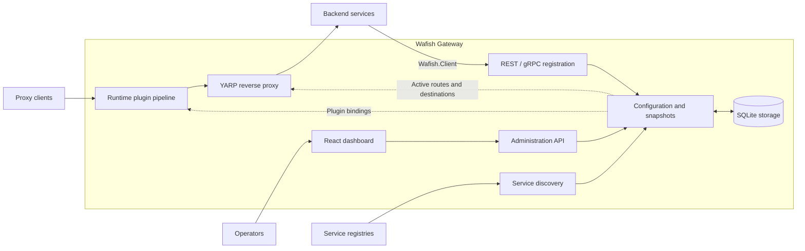

[](https://www.nuget.org/packages/Wafish)
[](https://www.nuget.org/packages/Wafish.ReactUi)
[](https://www.nuget.org/packages/Wafish.Client)
[](https://github.com/microsoft/reverse-proxy)
[](https://dotnet.microsoft.com/)
[](LICENSE)


---

**Wafish** is a .NET 10 API gateway built on [Microsoft YARP](https://microsoft.github.io/reverse-proxy/) 2.3.0.
It includes 16 built-in plugins, a management dashboard, an AI assistant, service discovery, and client registration.

- [Website](https://hallojoe.github.io/wafish/)
- [Documentation](https://hallojoe.github.io/wafish/docs/)
- [Presentation](https://hallojoe.github.io/wafish/presentation/)

## Releases

Publish a GitHub release to build and publish packages using its version tag, such as `1.1.0` or `1.1.0-rc.1`.
No version edit in build properties is required. Local builds use `0.0.0-dev`.
See the [package publishing workflows](docs/package-publishing.md) for setup, validation, and prerelease rules.

## Wafish vs. Bare YARP

Wafish uses YARP for proxy forwarding and destination selection.
Its additions provide management, persistence, and operational policies.

| Need | Bare YARP | Wafish |
|:-----|:----------|:-------------|
| Management UI | Build your own | ✅ Included |
| Edit config at runtime | File reload and programmatic updates through configuration providers | ✅ Management API and UI, persistent revisions, previews, rollback, and audit |
| Security (WAF) | None | ✅ WAF plugin (IP allow/deny, SQLi, XSS, path traversal) |
| Microservice registration | None | ✅ One-line REST/gRPC + heartbeat recovery |
| Observability | Logging, distributed tracing, and .NET/ASP.NET Core metrics | ✅ Stored request logs, gateway metrics, health views, and circuit-breaker controls |
| Service discovery | Destinations supplied through configuration providers | ✅ Consul / Nacos / Eureka / K8s / HTTP-JSON / Static |
| AI assistant | None | ✅ Chat-based management (40 tools, read/write split) |
| Extensibility | Middleware, transforms, configuration providers, and policy extension points | ✅ Managed `IGatewayPlugin` lifecycle, bindings, ordering, and compatibility checks |

See Microsoft’s documentation for [configuration providers](https://learn.microsoft.com/en-us/aspnet/core/fundamentals/servers/yarp/config-providers),
[logging](https://learn.microsoft.com/en-us/aspnet/core/fundamentals/servers/yarp/diagnosing-yarp-issues?view=aspnetcore-10.0),
[distributed tracing](https://learn.microsoft.com/en-us/aspnet/core/fundamentals/servers/yarp/distributed-tracing?view=aspnetcore-10.0),
[framework metrics](https://learn.microsoft.com/en-us/aspnet/core/metrics/overview?view=aspnetcore-10.0),
and [YARP extension points](https://learn.microsoft.com/en-us/aspnet/core/fundamentals/servers/yarp/extensibility?view=aspnetcore-10.0).

---

## Architecture



The host selects runtime, administration, UI, and storage components.
Plugins provide redirects, WAF, rate limits, retries, circuit breaking, caching, compression, metrics, request logs, and service discovery.
See [package boundaries and hosting APIs](docs/architecture.md).

---

## Highlights

- **Plugin architecture** — 15 first-party plugins provide request policies, redirects, metrics, logs, and service discovery.
- **Redirects** — fixed URLs, route templates, HTTPS enforcement, host allowlists, and request preview. Redirect routes can omit backends.
- **Visual dashboard** — clusters, routes, plugins, WAF, health, circuit breakers, logs, notifications, audit trail and config history in one place.
- **Runtime dynamic routing** — create / edit clusters & routes without restarting; auto-persists and auto-recovers on restart.
- **Native YARP config editing** — dual-mode **form + JSON** editor that works directly on the standard YARP schema.
- **Multi-provider service discovery** — Consul, Nacos, Eureka, Kubernetes, HTTP-JSON, Static.
- **One-line client registration** — microservices register on startup and unregister on shutdown over REST or gRPC, with heartbeat self-healing.
- **AI assistant** — manage the gateway by chat; 40 Function-Calling tools with a strict read/write permission split.
- **Flexible deployment** — `Auto` / `AllInOne` / `Split` / `ProxyOnly` / `DashboardOnly` with role-based endpoints.

---

The sample serves the [React workspace](docs/react-ui.md) at `/console`. The old Razor interface has been removed.
Use the [Aspire guide](docs/aspire.md) to start the gateway with two backend instances.
Use the [blue-green walkthrough](docs/blue-green.md) to verify a health-checked cutover and targeted rollback.
Use the [SonarQube guide](docs/sonarqube.md) for local analysis, .NET coverage, and CI quality gates.

## Quick Start

### Runtime only

Run `dotnet run --project samples/MinimalGateway` for a gateway with Runtime and SQLite only.
See the [minimal sample](samples/MinimalGateway/README.md) for backend configuration and independent package references.

### With administration

```bash
dotnet add package Wafish
dotnet add package Wafish.ReactUi
dotnet add package Wafish.Storage.Sqlite
```

```csharp
// Program.cs — Gateway
using Wafish.Extensions;
using Wafish.Runtime;
using Wafish.Administration;
using Wafish.ReactUi;
using Wafish.Storage.Sqlite;

var builder = WebApplication.CreateBuilder(args);
builder.Services.AddWafish();
builder.Services.AddWafishStorage();
builder.Services.AddWafishReactUi();

var app = builder.Build();
app.UseWafishGateway();   // includes MapReverseProxy
app.MapWafishAdministration();
app.MapWafishReactUi();
app.Run();
```

Dashboard: `http://localhost:5000/console`

**Microservice** — auto-registers on startup, no extra code:

```bash
dotnet add package Wafish.Client
```

```csharp
builder.Services.AddWafishClient();
```

```json
{ "Gateway": { "Registration": { "GatewayUrl": "http://localhost:5000" } } }
```

### Recommended (multi-port + gRPC + hot reload)

```csharp
using Wafish.Extensions;
using Wafish.Runtime;
using Wafish.Administration;
using Wafish.ReactUi;
using Wafish.Storage.Sqlite;

var builder = WebApplication.CreateBuilder(args);
builder.UseYarpKestrelAutoConfig();           // multi-port / gRPC support
builder.Services.AddWafish();
builder.Services.AddWafishStorage();
builder.Services.AddWafishReactUi();
builder.Services.AddWafishAdministrationDeployment();  // deployment modes + health endpoints

var app = builder.Build();
app.UseWafishGateway();
app.MapWafishAdministration();
app.MapWafishReactUi();
app.Run();
```

> See the [sample gateway](samples/SampleGateway/README.md) and [HTTPS setup](docs/sample-https.md).

---

## Package Structure

See the [solution project guide](docs/projects.md) for project READMEs, architecture diagrams, and package dependencies.

| Package | Purpose | YARP |
|:--------|:--------|:---:|
| **Wafish** | Gateway core: dynamic routing, IP isolation, API auth, plugin execution | ✅ |
| **Wafish.Runtime** | Runtime startup, plugin lifecycle, state, and proxy middleware | via core |
| **Wafish.Administration** | Administration APIs, authentication, realtime services, and AI services | via runtime |
| **Wafish.ReactUi** | React administration workspace | via administration |
| **Wafish.Client** | One-line auto-registration (no YARP dependency) | ❌ |
| **Wafish.Storage.Sqlite** | SQLite storage with optional SQLCipher-compatible encryption | via storage |
| **Wafish.Storage.Abstractions** | Storage interfaces & entities | ❌ |
| **Wafish.Grpc** | gRPC registration protocol | ❌ |
| **Wafish.Plugin.Abstractions** | Plugin contract (`IGatewayPlugin`) | ❌ |
| **Wafish.Plugin.\*** | 15 first-party plugins across 14 packages; see the catalog below | via core |

**.NET 10.0**.

Install the .NET 10 SDK to build this repository. Use the .NET 10 ASP.NET Core runtime for deployment.
`global.json` selects stable .NET 10 SDK feature bands. .NET 8 and .NET 9 targets are no longer supported.

---

## Feature Overview

| Area | What you get | Detail |
|:-----|:-------------|:-------|
| **Routing** | Dynamic clusters & routes, drag-sort priority, dual form/JSON editor, import/export, snapshot & rollback, audit log | [Guide](src/Wafish/README.md) |
| **External login** | OIDC visitor sessions, protected pages, CSRF protection, and controlled API token forwarding | [Guide](src/Wafish.Plugin.ExternalLogin/README.md) |
| **Redirects** | Fixed and template targets, HTTPS enforcement, host allowlists, and preview; routes can omit backends | [Guide](src/Wafish.Plugin.Redirect/README.md) |
| **Authentication** | `None` / `DefaultJwt` / `CustomJwt` / `ApiKey` / custom delegate; TOTP **2FA** | [Guide](docs/security.md) |
| **Security** | WAF: IP allow/deny, SQLi / XSS / path-traversal detection, request limits, security headers | [Guide](src/Wafish.Plugin.Waf/README.md) |
| **Observability** | Request logs (TraceID pairing, sanitization, sampling), real-time WebSocket stream | [Guide](src/Wafish.Plugin.ProxyLog/README.md) |
| **Monitoring** | Request / latency / status metrics (P50/P90/P99), health checks, circuit-breaker panel | [Guide](src/Wafish.Plugin.Metrics/README.md) |
| **Notification** | Webhook channels (DingTalk / HTTP), event rules with cooldown, delivery history | [Guide](src/Wafish.Administration/README.md) |
| **AI Assistant** | Chat-based management, 40 tools, read/write permission split, streaming, multi-provider | [Guide](src/Wafish.Administration/README.md) |
| **IP Isolation** | Route requests to a specific developer's instance by client IP for collaborative debugging | [Guide](src/Wafish/README.md) |
| **Client SDK** | Auto-register / unregister, heartbeat recovery, `GetServicesAsync` / `UpdateDestinationsAsync` | [Guide](src/Wafish.Client/README.md) |
| **Extensibility** | `IGatewayPlugin` contract, plugin-center management, hot-reconfigured bindings | [Guide](src/Wafish.Plugin.Abstractions/README.md) |
| **Config safety** | Auto-snapshot, rollback, `GET /api/config/apply-errors`, optional encrypted SQLite storage | [Guide](docs/architecture.md#configuration-transactions-arch-06-and-arch-07) |

---

## Service Discovery

`ServiceDiscoveryRefreshService` periodically resolves a cluster's destinations from a registry and publishes a new YARP snapshot — no restart. Bound per cluster (`service-discovery` plugin binding).

| Mode | Notes |
|:-----|:------|
| `Static` | Fixed endpoint list |
| `HttpJson` | Generic HTTP endpoint returning JSON endpoints |
| `Consul` | Healthy-instance filtering |
| `Nacos` | `healthyOnly` filter + `hosts` resolution |
| `Eureka` | JSON + `port.$` parsing + `UP` filtering |
| `Kubernetes` | ServiceAccount token + endpoints subsets |

Config: `Mode` (default `Static`), `Endpoint`, `ServiceName`, `Namespace` (`default`), `Scheme` (`http`), `RefreshSeconds` (`30`), `RequestTimeoutSeconds` (`5`).

---

## Built-in Plugins

Runtime registers all 16 plugins. Configure bindings through the plugin editor or administration API.
The Metrics package supplies both metric plugins. Each package link opens its configuration guide.

| ID | Scope | Package and guide | What it does |
|:---|:------|:------------------|:-------------|
| `route-authorization` | Route | [Wafish.Plugin.RouteAuthorization](src/Wafish.Plugin.RouteAuthorization/README.md) | Require authenticated scopes and claims before route responses |
| `request-aggregation` | Route | [Wafish.Plugin.Aggregation](src/Wafish.Plugin.Aggregation/README.md) | Combine independent GET JSON routes with bounded parallel execution |
| `claims-transform` | Route | [Wafish.Plugin.ClaimsTransform](src/Wafish.Plugin.ClaimsTransform/README.md) | Authenticated claims to downstream headers, queries, and paths |
| `external-login` | Route | [Wafish.Plugin.ExternalLogin](src/Wafish.Plugin.ExternalLogin/README.md) | OIDC visitor sessions and controlled API token forwarding; providers require host registration |
| `redirect` | Route | [Wafish.Plugin.Redirect](src/Wafish.Plugin.Redirect/README.md) | Fixed and template redirects, HTTPS enforcement, host allowlists, and preview |
| `waf` | Route | [Wafish.Plugin.Waf](src/Wafish.Plugin.Waf/README.md) | IP allow/deny, SQLi, XSS, path traversal, request limits, and security headers |
| `rate-limit` | Route | [Wafish.Plugin.RateLimit](src/Wafish.Plugin.RateLimit/README.md) | Fixed window, sliding window, token bucket, concurrency limits, weighted request costs, and named shared quotas |
| `rate-limit-redis` | Route | [Wafish.Plugin.RateLimit.Redis](src/Wafish.Plugin.RateLimit.Redis/README.md) | Distributed Redis limits, trusted tenant partitions, combined burst/sustained quotas, rejection headers, and configured outage behavior |
| `request-retry` | Route | [Wafish.Plugin.Retry](src/Wafish.Plugin.Retry/README.md) | Bounded retries, backoff, jitter, replay checks, deadlines, and shared retry budgets |
| `circuit-breaker` | Cluster | [Wafish.Plugin.CircuitBreaker](src/Wafish.Plugin.CircuitBreaker/README.md) | Destination failure tracking, recovery delays, and limited recovery probes |
| `compression` | Route | [Wafish.Plugin.Compression](src/Wafish.Plugin.Compression/README.md) | Configurable Gzip/Brotli encodings and levels, size rules, and savings metrics |
| `response-cache` | Route | [Wafish.Plugin.Cache](src/Wafish.Plugin.Cache/README.md) | Bounded response caching, expiry, vary keys, shared fills, tags, and purge |
| `traffic-metrics` | Route | [Wafish.Plugin.Metrics](src/Wafish.Plugin.Metrics/README.md) | Request, error, latency, and byte measurements; OpenTelemetry export |
| `cluster-metrics` | Cluster | [Wafish.Plugin.Metrics](src/Wafish.Plugin.Metrics/README.md) | Cluster and destination measurements; OpenTelemetry export |
| `proxy-log` | Route | [Wafish.Plugin.ProxyLog](src/Wafish.Plugin.ProxyLog/README.md) | Request and response capture, optional bodies, sanitization, sampling, and persistence |
| `service-discovery` | Cluster | [Wafish.Plugin.ServiceDiscovery](src/Wafish.Plugin.ServiceDiscovery/README.md) | Periodic destination refresh from static configuration or supported registries |

---

## Documentation

Documentation is maintained in this repository.

- **Getting started** — [Sample gateway](samples/SampleGateway/README.md) · [HTTPS setup](docs/sample-https.md) · [Aspire topology](docs/aspire.md)
- **Architecture** — [Package boundaries](docs/architecture.md) · [Project guide](docs/projects.md)
- **Dashboard** — [React workspace](docs/react-ui.md)
- **Security** — [Authentication and deployment](docs/security.md) · [WAF](src/Wafish.Plugin.Waf/README.md)
- **Plugins** — [Configuration guide](docs/guide/plugins.md) · [Plugin catalog](#built-in-plugins) · [Plugin contracts](src/Wafish.Plugin.Abstractions/README.md) · [Lifecycle](docs/plugin-lifecycle-contract.md)
- **Operations** — [Leases, readiness, policy controls, and diagnostics](docs/registration-operations-contracts.md)
- **Client SDK** — [Registration](src/Wafish.Client/README.md) · [Mutation outcomes](docs/mutation-contracts.md)
- **Storage** — [SQLite](src/Wafish.Storage.Sqlite/README.md) · [Offline inspection](tools/Wafish.Storage.Tool/README.md)
- **Development** — [SonarQube](docs/sonarqube.md) · [Regression checks](tests/Wafish.Regression/README.md)

---

## Contributing

We welcome contributions!

1. Fork the repo and create a feature branch (`git checkout -b feature/your-feature`).
2. Commit with a clear message describing the change and its purpose.
3. Keep the **API surface stable** — new features should ideally be added as plugins.
4. For new plugins, follow the `IGatewayPlugin` manifest conventions (id, display name, version, scope, capabilities) and provide a JSON Schema.
5. When changing Dashboard strings, update the `en-US` language pack.
6. Build the solution with **0 warnings / 0 errors** before submitting a Pull Request.

Report bugs and feature requests via GitHub Issues. All first-party packages are MIT-licensed.

---

## NuGet

| Package | NuGet |
|:--------|:-----:|
| **Wafish** | [](https://www.nuget.org/packages/Wafish) |
| **Wafish.Runtime** | [](https://www.nuget.org/packages/Wafish.Runtime) |
| **Wafish.Administration** | [](https://www.nuget.org/packages/Wafish.Administration) |
| **Wafish.ReactUi** | [](https://www.nuget.org/packages/Wafish.ReactUi) |
| **Wafish.Client** | [](https://www.nuget.org/packages/Wafish.Client) |
| **Wafish.Storage.Abstractions** | [](https://www.nuget.org/packages/Wafish.Storage.Abstractions) |
| **Wafish.Storage.Sqlite** | [](https://www.nuget.org/packages/Wafish.Storage.Sqlite) |
| **Wafish.Grpc** | [](https://www.nuget.org/packages/Wafish.Grpc) |
| **Wafish.Plugin.Abstractions** | [](https://www.nuget.org/packages/Wafish.Plugin.Abstractions) |
| **Wafish.Plugin.RouteAuthorization** | Source package; publication is separate. |
| **Wafish.Plugin.Aggregation** | Source package; publication is separate. |
| **Wafish.Plugin.ClaimsTransform** | Source package; publication is separate. |
| **Wafish.Plugin.Cache** | [](https://www.nuget.org/packages/Wafish.Plugin.Cache) |
| **Wafish.Plugin.CircuitBreaker** | [](https://www.nuget.org/packages/Wafish.Plugin.CircuitBreaker) |
| **Wafish.Plugin.Compression** | [](https://www.nuget.org/packages/Wafish.Plugin.Compression) |
| **Wafish.Plugin.Metrics** | [](https://www.nuget.org/packages/Wafish.Plugin.Metrics) |
| **Wafish.Plugin.ProxyLog** | [](https://www.nuget.org/packages/Wafish.Plugin.ProxyLog) |
| **Wafish.Plugin.RateLimit** | [](https://www.nuget.org/packages/Wafish.Plugin.RateLimit) |
| **Wafish.Plugin.RateLimit.Redis** | [](https://www.nuget.org/packages/Wafish.Plugin.RateLimit.Redis) |
| **Wafish.Plugin.Redirect** | [](https://www.nuget.org/packages/Wafish.Plugin.Redirect) |
| **Wafish.Plugin.Retry** | [](https://www.nuget.org/packages/Wafish.Plugin.Retry) |
| **Wafish.Plugin.ServiceDiscovery** | [](https://www.nuget.org/packages/Wafish.Plugin.ServiceDiscovery) |
| **Wafish.Plugin.Waf** | [](https://www.nuget.org/packages/Wafish.Plugin.Waf) |

**.NET 10.0** · **YARP 2.3.0**

---

## Build

Open `Wafish.slnx` or build from the repository root:

```bash
dotnet build Wafish.slnx -c Release
```

NuGet versions are defined in `Directory.Packages.props` for source, sample, test, and AppHost projects.
Keep package references versionless in project files.
The administration UI and API labels use English.

## Development tools and agent skills

Use the .NET 10 SDK selected by `global.json`, Node.js 24, and npm.
Use Python 3 for repository verification scripts.
Aspire CLI is optional for AppHost orchestration. APM CLI is required for agent skill setup.
APM 0.38.1 was used to validate this setup.

```bash
dotnet --version
node --version
npm --version
dotnet tool restore
apm install --frozen
apm compile
```

[apm.yml](apm.yml) is the agent entry point. [apm.lock.yaml](apm.lock.yaml) pins resolved dependencies and deployment records.
Microsoft .NET and Aspire skills use pinned Git repository references.
Local [Wafish skills](.apm/skills/) cover builds, tests, diagnostics, plugins, benchmarks, and packages.
Edit [.apm/instructions/wafish.instructions.md](.apm/instructions/wafish.instructions.md) for global instructions, then compile.
The generated root [AGENTS.md](AGENTS.md) uses a managed section. Scoped project instructions remain authoritative within their scope.
Downloaded dependencies and generated skill installations are ignored.

For dependency updates, change the Git revision deliberately, run `apm install`, and review the lockfile and imported instructions.
Run `apm audit --ci` and `apm compile --validate` before committing updates.

## License

[MIT](LICENSE)

### Administration authenticators

Optional passkeys and FIDO2 security keys support JWT administration login. Configured TOTP remains required.
See [WebAuthn setup and recovery](docs/administration-webauthn.md).
