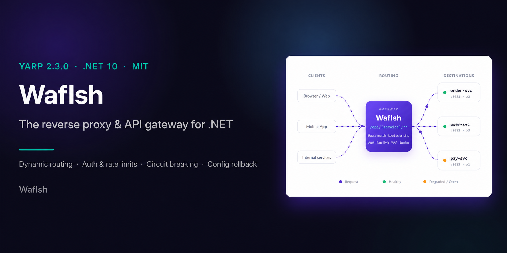

<div align="center">


<br/>


**WafIsh — Full-featured API Gateway powered by YARP**

Plugin Architecture · Dashboard · Dynamic Routing · WAF · Service Discovery · AI Assistant · 2FA · IP Isolation

[](https://www.nuget.org/packages/WafIsh)
[](https://www.nuget.org/packages/WafIsh.ReactUi)
[](https://www.nuget.org/packages/WafIsh.Client)
[](https://github.com/microsoft/reverse-proxy)
[](https://dotnet.microsoft.com/)
[](LICENSE)


</div>

---

**WafIsh** is a production-ready API gateway built on [Microsoft YARP](https://microsoft.github.io/reverse-proxy/) 2.3.0. It ships with everything you'd otherwise build yourself: a **plugin architecture** (11 built-in plugins), a visual **management dashboard**, WAF, AI assistant, multi-provider **service discovery**, notifications, health & circuit-breaker monitoring, and **one-line client auto-registration**.

[📖 Documentation](https://yarp.aneiang.com/docs/index.html#overview) · [🚀 Live Demo](https://yarp-test.aneiang.com/aneiang) (credentials supplied by the demo operator)

---

## WafIsh vs. Bare YARP

| Need | Bare YARP | WafIsh |
|:-----|:----------|:-------------|
| Management UI | Build your own | ✅ Included |
| Edit config at runtime | Reload file only | ✅ CRUD + form/JSON editor + rollback + audit |
| Security (WAF) | None | ✅ WAF plugin (IP allow/deny, SQLi, XSS, path traversal) |
| Microservice registration | None | ✅ One-line REST/gRPC + heartbeat recovery |
| Observability | Logging only | ✅ Metrics, request logs, health, circuit-breaker panel |
| Service discovery | Manual clusters | ✅ Consul / Nacos / Eureka / K8s / HTTP-JSON / Static |
| AI assistant | None | ✅ Chat-based management (40 tools, read/write split) |
| Extensibility | Custom middleware | ✅ Drop-in `IGatewayPlugin` framework |

---

## Architecture

```
                   +-----------------------------------------------------------+
                   |                 WafIsh Gateway (YARP 2.3.0)          |
 +-------------+   |   +------------------+  +-------------------------------+  |
 |  5+ clients  |   |   |  Web Dashboard   |  |  Management API + gRPC host   |  |
 |  (browsers/   |   |   |  Routes/Plugins  |  |  Client auto-registration     |  |
 |   apps)       |-->|   |  WAF / AI / 2FA  |  |                               |  |
 +-------------+   |   +--------+----------+  +--------------+----------------+  |
                   |            +------------------------------------------------+ |
                   |            |                                                  |
                   |   +--------v---------+                                    | |
                   |   |  Plugin Pipeline(11 built-in plugins)                     | |
                   |   |  WAF → RateLimit → Retry → CircuitBreaker →            | |
                   |   |  Compression → Cache → Metrics → ProxyLog              | |
                   |   +--------+---------+                                    | |
                   |            +------------------------------------------------+ |
                   |            |                                                  |
                   |   +--------v---------+   +-------------------------------+  |
                   |   |  YARP Reverse Proxy | → | Target services / clusters |  |
                   |   |  (dynamic routes)  |   |  (via Service Discovery)    |  |
                   |   +--------+---------+   +-------------------------------+  |
                   |            |
                   |   +--------v--------+
                   |   |  Storage: SQLite (optional encryption) |
                   +-----------------------------------------------------------+
```

---

## Highlights

- **Plugin architecture** — everything is a plugin; 11 first-party plugins provide WAF, rate limiting, retry, circuit breaking, compression, caching, metrics and more. Bring your own `IGatewayPlugin` in minutes.
- **Visual dashboard** — clusters, routes, plugins, WAF, health, circuit breakers, logs, notifications, audit trail and config history in one place.
- **Runtime dynamic routing** — create / edit clusters & routes without restarting; auto-persists and auto-recovers on restart.
- **Native YARP config editing** — dual-mode **form + JSON** editor that works directly on the standard YARP schema.
- **Multi-provider service discovery** — Consul, Nacos, Eureka, Kubernetes, HTTP-JSON, Static.
- **One-line client registration** — microservices register on startup and unregister on shutdown over REST or gRPC, with heartbeat self-healing.
- **AI assistant** — manage the gateway by chat; 40 Function-Calling tools with a strict read/write permission split.
- **Flexible deployment** — `Auto` / `AllInOne` / `Split` / `ProxyOnly` / `DashboardOnly` with role-based endpoints.

---

The sample serves the [React workspace](docs/react-ui.md) at `/console`. The old Razor interface has been removed.
Use the [Aspire guide](docs/aspire.md) to start the gateway with two backend instances.
Use the [SonarQube guide](docs/sonarqube.md) for local analysis, .NET coverage, and CI quality gates.

## Quick Start

### Minimal

```bash
dotnet add package WafIsh
dotnet add package WafIsh.ReactUi
dotnet add package WafIsh.Storage.Sqlite
```

```csharp
// Program.cs — Gateway
using WafIsh.Extensions;
using WafIsh.Runtime;
using WafIsh.Administration;
using WafIsh.ReactUi;
using WafIsh.Storage.Sqlite;

var builder = WebApplication.CreateBuilder(args);
builder.Services.AddWafIsh();
builder.Services.AddWafIshStorage();
builder.Services.AddWafIshReactUi();

var app = builder.Build();
app.UseWafIshGateway();   // includes MapReverseProxy
app.MapWafIshAdministration();
app.MapWafIshReactUi();
app.Run();
```

Dashboard: `http://localhost:5000/console`

**Microservice** — auto-registers on startup, no extra code:

```bash
dotnet add package WafIsh.Client
```

```csharp
builder.Services.AddWafIshClient();
```

```json
{ "Gateway": { "Registration": { "GatewayUrl": "http://localhost:5000" } } }
```

### Recommended (multi-port + gRPC + hot reload)

```csharp
using WafIsh.Extensions;
using WafIsh.Runtime;
using WafIsh.Administration;
using WafIsh.ReactUi;
using WafIsh.Storage.Sqlite;

var builder = WebApplication.CreateBuilder(args);
builder.UseYarpKestrelAutoConfig();           // multi-port / gRPC support
builder.Services.AddWafIsh();
builder.Services.AddWafIshStorage();
builder.Services.AddWafIshReactUi();
builder.Services.AddWafIshAdministrationDeployment();  // deployment modes + health endpoints

var app = builder.Build();
app.UseWafIshGateway();
app.MapWafIshAdministration();
app.MapWafIshReactUi();
app.Run();
```

> Full step-by-step guide: [Quick Start](https://yarp.aneiang.com/docs/index.html#quickstart)

---

## Package Structure

See the [solution project guide](docs/projects.md) for project READMEs, Mermaid diagrams, agent notes, and proposed work.

| Package | Purpose | YARP |
|:--------|:--------|:---:|
| **WafIsh** | Gateway core: dynamic routing, IP isolation, API auth, plugin execution | ✅ |
| **WafIsh.Runtime** | Runtime startup, plugin lifecycle, state, and proxy middleware | via core |
| **WafIsh.Administration** | Administration APIs, authentication, realtime services, and AI services | via runtime |
| **WafIsh.ReactUi** | React administration workspace | via administration |
| **WafIsh.Client** | One-line auto-registration (no YARP dependency) | ❌ |
| **WafIsh.Storage.Sqlite** | SQLite storage with optional SQLCipher-compatible encryption | via storage |
| **WafIsh.Storage.Abstractions** | Storage interfaces & entities | ❌ |
| **WafIsh.Grpc** | gRPC registration protocol | ❌ |
| **WafIsh.Plugin.Abstractions** | Plugin contract (`IGatewayPlugin`) | ❌ |
| **WafIsh.Plugin.\*** | 11 first-party plugins, pulled in individually | via core |

**.NET 10.0**.

Install the .NET 10 SDK to build this repository. Use the .NET 10 ASP.NET Core runtime for deployment.
`global.json` selects stable .NET 10 SDK feature bands. .NET 8 and .NET 9 targets are no longer supported.

---

## Feature Overview

| Area | What you get | Detail |
|:-----|:-------------|:-------|
| **Routing** | Dynamic clusters & routes, drag-sort priority, dual form/JSON editor, import/export, snapshot & rollback, audit log | [:link:](https://yarp.aneiang.com/docs/index.html#dynamic-routing) |
| **Authentication** | `None` / `DefaultJwt` / `CustomJwt` / `ApiKey` / custom delegate; TOTP **2FA** | [:link:](https://yarp.aneiang.com/docs/index.html#authentication) |
| **Security** | WAF: IP allow/deny, SQLi / XSS / path-traversal detection, request limits, security headers | [:link:](https://yarp.aneiang.com/docs/index.html#waf-firewall) |
| **Observability** | Request logs (TraceID pairing, sanitization, sampling), real-time WebSocket stream | [:link:](https://yarp.aneiang.com/docs/index.html#request-logs) |
| **Monitoring** | Request / latency / status metrics (P50/P90/P99), health checks, circuit-breaker panel | [:link:](https://yarp.aneiang.com/docs/index.html#health-check) |
| **Notification** | Webhook channels (DingTalk / HTTP), event rules with cooldown, delivery history | [:link:](https://yarp.aneiang.com/docs/index.html#notifications) |
| **AI Assistant** | Chat-based management, 40 tools, read/write permission split, streaming, multi-provider | [:link:](https://yarp.aneiang.com/docs/index.html#ai-assistant) |
| **IP Isolation** | Route requests to a specific developer's instance by client IP for collaborative debugging | [:link:](https://yarp.aneiang.com/docs/index.html#ip-isolation) |
| **Client SDK** | Auto-register / unregister, heartbeat recovery, `GetServicesAsync` / `UpdateDestinationsAsync` | [:link:](https://yarp.aneiang.com/docs/index.html#client-registration) |
| **Extensibility** | `IGatewayPlugin` contract, plugin-center management, hot-reconfigured bindings | [:link:](https://yarp.aneiang.com/docs/index.html#plugin-system) |
| **Config safety** | Auto-snapshot, rollback, `GET /api/config/apply-errors`, optional encrypted SQLite storage | [:link:](https://yarp.aneiang.com/docs/index.html#config-history) |

---

## Service Discovery

`ServiceDiscoveryRefreshService` periodically resolves a cluster's destinations from a registry and publishes a new YARP snapshot — no restart. Bound per cluster (`service-discovery` plugin binding).

| Mode | Notes |
|:-----|:------|
| `Static` | Fixed endpoint list |
| `HttpJson` | Generic HTTP endpoint returning JSON endpoints |
| `Consul` | Healthy-instance filtering |
| `Nacos` | `healthyOnly` filter + `hosts` resolution |
| `Eureka` | JSON + `port.$` parsing + `UP` filtering |
| `Kubernetes` | ServiceAccount token + endpoints subsets |

Config: `Mode` (default `Static`), `Endpoint`, `ServiceName`, `Namespace` (`default`), `Scheme` (`http`), `RefreshSeconds` (`30`), `RequestTimeoutSeconds` (`5`).

---

## Built-in Plugins

| ID | Scope | What it does |
|:---|:------|:-------------|
| `waf` | Route | IP allow/deny, SQLi / XSS / path-traversal detection, request limits, security headers |
| `rate-limit` | Route | FixedWindow / SlidingWindow / TokenBucket / Concurrency |
| `rate-limit-redis` | Route | Distributed limiting via Redis Lua; 429 with `Retry-After` / `X-RateLimit-*` |
| `request-retry` | Route | Retry with exponential backoff + jitter, status/exception policy |
| `circuit-breaker` | Cluster | Failure threshold, recovery timeout, half-open probing |
| `compression` | Route | Gzip / Brotli by MIME allowlist + min size |
| `response-cache` | Route | Bounded in-memory cache with TTL & vary key |
| `traffic-metrics` | Route | Per-route requests / errors / latency / bytes |
| `cluster-metrics` | Cluster | Per-cluster requests / errors / latency / destinations |
| `proxy-log` | Route | Full proxy capture (headers / optional body), sampling |
| `service-discovery` | Cluster | Periodic registry-backed endpoint refresh |

---

## Documentation

Full documentation lives at **[yarp.aneiang.com](https://yarp.aneiang.com)**.

- **Getting Started** — [Overview](https://yarp.aneiang.com/docs/index.html#overview) · [Quick Start](https://yarp.aneiang.com/docs/index.html#quickstart)
- **Gateway Core** — [Authentication](https://yarp.aneiang.com/docs/index.html#authentication) · [Dynamic Routing](https://yarp.aneiang.com/docs/index.html#dynamic-routing) · [IP Isolation](https://yarp.aneiang.com/docs/index.html#ip-isolation) · [Configuration Reference](https://yarp.aneiang.com/docs/index.html#configuration)
- **Dashboard** — [Dashboard Overview](https://yarp.aneiang.com/docs/index.html#dashboard-overview) · [Config History](https://yarp.aneiang.com/docs/index.html#config-history)
- **Security** — [WAF Firewall](https://yarp.aneiang.com/docs/index.html#waf-firewall) · [Policy Management](https://yarp.aneiang.com/docs/index.html#policy-management)
- **Monitoring** — [Health Check](https://yarp.aneiang.com/docs/index.html#health-check) · [Circuit Breaker](https://yarp.aneiang.com/docs/index.html#circuit-breaker) · [Rate Limiting](https://yarp.aneiang.com/docs/index.html#rate-limiting) · [Request Logs](https://yarp.aneiang.com/docs/index.html#request-logs) · [Request Retry](https://yarp.aneiang.com/docs/index.html#request-retry) · [Notifications](https://yarp.aneiang.com/docs/index.html#notifications)
- **Plugins & Pipeline** — [Plugin System](https://yarp.aneiang.com/docs/index.html#plugin-system) · [Middleware Pipeline](https://yarp.aneiang.com/docs/index.html#middleware-pipeline)
- **Client SDK** — [Client Registration](https://yarp.aneiang.com/docs/index.html#client-registration)
- **AI Assistant** — [AI Assistant](https://yarp.aneiang.com/docs/index.html#ai-assistant)
- **Advanced** — [Deployment Modes](https://yarp.aneiang.com/docs/index.html#deployment-modes) · [Custom Auth](https://yarp.aneiang.com/docs/index.html#custom-auth) · [Production Config](https://yarp.aneiang.com/docs/index.html#production-config)
- **Storage** — [SQLite Storage](https://yarp.aneiang.com/docs/index.html#storage-sqlite)

---

## Contributing

We welcome contributions!

1. Fork the repo and create a feature branch (`git checkout -b feature/your-feature`).
2. Commit with a clear message describing the change and its purpose.
3. Keep the **API surface stable** — new features should ideally be added as plugins.
4. For new plugins, follow the `IGatewayPlugin` manifest conventions (id, display name, version, scope, capabilities) and provide a JSON Schema.
5. When changing Dashboard strings, update the `en-US` language pack.
6. Build the solution with **0 warnings / 0 errors** before submitting a Pull Request.

Report bugs and feature requests via GitHub Issues. All first-party packages are MIT-licensed.

---

## NuGet

| Package | NuGet |
|:--------|:-----:|
| **WafIsh** | [](https://www.nuget.org/packages/WafIsh) |
| **WafIsh.ReactUi** | [](https://www.nuget.org/packages/WafIsh.ReactUi) |
| **WafIsh.Client** | [](https://www.nuget.org/packages/WafIsh.Client) |
| **WafIsh.Storage.Abstractions** | [](https://www.nuget.org/packages/WafIsh.Storage.Abstractions) |
| **WafIsh.Storage.Sqlite** | [](https://www.nuget.org/packages/WafIsh.Storage.Sqlite) |
| **WafIsh.Grpc** | [](https://www.nuget.org/packages/WafIsh.Grpc) |
| **WafIsh.Plugin.Abstractions** | [](https://www.nuget.org/packages/WafIsh.Plugin.Abstractions) |

**.NET 10.0** · **YARP 2.3.0**

---

## Build

Open `WafIsh.slnx` or build from the repository root:

```bash
dotnet build WafIsh.slnx -c Release
```

NuGet versions are defined in `Directory.Packages.props` for source, sample, test, and AppHost projects.
Keep package references versionless in project files.
The administration UI and API labels use English.

## License

[MIT](LICENSE)

---

<div align="center">

If this project helps you, [⭐ Star it](https://github.com/aneiang/WafIsh) to support development

</div>

## Changelog

### 2026-11-14 — Review items 11–13

- Included deployment path bases in UI, API, and asset URLs.
- Tracked frontend build inputs and rejected incomplete assets before embedding or packing.
- Joined retired plugin domains and watcher tasks during shutdown.
- Deprecated ineffective cache switches and made compression fallback independent of write chunk size.
- Fixed notification queue cleanup when shutdown precedes background execution.
- Verified 163 .NET regressions, 20 browser checks, and 93.85% changed C# source coverage.
- [Verification and compatibility evidence](tests/WafIsh.Regression/evidence/review111213/README.md).

### 2026-11-14 — Review items 8–10

- Preserved interrupted log batches and counted exhausted retries, overflow, and shutdown losses.
- Added notification delivery, failure, suppression, and discard counters.
- Corrected indexed SQLite UTC comparisons and batch orphan-cluster cleanup.
- Recorded failed and cancelled metric attempts once, with explicit retry semantics.
- Verified 157 regression executions and 86.67% changed production-line coverage.
- [Verification and compatibility evidence](tests/WafIsh.Regression/evidence/review8910/README.md).

### 2026-11-14 — Complete review items 1–3

- Limit authentication attempts and verify real HTTPS cookie flows.
- Reject invalid CIDR rules and remove request secrets from WAF rejection logs.
- Require complete bounded request replay and stop retries when response transmission begins.
- Bound decoded log capture and local limiter admission. Preserve active limiter leases during cleanup.
- Add live Kestrel/YARP streaming, plugin-combination, and cancellation regressions.
- Release build, 110 main checks, and 24 administration checks pass. Changed source coverage is 91.64%.
- See [verification evidence](tests/WafIsh.Regression/evidence/review123/README.md) and [consumer migration notes](docs/security.md#consumer-changes-for-review-fixes).

### 2026-11-14 — Replace the outdated native database component

- Replace the retired SQLCipher bundle with SQLite3MC 2.7.0 and SQLite 3.54.1.
- Preserve existing plaintext files and SQLCipher 4 encrypted databases without changing default encryption settings.
- Verify old database fixtures, migrations, writes, reopening, wrong-key rejection, and native version requirements.
- Preserve encryption and committed WAL writes in backups. Return HTTP 503 when backup creation fails.
- Add native storage checks to Linux, Windows, and macOS CI jobs.
- Resolve the documented database release blocker. See [migration guidance](docs/security.md#native-sqlite-replacement-sec-14).


### 2026-11-14 — Remove the old Razor interface

- Remove the Razor project, page routes, static assets, hosting wrappers, and React fallback link.
- Keep React at `/console` with the existing administration APIs and authentication.
- Update sample and performance hosts, package publishing, and migration instructions.
- Preserve all 87 non-page controller contracts.
- Verify React-only publishing and deployment isolation. See [removal evidence](tests/WafIsh.Regression/evidence/ui08/README.md).


### 2026-11-14 — React administration workspace

- Implement the approved React UI with TypeScript, Tailwind, shadcn/ui, and Radix components.
- Add responsive navigation, light/dark themes, and English translations.
- Implement configuration, plugins, observation, history, settings, and optional AI workflows.
- Preserve form drafts and distinguish validation, conflict, storage, and activation failures.
- Use cookie JWT sessions and memory-only Basic/API-key credentials, including authenticated realtime updates.
- Persist two-factor state atomically. Reject login when existing state cannot be read safely.
- Preserve disabled routes across restart, export, import, rollback, and rename.
- Repair Razor JSON workers and load fallback assets during Aspire development.
- Embed production assets. Add a Node.js container build stage and continuous verification workflow.
- See [hosting instructions](docs/react-ui.md) and [verification evidence](tests/WafIsh.Regression/evidence/ui/README.md).

### 2026-11-14 — Aspire development topology

- Add an AppHost with dynamic HTTP/gRPC endpoints, two backend identities, persistent SQLite, and secret injection.
- Add health checks and correlated telemetry without changing gateway retry behavior.
- Verify load balancing, process restart, optional Redis, shared limits across two gateways, and outage recovery.
- Add external-endpoint performance-runner mode. Preserve the existing managed mode.
- Remove unconditional registration-client TLS certificate acceptance.
- Document [operation and recovery](docs/aspire.md) with [verification evidence](tests/WafIsh.Regression/evidence/aspire/README.md).


Track pending work and acceptance checks in [PLAN.md](PLAN.md).
Deferred proposals are recorded in [IDEAS.md](IDEAS.md).
Earlier release history remains in [CHANGELOG.md](CHANGELOG.md).

### 2026-11-14 — Administration and proxy security

- Apply shared authentication and network checks across REST, gRPC, dashboard APIs, hubs, and MCP.
- Remove working sample credentials and restrict default listeners to loopback.
- Bound response-cache memory and stream compressed responses.
- Inspect unknown-length request bodies and enforce byte limits.
- Make Redis outage behavior explicit. Verify shared counters and reconnection with Redis.
- Document [security configuration](docs/security.md), secret injection, and the unresolved native SQLCipher release blocker.

### 2026-11-14 — Atomic configuration updates

- Validate isolated candidates before storing and publishing configuration.
- Commit routes, clusters, destinations, binding identities, and revisions in one SQLite transaction.
- Preserve active configuration when storage fails. Report stored and active revisions when activation fails.
- Add structured outcomes and HTTP error codes. Show actionable errors in the existing dashboard.
- Make gRPC multi-route registration and deregistration atomic.
- Verify restart recovery, concurrent readers, write failures, renamed bindings, and plugin lifecycle behavior.
- Publish [migration instructions](docs/architecture.md#configuration-transactions-arch-06-and-arch-07) and [verification evidence](tests/WafIsh.Regression/evidence/arch04-09/README.md).

### 2026-11-14 — Runtime pipeline and optional features

- Moved gateway pipeline composition and deployment middleware into the runtime package.
- Verified proxy-only caching, transforms, health endpoints, and endpoint-role isolation.
- Removed stale transfer headers from cached responses.
- Added explicit, independent AI and MCP registration.
- Disabled AI controls and endpoints when AI services are not registered.

### 2026-11-14 — Administration and presentation separation

- Added `WafIsh.Administration` for administration APIs, authentication, history, realtime hubs, models, and services.
- Added administration registration and endpoint mapping without Razor services or dashboard assets.
- Kept the existing dashboard entry points as presentation wrappers over administration services.
- Separated login rendering and database settings APIs while preserving all 102 controller method/path contracts.
- Verified 44 main regression checks, eight API-only checks, and browser login, cluster creation, navigation, and localization.
- Added [hosting and migration instructions](docs/architecture.md#administration-extraction-arch-03).

### 2026-11-13 — .NET 10 and urgent security fixes

- Target .NET 10 across libraries, samples, regression checks, and performance tools.
- Added SDK selection and updated Docker images, debugger paths, and benchmark paths.
- Updated Microsoft.Data.Sqlite.Core to 10.0.15, preserving the SQLCipher provider for encrypted storage.
- Added encrypted-storage checks for reopening databases and rejecting missing or incorrect keys.
- Native SQLCipher dependency review remains tracked under SEC-10.
- Disabled registration now removes both REST and gRPC registration endpoints.
- Invalid authentication configuration is rejected. Empty dashboard API keys no longer grant access.
- Gateway authentication reads nested dashboard settings and respects explicit control-plane configuration.
- gRPC enforces its selected authentication mode.
- Shared caching bypasses authenticated requests and excludes private or cookie-setting responses.
- Added security regression checks and preserved baseline evidence.
- Restored legacy plugin-state import and corrected logging setup in runtime test fixtures.
- Extracted runtime services into WafIsh.Runtime. Proxy startup no longer requires dashboard registration.
- Fixed response-header callback ordering in the extracted proxy pipeline.
- Verified Debug and Release builds, 42 regression checks, and published dashboard startup with encrypted storage.

### 2026-11-13 — Improvement planning

- Added phase plans for architecture, security, Aspire, and UI, with urgent security fixes first.
- Added task identifiers, dependencies, status tracking, and completion checks.
- Recorded historical review results separately from current source findings.
- Recorded decisions to permit breaking changes and reject configuration updates when persistence fails.
- Deferred separate administration processes and replacement UI selection to their respective design milestones.

See [PLAN.md](PLAN.md) for completed work, verification evidence, and remaining tasks.

## Review completion: items 14–16

Public packages now have package consistency checks and initial API snapshots.
Isolated consumers verify runtime, administration, React assets, and encrypted SQLite.
CI runs live Redis checks and strict dependency audits, with retained JSON test reports.
UTC migration and injected clocks support consistent storage and controlled policy timing.
Metric stores retire obsolete identities and bound retained series.
See [verification and platform limits](tests/WafIsh.Regression/evidence/review141516/README.md).
