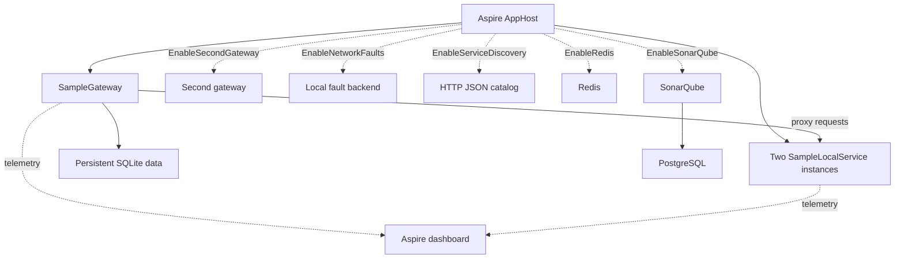

# Wafish.AppHost

[README](README.md) · [Agent notes](AGENTS.md) · [Proposed work](../PLAN.md) · [Project index](../docs/projects.md)

## Intro

This Aspire AppHost runs the local sample topology and optional development infrastructure.



## Real-world example

A developer starts one gateway and two backends, then uses the dashboard to trace a request across them.

## Real-world value

One topology supplies endpoint wiring, generated credentials, health dependencies, and local observability.

## What it does

- Start a gateway and two backend instances with assigned endpoints.
- Optionally add a second gateway, Redis, SonarQube with PostgreSQL, and a local fault fixture.
- Persist sample gateway data and generated secret parameters.

## What it does not do

- Run a SonarQube analysis merely by starting the server.
- Deploy a production environment or add Aspire dependencies to reusable libraries.

## Start here

Source project: [Wafish.AppHost.csproj](Wafish.AppHost.csproj).
Direct project references: [SampleGateway](../samples/SampleGateway/README.md), [SampleLocalService](../samples/SampleLocalService/README.md).

Start from the repository root:

```bash
aspire start --apphost Wafish.AppHost/Wafish.AppHost.csproj --non-interactive
```

See [topology options](../docs/aspire.md) and [SonarQube analysis](../docs/sonarqube.md).
The default topology needs no container runtime. Redis and SonarQube require one.

The resource table links to the gateway console at `/console` and backend details at `/api/local-service/instance`.
The gRPC endpoint appears only in resource details. It requires an HTTP/2 client and cannot open in a browser.
Service root paths have no page and return HTTP 404.
See [browser-link verification](../ARCHIVE.md#archive-tests-wafish-regression-evidence-aspire-dashboard-links-readme-md).

Build and verification commands are in [AGENTS.md](AGENTS.md). Future work is in [PLAN.md](../PLAN.md).

## Isolated persistent state

`TopologyId` selects separate database directories, generated credentials, and optional container volumes.
The default identifier is `default`. Use `UseLegacyTopologyState=true` to reopen previous state.
The compatibility option requires the default identifier and never deletes existing volumes.
Run `python scripts/check-topology.py` for controlled restart verification.
SonarQube readiness accepts only an exact `UP` status. Invalid, unavailable, and timed-out responses remain unhealthy.

## External login sample

Set `EnableExternalLogin=true` to start the optional visitor gateway, static site, support API, Keycloak, and Redis.
Set `EnableSecondVisitorGateway=true` to verify shared visitor sessions across two gateways.
This profile requires a container runtime and trusted development certificates.
See the [sample guide](../samples/SampleExternalLogin/README.md) for ports, generated credentials, and browser verification.

## Optional network faults

Set `EnableNetworkFaults=true` to add the container-free `fault-backend` resource.
It exposes bounded delays, stalled responses, disconnects, and transient failures on loopback.
It does not intercept ordinary backend traffic or automatically create proxy routes.
See the [fault walkthrough](../docs/network-faults.md) and run `python3 scripts/check-network-faults.py` when this AppHost is stopped.

## Optional HTTP JSON discovery

`EnableServiceDiscovery=true` adds a bounded local catalog for the existing sample backends.
The ordinary gRPC registration remains independent. The profile requires no containers.
The [discovery walkthrough](../docs/service-discovery-sample.md) creates real bindings and demonstrates membership changes, stale rejection, and recovery.
Run `python3 scripts/check-service-discovery.py` only when the target AppHost is stopped.

## Optional telemetry configuration report

Set `EnableTelemetryDiagnostics=true` to print registration reports in each sample resource console.
The switch includes the optional second gateway and discovery catalog. It defaults to false.
Reports omit configuration values and describe sample registration, not collector connectivity.
See [inspection and verification](../docs/telemetry-configuration.md).
