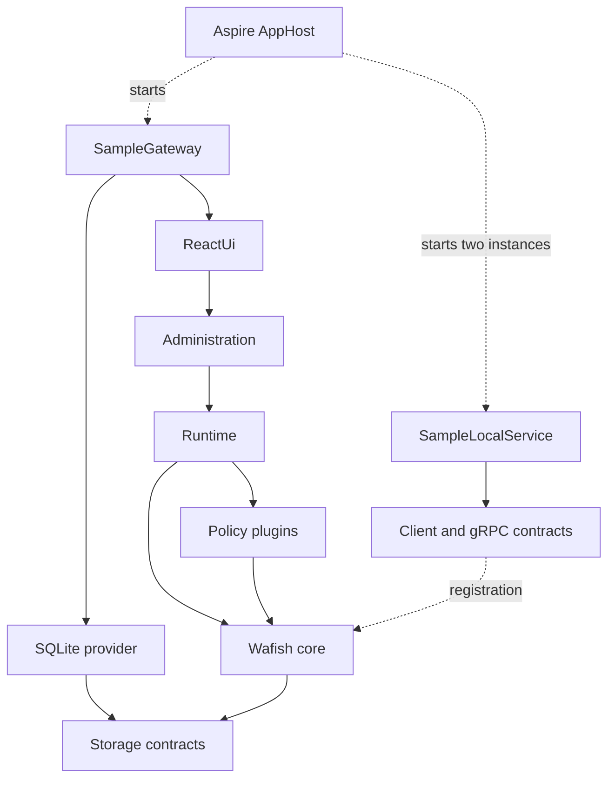

# Solution project guide

Project documentation has two roles:

- **README.md:** purpose, examples, responsibilities, limits, and architecture.
- **AGENTS.md:** source map, implementation boundaries, and verification commands.

The [root backlog](../PLAN.md) contains all remaining tasks, ratings, and acceptance checks.
The [planning archive](archive/2026-11-planning/README.md) preserves completed plans and review history.
AGENTS.md contains repository instructions. These projects do not need a separate reusable SKILL.md workflow.
Project READMEs describe the source projects. Current NuGet packaging still includes the root README.

## Main relationships

Arrows show main dependencies or labeled runtime relationships, not every project reference.

## Projects

| Project | Purpose | Documentation |
| --- | --- | --- |
| `SampleGateway` | This executable combines the gateway runtime, SQLite storage, administration APIs, and the React workspace. | [README](../samples/SampleGateway/README.md) · [AGENTS](../samples/SampleGateway/AGENTS.md) |
| `SampleLocalService` | This executable is a small backend that registers itself with a gateway. | [README](../samples/SampleLocalService/README.md) · [AGENTS](../samples/SampleLocalService/AGENTS.md) |
| `SampleServiceDefaults` | This library adds shared telemetry, service discovery, and health defaults to the sample hosts. | [README](../samples/SampleServiceDefaults/README.md) · [AGENTS](../samples/SampleServiceDefaults/AGENTS.md) |
| `Wafish.Administration` | This project provides administration APIs, authentication, realtime updates, and optional AI and MCP services. | [README](../src/Wafish.Administration/README.md) · [AGENTS](../src/Wafish.Administration/AGENTS.md) |
| `Wafish.Client` | This client registers an ASP.NET Core service with a gateway through HTTP or gRPC. | [README](../src/Wafish.Client/README.md) · [AGENTS](../src/Wafish.Client/AGENTS.md) |
| `Wafish.Grpc` | This project defines the protobuf registration protocol and generates its .NET client and server types. | [README](../src/Wafish.Grpc/README.md) · [AGENTS](../src/Wafish.Grpc/AGENTS.md) |
| `Wafish.Plugin.Abstractions` | This project defines the contracts shared by plugin implementations and the runtime host. | [README](../src/Wafish.Plugin.Abstractions/README.md) · [AGENTS](../src/Wafish.Plugin.Abstractions/AGENTS.md) |
| `Wafish.Plugin.Cache` | This plugin adds a bounded, in-memory HTTP response cache to selected routes. Its binding ID is `response-cache`. | [README](../src/Wafish.Plugin.Cache/README.md) · [AGENTS](../src/Wafish.Plugin.Cache/AGENTS.md) |
| `Wafish.Plugin.CircuitBreaker` | This plugin tracks destination failures and opens circuits for selected clusters. Its binding ID is `circuit-breaker`. | [README](../src/Wafish.Plugin.CircuitBreaker/README.md) · [AGENTS](../src/Wafish.Plugin.CircuitBreaker/AGENTS.md) |
| `Wafish.Plugin.Compression` | This plugin compresses eligible route responses with Gzip or Brotli. Its binding ID is `compression`. | [README](../src/Wafish.Plugin.Compression/README.md) · [AGENTS](../src/Wafish.Plugin.Compression/AGENTS.md) |
| `Wafish.Plugin.Metrics` | This project supplies the `traffic-metrics` and `cluster-metrics` plugins with shared request measurements. | [README](../src/Wafish.Plugin.Metrics/README.md) · [AGENTS](../src/Wafish.Plugin.Metrics/AGENTS.md) |
| `Wafish.Plugin.ProxyLog` | This plugin captures proxy metadata and optional payloads. Its binding ID is `proxy-log`. | [README](../src/Wafish.Plugin.ProxyLog/README.md) · [AGENTS](../src/Wafish.Plugin.ProxyLog/AGENTS.md) |
| `Wafish.Plugin.RateLimit.Redis` | This plugin uses Redis Lua operations for shared route limits. Its binding ID is `rate-limit-redis`. | [README](../src/Wafish.Plugin.RateLimit.Redis/README.md) · [AGENTS](../src/Wafish.Plugin.RateLimit.Redis/AGENTS.md) |
| `Wafish.Plugin.RateLimit` | This plugin limits route traffic inside one gateway process. Its binding ID is `rate-limit`. | [README](../src/Wafish.Plugin.RateLimit/README.md) · [AGENTS](../src/Wafish.Plugin.RateLimit/AGENTS.md) |
| `Wafish.Plugin.Retry` | This plugin retries eligible upstream failures according to route policy. Its binding ID is `request-retry`. | [README](../src/Wafish.Plugin.Retry/README.md) · [AGENTS](../src/Wafish.Plugin.Retry/AGENTS.md) |
| `Wafish.Plugin.ServiceDiscovery` | This plugin refreshes cluster destinations from supported discovery sources. Its binding ID is `service-discovery`. | [README](../src/Wafish.Plugin.ServiceDiscovery/README.md) · [AGENTS](../src/Wafish.Plugin.ServiceDiscovery/AGENTS.md) |
| `Wafish.Plugin.Waf` | This plugin inspects route requests before forwarding. Its binding ID is `waf`. | [README](../src/Wafish.Plugin.Waf/README.md) · [AGENTS](../src/Wafish.Plugin.Waf/AGENTS.md) |
| `Wafish.ReactUi` | This project embeds the React administration workspace in an ASP.NET Core package. | [README](../src/Wafish.ReactUi/README.md) · [AGENTS](../src/Wafish.ReactUi/AGENTS.md) |
| `Wafish.Runtime` | This project assembles gateway services, plugin lifecycles, and the request pipeline without a browser interface. | [README](../src/Wafish.Runtime/README.md) · [AGENTS](../src/Wafish.Runtime/AGENTS.md) |
| `Wafish.Storage.Abstractions` | This project defines storage interfaces and data records used by gateway and administration services. | [README](../src/Wafish.Storage.Abstractions/README.md) · [AGENTS](../src/Wafish.Storage.Abstractions/AGENTS.md) |
| `Wafish.Storage.Sqlite` | This project implements the storage contracts with SQLite and optional SQLCipher-compatible encryption through SQLite3MC. | [README](../src/Wafish.Storage.Sqlite/README.md) · [AGENTS](../src/Wafish.Storage.Sqlite/AGENTS.md) |
| `Wafish` | The gateway core connects YARP routing, configuration changes, registration, and control-plane access rules. | [README](../src/Wafish/README.md) · [AGENTS](../src/Wafish/AGENTS.md) |
| `Wafish.Administration.Regression` | This executable verifies administration APIs against isolated running hosts and real storage. | [README](../tests/Wafish.Administration.Regression/README.md) · [AGENTS](../tests/Wafish.Administration.Regression/AGENTS.md) |
| `Wafish.ReactUi.Host` | This test-only ASP.NET Core host supplies real administration APIs for browser verification. | [README](../tests/Wafish.ReactUi.Host/README.md) · [AGENTS](../tests/Wafish.ReactUi.Host/AGENTS.md) |
| `Wafish.Regression` | This executable runs the main gateway regression checks. It uses a custom runner rather than a unit-test framework runner. | [README](../tests/Wafish.Regression/README.md) · [AGENTS](../tests/Wafish.Regression/AGENTS.md) |
| `Backend` | This executable is the controlled upstream service used by the performance harness. | [README](../tests/Wafish.Performance/Backend/README.md) · [AGENTS](../tests/Wafish.Performance/Backend/AGENTS.md) |
| `EnhancedYarp` | This executable hosts Wafish variants for performance and resilience scenarios. | [README](../tests/Wafish.Performance/EnhancedYarp/README.md) · [AGENTS](../tests/Wafish.Performance/EnhancedYarp/AGENTS.md) |
| `NativeYarp` | This executable provides the bare YARP baseline for gateway performance comparisons. | [README](../tests/Wafish.Performance/NativeYarp/README.md) · [AGENTS](../tests/Wafish.Performance/NativeYarp/AGENTS.md) |
| `Runner` | This executable drives repeatable load scenarios and writes performance comparison reports. | [README](../tests/Wafish.Performance/Runner/README.md) · [AGENTS](../tests/Wafish.Performance/Runner/AGENTS.md) |
| `Wafish.AppHost` | This Aspire AppHost runs the local sample topology and optional development infrastructure. | [README](../Wafish.AppHost/README.md) · [AGENTS](../Wafish.AppHost/AGENTS.md) |

## Offline tools

[Wafish.Storage.Tool](../tools/Wafish.Storage.Tool/README.md) inspects and verifies standalone backups through private copies.
It belongs to the solution and is exercised by the main regression runner.
