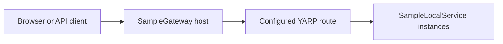

# SampleGateway

[README](README.md) · [Agent notes](AGENTS.md) · [Proposed work](PLAN.md) · [Project index](../../docs/projects.md)

## Intro

This executable combines the gateway runtime, SQLite storage, administration APIs, and the React workspace.

## Real-world example

A developer starts the Aspire topology and sends a request through this gateway to either sample backend instance.

## Real-world value

The sample demonstrates how the separate packages fit together in one working host.

## What it does

- Compose runtime, storage, administration, React UI, and sample AI services.
- Support standalone settings and Aspire-assigned HTTP and gRPC endpoints.
- Configure Serilog, telemetry defaults, and deployment options.

## What it does not do

- Provide ready-made production credentials or infrastructure.
- Enable MCP merely because the sample includes AI services.

## Start here

Source project: [SampleGateway.csproj](SampleGateway.csproj).
Direct project references: [WafIsh](../../src/WafIsh/README.md), [WafIsh.Storage.Sqlite](../../src/WafIsh.Storage.Sqlite/README.md), [SampleServiceDefaults](../SampleServiceDefaults/README.md), [WafIsh.ReactUi](../../src/WafIsh.ReactUi/README.md).

Use the [Aspire guide](../../docs/aspire.md) for the complete local topology.
Use the [security guide](../../docs/security.md) before standalone access.

Build and verification commands are in [AGENTS.md](AGENTS.md). Future work is in [PLAN.md](PLAN.md).
