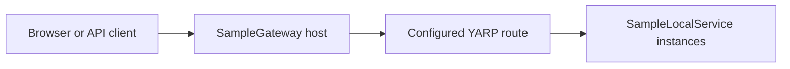

# SampleGateway

[README](README.md) · [Agent notes](AGENTS.md) · [Proposed work](../../PLAN.md) · [Project index](../../docs/projects.md)

## Intro

This executable combines the gateway runtime, SQLite storage, administration APIs, and the React workspace.

## Real-world example

A developer starts the Aspire topology and sends a request through this gateway to either sample backend instance.

## Real-world value

The sample demonstrates how the separate packages fit together in one working host.

## What it does

- Compose runtime, storage, administration, React UI, and sample AI services.
- Support standalone settings and Aspire-assigned HTTP and gRPC endpoints.
- Configure Serilog, telemetry defaults, and deployment options.

## What it does not do

- Provide ready-made production credentials or infrastructure.
- Enable MCP merely because the sample includes AI services.

## Start here

Source project: [SampleGateway.csproj](SampleGateway.csproj).
Direct project references: [Wafish](../../src/Wafish/README.md), [Wafish.Storage.Sqlite](../../src/Wafish.Storage.Sqlite/README.md), [SampleServiceDefaults](../SampleServiceDefaults/README.md), [Wafish.ReactUi](../../src/Wafish.ReactUi/README.md).

Use the [Aspire guide](../../docs/aspire.md) for the complete local topology.
Use the [security guide](../../docs/security.md) before standalone access.
The sample serves administration APIs under `/wafish` and the React workspace at `/console`.
See [naming migration](../../docs/naming-migration.md#repository-branding-and-configured-names) when upgrading existing clients or stored registrations.

Build and verification commands are in [AGENTS.md](AGENTS.md). Future work is in [PLAN.md](../../PLAN.md).

## Standalone HTTPS and container checks

See the [HTTPS recipe](../../docs/sample-https.md) for certificate, authentication, proxy, and cookie checks.
Startup prints the effective HTTPS authority and configured React UI prefix after Kestrel binds.
Wildcard listeners produce localhost links. HTTP/2-only gRPC endpoints are excluded from browser links.
Orchestrated hosts never open a browser automatically.

## Minimal composition

Use [MinimalGateway](../MinimalGateway/README.md) for runtime and SQLite without administration, AI, registration, or Aspire.
