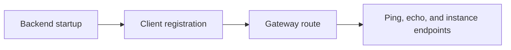

# SampleLocalService

[README](README.md) · [Agent notes](AGENTS.md) · [Proposed work](PLAN.md) · [Project index](../../docs/projects.md)

## Intro

This executable is a small backend that registers itself with a gateway.

## Real-world example

Two instances expose the same API. Their instance endpoint shows which backend handled a proxied request.

## Real-world value

The sample makes registration, load distribution, and trace propagation visible during local development.

## What it does

- Register through Wafish.Client and send lifecycle heartbeats.
- Expose ping, echo, POST echo, and instance identity endpoints.
- Apply shared telemetry and development health endpoints.

## What it does not do

- Implement a complete business service or persistent domain model.
- Act as a gateway or host administration pages.

## Start here

Source project: [SampleLocalService.csproj](SampleLocalService.csproj).
Direct project references: [Wafish.Client](../../src/Wafish.Client/README.md), [SampleServiceDefaults](../SampleServiceDefaults/README.md).

The instance endpoint is `/api/local-service/instance`. Start both instances through the [AppHost](../../Wafish.AppHost/README.md).

Build and verification commands are in [AGENTS.md](AGENTS.md). Future work is in [PLAN.md](PLAN.md).
