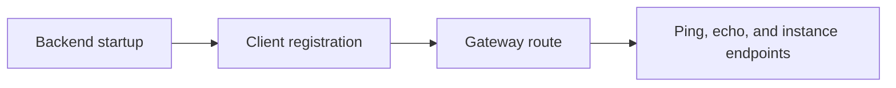

# SampleLocalService

[README](README.md) · [Agent notes](AGENTS.md) · [Proposed work](../../PLAN.md) · [Project index](../../docs/projects.md)

## Intro

This executable is a small backend that registers itself with a gateway.



## Real-world example

Two instances expose the same API. Their instance endpoint shows which backend handled a proxied request.

## Real-world value

The sample makes registration, load distribution, and trace propagation visible during local development.

## What it does

- Register through Wafish.Client and send lifecycle heartbeats.
- Expose ping, echo, POST echo, instance identity, and bounded streaming endpoints.
- Apply shared telemetry and development health endpoints.

## What it does not do

- Implement a complete business service or persistent domain model.
- Act as a gateway or host administration pages.

## Start here

Source project: [SampleLocalService.csproj](SampleLocalService.csproj).
Direct project references: [Wafish.Client](../../src/Wafish.Client/README.md), [SampleServiceDefaults](../SampleServiceDefaults/README.md).

The instance endpoint is `/api/local-service/instance`. Start both instances through the [AppHost](../../Wafish.AppHost/README.md).

Build and verification commands are in [AGENTS.md](AGENTS.md). Future work is in [PLAN.md](../../PLAN.md).

## One identity for every endpoint

`Gateway:Registration:InstanceId` supplies the registration identity, response body, `X-Backend-Instance` header, and trace tag.
Ping, query echo, POST echo, and the instance endpoint return the same identity.
Each response also returns its W3C trace ID.
If no identity is configured, startup generates a unique `standalone-...` identity for that process.
Set an explicit stable identity when restarting an instance within a shared cluster.
Instance registration requires gRPC; the sample configuration enables it by default.

## Standalone registration

Start a gateway with separate HTTP and gRPC listeners.
This recipe uses HTTP 5200 and HTTP/2 cleartext 5201 on direct loopback.
Configure its control-plane Basic authentication credentials through private host configuration.
Use the same credentials below.

```bash
read -rsp 'Gateway password: ' WAFISH_GATEWAY_PASSWORD
export Gateway__Registration__Enabled=true
export Gateway__Registration__GatewayUrl=http://127.0.0.1:5200
export Gateway__Registration__GrpcUrl=http://127.0.0.1:5201
export Gateway__Registration__UseGrpcRegistration=true
export Gateway__Registration__InstanceId=standalone-one
export Gateway__Registration__RouteName=sample-service
export Gateway__Registration__ClusterName=sample-service
export Gateway__Registration__AutoResolveIp=false
export Gateway__Registration__DestinationAddress=http://127.0.0.1:5001
export Gateway__Registration__BasicAuthUsername=admin
export Gateway__Registration__BasicAuthPassword="$WAFISH_GATEWAY_PASSWORD"
export Urls=http://127.0.0.1:5001
export ASPNETCORE_ENVIRONMENT=Development
dotnet run --project samples/SampleLocalService --no-launch-profile
```

Run these commands from the repository root.
The existing `MatchPaths` configuration publishes `/api/local-service/{**catch-all}` and the alternate sample path.
The implemented controller endpoints use `/api/local-service`.
For a second process, change InstanceId, listener port, and DestinationAddress together.
All instances in the shared cluster must use matching service names, paths, and balancing policy.
A destination address must be reachable from the gateway.
For remote registration, use trusted HTTPS endpoints. Certificate validation remains enabled.

Verify `/api/local-service/ping`, `/api/local-service/echo?message=test`, and `/api/local-service/instance` through the gateway.
POST JSON to `/api/local-service/echopost` to verify request bodies.
`python scripts/check-topology.py` verifies these contracts against both registered Aspire instances.

## Cancellable streaming

`GET /api/local-service/stream` flushes synthetic newline-delimited JSON records.
Configure `chunks` (1–100) and `intervalMilliseconds` (0–1000). Scheduled delays cannot exceed 30 seconds.
Defaults are five records with 250 milliseconds between records.
Each record carries the backend identity and trace ID. Client cancellation stops production and appears in backend logs.
Responses use `Cache-Control: no-store, no-transform` to prevent caching and compression buffering.

The [streaming walkthrough](../../docs/cancellable-streaming.md) covers cancellation, cache, compression bypass, and retry deadlines.
[HTTP examples](SampleLocalService.http) include valid and invalid requests.

## Idempotent synthetic orders

`POST /api/local-service/orders` creates a bounded synthetic order using one `Idempotency-Key`.
Repeated keys replay the original result. Conflicting product or quantity returns 409.
Each process retains up to 1,024 orders for five minutes, with atomic concurrent handling.
Use one backend or a dedicated single-destination route. Default load-balanced backends do not share state.
See [scope, expiry, retry behavior, and verification](../../docs/idempotent-sample-orders.md).
The API document is available at `/openapi/v1.json` in Development and the orchestrated sample profile.
