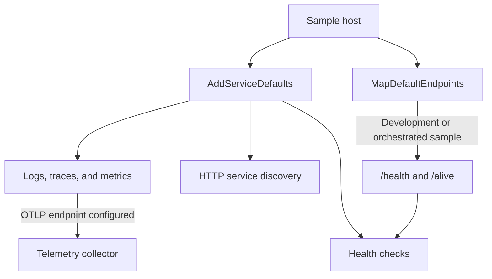

# SampleServiceDefaults

[README](README.md) · [Agent notes](AGENTS.md) · [Proposed work](PLAN.md) · [Project index](../../docs/projects.md)

## Intro

This library adds shared telemetry, service discovery, and health defaults to the sample hosts.

## Real-world example

A request crosses the sample gateway and backend. Both hosts export related telemetry to the Aspire dashboard.

## Real-world value

Sample services use consistent diagnostics without repeating their instrumentation setup.

## What it does

- Register ASP.NET Core, HTTP client, runtime, and YARP telemetry sources.
- Enable OTLP export when an endpoint is configured.
- Add service discovery and development or orchestrated health endpoints.

## What it does not do

- Create an OTLP collector or run the Aspire dashboard.
- Add an HTTP resilience handler that duplicates gateway retry policy.

## Start here

Source project: [SampleServiceDefaults.csproj](SampleServiceDefaults.csproj).
This project has no direct solution project references. Package and framework references remain in its project file.

Build and verification commands are in [AGENTS.md](AGENTS.md). Future work is in [PLAN.md](PLAN.md).
