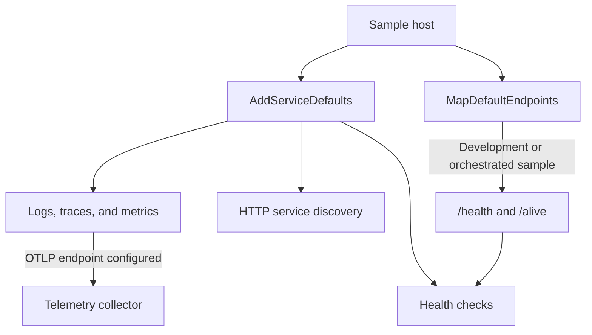

# SampleServiceDefaults

[README](README.md) · [Agent notes](AGENTS.md) · [Proposed work](PLAN.md) · [Project index](../../docs/projects.md)

## Intro

This library adds shared telemetry, service discovery, and health defaults to the sample hosts.

## Real-world example

A request crosses the sample gateway and backend. Both hosts export related telemetry to the Aspire dashboard.

## Real-world value

Sample services use consistent diagnostics without repeating their instrumentation setup.

## What it does

- Register ASP.NET Core, HTTP client, runtime, and YARP telemetry sources.
- Enable OTLP export when an endpoint is configured.
- Add service discovery and development or orchestrated health endpoints.

## What it does not do

- Create an OTLP collector or run the Aspire dashboard.
- Add an HTTP resilience handler that duplicates gateway retry policy.

## Start here

Source project: [SampleServiceDefaults.csproj](SampleServiceDefaults.csproj).
This project has no direct solution project references. Package and framework references remain in its project file.

Build and verification commands are in [AGENTS.md](AGENTS.md). Future work is in [PLAN.md](PLAN.md).

## Telemetry without a collector

An absent or empty `OTEL_EXPORTER_OTLP_ENDPOINT` disables OTLP exporter registration.
The sample still starts, serves requests, and produces normal application logs.
Tracing and metric instrumentation remain available to local listeners.
No OTLP exporter runs or retries when no endpoint is configured.
Set the endpoint through host configuration when a collector is available.
The Aspire AppHost supplies its dashboard endpoint automatically.

The registered activity sources include the host application name and `Yarp.ReverseProxy`.
Metrics include ASP.NET Core, HTTP client, runtime, and YARP instruments.
HTTP client instrumentation preserves correlation across gateway and backend requests.
Sample backends add `gateway.destination.instance` to their request activity.

## Health-request filtering

Tracing excludes exact `/health` and `/alive` paths.
It also excludes configured `Gateway:Deployment:HealthCheck:Path`, `ReadyPath`, and `LivePath` values.
Their defaults are `/health`, `/ready`, and `/live`.
Path comparisons ignore case. Normal paths such as `/health/reports` remain traceable.
Probe filtering applies to server spans; an independently instrumented health-check client can still emit client spans.
Metrics remain enabled for health requests.
The regression `--sample-contracts` group verifies custom probe paths and exporter-free telemetry behavior.

The metrics pipeline includes `Wafish.Plugin.Metrics` route and cluster instruments when their bindings are enabled.
