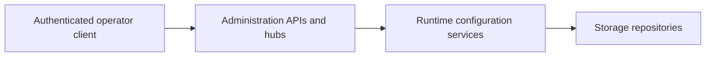

# WafIsh.Administration

[README](README.md) · [Agent notes](AGENTS.md) · [Proposed work](PLAN.md) · [Project index](../../docs/projects.md)

## Intro

This project provides administration APIs, authentication, realtime updates, and optional AI and MCP services.

## Real-world example

An operator changes a route, checks the resulting revision, and inspects its request logs through an authenticated client.

## Real-world value

Operators get one management boundary that can support different user interfaces.

## What it does

- Manage routes, clusters, bindings, presets, logs, history, and settings.
- Protect administration endpoints and realtime hubs.
- Register AI and MCP only through their explicit feature methods.

## What it does not do

- Embed React pages or depend on the removed Razor dashboard.
- Provide independent remote control of another gateway process.

## Start here

Source project: [WafIsh.Administration.csproj](WafIsh.Administration.csproj).
Direct project references: [WafIsh.Runtime](../WafIsh.Runtime/README.md).

Build and verification commands are in [AGENTS.md](AGENTS.md). Future work is in [PLAN.md](PLAN.md).
