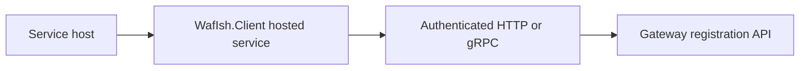

# WafIsh.Client

[README](README.md) · [Agent notes](AGENTS.md) · [Proposed work](PLAN.md) · [Project index](../../docs/projects.md)

## Intro

This client registers an ASP.NET Core service with a gateway through HTTP or gRPC.

## Real-world example

Two inventory instances register under one service name. Each instance sends heartbeats and removes its own registration during shutdown.

## Real-world value

Service instances can join a gateway without manually editing every destination address.

## What it does

- Resolve registration options and destination addresses.
- Register, send heartbeats, retry startup registration, and unregister.
- Configure local Kestrel endpoints when hosts use the provided extension.

## What it does not do

- Proxy incoming traffic or provide a management interface.
- Bypass platform TLS certificate validation.

## Start here

Source project: [WafIsh.Client.csproj](WafIsh.Client.csproj).
Direct project references: [WafIsh.Grpc](../WafIsh.Grpc/README.md).

Build and verification commands are in [AGENTS.md](AGENTS.md). Future work is in [PLAN.md](PLAN.md).

## Review fixes 4–7

One awaited heartbeat loop runs at a time. Shutdown cancels and joins that loop before unregistering.
gRPC destination updates send the instance identity and last successful configuration revision.
A revision conflict requires registration refresh before another update.

## Review items 14–16

Register a custom `TimeProvider` before `AddWafIshClient` to control registration backoff and heartbeat timers.
Shutdown cancels and joins heartbeat work before unregistering.

Verification: [review evidence](../../tests/WafIsh.Regression/evidence/review141516/README.md).
