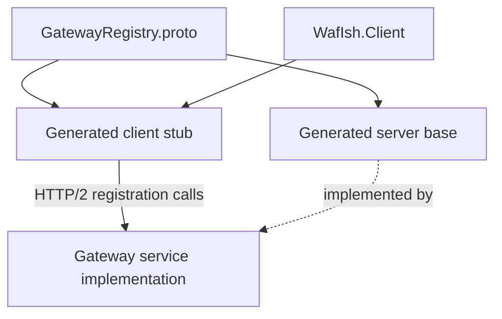

# WafIsh.Grpc

[README](README.md) · [Agent notes](AGENTS.md) · [Proposed work](PLAN.md) · [Project index](../../docs/projects.md)

## Intro

This project defines the protobuf registration protocol and generates its .NET client and server types.

## Real-world example

A worker reports its service identity, paths, and destinations to a gateway over HTTP/2.

## Real-world value

Clients and gateways share a typed registration contract instead of duplicating request formats.

## What it does

- Define registration, unregistration, heartbeat, service-list, and destination-update messages.
- Generate protobuf message types and gRPC stubs during the build.
- Carry instance identity and configuration result information.

## What it does not do

- Start a server or implement gateway business rules.
- Authorize calls without the consuming host and its interceptors.

## Start here

Source project: [WafIsh.Grpc.csproj](WafIsh.Grpc.csproj).
This project has no direct solution project references. Package and framework references remain in its project file.

Build and verification commands are in [AGENTS.md](AGENTS.md). Future work is in [PLAN.md](PLAN.md).
