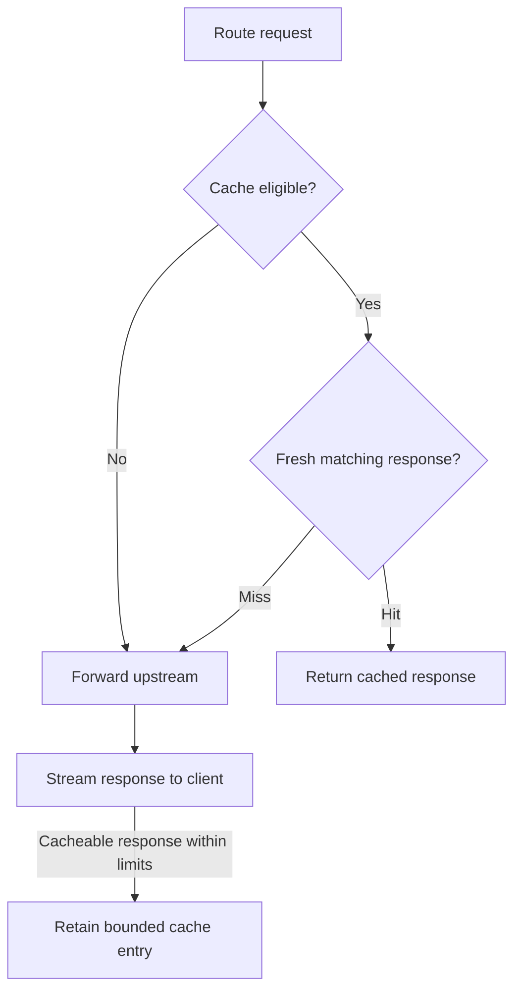

# WafIsh.Plugin.Cache

[README](README.md) · [Agent notes](AGENTS.md) · [Proposed work](PLAN.md) · [Project index](../../docs/projects.md)

## Intro

This plugin adds a bounded, in-memory HTTP response cache to selected routes. Its binding ID is `response-cache`.

## Real-world example

A public product catalog returns cacheable GET responses. Repeated requests can reuse those responses until freshness expires.

## Real-world value

Public read traffic can use fewer upstream requests while preserving HTTP cache rules.

## What it does

- Apply route-scoped cache policy and HTTP freshness rules.
- Separate request variants and bypass private or authenticated responses.
- Stream responses while bounding captured and retained memory.

## What it does not do

- Provide a distributed cache shared by gateway replicas.
- Cache arbitrary personalized responses or unlimited response bodies.

## Start here

Source project: [WafIsh.Plugin.Cache.csproj](WafIsh.Plugin.Cache.csproj).
Direct project references: [WafIsh.Plugin.Abstractions](../WafIsh.Plugin.Abstractions/README.md), [WafIsh](../WafIsh/README.md).

Build and verification commands are in [AGENTS.md](AGENTS.md). Future work is in [PLAN.md](PLAN.md).
