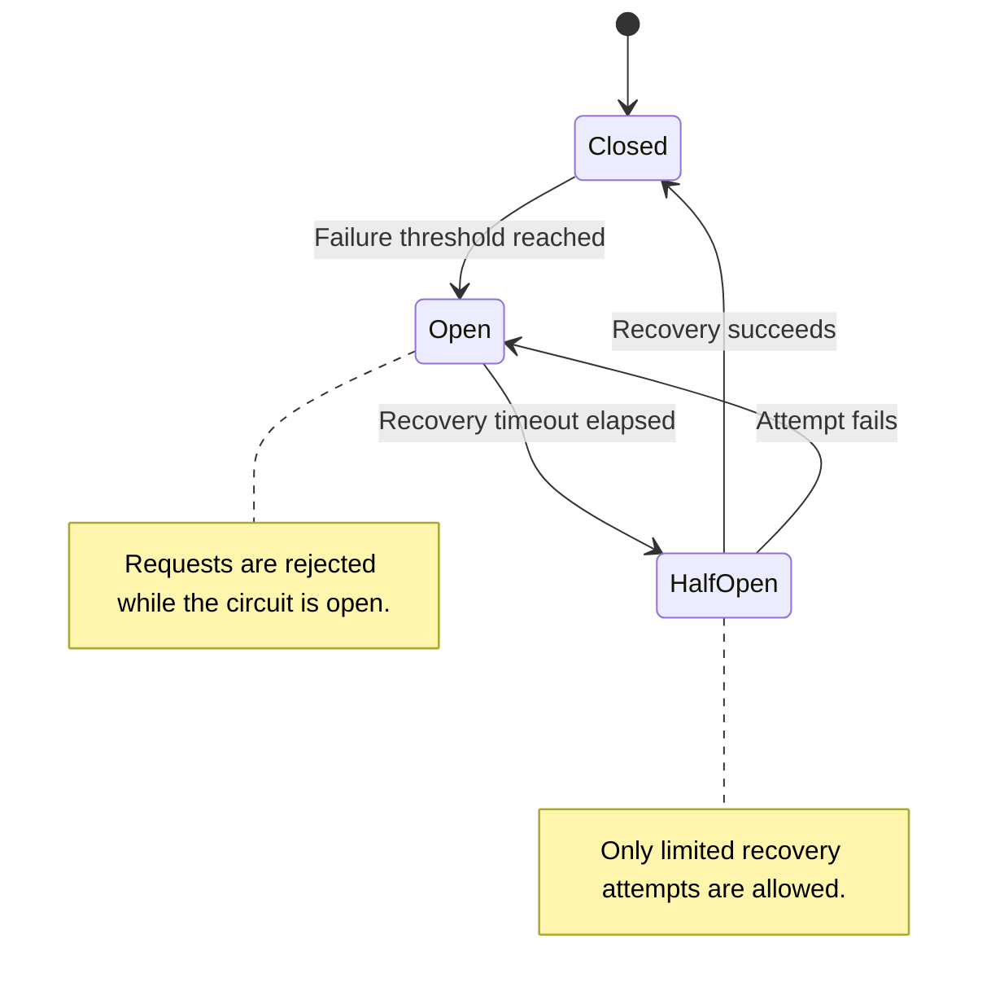

# WafIsh.Plugin.CircuitBreaker

[README](README.md) · [Agent notes](AGENTS.md) · [Proposed work](PLAN.md) · [Project index](../../docs/projects.md)

## Intro

This plugin tracks destination failures and opens circuits for selected clusters. Its binding ID is `circuit-breaker`.

## Real-world example

A payment backend starts returning failures. The gateway rejects or avoids unhealthy destinations while allowing recovery probes.

## Real-world value

Failing destinations receive less repeated traffic, which gives them time to recover.

## What it does

- Track closed, open, and half-open circuit states.
- Apply failure thresholds, sampling rules, and recovery limits.
- Expose circuit operations and restore supported runtime state.

## What it does not do

- Repair an upstream service or guarantee successful payments.
- Replace active health checks or retry policy.

## Start here

Source project: [WafIsh.Plugin.CircuitBreaker.csproj](WafIsh.Plugin.CircuitBreaker.csproj).
Direct project references: [WafIsh.Plugin.Abstractions](../WafIsh.Plugin.Abstractions/README.md), [WafIsh](../WafIsh/README.md).

Build and verification commands are in [AGENTS.md](AGENTS.md). Future work is in [PLAN.md](PLAN.md).

## Review fixes 4–7

Candidate filtering does not reserve probes. Load balancing selects a destination before probe acquisition.
An attempt lease releases canceled probes and records each forwarding outcome once.
Generation checks prevent late outcomes from changing a newer circuit state. Retry surrounds this attempt boundary.

## Review items 14–16

Runtime circuit state accepts an injected `TimeProvider`.
Recovery, sampling, and idle retention use monotonic elapsed time. External legacy state timestamps retain UTC comparison fallback.

Verification: [review evidence](../../tests/WafIsh.Regression/evidence/review141516/README.md).
