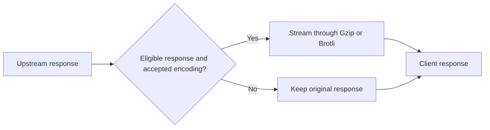

# WafIsh.Plugin.Compression

[README](README.md) · [Agent notes](AGENTS.md) · [Proposed work](PLAN.md) · [Project index](../../docs/projects.md)

## Intro

This plugin compresses eligible route responses with Gzip or Brotli. Its binding ID is `compression`.

## Real-world example

A reporting API returns large JSON documents. Clients that accept compression receive fewer response bytes.

## Real-world value

Large text responses can use less bandwidth while retaining streamed delivery.

## What it does

- Negotiate supported encodings from Accept-Encoding.
- Apply media type, size, and compression-level rules.
- Handle exclusions and response headers inside the proxy pipeline.

## What it does not do

- Compress every response regardless of status, range, or media type.
- Add new compression formats beyond the implemented encodings.

## Start here

Source project: [WafIsh.Plugin.Compression.csproj](WafIsh.Plugin.Compression.csproj).
Direct project references: [WafIsh.Plugin.Abstractions](../WafIsh.Plugin.Abstractions/README.md), [WafIsh](../WafIsh/README.md).

Build and verification commands are in [AGENTS.md](AGENTS.md). Future work is in [PLAN.md](PLAN.md).
