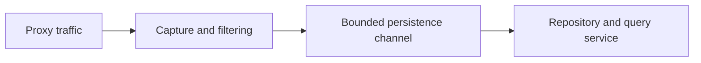

# WafIsh.Plugin.ProxyLog

[README](README.md) · [Agent notes](AGENTS.md) · [Proposed work](PLAN.md) · [Project index](../../docs/projects.md)

## Intro

This plugin captures proxy metadata and optional payloads. Its binding ID is `proxy-log`.

## Real-world example

An operator investigates failed order requests using trace IDs, response status, and selected body fields.

## Real-world value

Proxy-specific records make request failures easier to diagnose without changing every backend.

## What it does

- Capture request and response metadata with optional bounded body capture.
- Apply filters, sampling, and runtime capture settings.
- Queue records for background persistence and support log queries.

## What it does not do

- Guarantee lossless audit delivery from its bounded diagnostic queue.
- Make sensitive payload collection safe without a suitable redaction policy.

## Start here

Source project: [WafIsh.Plugin.ProxyLog.csproj](WafIsh.Plugin.ProxyLog.csproj).
Direct project references: [WafIsh.Plugin.Abstractions](../WafIsh.Plugin.Abstractions/README.md), [WafIsh](../WafIsh/README.md).

Build and verification commands are in [AGENTS.md](AGENTS.md). Future work is in [PLAN.md](PLAN.md).
