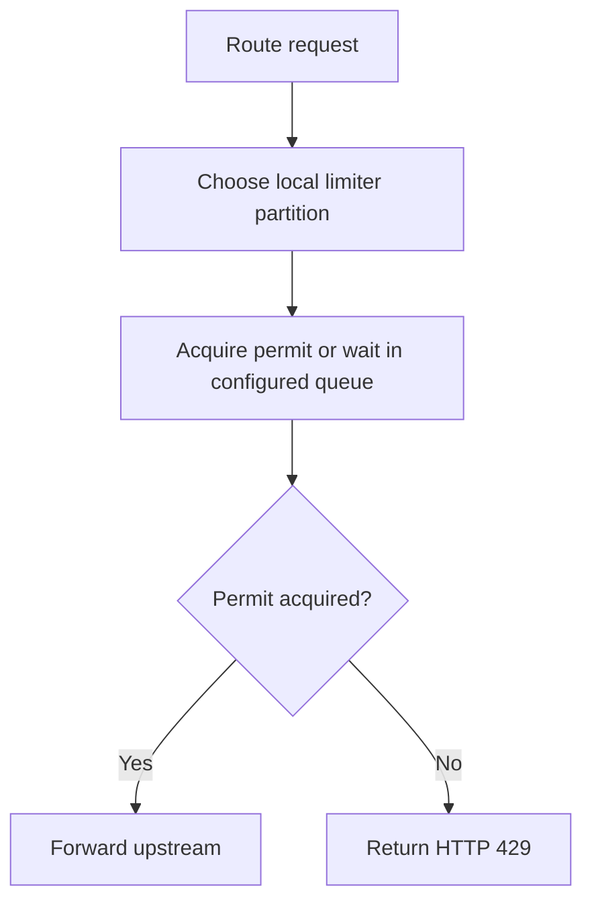

# WafIsh.Plugin.RateLimit

[README](README.md) · [Agent notes](AGENTS.md) · [Proposed work](PLAN.md) · [Project index](../../docs/projects.md)

## Intro

This plugin limits route traffic inside one gateway process. Its binding ID is `rate-limit`.

## Real-world example

A login route allows a limited request rate per client address. Excess requests receive HTTP 429 with retry guidance.

## Real-world value

A single gateway can protect upstream capacity and reduce abusive request bursts.

## What it does

- Support fixed-window, sliding-window, token-bucket, and concurrency algorithms.
- Partition limits using supported route policy keys.
- Reject exhausted limits with JSON and Retry-After guidance.

## What it does not do

- Share counters between gateway replicas.
- Authenticate users or replace authorization checks.

## Start here

Source project: [WafIsh.Plugin.RateLimit.csproj](WafIsh.Plugin.RateLimit.csproj).
Direct project references: [WafIsh.Plugin.Abstractions](../WafIsh.Plugin.Abstractions/README.md), [WafIsh](../WafIsh/README.md).

Build and verification commands are in [AGENTS.md](AGENTS.md). Future work is in [PLAN.md](PLAN.md).

## Review safety limits

The built-in store admits at most 2,000 partitions. New partitions receive HTTP 429 at capacity.
Route partitions use route identity. Variable paths share the route quota.
See [resource limits and consumer changes](../../docs/security.md#request-resource-limits-and-retry-behavior).

## Review items 14–16

The injected `TimeProvider` controls middleware cleanup scheduling and store idle retention.
Built-in .NET limiter replenishment retains its own system timers. Redis quota timing remains server-owned.

Verification: [review evidence](../../tests/WafIsh.Regression/evidence/review141516/README.md).
