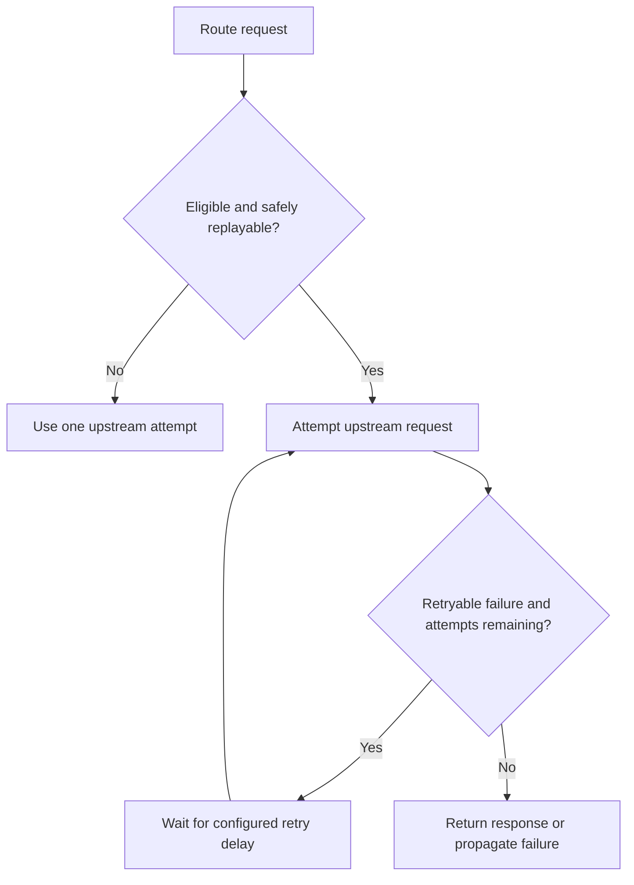

# WafIsh.Plugin.Retry

[README](README.md) · [Agent notes](AGENTS.md) · [Proposed work](PLAN.md) · [Project index](../../docs/projects.md)

## Intro

This plugin retries eligible upstream failures according to route policy. Its binding ID is `request-retry`.

## Real-world example

A read-only inventory request receives a transient 503. A bounded retry can reach a healthy destination.

## Real-world value

Short upstream failures can be recovered without requiring each client to implement the same retry behavior.

## What it does

- Apply retry counts, backoff, jitter, timeout, and failure-status settings.
- Optionally select a different eligible destination.
- Check replay eligibility and preserve response handling across attempts.

## What it does not do

- Guarantee exactly-once execution of upstream operations.
- Make retries of non-idempotent requests safe by themselves.

## Start here

Source project: [WafIsh.Plugin.Retry.csproj](WafIsh.Plugin.Retry.csproj).
Direct project references: [WafIsh.Plugin.Abstractions](../WafIsh.Plugin.Abstractions/README.md), [WafIsh](../WafIsh/README.md).

Build and verification commands are in [AGENTS.md](AGENTS.md). Future work is in [PLAN.md](PLAN.md).
