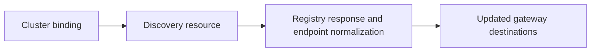

# WafIsh.Plugin.ServiceDiscovery

[README](README.md) · [Agent notes](AGENTS.md) · [Proposed work](PLAN.md) · [Project index](../../docs/projects.md)

## Intro

This plugin refreshes cluster destinations from supported discovery sources. Its binding ID is `service-discovery`.

## Real-world example

A gateway resolves available inventory instances from Consul and publishes updated destinations when instances change.

## Real-world value

Operators can use an existing service registry instead of maintaining every destination manually.

## What it does

- Resolve Static, HttpJson, Consul, Nacos, Eureka, and Kubernetes sources.
- Refresh enabled cluster bindings through a managed background resource.
- Normalize endpoints and publish changed destination sets.

## What it does not do

- Operate a registry server or deploy discovered services.
- Implement Kubernetes EndpointSlice watches in the current provider.

## Start here

Source project: [WafIsh.Plugin.ServiceDiscovery.csproj](WafIsh.Plugin.ServiceDiscovery.csproj).
Direct project references: [WafIsh.Plugin.Abstractions](../WafIsh.Plugin.Abstractions/README.md), [WafIsh](../WafIsh/README.md).

Build and verification commands are in [AGENTS.md](AGENTS.md). Future work is in [PLAN.md](PLAN.md).
