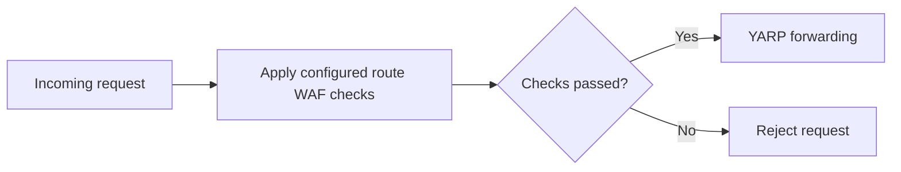

# WafIsh.Plugin.Waf

[README](README.md) · [Agent notes](AGENTS.md) · [Proposed work](PLAN.md) · [Project index](../../docs/projects.md)

## Intro

This plugin inspects route requests before forwarding. Its binding ID is `waf`.

## Real-world example

A public search API blocks configured address ranges and rejects requests that match enabled attack checks.

## Real-world value

Common request checks can be applied consistently at the gateway boundary.

## What it does

- Check address rules, request size, SQL injection patterns, XSS patterns, and path traversal.
- Inspect supported bodies while preserving downstream readability.
- Reject requests that violate the configured route policy.

## What it does not do

- Prove that a backend application is free from security defects.
- Replace authentication, authorization, parameterized SQL, or output encoding.

## Start here

Source project: [WafIsh.Plugin.Waf.csproj](WafIsh.Plugin.Waf.csproj).
Direct project references: [WafIsh.Plugin.Abstractions](../WafIsh.Plugin.Abstractions/README.md), [WafIsh](../WafIsh/README.md).

Build and verification commands are in [AGENTS.md](AGENTS.md). Future work is in [PLAN.md](PLAN.md).

## Review safety limits

CIDR rules are validated before activation. Rejection logs omit paths, queries, and matched request content.
See [resource limits and consumer changes](../../docs/security.md#request-resource-limits-and-retry-behavior).
