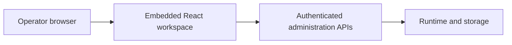

# WafIsh.ReactUi

[README](README.md) · [Agent notes](AGENTS.md) · [Proposed work](PLAN.md) · [Project index](../../docs/projects.md)

## Intro

This project embeds the React administration workspace in an ASP.NET Core package.

## Real-world example

An operator opens `/console`, signs in, edits a route, and sees whether the saved configuration became active.

## Real-world value

A host can ship a browser interface without deploying a separate frontend server.

## What it does

- Build React assets and embed them in the .NET assembly.
- Serve the workspace and provide host-specific API configuration.
- Support administration forms, logs, history, plugins, settings, and AI workflows.

## What it does not do

- Provide the administration API implementation itself.
- Require the removed Razor dashboard or store credentials in browser local storage.

## Start here

Source project: [WafIsh.ReactUi.csproj](WafIsh.ReactUi.csproj).
Direct project references: [WafIsh.Administration](../WafIsh.Administration/README.md).

Node.js is required for frontend builds. See [frontend instructions](ClientApp/README.md).
Browser tests start isolated hosts on ports 5219–5221.

Build and verification commands are in [AGENTS.md](AGENTS.md). Future work is in [PLAN.md](PLAN.md).
