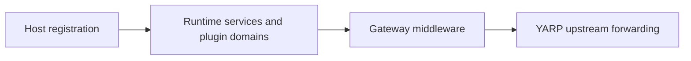

# WafIsh.Runtime

[README](README.md) · [Agent notes](AGENTS.md) · [Proposed work](PLAN.md) · [Project index](../../docs/projects.md)

## Intro

This project assembles gateway services, plugin lifecycles, and the request pipeline without a browser interface.

## Real-world example

A company runs a gateway beside its APIs. It enables proxy traffic and plugins without loading administration pages.

## Real-world value

Gateway traffic processing can remain independent of presentation choices.

## What it does

- Register shared state, plugin services, and background resources.
- Prepare plugin runtime domains and switch active pipelines.
- Compose deployment middleware and YARP proxy endpoints.

## What it does not do

- Serve React assets or own administration controllers.
- Implement a remote management protocol between separate gateway processes.

## Start here

Source project: [WafIsh.Runtime.csproj](WafIsh.Runtime.csproj).
Direct project references: [WafIsh](../WafIsh/README.md), [WafIsh.Plugin.Abstractions](../WafIsh.Plugin.Abstractions/README.md), [WafIsh.Storage.Abstractions](../WafIsh.Storage.Abstractions/README.md), [WafIsh.Plugin.Waf](../WafIsh.Plugin.Waf/README.md), [WafIsh.Plugin.Retry](../WafIsh.Plugin.Retry/README.md), [WafIsh.Plugin.CircuitBreaker](../WafIsh.Plugin.CircuitBreaker/README.md), [WafIsh.Plugin.RateLimit](../WafIsh.Plugin.RateLimit/README.md), [WafIsh.Plugin.RateLimit.Redis](../WafIsh.Plugin.RateLimit.Redis/README.md), [WafIsh.Plugin.ProxyLog](../WafIsh.Plugin.ProxyLog/README.md), [WafIsh.Plugin.Cache](../WafIsh.Plugin.Cache/README.md), [WafIsh.Plugin.Compression](../WafIsh.Plugin.Compression/README.md), [WafIsh.Plugin.ServiceDiscovery](../WafIsh.Plugin.ServiceDiscovery/README.md), [WafIsh.Plugin.Metrics](../WafIsh.Plugin.Metrics/README.md).

Build and verification commands are in [AGENTS.md](AGENTS.md). Future work is in [PLAN.md](PLAN.md).
