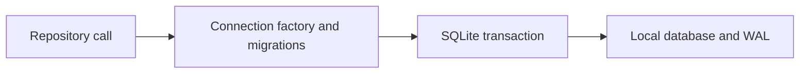

# WafIsh.Storage.Sqlite

[README](README.md) · [Agent notes](AGENTS.md) · [Proposed work](PLAN.md) · [Project index](../../docs/projects.md)

## Intro

This project implements the storage contracts with SQLite and optional SQLCipher-compatible encryption through SQLite3MC.

## Real-world example

A branch-office gateway stores routes and audit records locally. It restores the saved configuration after a restart.

## Real-world value

A gateway can retain its state without operating a separate database server.

## What it does

- Initialize connections and apply ordered schema migrations.
- Persist configuration snapshots with version checks and transactions.
- Store plugin state, logs, audit history, notifications, and AI records.

## What it does not do

- Provide a shared multi-node configuration consensus system.
- Replace the host responsibility for protecting encryption keys and backup files.

## Start here

Source project: [WafIsh.Storage.Sqlite.csproj](WafIsh.Storage.Sqlite.csproj).
Direct project references: [WafIsh.Storage.Abstractions](../WafIsh.Storage.Abstractions/README.md).

Build and verification commands are in [AGENTS.md](AGENTS.md). Future work is in [PLAN.md](PLAN.md).
