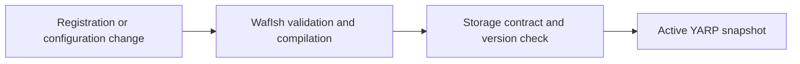

# WafIsh

[README](README.md) · [Agent notes](AGENTS.md) · [Proposed work](PLAN.md) · [Project index](../../docs/projects.md)

## Intro

The gateway core connects YARP routing, configuration changes, registration, and control-plane access rules.

## Real-world example

An orders service gains a second instance. The gateway updates destinations while existing requests continue using their active configuration.

## Real-world value

Applications can change routing without replacing their gateway host or restarting every backend.

## What it does

- Compile route, cluster, and plugin configuration into versioned snapshots.
- Validate and persist configuration changes before activation.
- Expose REST and gRPC registration support with shared access rules.

## What it does not do

- Provide the React interface or concrete SQLite repositories.
- Replace runtime service registration from WafIsh.Runtime.

## Start here

Source project: [WafIsh.csproj](WafIsh.csproj).
Direct project references: [WafIsh.Client](../WafIsh.Client/README.md), [WafIsh.Grpc](../WafIsh.Grpc/README.md), [WafIsh.Plugin.Abstractions](../WafIsh.Plugin.Abstractions/README.md), [WafIsh.Storage.Abstractions](../WafIsh.Storage.Abstractions/README.md).

Build and verification commands are in [AGENTS.md](AGENTS.md). Future work is in [PLAN.md](PLAN.md).

## Review safety limits

Custom limiter stores implement AcquireAsync and retain ownership until lease disposal. Null indicates partition capacity exhaustion.
See [resource limits and consumer changes](../../docs/security.md#request-resource-limits-and-retry-behavior).

## Review fixes 4–7

Configuration, binding, and discovery writers share one publication gate. Stored revisions remain separate from runtime generations.
`DynamicYarpConfigService.ReconcileAsync` reloads committed storage after an activation failure.
Instance destination updates require `InstanceId` and the expected configuration revision. Peer destinations remain unchanged.

## Batch route deletion

Optional orphan cleanup examines surviving cluster references after all requested route deletions.
Shared clusters remain while any surviving route references them.
Deletion and orphan cleanup retain the existing atomic persistence and publication behavior.

[Verification for review items 8–10](../../tests/WafIsh.Regression/evidence/review8910/README.md).
