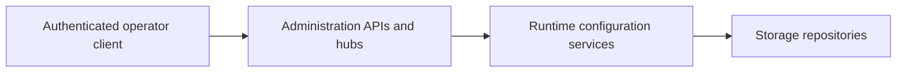

# Wafish.Administration

[README](README.md) · [Agent notes](AGENTS.md) · [Proposed work](PLAN.md) · [Project index](../../docs/projects.md)

## Intro

This project provides administration APIs, authentication, realtime updates, and optional AI and MCP services.

## Real-world example

An operator changes a route, checks the resulting revision, and inspects its request logs through an authenticated client.

## Real-world value

Operators get one management boundary that can support different user interfaces.

## What it does

- Manage routes, clusters, bindings, presets, logs, history, and settings.
- Protect administration endpoints and realtime hubs.
- Register AI and MCP only through their explicit feature methods.

## What it does not do

- Embed React pages or depend on the removed Razor dashboard.
- Provide independent remote control of another gateway process.

## Start here

Source project: [Wafish.Administration.csproj](Wafish.Administration.csproj).
Direct project references: [Wafish.Runtime](../Wafish.Runtime/README.md).

Build and verification commands are in [AGENTS.md](AGENTS.md). Future work is in [PLAN.md](PLAN.md).

## Review safety limits

Authentication attempts use bounded source and account windows. Exhaustion returns HTTP 429 with Retry-After.
See [resource limits and consumer changes](../../docs/security.md#request-resource-limits-and-retry-behavior).

## Atomic binding publication

Single and batch binding writes share the runtime publication gate.
Batches commit through revision-checked SQLite transactions. Partial failures leave active state unchanged.
Activation compensation cannot overwrite a newer successful storage revision.

## Notification accounting

`NotificationDispatcher.GetSnapshot()` reports submitted, queued, active, delivered, failed, discarded, and suppressed events.
The webhook settings GET response adds a top-level `dispatch` snapshot beside the existing `data` field.
Queue overflow counts the discarded oldest event. Shutdown counts abandoned queued and active events.
Rejected submissions after shutdown also count as discarded.
Missing subscriptions and cooldown filtering count as suppressed.
Partial endpoint delivery counts as one failed event. Counters measure events, not endpoint attempts.
Snapshots can change during active dispatch. At rest, every submitted event has one accounting category.

[Verification for review items 8–10](../../tests/Wafish.Regression/evidence/review8910/README.md).

Plugin mutations await asynchronous snapshot refresh after commit.
Install, uninstall, and upgrade controller methods now return `Task<IActionResult>`. Their HTTP contracts remain unchanged.
The authorization filter uses the corrected `Wafish.Dashboard` namespace.
See [verification](../../tests/Wafish.Regression/evidence/async-retry/README.md).

## Session lifecycle

Dashboard JWT sessions belong to the current host. Sign in through the login endpoint to obtain a usable token.
A signed token alone no longer authorizes administration access. Custom authorization delegates retain their own policy.
Sessions expire after eight hours. The registry permits at most 10,000 active sessions.
A full registry returns 503 for new logins without evicting active sessions.
Sign-out revokes presented bearer and cookie sessions. It closes their existing realtime connections.
Successful two-factor changes revoke every JWT session. Sign in again after changing two-factor settings.
Restarting the host invalidates its sessions, including deployments with a configured signing secret.
JWT sessions remain local to one host. Deployments with multiple hosts require session affinity.
Basic authentication and API keys remain request credentials. Their existing hub connections are rechecked each second.
Credential changes take effect during the next check; in-progress requests can finish.

Authorization covers built-in plugin controllers, including circuit-breaker actions.
Only the authentication controller's login and logout actions bypass credential checks.
See [verification](../../tests/Wafish.Regression/evidence/administration-lifecycle/README.md).

## Shutdown verification

Real overview and traffic connections close during host shutdown.
Queued and in-flight notification counts remain balanced, including cancelled deliveries.
Tests verify credential exclusion and reject success audit records before persistence commits.
See [shutdown evidence](../../tests/Wafish.Regression/evidence/lifetime-stress/README.md).

## Shared mutation responses

Configuration and plugin writes return shared status, outcome, and nullable revision fields.
Failures use Problem Details. Endpoint-specific fields retain their locations.
HTTP `status` is now numeric; read `outcome` for the application result.
See [consumer migration and error mappings](../../docs/mutation-contracts.md).

## Operation permissions

Authentication runs before operation permissions. Existing hosts retain all four permissions by default.
Set `DashboardOptions.Auth.Permissions` to restrict shared credentials.
An omitted or null setting preserves administrator access. An empty array grants no permissions.
For configuration files, use `Gateway:Dashboard:Auth:Permissions`, for example `["Read"]`.
Supported values are `Read`, `ConfigurationWrite`, `PluginManagement`, and `CredentialManagement`.
Authenticated principals can supply `wafish.permission` claims with these exact names.
When present, these claims replace the shared permissions.
`Auth.AuthorizeOperation` overrides both policies and receives the request cancellation token.
Custom authentication must set an authenticated principal with a stable name for per-user rules.

Read permits inspection, configuration previews, and realtime subscriptions.
Configuration writes require `ConfigurationWrite`; plugin changes and activation previews require `PluginManagement`.
Credential management includes two-factor setup, AI connection settings, webhook secrets, and database downloads.
Denied operations record their actor, target operation, and required permission in the audit log.
Realtime permissions are rechecked each second and at subscription changes.
AI tools and MCP requests use the same policy. Direct in-process tool calls remain trusted.
Login and logout retain their public authentication behavior.

The new endpoints are `POST api/config/changes/preview`, `POST api/config/changes`, and `POST api/plugins/preview`.
The configured administration prefix applies. See [request examples](../../docs/configuration-changes.http) and [workflow](../../docs/configuration-changes.md).
