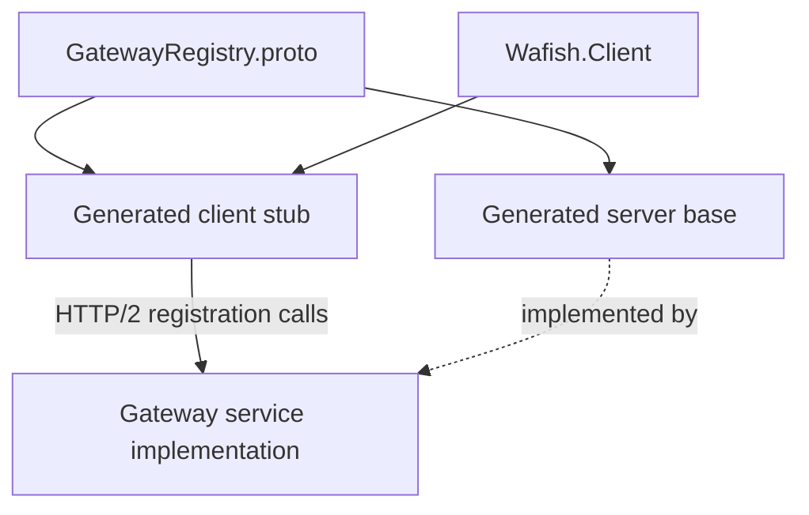

# Wafish.Grpc

[README](README.md) · [Agent notes](AGENTS.md) · [Proposed work](../../PLAN.md) · [Project index](../../docs/projects.md)

## Intro

This project defines the protobuf registration protocol and generates its .NET client and server types.

## Real-world example

A worker reports its service identity, paths, and destinations to a gateway over HTTP/2.

## Real-world value

Clients and gateways share a typed registration contract instead of duplicating request formats.

## What it does

- Define registration, unregistration, heartbeat, service-list, and destination-update messages.
- Generate protobuf message types and gRPC stubs during the build.
- Carry instance identity and configuration result information.

## What it does not do

- Start a server or implement gateway business rules.
- Authorize calls without the consuming host and its interceptors.

## Start here

Source project: [Wafish.Grpc.csproj](Wafish.Grpc.csproj).
This project has no direct solution project references. Package and framework references remain in its project file.

Build and verification commands are in [AGENTS.md](AGENTS.md). Future work is in [PLAN.md](../../PLAN.md).

## Review fixes 4–7

`UpdateDestinationsRequest` adds `instance_id` at field 3 and optional `expected_version` at field 4.
Existing field numbers remain unchanged. Requests without these fields fail explicitly.
Updates replace only the registered instance destinations. Use authenticated administration APIs for full-cluster replacement.
Instance IDs identify ownership within the trusted registration boundary; they are not independent authentication credentials.

The generated C# namespace is `Wafish.GatewayRegistry`, matching the renamed client and server consumers.
The protobuf package remains `wafish.v1`.

Registration RPCs pass caller cancellation into configuration preparation.
Cancellation after persistence starts does not abandon activation.

## Outcome and wire compatibility

Mutation outcomes use response `status` fields with optional stored and active revisions.
Application failures preserve gRPC `OK`; unexpected service failures return sanitized `Internal` errors.
Old responses without revisions remain valid. Fixed fixtures verify unknown fields and optional zero or empty values.
See [protocol mappings](../../docs/mutation-contracts.md#grpc-mapping) and [wire fixtures](../../tests/contracts/grpc/README.md).

## Capability discovery

`GetCapabilities` returns protocol version 1 and supported registration capability names.
Clients can query `GatewayAutoRegistrationClient.GetCapabilitiesAsync` before selecting optional operations.
An older server returning `UNIMPLEMENTED` produces an empty, version-zero result.
Authentication, transport failures, and cancellation remain errors. Discovery uses the existing credentials and deadline.
Registration does not require discovery. Existing clients and fixed wire field numbers remain compatible.
Capability names are additive. Ignore unknown names. Opt-in leases require capability discovery.

## Lease negotiation

Optional fields carry lease credentials, expiry, renewal timing, grace, and drain status.
New capability names are `instance-leases` and `instance-draining`. Existing wire numbers remain unchanged.

See [registration and operations](../../docs/registration-operations-contracts.md) for limits, configuration, and compatibility.
