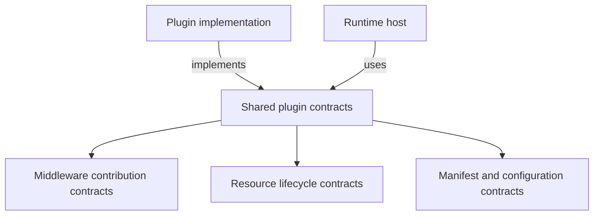

# Wafish.Plugin.Abstractions

[README](README.md) · [Agent notes](AGENTS.md) · [Proposed work](PLAN.md) · [Project index](../../docs/projects.md)

## Intro

This project defines the contracts shared by plugin implementations and the runtime host.

## Real-world example

A team adds a custom request filter. Its manifest declares supported scopes, configuration schemas, and required resources.

## Real-world value

Plugins can describe their behavior through shared interfaces instead of coupling directly to administration code.

## What it does

- Define plugin manifests, dependencies, capabilities, and scopes.
- Define service and middleware registration contracts.
- Define health probes and runtime resource lifecycle contracts.

## What it does not do

- Load assemblies or start plugin resources itself.
- Provide concrete policies, storage, or a user interface.

## Start here

Source project: [Wafish.Plugin.Abstractions.csproj](Wafish.Plugin.Abstractions.csproj).
This project has no direct solution project references. Package and framework references remain in its project file.

Build and verification commands are in [AGENTS.md](AGENTS.md). Future work is in [PLAN.md](PLAN.md).
