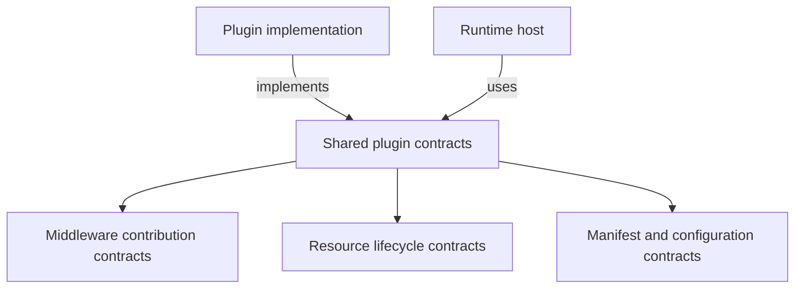

# Wafish.Plugin.Abstractions

[README](README.md) · [Agent notes](AGENTS.md) · [Proposed work](PLAN.md) · [Project index](../../docs/projects.md)

## Intro

This project defines the contracts shared by plugin implementations and the runtime host.

## Real-world example

A team adds a custom request filter. Its manifest declares supported scopes, configuration schemas, and required resources.

## Real-world value

Plugins can describe their behavior through shared interfaces instead of coupling directly to administration code.

## What it does

- Define plugin manifests, dependencies, capabilities, and scopes.
- Define service and middleware registration contracts.
- Define health probes and runtime resource lifecycle contracts.

## What it does not do

- Load assemblies or start plugin resources itself.
- Provide concrete policies, storage, or a user interface.

## Start here

Source project: [Wafish.Plugin.Abstractions.csproj](Wafish.Plugin.Abstractions.csproj).
This project has no direct solution project references. Package and framework references remain in its project file.

Build and verification commands are in [AGENTS.md](AGENTS.md). Future work is in [PLAN.md](PLAN.md).

## Lifecycle and compatibility contracts

[Lifecycle requirements](../../docs/plugin-lifecycle-contract.md) cover repeat calls, cancellation, partial startup, and shutdown failures.
Public API checks reject removals, record constructor changes, and new abstract requirements on existing contracts.
Default interface additions remain supported. Plugin state results distinguish validation rejection from storage failure.

## Ordering and host requirements

Manifests can declare `before` and `after` lists of enabled plugin IDs.
Missing targets and cycles reject preparation before plugin services are configured.
Numeric `order`, then ordinal plugin ID, break ties between unconstrained plugins.
The host preserves the built-in retry, cache, compression, logging, metrics, and circuit-breaker sequence.
External plugins now participate in both middleware callbacks in the resolved order.
A callback can remain empty when the plugin does not use that pipeline.

`requiredHostCapabilities` declares objects with `name` and `minimumVersion` fields.
Available contracts are `wafish.runtime`, `wafish.proxy-pipeline`, and `wafish.resource-lifecycle`, each at version 1.
Names are case-sensitive. Versions are positive integers and represent compatible contract revisions.
Unknown names or unsupported versions reject preparation before external plugin construction.
Omitted requirements preserve legacy behavior. Rejected replacements leave the active domain unchanged.
