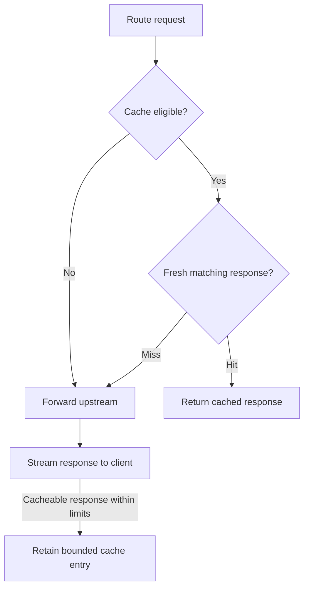

# Wafish.Plugin.Cache

[README](README.md) · [Agent notes](AGENTS.md) · [Proposed work](../../PLAN.md) · [Project index](../../docs/projects.md)

## Intro

This plugin adds a bounded, in-memory HTTP response cache to selected routes. Its binding ID is `response-cache`.

## Real-world example

A public product catalog returns cacheable GET responses. Repeated requests can reuse those responses until freshness expires.

## Real-world value

Public read traffic can use fewer upstream requests while preserving HTTP cache rules.

## What it does

- Apply route-scoped cache policy and HTTP freshness rules.
- Separate request variants and bypass private or authenticated responses.
- Stream responses while bounding captured and retained memory.

## What it does not do

- Provide a distributed cache shared by gateway replicas.
- Cache arbitrary personalized responses or unlimited response bodies.

## Start here

Source project: [Wafish.Plugin.Cache.csproj](Wafish.Plugin.Cache.csproj).
Direct project references: [Wafish.Plugin.Abstractions](../Wafish.Plugin.Abstractions/README.md), [Wafish](../Wafish/README.md).

Build and verification commands are in [AGENTS.md](AGENTS.md). Future work is in [PLAN.md](../../PLAN.md).

## Cache key configuration

`varyByQuery` and `varyHeaders` are deprecated, accepted for compatibility, and ignored.
Their schema descriptions identify this behavior.
Keys always include route, configuration generation, scheme, host, path base, path, and the complete query string.
Keys include request headers except `Cache-Control`, `Pragma`, `X-Request-Id`, `traceparent`, `tracestate`, and `baggage`.
Responses varying on excluded headers bypass storage. Credentials and private responses retain their existing bypass rules.
Removing deprecated settings from stored bindings does not reduce response isolation.
`enabled`, `ttlSeconds`, `maxBodyBytes`, and `cacheStatusCodes` retain their existing behavior.

[Verification](../../ARCHIVE.md#archive-tests-wafish-regression-evidence-review111213-readme-md).

## Review items 14–16

Cache lifetime and response age use monotonic time from the injected `TimeProvider`.
UTC clock adjustments do not extend or shorten cache freshness. Stored wall timestamps use UTC.

Verification: [review evidence](../../ARCHIVE.md#archive-tests-wafish-regression-evidence-review141516-readme-md).

## Generated header checks

`--protocol-properties` exercises 694 combinations of freshness, shared freshness, Age, Vary, and request directives.
An injected clock verifies expiration boundaries and response age without waiting for real time.
The matrix includes private responses, no-cache, no-store, only-if-cached, max-age, min-fresh, malformed fields, Date, and Expires.
Language variants remain isolated, and excluded operational Vary headers prevent storage.
Every generated cache fixture checks its retained-memory budget.

## Small responses and concurrent pressure

Completed captures below half their capacity can shrink to the exact body length.
The budget reserves both arrays before copying. Insufficient spare budget keeps the original capture.
Header and entry allowances remain charged. Evicted entries remain charged until their final reader releases them.
A 512-byte response with the default one-MiB capture limit retains 67,096 charged bytes after compaction.
The previous implementation retained 1,115,136 bytes for the same response.
The pressure check overlaps 32 misses with eight readers across generation changes.
These charges bound owned buffers and allowances, not process RSS or delayed garbage collection.

## Tags and purge

Bindings accept up to eight bounded tags. Authorized operators can purge by route, tag, or their intersection.
Unrelated cached entries remain available. Purge fences pending fills and preserves active-reader memory accounting.

See [registration and operations](../../docs/registration-operations-contracts.md) for limits, configuration, and compatibility.

## Concurrent fills

Identical eligible GET misses share one cache fill per process.
`fillWaitMilliseconds` defaults to 1000. Set zero to disable sharing; the maximum is 5000.
Coordination admits at most 256 owners and 1024 waiters across routes.
Waiters cancel independently. Timeout or admission overflow forwards the request normally.
Only a fresh, public cache entry can satisfy a waiter.
Failed, private, purged, and retired-generation fills cannot supply shared responses.
