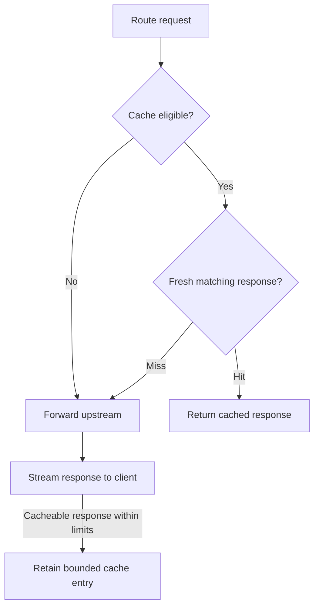

# Wafish.Plugin.Cache

[README](README.md) · [Agent notes](AGENTS.md) · [Proposed work](PLAN.md) · [Project index](../../docs/projects.md)

## Intro

This plugin adds a bounded, in-memory HTTP response cache to selected routes. Its binding ID is `response-cache`.

## Real-world example

A public product catalog returns cacheable GET responses. Repeated requests can reuse those responses until freshness expires.

## Real-world value

Public read traffic can use fewer upstream requests while preserving HTTP cache rules.

## What it does

- Apply route-scoped cache policy and HTTP freshness rules.
- Separate request variants and bypass private or authenticated responses.
- Stream responses while bounding captured and retained memory.

## What it does not do

- Provide a distributed cache shared by gateway replicas.
- Cache arbitrary personalized responses or unlimited response bodies.

## Start here

Source project: [Wafish.Plugin.Cache.csproj](Wafish.Plugin.Cache.csproj).
Direct project references: [Wafish.Plugin.Abstractions](../Wafish.Plugin.Abstractions/README.md), [Wafish](../Wafish/README.md).

Build and verification commands are in [AGENTS.md](AGENTS.md). Future work is in [PLAN.md](PLAN.md).

## Cache key configuration

`varyByQuery` and `varyHeaders` are deprecated, accepted for compatibility, and ignored.
Their schema descriptions identify this behavior.
Keys always include route, configuration generation, scheme, host, path base, path, and the complete query string.
Keys include request headers except `Cache-Control`, `Pragma`, `X-Request-Id`, `traceparent`, `tracestate`, and `baggage`.
Responses varying on excluded headers bypass storage. Credentials and private responses retain their existing bypass rules.
Removing deprecated settings from stored bindings does not reduce response isolation.
`enabled`, `ttlSeconds`, `maxBodyBytes`, and `cacheStatusCodes` retain their existing behavior.

[Verification](../../tests/Wafish.Regression/evidence/review111213/README.md).

## Review items 14–16

Cache lifetime and response age use monotonic time from the injected `TimeProvider`.
UTC clock adjustments do not extend or shorten cache freshness. Stored wall timestamps use UTC.

Verification: [review evidence](../../tests/Wafish.Regression/evidence/review141516/README.md).
