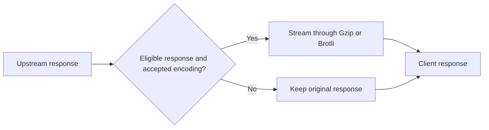

# Wafish.Plugin.Compression

[README](README.md) · [Agent notes](AGENTS.md) · [Proposed work](../../PLAN.md) · [Project index](../../docs/projects.md)

## Intro

This plugin compresses eligible route responses with Gzip or Brotli. Its binding ID is `compression`.

## Real-world example

A reporting API returns large JSON documents. Clients that accept compression receive fewer response bytes.

## Real-world value

Large text responses can use less bandwidth while retaining streamed delivery.

## What it does

- Negotiate supported encodings from Accept-Encoding.
- Apply media type, size, and compression-level rules.
- Handle exclusions and response headers inside the proxy pipeline.
- Measure response bytes, encoding, outcomes, and estimated codec duration.

## What it does not do

- Compress every response regardless of status, range, or media type.
- Add new compression formats beyond the implemented encodings.

## Start here

Source project: [Wafish.Plugin.Compression.csproj](Wafish.Plugin.Compression.csproj).
Direct project references: [Wafish.Plugin.Abstractions](../Wafish.Plugin.Abstractions/README.md), [Wafish](../Wafish/README.md).

Build and verification commands are in [AGENTS.md](AGENTS.md). Future work is in [PLAN.md](../../PLAN.md).

## Minimum response size

Known-length responses use the configured `minResponseSize`, including values above 64 KiB.
Unknown-length responses use at most 64 KiB of prefix storage.
For unknown lengths, thresholds above 65,536 bytes bypass compression regardless of write chunk size.
At lower thresholds, reaching the threshold selects compression. Completing below it preserves the original response.
An early flush selects uncompressed output for unknown lengths, preserving prompt streaming.
The schema description exposes this fallback. Existing encoding, media-type, and HTTP exclusion rules remain effective.

[Verification](../../ARCHIVE.md#archive-tests-wafish-regression-evidence-review111213-readme-md).

## Encoding negotiation

Brotli and gzip compete by quality. Brotli wins equal positive qualities.
An explicit coding overrides the wildcard. Duplicate coding or wildcard qualities use the lowest value.
Unknown codings do not select a compressor.
Malformed lists, duplicate parameters, and invalid quality syntax bypass compression for the entire field.
Quality syntax follows [RFC 9110 section 12.4.2](https://httpwg.org/specs/rfc9110.html#quality.values): values range from zero to one with at most three decimal places.
Unsupported or unacceptable compression leaves the upstream representation unchanged; this middleware does not generate a 406 response.
Generated checks cover field order, multiple header lines, wildcards, duplicates, malformed values, `Vary`, and byte-for-byte decompression.

## Allocation measurements

The allocation check streams sixteen concurrent sixteen-MiB responses into non-buffering sinks.
Both compressed JSON and excluded binary responses deliver bytes before producers finish.
Measured managed allocations remain below sixteen MiB for the complete 256-MiB workload.
The focused run allocated approximately 233 KiB for JSON and 87 KiB for excluded binary.
Native codec state and process RSS are outside this managed-allocation measurement.
Existing bounded prefix buffering required no code change.

## Compression measurements

`AddWafishRuntime` registers a process-local `CompressionMetricStore`.
Enabled compression bindings record one measurement after each response attempt, including uncompressed responses.
The sample telemetry defaults collect the `Wafish.Plugin.Compression` meter automatically.
Other hosts can select it with `.AddMeter("Wafish.Plugin.Compression")` in their OpenTelemetry metrics pipeline.

| Instrument | Unit | Meaning |
|---|---|---|
| `wafish.compression.responses` | `{response}` | Completed, cancelled, or faulted response attempts |
| `wafish.compression.input_bytes` | `By` | Bytes accepted by successful application writes, including buffered prefixes |
| `wafish.compression.output_bytes` | `By` | Bytes from successful destination writes, including codec headers and trailers |
| `wafish.compression.codec_duration` | `s` | Elapsed codec operation time, excluding destination writes and flushes |

Codec duration includes compressor creation, writes, flushes, and finalization.
Producer delays and measured output backpressure are excluded. Scheduling and measurement overhead can remain.
This is an elapsed cost estimate, not CPU time. Uncompressed output has zero codec duration.
No additional response-body buffering is used.

Each series has exactly three dimensions:

- `wafish.route.id`: the configured route ID.
- `compression.encoding`: `br`, `gzip`, or `identity`.
- `compression.outcome`: `completed`, `cancelled`, or `faulted`.

Paths, clients, arbitrary header values, and content types are not dimensions.
The store admits at most 1,024 series across all routes, encodings, and outcomes.
Existing series continue updating at capacity. New series are ignored until capacity becomes available.
Removed routes retire their series when configuration refreshes. Late completions for retired routes are ignored.
Process restarts reset counters. Recreated route identities can start new totals.
Exporters control their own retention of retired series.

### Assess savings and cost

Compare completed responses for the same route and encoding over the same interval:

- Saved bytes = input bytes minus output bytes.
- Savings fraction = 1 minus output bytes divided by input bytes, when input is positive.
- Average codec cost = codec duration divided by response count.

Small or incompressible responses can have negative savings. The raw counters preserve that expansion.
Use these measurements to adjust minimum sizes, media types, or compression levels.
`identity` measurements show bypass behavior, including size thresholds and negotiation exclusions.

Counts describe application body writes, not network traffic, HTTP framing, or TLS overhead.
HEAD and bodyless responses normally have zero bytes; writes discarded by the host cannot establish bytes sent to clients.
Failed or cancelled responses can contain partial measurements. Exclude those outcomes from completed-response savings calculations.
A failed destination write is not counted because its partial delivery is unknown.

`CompressionMetricStore.GetSnapshots()` returns copied per-series totals. Changes to the returned collection do not affect the store.
The existing two-argument middleware constructor remains supported without metrics.
Manual middleware construction can supply a metric store explicitly.

Source: [metric store](CompressionMetricStore.cs) and [measurement regression checks](../../tests/Wafish.Regression/CompressionMetricChecks.cs).
