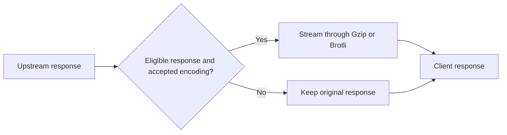

# Wafish.Plugin.Compression

[README](README.md) · [Agent notes](AGENTS.md) · [Proposed work](../../PLAN.md) · [Project index](../../docs/projects.md)

## Intro

This plugin compresses eligible route responses with Gzip or Brotli. Its binding ID is `compression`.

## Real-world example

A reporting API returns large JSON documents. Clients that accept compression receive fewer response bytes.

## Real-world value

Large text responses can use less bandwidth while retaining streamed delivery.

## What it does

- Negotiate supported encodings from Accept-Encoding.
- Apply media type, size, and compression-level rules.
- Handle exclusions and response headers inside the proxy pipeline.

## What it does not do

- Compress every response regardless of status, range, or media type.
- Add new compression formats beyond the implemented encodings.

## Start here

Source project: [Wafish.Plugin.Compression.csproj](Wafish.Plugin.Compression.csproj).
Direct project references: [Wafish.Plugin.Abstractions](../Wafish.Plugin.Abstractions/README.md), [Wafish](../Wafish/README.md).

Build and verification commands are in [AGENTS.md](AGENTS.md). Future work is in [PLAN.md](../../PLAN.md).

## Minimum response size

Known-length responses use the configured `minResponseSize`, including values above 64 KiB.
Unknown-length responses use at most 64 KiB of prefix storage.
For unknown lengths, thresholds above 65,536 bytes bypass compression regardless of write chunk size.
At lower thresholds, reaching the threshold selects compression. Completing below it preserves the original response.
An early flush selects uncompressed output for unknown lengths, preserving prompt streaming.
The schema description exposes this fallback. Existing encoding, media-type, and HTTP exclusion rules remain effective.

[Verification](../../tests/Wafish.Regression/evidence/review111213/README.md).

## Encoding negotiation

Brotli and gzip compete by quality. Brotli wins equal positive qualities.
An explicit coding overrides the wildcard. Duplicate coding or wildcard qualities use the lowest value.
Unknown codings do not select a compressor.
Malformed lists, duplicate parameters, and invalid quality syntax bypass compression for the entire field.
Quality syntax follows [RFC 9110 section 12.4.2](https://httpwg.org/specs/rfc9110.html#quality.values): values range from zero to one with at most three decimal places.
Unsupported or unacceptable compression leaves the upstream representation unchanged; this middleware does not generate a 406 response.
Generated checks cover field order, multiple header lines, wildcards, duplicates, malformed values, `Vary`, and byte-for-byte decompression.

## Allocation measurements

The allocation check streams sixteen concurrent sixteen-MiB responses into non-buffering sinks.
Both compressed JSON and excluded binary responses deliver bytes before producers finish.
Measured managed allocations remain below sixteen MiB for the complete 256-MiB workload.
The focused run allocated approximately 233 KiB for JSON and 87 KiB for excluded binary.
Native codec state and process RSS are outside this managed-allocation measurement.
Existing bounded prefix buffering required no code change.
