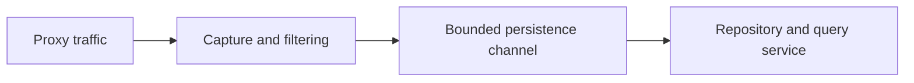

# Wafish.Plugin.ProxyLog

[README](README.md) · [Agent notes](AGENTS.md) · [Proposed work](PLAN.md) · [Project index](../../docs/projects.md)

## Intro

This plugin captures proxy metadata and optional payloads. Its binding ID is `proxy-log`.

## Real-world example

An operator investigates failed order requests using trace IDs, response status, and selected body fields.

## Real-world value

Proxy-specific records make request failures easier to diagnose without changing every backend.

## What it does

- Capture request and response metadata with optional bounded body capture.
- Apply filters, sampling, and runtime capture settings.
- Queue records for background persistence and support log queries.

## What it does not do

- Guarantee lossless audit delivery from its bounded diagnostic queue.
- Make sensitive payload collection safe without a suitable redaction policy.

## Start here

Source project: [Wafish.Plugin.ProxyLog.csproj](Wafish.Plugin.ProxyLog.csproj).
Direct project references: [Wafish.Plugin.Abstractions](../Wafish.Plugin.Abstractions/README.md), [Wafish](../Wafish/README.md).

Build and verification commands are in [AGENTS.md](AGENTS.md). Future work is in [PLAN.md](PLAN.md).

## Review safety limits

Decoded capture stops at the configured byte limit, capped at 1 MiB. Overflow adds a truncation marker.
Decoders preserve caller streams and observe request cancellation.
See [resource limits and consumer changes](../../docs/security.md#request-resource-limits-and-retry-behavior).

## Persistence accounting

Shutdown retains the dequeued batch before draining the captured queue backlog.
The drain has a cooperative five-second limit. Caller cancellation also stops the drain.
A cancelled stop retains task ownership until a later stop joins completion.
New arrivals after backlog capture remain pending for the next start.
Each failed write increments the failure counter. Three failed attempts discard the batch explicitly.
Health reports submitted, pending, written, discarded entries, and failed write attempts.
At rest, submitted entries equal pending, written, and discarded entries combined.
Counters cover persistence-enabled submissions and survive writer restarts within the store lifetime.
These memory queues cannot survive process termination.

[Verification for review items 8–10](../../tests/Wafish.Regression/evidence/review8910/README.md).

## Review items 14–16

Injected `TimeProvider` controls batch flush, retry delays, cleanup scheduling, and the shutdown drain timer.
Captured event timestamps use UTC. The drain timer is joined before its cancellation source is disposed.

Verification: [review evidence](../../tests/Wafish.Regression/evidence/review141516/README.md).

## Drain fault verification

Regression checks cover storage retry exhaustion, transient recovery, cancellation, and shutdown draining.
Persisted and discarded counts account for all submitted records after shutdown.
See [lifetime and accounting evidence](../../tests/Wafish.Regression/evidence/lifetime-stress/README.md).

## Route redaction

Route bindings accept `redactHeaders` and `redactJsonPaths`. Both lists support up to 64 entries.
Headers match without case sensitivity. Each header name supports up to 128 characters.
JSON paths use case-sensitive JSON Pointer segments, with `*` matching any property or array index.
Use `~1` for `/` and `~0` for `~`. Paths support 256 characters and 16 segments.
Example: `{"redactHeaders":["X-Customer"],"redactJsonPaths":["/customer/id","/items/*/value"]}`.
Rules apply before display truncation, persistence, and live delivery. They never modify forwarded data.
Invalid or incomplete JSON is masked. Invalid manually published rules mask all captured headers and bodies.
Default credential headers and JSON field names always remain protected when custom global lists are configured.
Compatibility: malformed JSON logs now contain a redaction marker instead of the unexamined payload.
