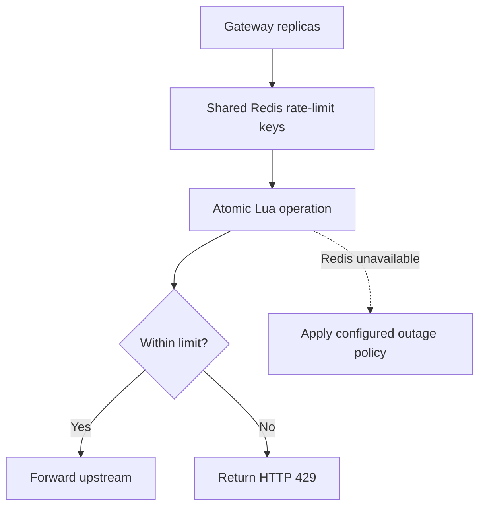

# Wafish.Plugin.RateLimit.Redis

[README](README.md) · [Agent notes](AGENTS.md) · [Proposed work](../../PLAN.md) · [Project index](../../docs/projects.md)

## Intro

This plugin uses Redis Lua operations for shared route limits. Its binding ID is `rate-limit-redis`.

## Real-world example

Two gateway replicas protect the same public API. Requests reaching either replica consume the same Redis-backed allowance.

## Real-world value

Horizontal scaling does not multiply the allowed traffic for each shared key.

## What it does

- Apply fixed-window, sliding-window, and token-bucket limits atomically.
- Use configured key prefixes and connection settings.
- Distinguish exhausted quotas from Redis outages using FailClosed or FailOpen policy.

## What it does not do

- Run Redis automatically outside an explicitly configured host topology.
- Implement the local concurrency-limiter algorithm in Redis.

## Start here

Source project: [Wafish.Plugin.RateLimit.Redis.csproj](Wafish.Plugin.RateLimit.Redis.csproj).
Direct project references: [Wafish.Plugin.Abstractions](../Wafish.Plugin.Abstractions/README.md), [Wafish](../Wafish/README.md).

Live Redis checks use `WAFISH_REDIS_SERVER` and the regression runner's `--redis` option.

Build and verification commands are in [AGENTS.md](AGENTS.md). Future work is in [PLAN.md](../../PLAN.md).

## Review fixes 4–7

Redis keys include a versioned hash of algorithm, limit, window, and burst settings.
Policy changes start fresh counters. Previous keys expire under their existing TTL.
Deploy replicas together when changing this key format; mixed versions use separate counters.

## Connection recovery

Failed connection creation retries on later requests after delays of 1, 2, 4, 8, 16, then 30 seconds.
Concurrent callers share one creation task per connection string. The store retains at most 32 connection entries.
Caller cancellation stops that caller's wait. It does not cancel a shared connection attempt.
Shutdown awaits pending creation and disposes successful connections.
Established multiplexers retain their normal reconnection behavior. Command failures do not replay Lua operations.
A cancelled or interrupted command can already have consumed a permit.
`FailClosed` remains the default. Use distinct `keyPrefix` values to isolate deployments.
The default `keyPrefix` is `wafish:rl`. Changing the prefix starts separate counters.
See [naming migration](../../docs/naming-migration.md#repository-branding-and-configured-names) before upgrading shared deployments.

Verification: [Redis and discovery recovery](../../ARCHIVE.md#archive-tests-wafish-regression-evidence-recovery-readme-md).
