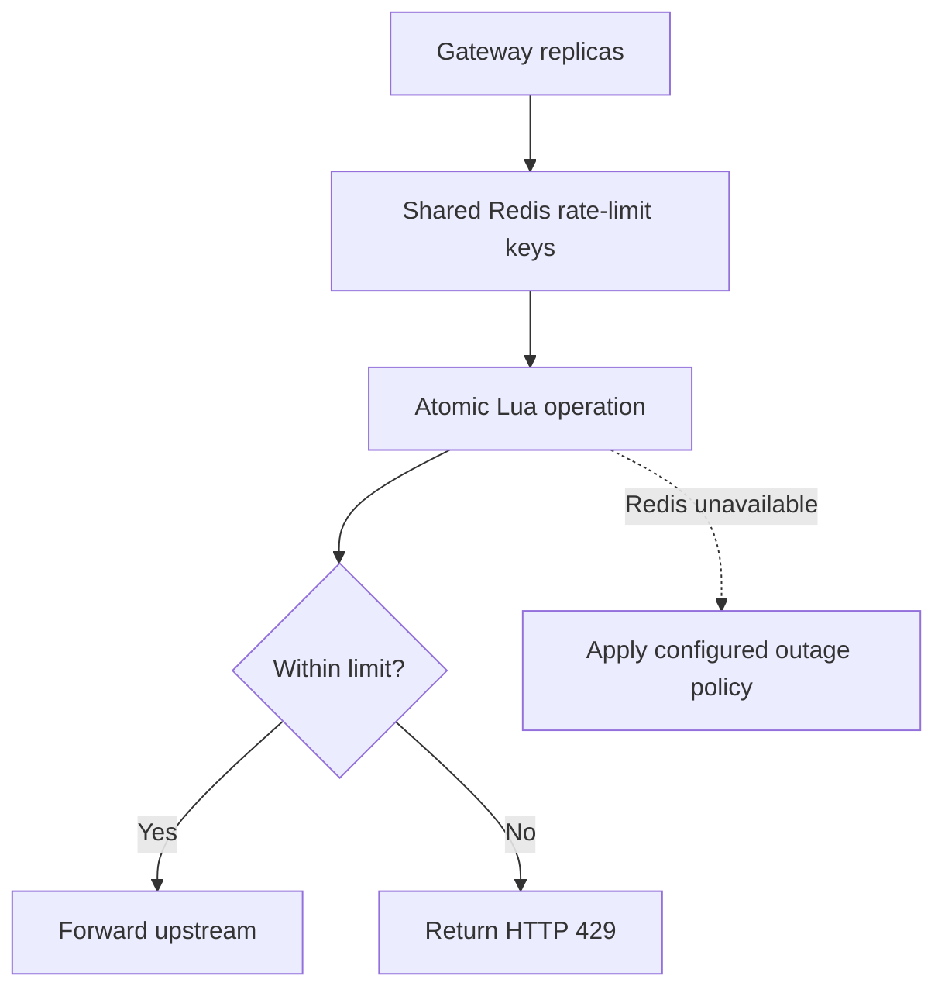

# Wafish.Plugin.RateLimit.Redis

[README](README.md) · [Agent notes](AGENTS.md) · [Proposed work](../../PLAN.md) · [Project index](../../docs/projects.md)

## Intro

This plugin uses Redis Lua operations for shared route limits. Its binding ID is `rate-limit-redis`.



## Real-world example

Two gateway replicas protect the same public API. Requests reaching either replica consume the same Redis-backed allowance.

## Real-world value

Horizontal scaling does not multiply the allowed traffic for each shared key.

## What it does

- Apply fixed-window, sliding-window, and token-bucket limits atomically.
- Enforce combined burst and sustained fixed windows with `DualWindow`.
- Use configured key prefixes and connection settings.
- Distinguish exhausted quotas from Redis outages using FailClosed or FailOpen policy.

## What it does not do

- Run Redis automatically outside an explicitly configured host topology.
- Implement the local concurrency-limiter algorithm in Redis.

## Start here

Source project: [Wafish.Plugin.RateLimit.Redis.csproj](Wafish.Plugin.RateLimit.Redis.csproj).
Direct project references: [Wafish.Plugin.Abstractions](../Wafish.Plugin.Abstractions/README.md), [Wafish](../Wafish/README.md).

Live Redis checks use `WAFISH_REDIS_SERVER` and the regression runner's `--redis` option.

Build and verification commands are in [AGENTS.md](AGENTS.md). Future work is in [PLAN.md](../../PLAN.md).

## Review fixes 4–7

Redis keys include a versioned hash of algorithm, limit, window, and burst settings.
Policy changes start fresh counters. Previous keys expire under their existing TTL.
Deploy replicas together when changing this key format; mixed versions use separate counters.

## Connection recovery

Failed connection creation retries on later requests after delays of 1, 2, 4, 8, 16, then 30 seconds.
Concurrent callers share one creation task per connection string. The store retains at most 32 connection entries.
Caller cancellation stops that caller's wait. It does not cancel a shared connection attempt.
Shutdown awaits pending creation and disposes successful connections.
Established multiplexers retain their normal reconnection behavior. Command failures do not replay Lua operations.
A cancelled or interrupted command can already have consumed a permit.
`FailClosed` remains the default. Use distinct `keyPrefix` values to isolate deployments.
The default `keyPrefix` is `wafish:rl`. Changing the prefix starts separate counters.
See [naming migration](../../docs/naming-migration.md#repository-branding-and-configured-names) before upgrading shared deployments.

Verification: [Redis and discovery recovery](../../ARCHIVE.md#archive-tests-wafish-regression-evidence-recovery-readme-md).

## Combined burst and sustained quotas

Select `DualWindow` to enforce both allowances in one atomic decision:

```json
{
  "enabled": true,
  "algorithm": "DualWindow",
  "limit": 100,
  "windowSeconds": 60,
  "burstLimit": 10,
  "burstWindowSeconds": 1,
  "keyPrefix": "production:rl",
  "failureMode": "FailClosed"
}
```

This example permits at most 10 requests per burst window and 100 per sustained window.
Each route and resolved client address has its own shared quota across gateway replicas.
Both windows are fixed windows. Each starts on the first accepted request after its previous window expires.
They are not rolling windows. Traffic can concentrate around a window boundary.
Redis server time determines both boundaries.

`limit` and `windowSeconds` define the sustained allowance. Both burst fields are required for `DualWindow`.
Limits range from 1 to 1,000,000. Windows range from 1 to 86,400 seconds.
The burst window must be shorter than the sustained window. The burst limit cannot exceed the sustained limit.
`burstBalance` must be zero; it remains exclusive to `TokenBucket`.
Other algorithms reject explicit burst-window fields instead of silently ignoring them.
Candidates, including disabled bindings, are validated before persistence.

### Atomicity, keys, and expiry

One Lua script reads both counters, checks both limits, and updates both counters only when admission succeeds.
A quota rejection changes neither counter nor window boundary. It does not extend key expiry.
Admission stores four fields in one Redis hash and expires it at the later active window boundary.
The key expires within the configured sustained window under normal server time progression.
No per-request event collection is stored.

The script accesses only its declared `KEYS[1]`. Both windows therefore occupy the same Redis Cluster slot.
No special hash tag is required. Existing tags in deployment prefixes retain Redis's normal placement behavior.
This follows Redis's [atomic script execution](https://redis.io/docs/latest/develop/programmability/eval-intro/)
and [single-slot requirements](https://redis.io/docs/latest/management/scaling/).

Combined keys use `:v3-dual:` plus a hash of both limits and both window lengths.
Changing either policy starts new counters. Previous keys retain their bounded expiry.
Existing algorithms keep their `:v2:` keys, defaults, and token-bucket `burstBalance` behavior.
Upgrade all replicas before enabling `DualWindow`. Older replicas cannot enforce this algorithm.

### Response headers and failures

For accepted requests, `X-RateLimit-Remaining` is the smaller remaining allowance.
`X-RateLimit-Limit` identifies that window's capacity. Ties select the burst window.
For rejected requests, remaining is zero. The limit identifies the blocking window with the longest wait.
`Retry-After` rounds that longest wait up to whole seconds. It does not reserve capacity.
Quota rejection returns HTTP 429 even when `FailOpen` is configured.

Redis outages retain the existing `FailClosed` or explicit `FailOpen` behavior.
Commands are not replayed after transport failure or cancellation. An interrupted command can already have consumed both allowances.
Custom stores can implement [IDualWindowRateLimitStore](IDistributedRateLimitStore.cs) without changing their existing interface implementation.
Without this capability, combined requests use the configured unavailable-store policy; the default returns HTTP 503.

Source: [compiler](RedisRateLimitCompiler.cs), [Lua store](RedisLuaRateLimitStore.cs),
and [combined quota regressions](../../tests/Wafish.Regression/RedisDualWindowChecks.cs).
