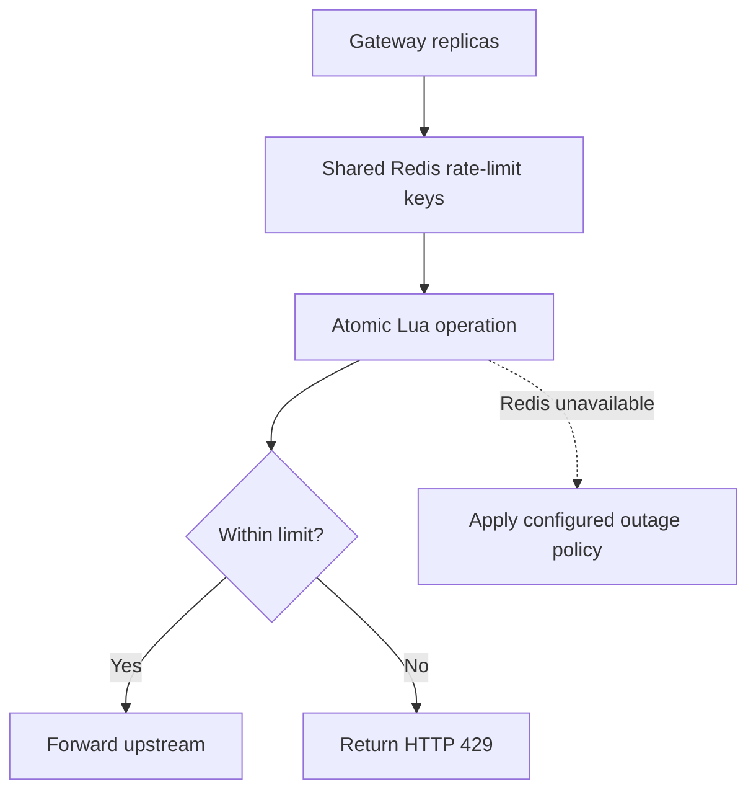

# Wafish.Plugin.RateLimit.Redis

[README](README.md) · [Agent notes](AGENTS.md) · [Proposed work](../../PLAN.md) · [Project index](../../docs/projects.md)

## Intro

This plugin uses Redis Lua operations for shared route limits. Its binding ID is `rate-limit-redis`.



## Real-world example

Two gateway replicas protect the same public API. Requests reaching either replica consume the same Redis-backed allowance.

## Real-world value

Horizontal scaling does not multiply the allowed traffic for each shared key.

## What it does

- Apply fixed-window, sliding-window, and token-bucket limits atomically.
- Use configured key prefixes and connection settings.
- Distinguish exhausted quotas from Redis outages using FailClosed or FailOpen policy.

## What it does not do

- Run Redis automatically outside an explicitly configured host topology.
- Implement the local concurrency-limiter algorithm in Redis.

## Start here

Source project: [Wafish.Plugin.RateLimit.Redis.csproj](Wafish.Plugin.RateLimit.Redis.csproj).
Direct project references: [Wafish.Plugin.Abstractions](../Wafish.Plugin.Abstractions/README.md), [Wafish](../Wafish/README.md).

Live Redis checks use `WAFISH_REDIS_SERVER` and the regression runner's `--redis` option.

Build and verification commands are in [AGENTS.md](AGENTS.md). Future work is in [PLAN.md](../../PLAN.md).

## Review fixes 4–7

Redis keys include a versioned hash of algorithm, limit, window, and burst settings.
Policy changes start fresh counters. Previous keys expire under their existing TTL.
Deploy replicas together when changing this key format; mixed versions use separate counters.

## Connection recovery

Failed connection creation retries on later requests after delays of 1, 2, 4, 8, 16, then 30 seconds.
Concurrent callers share one creation task per connection string. The store retains at most 32 connection entries.
Caller cancellation stops that caller's wait. It does not cancel a shared connection attempt.
Shutdown awaits pending creation and disposes successful connections.
Established multiplexers retain their normal reconnection behavior. Command failures do not replay Lua operations.
A cancelled or interrupted command can already have consumed a permit.
`FailClosed` remains the default. Use distinct `keyPrefix` values to isolate deployments.
The default `keyPrefix` is `wafish:rl`. Changing the prefix starts separate counters.
See [naming migration](../../docs/naming-migration.md#repository-branding-and-configured-names) before upgrading shared deployments.

Verification: [Redis and discovery recovery](../../tests/Wafish.Regression/evidence/recovery/README.md).

## Combined burst and sustained allowances (R38)

Use `DualWindow` to enforce two fixed-window allowances in one atomic Redis operation:

```json
{
  "enabled": true,
  "algorithm": "DualWindow",
  "burstLimit": 10,
  "limit": 100,
  "windowSeconds": 60,
  "failureMode": "FailClosed",
  "keyPrefix": "wafish:rl"
}
```

`burstLimit` applies to a one-second window. `limit` applies to the sustained `windowSeconds` window.
The sustained window must be 2–604,800 seconds. Each allowance must be 1–1,000,000 requests.
Supply `burstLimit` and `windowSeconds` explicitly for this algorithm.
Windows begin on their first accepted request, using Redis server time. They are fixed windows, not sliding windows.
Each request consumes one permit from both windows. Exhausting either allowance rejects the request without modifying either counter.
A rejection returns HTTP 429. `Retry-After` covers every exhausted window, rounded up to whole seconds.
`X-RateLimit-Limit` reports the smaller capacity. `X-RateLimit-Remaining` reports the smaller remaining allowance.

Both counters occupy one Redis hash key, so Redis Cluster never requires a cross-slot operation.
The key includes a `v3` policy hash containing both allowances and window lengths.
Accepted requests set expiry to the later window end. Rejections do not extend expiry.
Changing either allowance starts fresh counters; previous keys retain their bounded expiry.
Existing single-quota algorithms retain their `v2` key format and behavior.
See [Redis script atomicity](https://redis.io/docs/latest/develop/programmability/eval-intro/).

Custom stores can implement the additive `ICombinedDistributedRateLimitStore` capability.
Existing `IDistributedRateLimitStore` implementations remain compatible with single-quota bindings.
A combined binding with an unsupported store follows its configured outage policy. The default remains `FailClosed`.
Redis failures do not fall back to independent acquisitions. Such a fallback could partially consume an allowance.

## Trusted tenant partitions (R37)

`partitionKey` defaults to `IpAddress`, preserving existing keys and behavior.
Select `Tenant` to share a route quota across authenticated users and addresses belonging to the same tenant.

```json
{
  "enabled": true,
  "partitionKey": "Tenant",
  "tenantClaimType": "tenant_id",
  "tenantClaimIssuer": "https://identity.example.com",
  "allowedTenants": ["tenant-a", "tenant-b"],
  "algorithm": "FixedWindow",
  "limit": 100,
  "windowSeconds": 60,
  "failureMode": "FailClosed"
}
```

Authenticate requests before the gateway proxy pipeline. The authentication handler must verify the token issuer and signature.
This plugin reads claims only from authenticated identities and requires an exact configured claim issuer and type.
Caller headers never select the tenant. Configure claim mapping explicitly when the authentication handler changes claim names.
Multiple matching claims may repeat the same tenant. Conflicting values are rejected.

Unauthenticated requests return 401. Missing, untrusted, ambiguous, and unlisted tenant claims return 403.
Both responses set `X-RateLimit-Status: tenant-rejected` and stop before Redis or forwarding.
`FailOpen` applies only to store failures; it never bypasses tenant validation.

The allowlist contains 1–256 distinct tenant values, each at most 128 characters.
Unlisted values cannot create quota keys. The issuer and claim type are also bounded by the schema.
Keys contain a SHA-256 digest of the issuer, claim type, and tenant value, not raw tenant values.
Keys retain the configured deployment prefix and route identity, so separate routes retain separate quotas.
Replicas with the same policy, prefix, and route identity share the same tenant allowance.
The existing Redis policy hashes and expiry rules still apply.
Changing issuer or claim type changes the partition identity. Removing a tenant immediately rejects its requests.
Old counters expire through their existing bounded lifetime.
