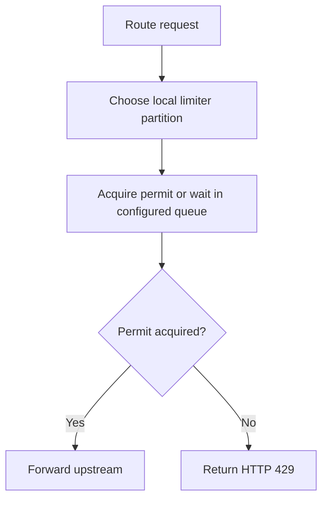

# Wafish.Plugin.RateLimit

[README](README.md) · [Agent notes](AGENTS.md) · [Proposed work](../../PLAN.md) · [Project index](../../docs/projects.md)

## Intro

This plugin limits route traffic inside one gateway process. Its binding ID is `rate-limit`.



## Real-world example

A login route allows a limited request rate per client address. Excess requests receive HTTP 429 with retry guidance.

## Real-world value

A single gateway can protect upstream capacity and reduce abusive request bursts.

## What it does

- Support fixed-window, sliding-window, token-bucket, and concurrency algorithms.
- Partition limits using supported route policy keys.
- Reject exhausted limits with JSON and Retry-After guidance.

## What it does not do

- Share counters between gateway replicas.
- Authenticate users or replace authorization checks.

## Start here

Source project: [Wafish.Plugin.RateLimit.csproj](Wafish.Plugin.RateLimit.csproj).
Direct project references: [Wafish.Plugin.Abstractions](../Wafish.Plugin.Abstractions/README.md), [Wafish](../Wafish/README.md).

Build and verification commands are in [AGENTS.md](AGENTS.md). Future work is in [PLAN.md](../../PLAN.md).

## Review safety limits

The built-in store admits at most 2,000 partitions. New partitions receive HTTP 429 at capacity.
Route partitions use route identity. Variable paths share the route quota.
See [resource limits and consumer changes](../../docs/security.md#request-resource-limits-and-retry-behavior).

## Review items 14–16

The injected `TimeProvider` controls middleware cleanup scheduling and store idle retention.
Built-in .NET limiter replenishment retains its own system timers. Redis quota timing remains server-owned.

Verification: [review evidence](../../tests/Wafish.Regression/evidence/review141516/README.md).

## Algorithm boundaries

Retry-After uses limiter metadata when available. Token-bucket fallback uses its replenishment period.
Concurrency limits return a one-second retry hint. A hint does not reserve a permit.
Cancellation releases queued ownership. Active partitions survive cleanup and remain owned until their requests finish.
See [algorithm and partition stress checks](../../tests/Wafish.Regression/evidence/lifetime-stress/README.md).

## Named local quota groups (R36)

Set the same `quotaGroup` on related route bindings to share one local allowance:

```json
{
  "enabled": true,
  "quotaGroup": "inventory-api",
  "algorithm": "FixedWindow",
  "permitLimit": 100,
  "window": "1m",
  "partitionKey": "Global"
}
```

Names are case-sensitive and contain 1–64 ASCII letters, digits, periods, underscores, or hyphens.
The first character must be a letter or digit. An empty or omitted name retains independent route quotas.
All enabled bindings in a group must use identical quota and partition settings, including defaults.
Conflicting settings fail snapshot compilation before persistence or activation.
Binding previews include existing bindings and report the same conflicts as saves.
Update every group member together through an atomic configuration change set when changing shared settings.

`Global` and `Route` partitions share one allowance across the named group.
`IpAddress` and `UserId` share an allowance per client identity within the group.
Unrelated groups and ungrouped routes retain separate allowances.
Group names and client values are hashed in runtime limiter keys.
Changing a group's settings starts a fresh local allowance. Existing idle partitions follow normal bounded cleanup.
Groups share permits only inside one gateway process. Use Redis for allowances shared across replicas.

## Weighted request costs (R39)

Set `requestCost` to charge an expensive route more permits per request. The default is `1`.
Fixed windows, sliding windows, and token buckets support costs from 1 to 1,000,000.
The cost must fit `permitLimit`, or `tokenLimit` for token buckets. Concurrency requires a cost of `1`.
Invalid costs fail validation before persistence or activation.

Routes in one `quotaGroup` can have different costs. All other quota settings must match.
For example, two routes can share five permits, with costs of one and three.
The expensive route consumes three permits atomically. A rejected request consumes none.
Changing only the cost retains the existing allowance. Request headers cannot change the charge.

`queueLimit` counts queued permits, not queued requests. Cancellation releases queued ownership.
Rejected requests return HTTP 429 with a positive `Retry-After` hint.
The built-in store supports weighted acquisition through `IWeightedRateLimiterStore`.
Custom legacy stores remain compatible with cost one. Higher costs return HTTP 503 with retry guidance.
