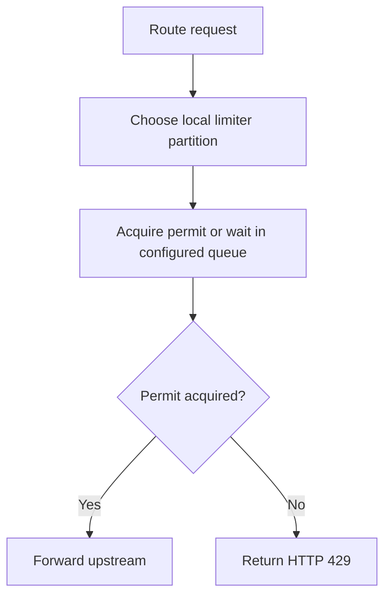

# Wafish.Plugin.RateLimit

[README](README.md) · [Agent notes](AGENTS.md) · [Proposed work](../../PLAN.md) · [Project index](../../docs/projects.md)

## Intro

This plugin limits route traffic inside one gateway process. Its binding ID is `rate-limit`.



## Real-world example

A login route allows a limited request rate per client address. Excess requests receive HTTP 429 with retry guidance.

## Real-world value

A single gateway can protect upstream capacity and reduce abusive request bursts.

## What it does

- Support fixed-window, sliding-window, token-bucket, and concurrency algorithms.
- Partition limits using supported route policy keys.
- Share a named local quota across selected routes.
- Reject exhausted limits with JSON and Retry-After guidance.

## What it does not do

- Share counters between gateway replicas.
- Authenticate users or replace authorization checks.

## Start here

Source project: [Wafish.Plugin.RateLimit.csproj](Wafish.Plugin.RateLimit.csproj).
Direct project references: [Wafish.Plugin.Abstractions](../Wafish.Plugin.Abstractions/README.md), [Wafish](../Wafish/README.md).

Build and verification commands are in [AGENTS.md](AGENTS.md). Future work is in [PLAN.md](../../PLAN.md).

## Review safety limits

The built-in store admits at most 2,000 partitions. New partitions receive HTTP 429 at capacity.
Route partitions use route identity. Variable paths share the route quota.
See [resource limits and consumer changes](../../docs/security.md#request-resource-limits-and-retry-behavior).

## Review items 14–16

The injected `TimeProvider` controls middleware cleanup scheduling and store idle retention.
Built-in .NET limiter replenishment retains its own system timers. Redis quota timing remains server-owned.

Verification: [review evidence](../../ARCHIVE.md#archive-tests-wafish-regression-evidence-review141516-readme-md).

## Algorithm boundaries

Retry-After uses limiter metadata when available. Token-bucket fallback uses its replenishment period.
Concurrency limits return a one-second retry hint. A hint does not reserve a permit.
Cancellation releases queued ownership. Active partitions survive cleanup and remain owned until their requests finish.
See [algorithm and partition stress checks](../../ARCHIVE.md#archive-tests-wafish-regression-evidence-lifetime-stress-readme-md).

## Named route quotas

Set the same `quotaGroup` on each participating route's `rate-limit` binding:

```json
{
  "enabled": true,
  "quotaGroup": "support-api",
  "algorithm": "FixedWindow",
  "partitionKey": "UserId",
  "permitLimit": 20,
  "window": "1m",
  "queueLimit": 0
}
```

This example permits 20 requests per user per minute across all participating routes.
`UserId` uses `HttpContext.User.Identity.Name`. Requests without that name share the `anonymous` partition.
Authentication must populate the identity before rate limiting.

| Partition key | Named group behavior |
|---|---|
| `Global` or `Route` | One shared pool across the group's routes |
| `IpAddress` | One shared pool per resolved client address |
| `UserId` | One shared pool per identity name |

Different groups and bindings without `quotaGroup` keep separate counters.
The group name replaces route identity; route renames and binding recreation preserve its counters.
Counters remain process-local. Gateway replicas and restarts do not share this state.

Names contain 1–64 lowercase letters, digits, or hyphens, and start with a letter.
Members must use identical effective policies, including algorithm, partition key, queue size, and algorithm-specific settings.
Equivalent durations, such as `1m` and `00:01:00`, match.
Unused algorithm settings do not affect policy identity. Each grouped route allows one enabled local rate-limit binding.

Named quotas require permits or tokens from 1 to 1,000,000 and queues from 0 to 10,000.
Windows and replenishment periods range from 1 millisecond to 1 day.
Use invariant TimeSpan syntax or numeric `s`, `m`, `h`, or `d` suffixes.
Sliding windows require 2–100 segments. Existing ungrouped bindings retain their previous validation behavior.

### Policy changes and removal

Conflicting policies fail validation before persistence. Preview does not allocate counters.
Removing all bindings does not immediately release the group or reset consumed permits.
The store retains policy ownership until every partition has no active or queued requests and is fully replenished.
Both last access and limiter idle time must exceed five minutes before cleanup can remove a partition.
Cleanup runs on rate-limited requests, at five-minute intervals. An idle gateway can retain groups longer.

To change a retained policy, remove its bindings and allow its partitions to retire before reusing the name.
A different group name creates an explicitly separate quota. Restarting the gateway also clears local counters.
A request racing with a conflicting configuration receives HTTP 503 with a one-second retry hint.
It cannot create a second counter set. Exhausted permits or partition capacity return HTTP 429.

The 2,000-partition store limit covers named and ungrouped counters together.
Custom stores must implement [IGroupedRateLimiterStore](../Wafish/Infrastructure/State/IGroupedRateLimiterStore.cs) to support named quotas.
Stores implementing only `IRateLimiterStore` continue to support ungrouped bindings.

Source: [group compiler](RateLimitGroupCompiler.cs), [policy normalization](../Wafish/Models/LocalQuotaGroupPolicy.cs),
and [regression checks](../../tests/Wafish.Regression/NamedQuotaChecks.cs).

## Weighted request costs

Set `requestCost` to charge a trusted route more than one permit per request:

```json
{
  "enabled": true,
  "algorithm": "TokenBucket",
  "partitionKey": "UserId",
  "tokenLimit": 100,
  "tokensPerPeriod": 20,
  "replenishmentPeriod": "1m",
  "requestCost": 5,
  "queueLimit": 0
}
```

This route spends five tokens per admitted request. The server takes the whole cost atomically.
Insufficient capacity returns HTTP 429 without partial consumption or upstream forwarding.
Clients cannot override costs through request headers, query values, claims, or bodies.

The default cost is one. Supported weighted algorithms are FixedWindow, SlidingWindow, and TokenBucket.
Costs must be integers from 1 to 1,000,000 and cannot exceed the algorithm's configured capacity.
For window algorithms, capacity is `permitLimit`. For TokenBucket, capacity is `tokenLimit`.
Concurrency retains unit cost. Invalid costs fail before persistence, including costs on disabled bindings.

### Sharing an allowance

Named quota members can use different request costs while sharing identical capacity policies.
For example, routes with costs one and three can share a five-permit window.
After one request to each route, one permit remains. Another three-permit request fails without consuming that remainder.

Changing a route's cost preserves its existing counter. Cost is not part of the limiter identity or group capacity fingerprint.
Changing a group's actual capacity still follows the existing retained-policy conflict rules.
Weighted limits remain process-local. Redis quotas continue to count one request per acquisition.

### Queues, cancellation, and retry timing

`queueLimit` counts queued permits. A request costing five needs room for five queued permits.
When queue capacity is insufficient, the request fails immediately with HTTP 429.
Cancellation removes queued acquisition without charging its cost. Active and queued requests retain their partition ownership.

Retry-After uses the underlying limiter's metadata when available.
Weighted token waits can require multiple replenishment periods. Large retry values retain integer seconds without 32-bit overflow.
The JSON `retryAfter` value matches the header. Retry timing remains a hint and does not reserve future capacity.

### Custom limiter stores

Existing `IRateLimiterStore` and `IGroupedRateLimiterStore` implementations remain supported for unit costs.
Weighted routes require the optional [weighted contracts](../Wafish/Infrastructure/State/IWeightedRateLimiterStore.cs).
Implement `IWeightedRateLimiterStore` for ordinary partitions and `IWeightedGroupedRateLimiterStore` for named groups.
The built-in runtime store implements both.
Upgrade gateway hosts and custom stores before enabling costs above one.

Custom stores must acquire the whole cost atomically and retain ownership until lease disposal.
Repeated unit acquisitions are unsafe because rejection could partially consume a quota.
The compiler rejects weighted configurations with unsupported stores. Middleware returns HTTP 503 for an incompatible runtime state.
