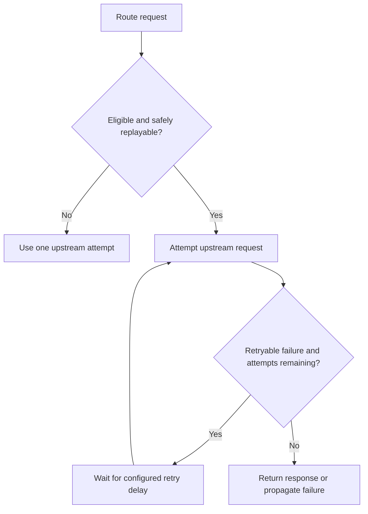

# Wafish.Plugin.Retry

[README](README.md) · [Agent notes](AGENTS.md) · [Proposed work](PLAN.md) · [Project index](../../docs/projects.md)

## Intro

This plugin retries eligible upstream failures according to route policy. Its binding ID is `request-retry`.

## Real-world example

A read-only inventory request receives a transient 503. A bounded retry can reach a healthy destination.

## Real-world value

Short upstream failures can be recovered without requiring each client to implement the same retry behavior.

## What it does

- Apply retry counts, backoff, jitter, timeout, and failure-status settings.
- Optionally select a different eligible destination.
- Check replay eligibility and preserve response handling across attempts.

## What it does not do

- Guarantee exactly-once execution of upstream operations.
- Make retries of non-idempotent requests safe by themselves.

## Start here

Source project: [Wafish.Plugin.Retry.csproj](Wafish.Plugin.Retry.csproj).
Direct project references: [Wafish.Plugin.Abstractions](../Wafish.Plugin.Abstractions/README.md), [Wafish](../Wafish/README.md).

Build and verification commands are in [AGENTS.md](AGENTS.md). Future work is in [PLAN.md](PLAN.md).

## Review safety limits

Replay requires a complete known-length body of at most 1 MiB. Failure capture stops at 64 KiB.
Flush, response start, and forwarded bytes prevent further retries. Cancellation restores owned streams and features.
See [resource limits and consumer changes](../../docs/security.md#request-resource-limits-and-retry-behavior).

## Review fixes 4–7

Circuit outcomes belong to the selected forwarding attempt. Retry does not record a second outcome.

## Review items 14–16

Retry backoff uses `TimeProvider` from request services, with `TimeProvider.System` as fallback.
Request and attempt cancellation deadlines retain their existing system timers.

Verification: [review evidence](../../tests/Wafish.Regression/evidence/review141516/README.md).
