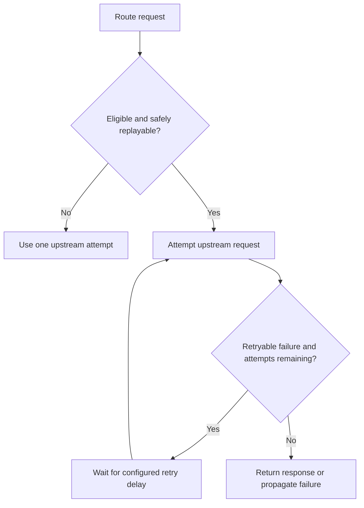

# Wafish.Plugin.Retry

[README](README.md) · [Agent notes](AGENTS.md) · [Proposed work](../../PLAN.md) · [Project index](../../docs/projects.md)

## Intro

This plugin retries eligible upstream failures according to route policy. Its binding ID is `request-retry`.

## Real-world example

A read-only inventory request receives a transient 503. A bounded retry can reach a healthy destination.

## Real-world value

Short upstream failures can be recovered without requiring each client to implement the same retry behavior.

## What it does

- Apply retry counts, backoff, jitter, timeout, and failure-status settings.
- Optionally select a different eligible destination.
- Check replay eligibility and preserve response handling across attempts.

## What it does not do

- Guarantee exactly-once execution of upstream operations.
- Make retries of non-idempotent requests safe by themselves.

## Start here

Source project: [Wafish.Plugin.Retry.csproj](Wafish.Plugin.Retry.csproj).
Direct project references: [Wafish.Plugin.Abstractions](../Wafish.Plugin.Abstractions/README.md), [Wafish](../Wafish/README.md).

Build and verification commands are in [AGENTS.md](AGENTS.md). Future work is in [PLAN.md](../../PLAN.md).

## Review safety limits

Replay requires a complete known-length body of at most 1 MiB. Failure capture stops at 64 KiB.
Flush, response start, and forwarded bytes prevent further retries. Cancellation restores owned streams and features.
See [resource limits and consumer changes](../../docs/security.md#request-resource-limits-and-retry-behavior).

## Review fixes 4–7

Circuit outcomes belong to the selected forwarding attempt. Retry does not record a second outcome.

## Review items 14–16

Retry backoff uses `TimeProvider` from request services, with `TimeProvider.System` as fallback.
Request, attempt, and total deadlines also use the registered time provider.

Verification: [review evidence](../../tests/Wafish.Regression/evidence/review141516/README.md).

## Total deadline and upstream timing

`totalTimeoutSeconds` defaults to 120, with a range of 1–1800 seconds.
The deadline covers body preparation, attempts, and waits, including requests that cannot be replayed.
An expired deadline returns 504 before response start. Started responses are aborted.
Downstream handlers must observe cancellation. The middleware retains ownership until they return.
Caller cancellation remains cancellation, without conversion to 504.

`maxRetryAfterSeconds` defaults to 60, with a range of 0–300 seconds.
Valid Retry-After seconds and HTTP dates establish a bounded minimum delay.
The larger of upstream delay and local backoff applies. Invalid or past values use local backoff.
A zero maximum disables the upstream delay contribution.
All timers use the registered `TimeProvider`. Tests can register `Random` for repeatable jitter.
These defaults introduce a total deadline for existing configured retry bindings.
See [verification](../../tests/Wafish.Regression/evidence/async-retry/README.md).

## Shared retry budget

`Gateway:RetryBudget:RetriesPerWindow` defaults to 100 extra attempts per cluster.
`Gateway:RetryBudget:WindowSeconds` defaults to 1 and supports 1–3600 seconds.
Zero retries disables extra attempts. Initial attempts retain their existing policy.
Routes targeting the same cluster share a host-local allowance. Separate processes have separate allowances.
Exhaustion returns the last upstream response without another attempt. Upstream exceptions retain their original failure behavior.
The allowance uses fixed windows. Bursts can straddle a window boundary.
At most 10,000 cluster identities are retained. Expired identities are removed during new-cluster admission.
`DeniedRetries` counts rejected extra attempts for the budget lifetime. Process restart resets the budget.
Compatibility: sustained upstream failures can now reach the shared limit before each route exhausts its individual retries.
