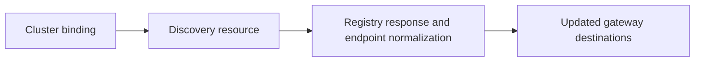

# Wafish.Plugin.ServiceDiscovery

[README](README.md) · [Agent notes](AGENTS.md) · [Proposed work](PLAN.md) · [Project index](../../docs/projects.md)

## Intro

This plugin refreshes cluster destinations from supported discovery sources. Its binding ID is `service-discovery`.



## Real-world example

A gateway resolves available inventory instances from Consul and publishes updated destinations when instances change.

## Real-world value

Operators can use an existing service registry instead of maintaining every destination manually.

## What it does

- Resolve Static, HttpJson, Consul, Nacos, Eureka, and Kubernetes sources.
- Refresh enabled cluster bindings through a managed background resource.
- Normalize endpoints and publish changed destination sets.

## What it does not do

- Operate a registry server or deploy discovered services.
- Implement Kubernetes EndpointSlice watches in the current provider.

## Start here

Source project: [Wafish.Plugin.ServiceDiscovery.csproj](Wafish.Plugin.ServiceDiscovery.csproj).
Direct project references: [Wafish.Plugin.Abstractions](../Wafish.Plugin.Abstractions/README.md), [Wafish](../Wafish/README.md).

Build and verification commands are in [AGENTS.md](AGENTS.md). Future work is in [PLAN.md](PLAN.md).

## Review fixes 4–7

Destination IDs use SHA-256 over normalized absolute addresses. URI path case remains significant.
Publication checks the captured binding and shares the configuration mutation gate.
Unrelated configuration changes preserve the last discovered destinations. Removed or changed bindings reject stale refresh results.

## Review items 14–16

Injected `TimeProvider` controls refresh intervals and loop delays.
Refresh intervals use monotonic elapsed time; resource health timestamps use UTC.

Verification: [review evidence](../../tests/Wafish.Regression/evidence/review141516/README.md).

## Failure health and stale destinations

Each binding retains its failure until that binding succeeds, changes, or becomes disabled.
Successful empty responses remove destinations and count as healthy discovery.
Malformed responses preserve the previous destination set and report a failure.
Eureka and Kubernetes use independent provider parsers. Unhealthy or unready endpoints are excluded.

Failed refreshes use exponential backoff with jitter between 80% and 100% of the current delay.
The delay ceiling is 300 seconds, or `refreshSeconds` when that interval is longer.
Successful refreshes restore the configured interval.

Configure stale handling in the cluster binding:

```json
{
  "enabled": true,
  "mode": "HttpJson",
  "endpoint": "http://registry/catalog",
  "refreshSeconds": 30,
  "requestTimeoutSeconds": 5,
  "maxStaleSeconds": 120,
  "stalePolicy": "RejectNewTraffic"
}
```

- `maxStaleSeconds`: elapsed freshness limit, from 0 through 604800 seconds. Zero disables expiry.
- `RetainLastKnown`: retain destinations after expiry and report degraded health. This is the default.
- `RejectNewTraffic`: publish an empty runtime destination set after expiry. YARP rejects new requests with HTTP 503.

Expiry uses monotonic time since the last successful refresh, including successful empty results.
Before the first success, age starts when the binding is first observed.
Expiry is checked each refresh cycle, independently of retry backoff, and after failed requests.
The one-second loop, active provider requests, and publication contention can delay enforcement.
Choose a limit above the normal refresh interval and request timeout.
Persisted configuration and binding revisions remain unchanged. Successful discovery restores destinations with stable identities.
Existing requests retain their captured runtime configuration.

`GetBindingHealth()` exposes cluster identity, last-success UTC, stale age, failure count, failure type, and retry delay.
It also reports stale status and whether traffic was rejected.
Resource health includes failing, stale, and rejected binding counts. Failure diagnostics omit provider exception messages.

Verification: [Redis and discovery recovery](../../tests/Wafish.Regression/evidence/recovery/README.md).
