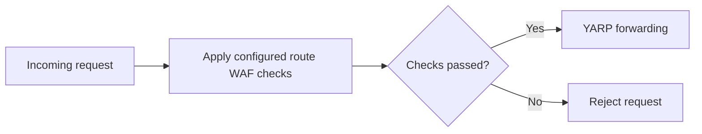

# Wafish.Plugin.Waf

[README](README.md) · [Agent notes](AGENTS.md) · [Proposed work](PLAN.md) · [Project index](../../docs/projects.md)

## Intro

This plugin inspects route requests before forwarding. Its binding ID is `waf`.

## Real-world example

A public search API blocks configured address ranges and rejects requests that match enabled attack checks.

## Real-world value

Common request checks can be applied consistently at the gateway boundary.

## What it does

- Check address rules, request size, SQL injection patterns, XSS patterns, and path traversal.
- Inspect supported bodies while preserving downstream readability.
- Reject requests that violate the configured route policy.

## What it does not do

- Prove that a backend application is free from security defects.
- Replace authentication, authorization, parameterized SQL, or output encoding.

## Start here

Source project: [Wafish.Plugin.Waf.csproj](Wafish.Plugin.Waf.csproj).
Direct project references: [Wafish.Plugin.Abstractions](../Wafish.Plugin.Abstractions/README.md), [Wafish](../Wafish/README.md).

Build and verification commands are in [AGENTS.md](AGENTS.md). Future work is in [PLAN.md](PLAN.md).

## Review safety limits

CIDR rules are validated before activation. Rejection logs omit paths, queries, and matched request content.
See [resource limits and consumer changes](../../docs/security.md#request-resource-limits-and-retry-behavior).

## Decoding and rule corpus

The synthetic [behavior corpus](../../tests/Wafish.Regression/fixtures/waf/README.md) separates benign data from attack fixtures.
Checks report rejected benign cases and missed attacks separately.
Six accidental matches are corrected: keyword prefixes, embedded event-handler fragments, and filename suffixes after two dots.
SQL checks match whole keywords. `XP_` and `SP_` remain procedure prefixes.
XSS handler matching starts at a word boundary.
Traversal checks cover mixed raw, single-encoded, and double-encoded dots and separators.
The existing conservative rejection of paired double-encoded dots remains effective.

The corpus still records two expected benign rejections: a standalone SQL verb and HTML tutorial content.
These limits reflect broad text rules. They do not establish complete attack detection or arbitrary JSON semantic decoding.
Generated cases cover Unicode, malformed escapes, split reads, invalid UTF-8, and byte limits.
Run `--protocol-properties` with an optional `--seed` to reproduce generated inputs.
