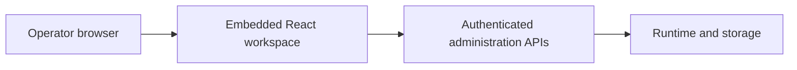

# Wafish.ReactUi

[README](README.md) · [Agent notes](AGENTS.md) · [Proposed work](PLAN.md) · [Project index](../../docs/projects.md)

## Intro

This project embeds the React administration workspace in an ASP.NET Core package.

## Real-world example

An operator opens `/console`, signs in, edits a route, and sees whether the saved configuration became active.

## Real-world value

A host can ship a browser interface without deploying a separate frontend server.

## What it does

- Build React assets and embed them in the .NET assembly.
- Serve the workspace and provide host-specific API configuration.
- Support administration forms, logs, history, plugins, settings, and AI workflows.

## What it does not do

- Provide the administration API implementation itself.
- Require the removed Razor dashboard or store credentials in browser local storage.

## Start here

Source project: [Wafish.ReactUi.csproj](Wafish.ReactUi.csproj).
Direct project references: [Wafish.Administration](../Wafish.Administration/README.md).

Node.js is required for frontend builds. See [frontend instructions](ClientApp/README.md).
Browser tests start isolated hosts on ports 5219–5224.

Build and verification commands are in [AGENTS.md](AGENTS.md). Future work is in [PLAN.md](PLAN.md).

## Deployment prefixes and build validation

Configure the host's `UsePathBase` before routing and Wafish middleware.
The shell includes `Request.PathBase` in its UI base, API base, and HTML base URL.
For example, `/edge`, `manage/ui`, and `manage/api` produce URLs below `/edge/manage/`.
Asset routes remain relative to the host routing path. Injected HTML paths are encoded.
JWT, BasicAuth, API-key login, navigation, and realtime connections pass under this configuration.

Frontend inputs include package scripts, lockfiles, source files, public assets, configuration, and build scripts.
An input-list record detects added and removed source files.
Vite emits an asset manifest. Builds and packing reject missing entry, stylesheet, font, chunk, or manifest assets.
`SkipReactBuild=true` skips generation but retains asset validation. Node.js remains required for validation.
The package icon is staged separately because the repository contains both `logo.png` and `Logo.png`.
Browser fixtures use ports 5219–5224, including three prefixed authentication hosts.

[Verification](../../tests/Wafish.Regression/evidence/review111213/README.md).
