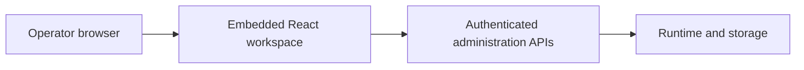

# Wafish.ReactUi

[README](README.md) · [Agent notes](AGENTS.md) · [Proposed work](../../PLAN.md) · [Project index](../../docs/projects.md)

## Intro

This project embeds the React administration workspace in an ASP.NET Core package.

## Real-world example

An operator opens `/console`, signs in, edits a route, and sees whether the saved configuration became active.

## Real-world value

A host can ship a browser interface without deploying a separate frontend server.

## What it does

- Build React assets and embed them in the .NET assembly.
- Serve the workspace and provide host-specific API configuration.
- Support administration forms, logs, history, plugins, settings, and AI workflows.

## What it does not do

- Provide the administration API implementation itself.
- Require the removed Razor dashboard or store credentials in browser local storage.

## Start here

Source project: [Wafish.ReactUi.csproj](Wafish.ReactUi.csproj).
Direct project references: [Wafish.Administration](../Wafish.Administration/README.md).

Node.js is required for frontend builds. See [frontend instructions](ClientApp/README.md).
Browser tests start isolated hosts on ports 5219–5224.

Build and verification commands are in [AGENTS.md](AGENTS.md). Future work is in [PLAN.md](../../PLAN.md).

## Deployment prefixes and build validation

Configure the host's `UsePathBase` before routing and Wafish middleware.
The shell includes `Request.PathBase` in its UI base, API base, and HTML base URL.
For example, `/edge`, `manage/ui`, and `manage/api` produce URLs below `/edge/manage/`.
Asset routes remain relative to the host routing path. Injected HTML paths are encoded.
JWT, BasicAuth, API-key login, navigation, and realtime connections pass under this configuration.

Frontend inputs include package scripts, lockfiles, source files, public assets, configuration, and build scripts.
An input-list record detects added and removed source files.
Vite emits an asset manifest. Builds and packing reject missing entry, stylesheet, font, chunk, or manifest assets.
`SkipReactBuild=true` skips generation but retains asset validation. Node.js remains required for validation.
The package icon is staged from the canonical `brand/logo.png`.
Browser fixtures use ports 5219–5224, including three prefixed authentication hosts.

[Verification](../../ARCHIVE.md#archive-tests-wafish-regression-evidence-review111213-readme-md).

Browser verification covers HTTP and HTTPS with nested prefixes for JWT, Basic authentication, and API keys.
Two-factor changes invalidate the current JWT session. The workspace requires a new sign-in.
The browser runner owns fixture process and temporary-state cleanup.
See [verification](../../ARCHIVE.md#archive-tests-wafish-regression-evidence-administration-lifecycle-readme-md).

Mutation errors accept named `outcome` fields and legacy `status` values.
Unknown revisions remain hidden. Validation, conflicts, storage failures, and activation failures retain distinct messages.
See [HTTP migration](../../docs/mutation-contracts.md#consumer-migration).

## Workspace state verification

The development client and browser fixtures use `/wafish` for administration APIs.
Hosted clients use the API prefix supplied by their host. The default workspace path remains `/console`.

Page component checks cover all 18 workspaces, including route/cluster and log/audit variants.
They exercise pending reads, failed reads, recovery, cancellation, stale results, and editable drafts.
Assistant session and message panels show loading and failure states with retry controls.
Overview events update the same locale-specific query that the page displays.
Browser checks cover validation dialogs, realtime disconnection, and mobile navigation with keyboard and axe assertions.
Large-list and plugin profiles verify pagination and seeded bindings.
Process-selected failure profiles verify real mutation envelopes and delayed draft preservation.
See [infrastructure evidence](../../ARCHIVE.md#archive-tests-wafish-regression-evidence-regression-infrastructure-readme-md).

## Build identity

The header, sign-in view, and favicon use the shared Wafish routing mark.
Editable masters and usage guidance are in [brand](../../brand/README.md).

`GET /console/version` returns package version, asset SHA-256, and administration contract version 1.
The configured UI prefix and PathBase also apply to this endpoint. Control-plane access policy remains enforced.
The shell includes the same metadata in `app-config.build`. Responses use `Cache-Control: no-store`.
The hash covers ordered embedded resource names, lengths, and bytes, excluding timestamps and machine paths.
Identical assets produce identical hashes. Keep UI and administration packages on matching releases.

## Assistant common actions

The Assistant offers prompts for routes, backends, traffic, plugins, route troubleshooting, and route creation.
Choosing a prompt fills and focuses the message editor. Review or edit it, then select Send.
Suggestions are disabled while streaming or while a draft contains text, so existing drafts remain intact.
Write tools retain the normal confirmation step. Suggestions are hidden when the host disables AI.

## Route redirects

The `redirect` plugin supports fixed targets, path and host templates, and HTTPS enforcement.
Routes can omit clusters. Active redirects run before YARP requires a backend.
Other requests on routes without clusters return `503`.
Manage bindings and preview sample requests through the existing plugin editor.
See the [redirect reference](../Wafish.Plugin.Redirect/README.md) for validation, policies, and setup.

The aggregation binding editor selects child routes by name and stores stable route UIDs.
Nested rows edit child paths, query mappings, and header allowlists. Missing child selections show dependency feedback.

## External login bindings

The external-login editor lists host-configured sites and their API token targets.
Changing the site or selecting page mode clears incompatible token selections.
Provider credentials remain in host configuration. Provider changes require a gateway restart.

## Authenticators

Configured JWT hosts can expose passkey enrollment, sign-in, and removal through the Account page.
Changes require fresh credentials and a new sign-in. See [WebAuthn setup](../../docs/administration-webauthn.md).
