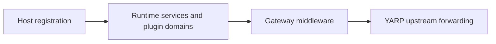

# Wafish.Runtime

[README](README.md) · [Agent notes](AGENTS.md) · [Proposed work](../../PLAN.md) · [Project index](../../docs/projects.md)

## Intro

This project assembles gateway services, plugin lifecycles, and the request pipeline without a browser interface.

## Real-world example

A company runs a gateway beside its APIs. It enables proxy traffic and plugins without loading administration pages.

## Real-world value

Gateway traffic processing can remain independent of presentation choices.

## What it does

- Register shared state, plugin services, and background resources.
- Prepare plugin runtime domains and switch active pipelines.
- Compose deployment middleware and YARP proxy endpoints.

## What it does not do

- Serve React assets or own administration controllers.
- Implement a remote management protocol between separate gateway processes.

## Start here

Source project: [Wafish.Runtime.csproj](Wafish.Runtime.csproj).
Direct project references: [Wafish](../Wafish/README.md), [Wafish.Plugin.Abstractions](../Wafish.Plugin.Abstractions/README.md), [Wafish.Storage.Abstractions](../Wafish.Storage.Abstractions/README.md), [Wafish.Plugin.Waf](../Wafish.Plugin.Waf/README.md), [Wafish.Plugin.Retry](../Wafish.Plugin.Retry/README.md), [Wafish.Plugin.CircuitBreaker](../Wafish.Plugin.CircuitBreaker/README.md), [Wafish.Plugin.RateLimit](../Wafish.Plugin.RateLimit/README.md), [Wafish.Plugin.RateLimit.Redis](../Wafish.Plugin.RateLimit.Redis/README.md), [Wafish.Plugin.ProxyLog](../Wafish.Plugin.ProxyLog/README.md), [Wafish.Plugin.Cache](../Wafish.Plugin.Cache/README.md), [Wafish.Plugin.Compression](../Wafish.Plugin.Compression/README.md), [Wafish.Plugin.ServiceDiscovery](../Wafish.Plugin.ServiceDiscovery/README.md), [Wafish.Plugin.Metrics](../Wafish.Plugin.Metrics/README.md).

Build and verification commands are in [AGENTS.md](AGENTS.md). Future work is in [PLAN.md](../../PLAN.md).

## Review safety limits

Limiter leases retain ownership through queued acquisition and downstream work. Cleanup removes only fully idle partitions.
Snapshot preparation validates WAF address rules before storage and activation.
See [resource limits and consumer changes](../../docs/security.md#request-resource-limits-and-retry-behavior).

## Review fixes 4–7

Binding mutations use atomic storage revisions and the shared publication gate. Compensation rejects newer storage revisions.
`IPluginBindingMutationService.ReconcileAsync` rebuilds stored bindings and their runtime domain after activation failures.
Rate limiter callers must use `AcquireAsync` and dispose its lease. The unowned `GetOrAdd` API was removed.

## Domain shutdown ownership

The manager retains retirement tasks until disposal completes.
Shutdown blocks new preparation, commits, and pipeline entry. It joins the current domain and all retired domains.
Existing request leases keep their providers alive until those requests finish.
Repeated shutdown calls share one completion task. Disposal failures remain visible to shutdown callers and logs.
Successful retirements release their tracking entries.
The post-transition watcher is cancelled and joined before manager shutdown completes.
A rejected late commit disposes its candidate. Failed pipeline construction releases its provider.
Shutdown does not forcibly dispose providers used by long requests. Such requests can delay completion.

[Verification](../../tests/Wafish.Regression/evidence/review111213/README.md).

## Review items 14–16

Register a custom `TimeProvider` before `AddWafishRuntime` to control policy clocks.
The default is `TimeProvider.System`. Circuit recovery and idle cleanup use monotonic elapsed time.
Plugin fallback providers expose service availability from both scopes for constructor selection.

Verification: [review evidence](../../tests/Wafish.Regression/evidence/review141516/README.md).

## Lifetime stress verification

Direct domain disposal drains active requests. Copied leases share one release operation.
External resources stop before their provider dependencies are disposed.
External hosts support asynchronous disposal and deactivation. Repeated cleanup shares its completion task.
Stop and disposal failures remain observable after cleanup; retained reports do not retain plugin-defined exception instances.
See [bounds, verification, and compatibility](../../tests/Wafish.Regression/evidence/lifetime-stress/README.md).

## Resource contract enforcement

The resource coordinator stops reconciliation before shutdown cleanup.
Partial startup failure or cancellation triggers an uncancelled cleanup attempt.
Faulted health queries expose a safe summary. Detailed exceptions remain in host logs.
Audit disposal joins its initial read and every accepted background write before storage resources are released.
Audit persistence remains best effort: write failures are logged; disposal joins attempts without guaranteeing successful storage.
See [lifecycle requirements](../../docs/plugin-lifecycle-contract.md).

Audit history loads without blocking synchronous callers.
The initial load merges stored history with accepted writes under the same lock.
The merge preserves chronological eviction order and the 200-entry capacity.
Readers cannot observe a partially rebuilt queue.
Named fault schedules verify writes accepted during the blocked load.

## Plugin activation previews

`IPluginActivationPreviewService.PreviewAsync` prepares a candidate and reports plugin health and declared resource requirements.
It disposes the candidate without publishing it or starting background resources.
The active domain and its request leases remain unchanged.
Missing plugins and failed preparation, probes, or disposal produce an unsuccessful report.
A null health result means the plugin has no health probe. Readiness does not guarantee external dependency availability.
Health probes must be read-only and honor cancellation. Constructors and configuration callbacks must not start resources.
Preview waits for cooperative cancellation before releasing candidate ownership.
Input is limited to 1,000 distinct plugin IDs.

## Drain progress and lease cleanup

`IPluginDrainDiagnostics` reports held generations, retirement age, and safe disposal failures.
A five-second reaper removes expired leased destinations without removing healthy or legacy peers.

See [registration and operations](../../docs/registration-operations-contracts.md) for limits, configuration, and compatibility.

## Atomic change sets

Versioned change sets combine routes, clusters, and plugin bindings in one transaction.
See [change-set contracts](../../docs/configuration-policy-contracts.md) for API examples, revisions, permissions, and recovery.

Weighted local quotas use the optional `IWeightedRateLimiterStore` capability.
The built-in store acquires the configured permits atomically and retains ownership while queued.
The original `IRateLimiterStore` contract still acquires one permit.
