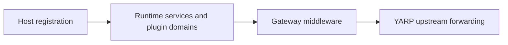

# Wafish.Runtime

[README](README.md) · [Agent notes](AGENTS.md) · [Proposed work](PLAN.md) · [Project index](../../docs/projects.md)

## Intro

This project assembles gateway services, plugin lifecycles, and the request pipeline without a browser interface.

## Real-world example

A company runs a gateway beside its APIs. It enables proxy traffic and plugins without loading administration pages.

## Real-world value

Gateway traffic processing can remain independent of presentation choices.

## What it does

- Register shared state, plugin services, and background resources.
- Prepare plugin runtime domains and switch active pipelines.
- Compose deployment middleware and YARP proxy endpoints.

## What it does not do

- Serve React assets or own administration controllers.
- Implement a remote management protocol between separate gateway processes.

## Start here

Source project: [Wafish.Runtime.csproj](Wafish.Runtime.csproj).
Direct project references: [Wafish](../Wafish/README.md), [Wafish.Plugin.Abstractions](../Wafish.Plugin.Abstractions/README.md), [Wafish.Storage.Abstractions](../Wafish.Storage.Abstractions/README.md), [Wafish.Plugin.Waf](../Wafish.Plugin.Waf/README.md), [Wafish.Plugin.Retry](../Wafish.Plugin.Retry/README.md), [Wafish.Plugin.CircuitBreaker](../Wafish.Plugin.CircuitBreaker/README.md), [Wafish.Plugin.RateLimit](../Wafish.Plugin.RateLimit/README.md), [Wafish.Plugin.RateLimit.Redis](../Wafish.Plugin.RateLimit.Redis/README.md), [Wafish.Plugin.ProxyLog](../Wafish.Plugin.ProxyLog/README.md), [Wafish.Plugin.Cache](../Wafish.Plugin.Cache/README.md), [Wafish.Plugin.Compression](../Wafish.Plugin.Compression/README.md), [Wafish.Plugin.ServiceDiscovery](../Wafish.Plugin.ServiceDiscovery/README.md), [Wafish.Plugin.Metrics](../Wafish.Plugin.Metrics/README.md).

Build and verification commands are in [AGENTS.md](AGENTS.md). Future work is in [PLAN.md](PLAN.md).

## Review safety limits

Limiter leases retain ownership through queued acquisition and downstream work. Cleanup removes only fully idle partitions.
Snapshot preparation validates WAF address rules before storage and activation.
See [resource limits and consumer changes](../../docs/security.md#request-resource-limits-and-retry-behavior).

## Review fixes 4–7

Binding mutations use atomic storage revisions and the shared publication gate. Compensation rejects newer storage revisions.
`IPluginBindingMutationService.ReconcileAsync` rebuilds stored bindings and their runtime domain after activation failures.
Rate limiter callers must use `AcquireAsync` and dispose its lease. The unowned `GetOrAdd` API was removed.

## Domain shutdown ownership

The manager retains retirement tasks until disposal completes.
Shutdown blocks new preparation, commits, and pipeline entry. It joins the current domain and all retired domains.
Existing request leases keep their providers alive until those requests finish.
Repeated shutdown calls share one completion task. Disposal failures remain visible to shutdown callers and logs.
Successful retirements release their tracking entries.
The post-transition watcher is cancelled and joined before manager shutdown completes.
A rejected late commit disposes its candidate. Failed pipeline construction releases its provider.
Shutdown does not forcibly dispose providers used by long requests. Such requests can delay completion.

[Verification](../../tests/Wafish.Regression/evidence/review111213/README.md).

## Review items 14–16

Register a custom `TimeProvider` before `AddWafishRuntime` to control policy clocks.
The default is `TimeProvider.System`. Circuit recovery and idle cleanup use monotonic elapsed time.
Plugin fallback providers expose service availability from both scopes for constructor selection.

Verification: [review evidence](../../tests/Wafish.Regression/evidence/review141516/README.md).
