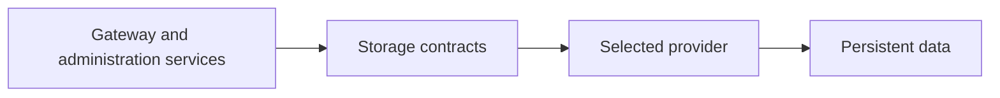

# Wafish.Storage.Abstractions

[README](README.md) · [Agent notes](AGENTS.md) · [Proposed work](PLAN.md) · [Project index](../../docs/projects.md)

## Intro

This project defines storage interfaces and data records used by gateway and administration services.

## Real-world example

A host selects SQLite today. Another storage provider can implement the same repository contracts later.

## Real-world value

Business services can use storage operations without embedding database-specific SQL.

## What it does

- Define repositories for configuration, plugins, logs, audits, AI records, and webhooks.
- Define versioned configuration snapshots and storage options.
- Provide stable identity helpers and persistence entities.

## What it does not do

- Open database connections or run schema migrations.
- Guarantee provider behavior without a concrete implementation and tests.

## Start here

Source project: [Wafish.Storage.Abstractions.csproj](Wafish.Storage.Abstractions.csproj).
This project has no direct solution project references. Package and framework references remain in its project file.

Build and verification commands are in [AGENTS.md](AGENTS.md). Future work is in [PLAN.md](PLAN.md).

## Review fixes 4–7

`GetBindingsSnapshotAsync` returns bindings and their storage revision.
`CommitBindingsAsync` applies upserts and deletions atomically against that revision.
Stale revisions throw `BindingRevisionConflictException`. Unsupported providers fail explicitly.
Revisions increase monotonically; one batch can advance the revision more than once.

## Query bounds and ordering

Requested history and log limits clamp to 1–500. Empty datasets still return empty collections.
Proxy-log pages use 64-bit offsets. Page numbers below one select the first page.
Proxy-log string filters are limited to 1,024 characters. Longer filters throw `ArgumentException`.
The administration history endpoint retains its 200-row limit and returns HTTP 400 for oversized filters.

Proxy logs sort by timestamp descending, then numeric ID descending. Counts and rows share a read transaction.
Configuration history uses creation time descending, then version ID descending.
Audit history uses timestamp descending, then audit ID descending.
AI sessions use last activity descending, then session ID descending.
Message history selects recent insertion IDs and returns them in ascending order.
Delivery history uses insertion ID descending. Analysis uses insertion ID, with severity first where requested.

Stable datasets have no duplicate or skipped rows across pages. Concurrent writes can shift later offset-based pages.
Retention operations retain their existing limits and behavior. Repeated reads now use deterministic tie breakers.
Consumers requesting zero, negative, or oversized read limits must account for normalization.

The provider-neutral suite accepts an isolated fixture factory and uses repository interfaces only.
See [contract checks](../../tests/Wafish.Regression/StorageConformanceChecks.cs) and [verification](../../tests/Wafish.Regression/evidence/storage-reliability/README.md).

## Atomic configuration receipts

`IIdempotentConfigurationSnapshotRepository` extends snapshot storage without changing existing provider requirements.
Receipt reservation and the configuration save must share one transaction and expected-version check.
Duplicate keys throw `ConfigurationReceiptExistsException`. Receipt completion retains the first acknowledgement.
A null acknowledgement means the configuration committed but its original activation outcome is unknown.
Providers without this optional contract reject idempotent configuration applies before writing.

## Capabilities and backup ownership

`IStorageCapabilitiesProvider` reports optional provider support. `AddWafishStorageRequirements` rejects unsupported requirements at startup.
`IStorageBackupProvider` returns an owned backup stream. Dispose `StorageBackup` to release all temporary resources.

See [registration and operations](../../docs/need-seven-features.md) for limits, configuration, and compatibility.
