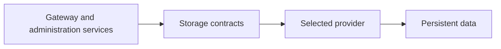

# Wafish.Storage.Abstractions

[README](README.md) · [Agent notes](AGENTS.md) · [Proposed work](PLAN.md) · [Project index](../../docs/projects.md)

## Intro

This project defines storage interfaces and data records used by gateway and administration services.

## Real-world example

A host selects SQLite today. Another storage provider can implement the same repository contracts later.

## Real-world value

Business services can use storage operations without embedding database-specific SQL.

## What it does

- Define repositories for configuration, plugins, logs, audits, AI records, and webhooks.
- Define versioned configuration snapshots and storage options.
- Provide stable identity helpers and persistence entities.

## What it does not do

- Open database connections or run schema migrations.
- Guarantee provider behavior without a concrete implementation and tests.

## Start here

Source project: [Wafish.Storage.Abstractions.csproj](Wafish.Storage.Abstractions.csproj).
This project has no direct solution project references. Package and framework references remain in its project file.

Build and verification commands are in [AGENTS.md](AGENTS.md). Future work is in [PLAN.md](PLAN.md).

## Review fixes 4–7

`GetBindingsSnapshotAsync` returns bindings and their storage revision.
`CommitBindingsAsync` applies upserts and deletions atomically against that revision.
Stale revisions throw `BindingRevisionConflictException`. Unsupported providers fail explicitly.
Revisions increase monotonically; one batch can advance the revision more than once.
